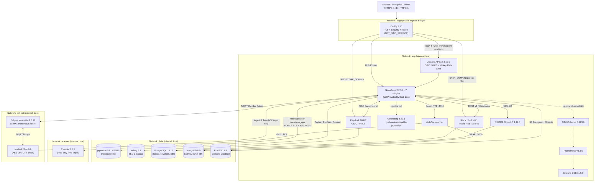

# Zero-Trust Production Deployment (`infra/compose/prod.yml`)

**LatticeDX `v0.4.2`** ships a hardened, digest-pinned production stack in `infra/compose/prod.yml` (`project name: lattice-dx-prod`). Every service enforces zero-trust container hardening, strict east-west network segmentation across **5 isolated Docker bridge networks**, and non-superuser PostgreSQL `FORCE ROW LEVEL SECURITY`.

## 1. Five-Network Zero-Trust Topology

Except for `edge`, all four internal networks (`app`, `data`, `scanner`, `iiot-net`) are declared with **`internal: true`**, blocking direct outbound internet egress or unrouted lateral access from data, scanning, or shop-floor OT planes.



### Network Segmentation Matrix

| Network | `internal` | Purpose | Attached Services |
| :--- | :--- | :--- | :--- |
| **`edge`** | `false` | Public TLS ingress (`80`, `443`, `443/udp`) | `caddy`, `keycloak`, `gateway`, `nocobase` |
| **`app`** | `true` | Internal HTTP/API control & orchestration plane | `caddy`, `redis` (Valkey), `keycloak`, `keycloak-config-cli`, `file-scanner`, `gateway`, `orion-ld`, `n8n`, `nocobase`, `otel-collector`, `prometheus`, `grafana`, `gotenberg`, `nodered` |
| **`data`** | `true` | Isolated persistence, vector/relational DBs, cache & S3 objects | `postgres`, `nocobase-db`, `redis` (Valkey), `rustfs`, `keycloak`, `file-scanner`, `orion-mongo`, `orion-ld`, `n8n`, `nocobase`, `otel-collector`, `prometheus`, `grafana` |
| **`scanner`** | `true` | Air-gapped antivirus scanning between `@dx/file-scanner` and `clamd` | `clamav`, `file-scanner` |
| **`iiot-net`** | `true` | Shop-floor MQTT broker & Node-RED protocol bridge | `mosquitto`, `nodered`, `nocobase` |

## 2. Container Hardening & Least-Privilege Guarantees

Every service in `infra/compose/prod.yml` inherits the `x-hardened` anchor:

- **Privilege Escalation Prevention:** `security_opt: ["no-new-privileges:true"]` on every container.
- **Capability Dropping:** `cap_drop: [ALL]` globally, adding back only minimal required capabilities per service (e.g., `NET_BIND_SERVICE` for `caddy` and `nocobase`; `CHOWN`, `SETUID`, `SETGID`, `DAC_OVERRIDE`, `FOWNER` for `postgres`/`nocobase-db`/`orion-mongo`).
- **Read-Only Root Filesystems:** `file-scanner`, `otel-collector`, `prometheus`, and `gotenberg` run with `read_only: true` and scoped `tmpfs` (`noexec,nosuid`).
- **Digest-Pinned OCI Images:** All 19 OCI images (18 supporting services + `nocobase/nocobase:2.2.50`) are pinned by immutable `@sha256:` digests verified by `pnpm pof:check` and `scripts/tests/infra-compose-security.test.mjs`.
- **Non-Superuser `nocobase_app` Role:** `infra/config/postgres/init-nocobase-db.sh` creates `nocobase_app` with `NOSUPERUSER NOCREATEDB NOCREATEROLE NOINHERIT NOBYPASSRLS` and fails fast if `NOCOBASE_APP_DB_USER` equals `POSTGRES_USER`, ensuring PostgreSQL `FORCE ROW LEVEL SECURITY` cannot be bypassed.
- **Hardened Reverse Proxy & Gateway:**
  - `infra/config/caddy/Caddyfile` enforces `Strict-Transport-Security`, `X-Content-Type-Options: nosniff`, `X-Frame-Options: SAMEORIGIN`, `Referrer-Policy`, `Permissions-Policy`, removes the `Server` header, and routes `/api/*` and `/.well-known/agent-card.json` through Apache APISIX `3.19.0`.
  - `infra/config/apisix/apisix.prod.yaml` enforces Valkey-backed `limit-count` rate limits (`120/min` on public/auth/MCP routes, `240/min` on `/api/*`, `300/min` on IIoT ingest routes), `X-Request-Id`, strict CORS (`LATTICE_ALLOWED_ORIGIN`), and `openid-connect` JWKS validation for `/api/dxos-oidc/*`.
- **RustFS Console Disabled:** `RUSTFS_CONSOLE_ENABLE: "false"` keeps S3 object storage strictly internal on `data:9000`.
- **Gotenberg Hardened:** `gotenberg/gotenberg:8.20.1` runs with `--chromium-disable-javascript=true` (`--profile pdf`).

## 3. Core Services & Optional Compose Profiles

### Core Services (Always Started)

| Service | OCI Image | Role |
| :--- | :--- | :--- |
| `caddy` | `caddy:2.10-alpine` | TLS termination, HTTP/3, security headers, domain routing |
| `gateway` | `apache/apisix:3.19.0-debian` | API Gateway, Redis/Valkey rate-limiting, OIDC JWKS verification |
| `keycloak` | `quay.io/keycloak/keycloak:26.8.2` | Enterprise IdP (`--proxy-headers=xforwarded`, `--http-enabled=true`) |
| `postgres` | `postgres:16.16-alpine` | Core PostgreSQL hosting `lattice`, `keycloak`, `n8n` databases + WAL PITR |
| `nocobase-db` | `pgvector/pgvector:0.8.1-pg16` | NocoBase & DX-OS database (`nocobase_app`, `pgvector` HNSW, `FORCE RLS`, WAL PITR) |
| `redis` | `valkey/valkey:8.1-alpine` | `BSD-3-Clause` store for NocoBase cache (`/0`), pubsub (`/1`), auth sessions (`/2`), APISIX rate-limits |
| `rustfs` | `rustfs/rustfs:1.0.6` | S3-compatible object storage for scanned uploads & attachments |
| `clamav` | `clamav/clamav:1.5.5` | Internal virus scanner daemon |
| `file-scanner` | Built from `apps/file-scanner/Dockerfile` | `@dx/file-scanner` service bridging NocoBase uploads -> ClamAV -> RustFS |
| `orion-mongo` | `mongo:8.0` | Authenticated MongoDB backend for Orion-LD |
| `orion-ld` | `fiware/orion-ld:1.12.0` | NGSI-LD Context Broker (`SCRAM-SHA-256`) |
| `nocobase` | `nocobase/nocobase:2.2.50` | External OCI host mounting the 7 Apache-2.0 `@latticedx/*` plugins read-only (`:ro`) |

### Optional Production Profiles

| Profile | Services | Purpose |
| :--- | :--- | :--- |
| `--profile iam-sync` | `keycloak-config-cli` (`6.5.1-26`) | One-shot import of `infra/config/keycloak/lattice-realm.prod.json` |
| `--profile n8n` | `n8n` (`n8nio/n8n:2.48.1`) | Stock workflow engine backed by `postgres` (`n8n_app`) |
| `--profile iiot` | `mosquitto` (`2.0.21`) + `nodered` (`4.0.9`) | Dynamic Security MQTT broker & encrypted Node-RED 2-way Digital Twin bridge |
| `--profile observability` | `otel-collector` (`0.123.0`) + `prometheus` (`v3.3.0`) + `grafana` (`11.5.8`) | OTLP/HTTP trace ingestion, `15d` Prometheus metrics & alerts, Grafana 360° dashboards |
| `--profile pdf` | `gotenberg` (`8.20.1`) | Sandboxed headless PDF rendering (`DXOS_GOTENBERG_URL=http://gotenberg:3000`) |

## 4. Step-by-Step Production Deployment

### Step 1: Prepare Production Environment File

Copy `infra/compose/prod.env.example` to an untracked `.env.prod` file (outside Git) and replace every `CHANGE_ME_*` placeholder with high-entropy cryptographic secrets:

```sh
cp infra/compose/prod.env.example .env.prod
chmod 600 .env.prod
```

Refer to [Environment & Runtime Configuration](/en/getting-started/configuration) for exact requirements on `NOCOBASE_APP_KEY`, `NOCOBASE_ENCRYPTION_FIELD_KEY`, `NOCOBASE_APP_DB_USER`, `DX_VAULT_MASTER_KEY`, `DX_METRICS_TOKEN`, and domain variables (`LATTICE_DOMAIN`, `KEYCLOAK_DOMAIN`, `N8N_DOMAIN`).

### Step 2: Validate Compose Configuration

Before starting containers, verify variable interpolation and Compose syntax:

```sh
docker compose --env-file .env.prod -f infra/compose/prod.yml config --quiet
```

### Step 3: Build Local Plugin Artifacts & Start Core Services

Ensure the 7 plugins under `plugins/nocobase/` are built (`dist/` present) because `prod.yml` mounts them read-only (`:ro`) into `/app/nocobase/node_modules/@latticedx/*`:

```sh
pnpm install --frozen-lockfile
npm ci --prefix plugins/nocobase/plugin-enterprise-auth --ignore-scripts --no-audit --no-fund
node plugins/nocobase/action-bridge/build.mjs
node plugins/nocobase/plugin-lattice-foundation/scripts/build.mjs
node plugins/nocobase/plugin-enterprise-auth/build.mjs
node plugins/nocobase/plugin-dxos-para/build.mjs
node plugins/nocobase/plugin-dxos-blocks/build.mjs
node plugins/nocobase/plugin-dxos-studio/build.mjs
node plugins/nocobase/plugin-dxos-ai/build.mjs
```

Then start the core production stack (add `--profile` flags as needed):

```sh
docker compose --env-file .env.prod -f infra/compose/prod.yml \
  --profile iam-sync \
  --profile n8n \
  --profile iiot \
  --profile observability \
  --profile pdf \
  up -d --build
```

::: tip Non-Destructive Startup Order
`depends_on` health checks automatically sequence `postgres` and `nocobase-db` -> `keycloak` and `redis` -> `clamav` and `rustfs` -> `file-scanner` -> `gateway` and `nocobase` -> `caddy`. Allow up to 120 seconds on the first boot for ClamAV to initialize its signature database.
:::

### Step 4: Enable & Upgrade the 7 Plugins on First Boot

On the initial clean database boot, install/enable the 7 mounted `@latticedx/*` plugins inside the `nocobase` container and run `yarn nocobase upgrade`:

```sh
for pkg in \
  @latticedx/plugin-action-bridge \
  @latticedx/plugin-lattice-foundation \
  @latticedx/plugin-enterprise-auth \
  @latticedx/plugin-dxos-para \
  @latticedx/plugin-dxos-blocks \
  @latticedx/plugin-dxos-studio \
  @latticedx/plugin-dxos-ai; do
  docker compose --env-file .env.prod -f infra/compose/prod.yml exec -T nocobase yarn nocobase pm add "$pkg" || true
  docker compose --env-file .env.prod -f infra/compose/prod.yml exec -T nocobase yarn nocobase pm enable "$pkg"
done

docker compose --env-file .env.prod -f infra/compose/prod.yml exec -T nocobase yarn nocobase upgrade
```

### Step 5: Verify Production Health & PITR WAL Archiving

Confirm all services are healthy and verify both Caddy public routing and WAL archiving:

```sh
docker compose --env-file .env.prod -f infra/compose/prod.yml ps
curl -fsS "https://<your-lattice-domain>/api/dxos:health"
```

Both `postgres` and `nocobase-db` boot with `wal_level=replica`, `archive_mode=on`, `archive_timeout=300`, `wal_compression=on`, and `pitr-archive.sh` writing compressed `.gz` WAL segments (or forwarding to `wal-g` / `pgbackrest` via `PG_ARCHIVE_COMMAND`). See the Operations & DR documentation under `/en/operations/` for full-stack snapshot and PITR recovery rehearsals (`scripts/stack-recovery.mjs`, `scripts/pitr-backup.mjs`).
