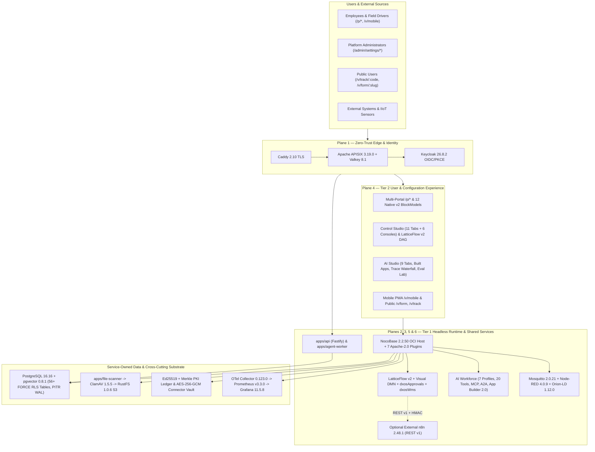
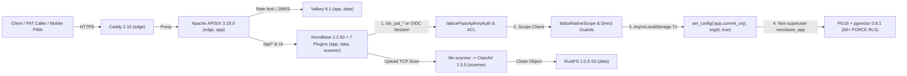
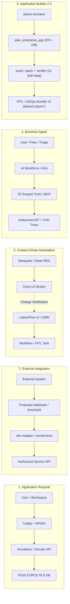

# 6-Plane DX-OS Architecture

LatticeDX `v0.4.2` is engineered as a **6-Plane Digital Enterprise Operating System (DX-OS)** with strict separation between external edge access, user/configuration portals, headless domain services, service-owned PostgreSQL `FORCE RLS` storage, and container-isolated infrastructure.

---

## The 6 Coordinated DX-OS Planes

| Plane | Responsibility | Core Components & Modules (`v0.4.2`) |
| --- | --- | --- |
| **Plane 1 — Identity, Zero-Trust Edge & Security Guardrails** | TLS termination, gateway rate limiting, OIDC/PKCE SSO, scoped API keys, malware quarantine, encrypted connector secrets, and row-level database enforcement | `Caddy 2.10`, `Apache APISIX 3.19.0`, `Keycloak 26.8.2` + `@latticedx/plugin-enterprise-auth`, `Valkey 8.1` (`BSD-3-Clause`), `apps/file-scanner` + `ClamAV 1.5.5` + `RustFS 1.0.6`, `dxosApiKeys` (`ldx_pat_*`), `dxosLedger` (Ed25519 + Merkle), `dxosVault` (AES-256-GCM + OAuth2 PKCE S256), `pg-rls.js` (**56 static `FORCE RLS` tables** + dynamic `latticeCustom*` + `nocobase_app`) |
| **Plane 2 — IT/OT Digital Twin, Mosquitto DynSec & Orion-LD** | Authenticated MQTT edge telemetry, `BIRTH`/`DEATH` LWT monitoring, NGSI-LD 2-way context broker, edge normalization, and cold-chain thermal compliance | `Eclipse Mosquitto 2.0.21` (`$CONTROL/dynamic-security/v1`, ACL `latticedx/<orgId>/<deviceKey>/*`, `allow_anonymous false`), `Node-RED 4.0.9`, `FIWARE Orion-LD 1.12.0` + `MongoDB 8.0`, `dxosBroker`, `digital-twin.js` (`HITL_TEMP_THRESHOLD_C = 2.0`), `PostgreSQL 16` `latticeTelemetryPoints`, Arrhenius MKT & quarantine (`dxosDataGov`) |
| **Plane 3 — Event Bus, LatticeFlow v2, Approvals, OMS/WMS & `n8n`** | Reliable domain events, visual DAG & decision automation, multi-level approvals, omnichannel delivery, cold-chain fulfillment, and external workflow integration | `dxosEvents` (CloudEvents 1.0 + Standard Webhooks `whsec_` + PG Outbox `FOR UPDATE SKIP LOCKED` + Circuit Breaker), `dxosAutomations` (24-node LatticeFlow v2 DAG, Draft/Publish, `ai.agent` ReAct, HITL Loop Cursor), `dxosDmn` (Visual DMN), `dxosApprovals` (sequential & `M-of-N` + `dxosDelegations`), `dxosNotify` (`smtp`/`telegram`/`slack`/`webhook`), `dxosWms` (FEFO `FOR UPDATE` + ePOD + ISO QR + `/v/track/:code`), `dxosN8n` (`n8n 2.48.1` REST v1) |
| **Plane 4 — Multi-Portal, 12 BlockModels, Mobile PWA, P.A.R.A. & GitOps** | Role-scoped user portals, offline field execution, zero-PII public portals, enterprise knowledge search, and declarative solution bundling | Multi-Portal `/p/*`, **12 Native v2 BlockModels** (`DxosBiChartBlockModel`, `DxosWebGisBlockModel` via `maplibre-gl@6.19.0`, `DxosWmsOpsBlockModel`, `DxosKanbanScheduleBlockModel`, etc.), Mobile Field PWA (`/v/mobile` IndexedDB Outbox + Quarantine), Public Forms (`/v/form/:slug`), `@latticedx/plugin-dxos-para` (PDF/DOCX/XLSX/PPTX + OCR + `pgvector 0.8.1` HNSW RRF), `dxosBuilder` (Rich Schema + Packs + Tenant Provisioning), `dxosStudio` (Solution Bundle v3) |
| **Plane 5 — AI Workforce, App Builder 2.0, A2A & 2-Way MCP** | Governed agent execution, multi-entity full-stack app synthesis, cross-agent interoperability, proactive incident triage, and NL evaluation | `@latticedx/plugin-dxos-ai`: **7 Starter AI Profiles**, **20 Unified Tools** (`11` Admin Builder including `dxos_provision_role_workspace` + `6` Operational + `3` Memory `dxos_memory_*`), Google/LF A2A (`/.well-known/agent-card.json`, `/api/dxos-a2a`), 2-Way MCP (`/api/dxos-mcp`, `/api/dxos-mcp/it-ot`), Proactive LLM Triage, HITL Approval Queue, PG Quotas + VN PII Redaction, Eval Lab (`163/163` Vietnamese NL cases) |
| **Plane 6 — Application Data, OTel Tracing & PITR WAL Substrate** | Host UI/data runtime, companion Fastify API contracts, GenAI & system telemetry, and point-in-time database recovery | External OCI `nocobase/nocobase:2.2.50` + 7 Apache-2.0 plugins (`sdkProvidedByHost: true`), `apps/api` (`Fastify 5.12.8`), `apps/agent-worker`, `@dx/contracts`, OpenAPI 3.1.0 / AsyncAPI 3.0.0 (`/api/dxos:openapi`, `/api/dxos:asyncapi`), `otel-exporter.js` + `OTel Collector 0.123.0` + `Prometheus v3.3.0` (`/api/dxos:metrics`) + `Grafana OSS 11.5.8`, `PostgreSQL 16.16` PITR WAL (`wal_level=replica`, `archive_timeout=300`) |

---

## 6-Plane & Layered Tier Topology

---

## Zero-Trust Request & Multi-Tenant RLS Data Flow

In `infra/compose/prod.yml`, services are partitioned into **5 isolated Docker networks** (`edge`, `app` internal, `data` internal, `scanner` internal, `iiot-net` internal) with `no-new-privileges:true` and `cap_drop: [ALL]`.

Key security invariants enforced on every request:

1. **Non-Superuser Database Role (`nocobase_app`):** Prevents superuser RLS bypass at the database engine level.
2. **Transaction-Scoped `AsyncLocalStorage` Bridge:** `pg-rls.js` sets `app.current_org` strictly for the active transaction (`is_local = true`) so pooled connections never leak tenant context across requests.
3. **Direct CRUD Guards:** `dxosTelemetryDirectGuard`, `dxosOrganizationDirectGuard`, WMS/DMN guards, and Automation guards reject unauthorized raw collection queries (`403`) and force callers through audited domain resources (`dxosBlocks`, `dxosBroker`, `dxosWms`, `dxosAutomations`, `dxosBuilder`).
4. **Fail-Closed Public Endpoints:** `/v/track/:code` strips PII (`recipientName`, `recipientPhone`, `signatureDataUrl`, `trackingTokenHash`) and validates tokens/Ed25519 signatures; `/v/form/:slug` enforces rate limits (`20/min` submit, `60/min` status), honeypot checks, and prototype-pollution filtering.

---

## The 5 Platform Interaction Patterns

LatticeDX organizes every technical interaction into **5 standardized architectural patterns** across Tier 3, Tier 2, Tier 1, and Data:

1. **Pattern 1 — Application Request:** Interactive users (`/p/*`, `/v/mobile`) or API clients (`ldx_pat_*`) traverse Caddy -> APISIX -> NocoBase / `@dx/api`, passing RBAC + `latticeNativeScope` + `FORCE RLS` before touching service-owned PostgreSQL tables.
2. **Pattern 2 — External Integration:** Inbound webhooks (`whsec_` Standard Webhooks) and outbound connectors (`dxosVault` AES-256-GCM + OAuth2 PKCE S256 + SSRF allowlist) coordinate with `dxosEvents` (PG Outbox `FOR UPDATE SKIP LOCKED`, Circuit Breaker) and optional external `n8n 2.48.1` (`dxosN8n`) strictly through authorized service APIs.
3. **Pattern 3 — Context-Driven Automation:** IIoT sensors push MQTT payloads over Mosquitto `2.0.21` DynSec (`BIRTH`/`DEATH` LWT) -> Node-RED `4.0.9` -> FIWARE Orion-LD `1.12.0` -> `/api/dxosBroker:orionNotify`, emitting notifications that trigger LatticeFlow v2 DAGs, Visual DMN evaluations, or Arrhenius MKT lot holds.
4. **Pattern 4 — Business Agent:** Users, scheduled jobs, or proactive triage invoke one of the 7 AI Profiles (`dxos-coordinator`, `dxos-ops`, etc.), `ai.agent` ReAct nodes, or A2A/MCP callers; every tool call is governed by `ALLOW`/`ASK`/`OFF` permissions, HITL approval queues, PG quota policies, Vietnamese PII redaction, and `latticeAiTraces` spans.
5. **Pattern 5 — Application Builder 2.0:** Administrators use `dxos_provision_role_workspace` (`plan_enterprise_app` -> `build_enterprise_app` -> `patch_enterprise_app` -> `verify_app` -> `rollback_enterprise_app` -> `export_app_bundle`). Generated schemas are strictly isolated to `latticeCustom*` tables with `FORCE RLS`, ordered topologically via Kahn's algorithm, verified through 2 self-healing passes, and exportable as `latticedx.solution-bundle/v3` without mutating core system tables (`users`, `roles`, `latticeBuiltApps`).

## Further Reading

- [7-Plugin Modularity & esbuild Isolation](/en/guide/plugins-modularity)
- [Tech Stack & Pure-OSI Boundary](/en/guide/tech-stack-and-osi)
- [Multi-Tenant PostgreSQL FORCE RLS](/en/security/multi-tenant-rls)
- [Observability & PITR WAL DR](/en/operations/observability)
