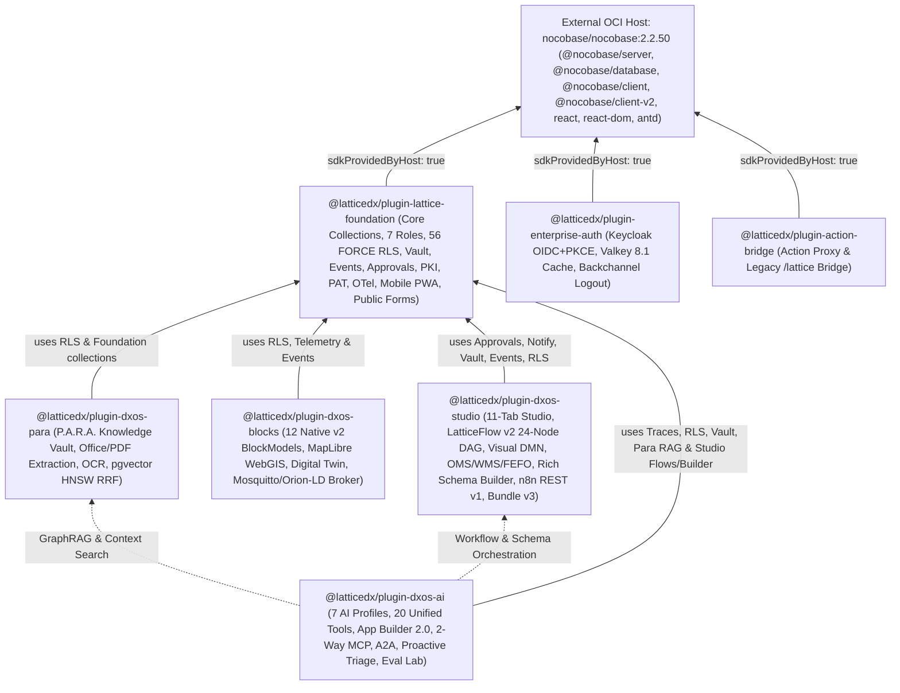

# 7-Plugin Modularity (`v0.4.2`)

All LatticeDX domain capabilities on NocoBase `2.2.50` live inside **7 independent Apache-2.0 plugins** under `plugins/nocobase/*`. Every plugin declares `"version": "0.4.2"`, `"license": "Apache-2.0"`, `"testedRuntime": "2.2.50"`, and `"nocobase": { "sdkProvidedByHost": true }`, accompanied by its own `LICENSE`, `README.md`, and `node --test` suite.

---

## Plugin Dependency & Host Isolation Diagram

---

## Inventory of the 7 Apache-2.0 Plugins

### 1. `@latticedx/plugin-lattice-foundation`

- **Path:** `plugins/nocobase/plugin-lattice-foundation` · **Build:** `node plugins/nocobase/plugin-lattice-foundation/scripts/build.mjs`
- **Role:** Core DX-OS data, security, governance, and portal substrate.
- **Registered Resources:**
  - `dxosApiKeys` (scoped `ldx_pat_*` PaaS keys)
  - `dxosLedger` (`8` actions: `publicKey`, `entries`, `status`, `verify`, `signDocument`, `verifySignature`, `rotateKey`, `exportProof`)
  - `dxosDataGov` (Hot–Warm–Cold tiering, lineage, quarantine, Arrhenius MKT)
  - `dxosVault` (`8` actions: `list`, `save`, `rotateSecret`, `delete`, `testConnection`, `appCatalog`, `oauthStart`, `oauthCallback`)
  - `dxosEvents` (`10` actions: `listEvents`, `publish`, `listSubscriptions`, `saveSubscription`, `toggleSubscription`, `deleteSubscription`, `listDeliveries`, `dispatchNow`, `replayDlq`, `resetCircuit`)
  - `dxosApprovals` (`8` actions: `listInbox`, `decide`, `request`, `cancel`, `listPolicies`, `savePolicy`, `deletePolicy`, `evaluateSlaNow`)
  - `dxosNotify` (`4` actions: `send`, `testSend`, `logs`, `channels`)
  - `dxosForms` (`10` actions: `meta`, `submit`, `status`, `list`, `get`, `save`, `delete`, `rotateToken`, `listSubmissions`, `downloadAttachment`)
  - `dxos` (`9` actions: `health`, `metrics`, `openapi`, `asyncapi`, `manifest`, `sw.js`, `sw`, `icon-192.png`, `icon-512.png`)
  - `latticeVoucher`, `latticeNotifications`, `latticeSla`, `latticeChatter`, `latticePortals`, `latticeApps`, `latticeNative`
- **Gateway Handlers & Middlewares:**
  - `Gateway` handlers for `/v/mobile`, `/v/form/:slug`, `/v/track/:code`, and public branding
  - Resource middlewares: `latticePublicBrandingLogo`, `latticePublicAuthPolicy`, `latticePaasApiKeyAuth` (runs `before: 'auth'`), `latticeNativeScope` (runs `after: 'acl'`)
- **Database & Clause 5.2:** Installs `attachLatticeRlsPolicy` across **56 static `FORCE RLS` tables** + dynamic `latticeCustom*` tables with non-superuser `nocobase_app`; preserves Clause 5.2 NocoBase attribution (`Powered by NocoBase`, `v2.2.50`, `https://www.nocobase.com`, `License settings`) in `native-builder-navigation.js` and `native-portal-settings.js`.

### 2. `@latticedx/plugin-enterprise-auth`

- **Path:** `plugins/nocobase/plugin-enterprise-auth` · **Build:** `node plugins/nocobase/plugin-enterprise-auth/build.mjs`
- **Role:** Enterprise OIDC + PKCE SSO integration backed by **Keycloak `26.8.2`** and **Valkey `8.1`** session caching (with automatic fallback to in-memory cache if Redis-compatible cache is unavailable).
- **Registered Resource (`enterpriseAuth`, 9 actions):** `start`, `callback`, `finish`, `backchannelLogout`, `configuration`, `link`, `listLinkTargets`, `listMappings`, `unlink`.
- **Middleware & Routes:** `enterpriseAuthRevocationGuard` (`after: 'auth'`), client route `/enterprise-login`, settings page `/admin/settings/auth/enterprise-mappings`.
- **Bundled OSI Dependencies (`bundleDependencies`):** `openid-client@6.8.9` (`MIT`), `jose@6.2.15` (`MIT`), `oauth4webapi@3.8.8` (`MIT`), locked in `package-lock.json` with original `LICENSE.md` files preserved.

### 3. `@latticedx/plugin-action-bridge`

- **Path:** `plugins/nocobase/action-bridge` · **Build:** `node plugins/nocobase/action-bridge/build.mjs` · **Entry:** `server.cjs`
- **Role:** Server-side PKCE account linking and scoped action proxy bridging legacy `/lattice/*` routes and companion Fastify `/v1/*` APIs.
- **Registered Resource (`dxActions`, 13 actions):** `connect`, `callback`, `status`, `catalog`, `list`, `run`, `files`, `workflow`, `studio`, `entity`, `agent`, `logistics`, `disconnect`.

### 4. `@latticedx/plugin-dxos-para`

- **Path:** `plugins/nocobase/plugin-dxos-para` · **Build:** `node plugins/nocobase/plugin-dxos-para/build.mjs`
- **Role:** P.A.R.A. Knowledge Vault (`latticeParaDocuments`, `latticeParaChunks`), multi-format document extraction (PDF with Vietnamese `ToUnicode` CMap, DOCX, XLSX, PPTX with `10 MB` ZIP guard & XXE protection), OCR Form Autofill, and Hybrid `pgvector 0.8.1` HNSW + `tsvector` RRF search.
- **Registered Resource (`latticePara`, 6 actions):** `summary`, `hybridSearch`, `reindex`, `extractAttachment`, `extractFormFields`, `indexHealth`.
- **Hooks & Settings:** `latticeParaDocuments.beforeValidate`, `afterCommit` chunk indexing with exponential backoff retries (`MAX_RETRY_LOG_ENTRIES = 50`), settings route `/admin/settings/dxos-para`.

### 5. `@latticedx/plugin-dxos-blocks`

- **Path:** `plugins/nocobase/plugin-dxos-blocks` · **Build:** `node plugins/nocobase/plugin-dxos-blocks/build.mjs`
- **Role:** Provides all **12 Native v2 `BlockModel`s** for NocoBase UI Editor (`Add block`), 2-way Digital Twin shadow sync, and IIoT broker management.
- **Registered Resources:**
  - `dxosBlocks` (`17` actions): `proposals`, `decideProposal`, `contextTelemetry`, `telemetrySeries`, `telemetryIngest`, `alarmIngest`, `alarmAck`, `alarmClear`, `exportReport`, `globalSearch`, `twinShadow`, `twinSetDesired`, `twinAckCommand`, `bulkImportDryRun`, `bulkImportCommit`, `collectionsMeta`, `aggregateQuery`.
  - `dxosBroker` (`10` actions): `listDevices`, `provisionDevice`, `revokeDevice`, `deviceStatusIngest`, `orionEntities`, `orionListSubscriptions`, `orionCreateSubscription`, `orionToggleSubscription`, `orionDeleteSubscription`, `orionNotify`.
- **Middleware:** `dxosTelemetryDirectGuard` (`after: 'acl'`, `before: 'latticeNativeScope'`) blocking unauthorized raw CRUD on `latticeTelemetryPoints`, `latticeTwinShadows`, `latticeIotDevices`, and `latticeBrokerSubscriptions`.
- **Build-Time `devDependencies`:** `maplibre-gl@6.19.0` (`BSD-3-Clause`) + `esbuild@0.28.2` (`MIT`).

### 6. `@latticedx/plugin-dxos-studio`

- **Path:** `plugins/nocobase/plugin-dxos-studio` · **Build:** `node plugins/nocobase/plugin-dxos-studio/build.mjs`
- **Role:** Administrative Control Studio (`/admin/settings/dxos-studio`), LatticeFlow v2 DAG Studio (`/admin/settings/workflow/automation` and alias `/admin/settings/dxos-flow-studio`), Visual DMN, OMS/WMS/FEFO/ePOD, Rich Schema Domain Builder, Stock `n8n` REST v1 integration, and GitOps Solution Bundle v3.
- **Registered Resources:**
  - `dxosStudio` (`15` actions)
  - `dxosWms` (`12` actions)
  - `dxosDmn` (`3` actions)
  - `dxosDelegations` (`4` actions)
  - `dxosAutomations` (`19` actions)
  - `dxosBuilder` (`6` actions)
  - `dxosN8n` (`10` actions)
- **Middlewares:** `dxosOrganizationDirectGuard`, WMS/DMN direct guard, and Automation direct guard.
- **Build-Time `devDependencies`:** `@xyflow/react@12.12.1` (`MIT`), `@dagrejs/dagre@3.1.3` (`MIT`), `esbuild@0.28.2` (`MIT`).

### 7. `@latticedx/plugin-dxos-ai`

- **Path:** `plugins/nocobase/plugin-dxos-ai` · **Build:** `node plugins/nocobase/plugin-dxos-ai/build.mjs`
- **Role:** AI Studio (`/admin/settings/dxos-ai`), **7 Starter AI Profiles**, **20 Unified AI Tools**, App Builder 2.0 (`plan`/`build`/`patch`/`rollback`/`verify`), Proactive LLM Triage, HITL Approval Queue, PG Quota & VN PII Redaction, and Eval Lab.
- **Registered Resource (`dxosAi`, 41 actions):** covers profiles, portal agents, audit logs, quota policies, MCP catalog & testing, enterprise topology, page surface state & rollback, HITL triage & approvals, LLM health & quick-connect, Built Apps lifecycle (`planBuiltApp`, `buildBuiltApp`, `patchBuiltApp`, `rollbackBuiltApp`, `exportBuiltAppBundle`, `teardownBuiltApp`), persistent memory (`rememberFact`, `recallMemories`, `forgetMemory`), OTel trace waterfall (`listAgentTraces`, `getAgentTraceDetail`), and eval benchmarks (`listEvalSuites`, `runEvalBenchmark`).
- **Protocol Middlewares & Gateway:**
  - `dxosMcpGateway` -> `/api/dxos-mcp` (`enterprise`) & `/api/dxos-mcp/it-ot` (`itot`), protocol versions `2025-03-26` and `2024-11-05`
  - `dxosA2aAgentCard` -> `/.well-known/agent-card.json` & `/api/dxos-a2a/agent-card.json`
  - `dxosA2aGateway` -> `/api/dxos-a2a` (JSON-RPC)
- **Security Hooks:** `latticeAiProfiles.beforeValidate` enforces Admin Builder role locks (`root`/`admin` only) and blocks SSRF MCP URLs; `roles.afterCreate` prevents host auto-granting new roles to Admin Builder AIs.

---

## `esbuild` Build Isolation & Host-External Wrapping

To bundle modern OSI UI libraries (MapLibre GL for WebGIS and React Flow + Dagre for LatticeFlow v2) **without** ever bundling or duplicating host-owned packages (`react`, `react-dom`, `antd`, `@nocobase/client`, `@nocobase/client-v2`), `plugin-dxos-blocks/build.mjs` and `plugin-dxos-studio/build.mjs` use a deterministic `esbuild@0.28.2` pipeline:

1. **Syntax Pre-Check:** Validates every `.js` file under `src/` with `node --check`.
2. **Host External Version Stamp:** Emits `dist/externalVersion.js` via `scripts/lib/nocobase-externals.mjs` for `@nocobase/server`, `@nocobase/database`, `@nocobase/client`, `@nocobase/client-v2`, `react`, `react-dom`, and `antd`.
3. **Virtual Entry & CSS/Worker Inlining:**
   - `plugin-dxos-blocks` bundles `maplibre-gl`, `maplibre-gl/dist/maplibre-gl.css`, and an IIFE-compiled `maplibre-gl/dist/maplibre-gl-worker.mjs` onto `globalThis.__DXOS_MAPLIBRE_BUNDLE__`.
   - `plugin-dxos-studio` bundles `@xyflow/react`, `@dagrejs/dagre`, and `@xyflow/react` CSS text.
4. **Host External Interception (`dxos-host-external`):** `onResolve` intercepts `react`, `react-dom`, `react-dom/client`, `react/jsx-runtime`, `react/jsx-dev-runtime`, `antd`, `@nocobase/client`, and `@nocobase/client-v2`, rewriting them to `__dxosHostExternals.*` shims supplied by the outer UMD wrapper (`define` / `module.exports` / global).
5. **Post-Bundle Verification:** Runs `node --check` on the generated `dist/client/index.js` before finishing.

Meanwhile, the other plugins (`plugin-lattice-foundation`, `plugin-dxos-para`, `plugin-dxos-ai`, `action-bridge`) rely strictly on Node.js built-ins and host-provided NocoBase/React/Antd SDK globals with zero extra bundled npm packages, while `plugin-enterprise-auth` bundles only its three `MIT` OIDC packages (`openid-client`, `jose`, `oauth4webapi`).

## Further Reading

- [Tech Stack & Pure-OSI Boundary](/en/guide/tech-stack-and-osi)
- [NocoBase Clause 5.2 Attribution & Source Boundary](/en/oss/nocobase-clause-5-2)
- [SBOM & Build from Source](/en/oss/sbom-and-build-from-source)
