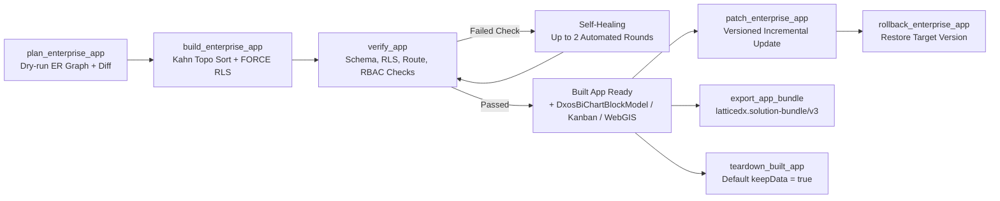

# DX-OS AI Studio & App Builder 2.0

The **DX-OS AI Studio & App Builder 2.0** module (`@latticedx/plugin-dxos-ai`, version `0.4.2`, Apache-2.0) provides an enterprise-governed multi-agent workforce, a declarative Multi-Entity App Builder with plan/patch/rollback lifecycles, a two-way Model Context Protocol (MCP) gateway, an Agent-to-Agent (A2A) JSON-RPC server, OpenTelemetry GenAI trace waterfalls, an embedded Vietnamese NL Eval Lab (`163/163`), and persistent quota/PII guardrails.

::: info Entry Route & Host Boundary
- **Studio Route:** `/admin/settings/dxos-ai` (`aclSnippet: 'pm'`, admin-scoped management)
- **Portal Launcher:** Embedded context-aware assistant across `/p/<slug>` portals (`dxos-coordinator`, `dxos-ops`, `dxos-logistics`, `dxos-workspace`, `dxos-analyst`, `dxos-operator`, `dxos-architect`)
- **Host Runtime:** Runs as an Apache-2.0 NocoBase `2.2.50` plugin with `"sdkProvidedByHost": true`, keeping upstream `Powered by NocoBase` attribution intact per Clause 5.2.
:::

---

## 1. AI Studio 9-Tab Console

In `/admin/settings/dxos-ai`, the studio is organized into **3 functional groups and 9 tabs** (`tabCategories` in `ai-studio-page.js`):

| Group | Tab | Key | Primary Capabilities |
| :--- | :--- | :--- | :--- |
| **Overview & Connectivity** | 1. 6-Plane Operating System | `topology` | Inspect 6-plane runtime metrics (`rolesCount`, `assetsCount`, `outboxPending`, `activeWorkflowsCount`, `layoutCount`, `paraDocumentsCount`, `activeAiProfilesCount`, `auditLogsCount`, `collectionsCount`) and LLM Quick-Connect (`OpenAI`, `9router`, `Google Gemini`, `Anthropic Claude`, `DeepSeek`, `Ollama`) |
| **Overview & Connectivity** | 2. Dynamic AI Workforce | `workforce` | Manage AI employee profiles, portal bindings, role locks (`allowedRoles`), per-tool policies (`ALLOW` / `ASK` / `OFF`), and `bootstrapDefaults` |
| **Overview & Connectivity** | 3. Two-Way Enterprise MCP | `mcp` | Inspect and test `/api/dxos-mcp` (enterprise) and `/api/dxos-mcp/it-ot` (IT/OT) catalogs, prompts, and resources |
| **Build & Evaluate** | 4. Built Apps | `built-apps` | Launch App Builder 2.0 quickstart presets (`clinic`, `crm`, `itsm`), inspect ER graphs, inspect `latticedx.solution-bundle/v3` previews, rebuild, rollback versions, and safe-teardown |
| **Build & Evaluate** | 5. Audit Logs | `audit` | Filter immutable `latticeAiAuditLogs` by channel, status (`allowed`, `denied`, `degraded`, `error`), and tool execution summary (GMT+7 formatted) |
| **Build & Evaluate** | 6. Agent Trace Waterfall | `traces` | Inspect OpenTelemetry GenAI spans (`invoke_agent`, `chat` / `generate_content`, `execute_tool`) with token & latency waterfalls |
| **Build & Evaluate** | 7. Eval Lab | `eval-lab` | Run deterministic NL routing & red-team benchmarks (`vietnamese-nl-agent` 163 cases, `wave1-3-capabilities`, `security-red-team`, or custom suites) |
| **Governance & Approvals** | 8. AI Approvals (HITL) | `hitl` | Review, approve, or reject `ASK`-gated tool invocations in `latticeAiApprovalQueue` with expiry countdowns and risk levels (`low`, `medium`, `high`, `critical`) |
| **Governance & Approvals** | 9. AI Quotas & Cost | `quota` | Configure per-organization daily call, token, and USD ceilings (`latticeAiQuotaPolicies`) and monitor `latticeAiQuotaUsage` + PII redaction counts |

---

## 2. 7 Starter AI Profiles

LatticeDX ships **7 starter AI profiles** (`STARTER_AI_BLUEPRINTS` & `A2A_AGENT_CATALOG`). All operational profiles remain bounded by caller RBAC and organization RLS; only `dxos-architect` carries `isAdminBuilder: true` and is locked to `root` / `admin`.

| Profile ID (`username`) | Role & Focus | `isAdminBuilder` | Sub-Agent Dispatch | Default Portal Bindings |
| :--- | :--- | :---: | :---: | :--- |
| `dxos-coordinator` | Central multi-agent coordinator for cross-department routing & radar | `false` | `true` | `*` |
| `dxos-architect` | System & App Architect (12 Native v2 BlockModels, Rich Schema, DMN, LatticeFlow v2, Stock `n8n`, App Builder 2.0) | `true` | `false` | `*` (`root`, `admin` only) |
| `dxos-ops` | Cold-Chain & IoT Operations specialist (FIWARE Orion-LD + P.A.R.A. SOP triage) | `false` | `false` | `incidents`, `procurement` |
| `dxos-logistics` | 5-step cold-chain logistics, FEFO stock lots, and ePOD handoff assistant | `false` | `false` | `logistics` |
| `dxos-workspace` | Services, Procurement & P.A.R.A. knowledge assistant | `false` | `false` | `services`, `procurement` |
| `dxos-operator` | Governed operational executor for telemetry monitoring, triage & workflow tasks | `false` | `false` | Operational roles (`ldx_operator`, `ldx_dispatcher`, `ldx_warehouse`, managers) |
| `dxos-analyst` | Cross-department BI analytics, GraphRAG impact lineage, and SLA diagnostics | `false` | `false` | `root`, `admin`, `ldx_admin`, `ldx_director`, `ldx_manager`, `ldx_employee` |

---

## 3. 20 Unified AI Tools

Every AI invocation goes through tool permission enforcement (`ALLOW` / `ASK` / `OFF`) and caller RBAC verification. `adminOnly` tools are stripped from non-admin callers at both runtime and MCP/A2A discovery layers.

### 3.1 Admin Builder Tools (11 Tools — `adminOnly: true`)

| Tool Name | Purpose |
| :--- | :--- |
| `dxos_inspect_architecture` | Read live 6-plane topology, collections, roles, portals, and NocoBase runtime state |
| `dxos_recommend_page_blueprint` | Recommend column layouts and Native v2 BlockModels for a target `<portalSlug>` |
| `dxos_design_creative_block` | Design safe creative widgets (`gauge`, `timeseries-line`, `stage-pipeline`, KPI cards) with themes (`industrial-cockpit`, `emerald-ops`, `amber-alert`, `royal-indigo`, `clean-light`) |
| `dxos_compose_page_blocks` | List, add, or rearrange standard and 12 Native v2 BlockModels on a portal page |
| `dxos_snapshot_or_rollback_page` | Time-Machine UI snapshot creation and 1-click layout rollback (`latticeUiSnapshots`) |
| `dxos_provision_role_workspace` | Provision custom `ldx_*` role workspaces and execute all 10 App Builder 2.0 lifecycle operations |
| `dxos_manage_portal_and_acl` | Create or update portals, routes, and portal-level ACL visibility |
| `dxos_extend_collection_schema` | Extend custom tables with Rich Schema types (`belongsTo`, `hasOne`, `belongsToMany`, AST formulas, validation rules) |
| `dxos_manage_rbac_permissions` | Configure collection-level and field-level permissions for roles |
| `dxos_deploy_workflow` | Deploy and activate packaged workflow templates |
| `dxos_configure_workflow` | Draft, patch, suggest, test, resume, save, or run LatticeFlow v2 DAGs, DMN tables, and Stock `n8n` workflows |

### 3.2 Operational Tools (6 Tools — `adminOnly: false`)

| Tool Name | Purpose |
| :--- | :--- |
| `dxos_search_enterprise_context` | Hybrid search across P.A.R.A. knowledge vault and enterprise records with `[collection:code#id]` citations |
| `dxos_execute_record_action` | Execute governed write actions on allowlisted business collections (`latticeServiceTickets`, `latticeOrders`, `latticeRequests`, `latticeParaDocuments`) while blocking server-protected fields |
| `dxos_my_workflow_tasks` | List and act on manual workflow/approval tasks assigned to the authenticated caller |
| `dxos_orchestrate_enterprise_case` | Cross-department bottleneck radar and multi-step case orchestration |
| `dxos_graph_impact_analysis` | GraphRAG lineage traversal across `latticeAssets`, `latticeIncidentCases`, `latticeStockLots`, and `latticeOrders` (with optional live telemetry) |
| `dxos_alarm_action` | Acknowledge (`ack`) or clear (`clear`) IoT/cold-chain alarms |

### 3.3 Persistent Memory Tools (3 Tools — `adminOnly: false`)

Stored in `latticeAiMemory` across 4 isolation scopes (`org`, `agent`, `user`, `session`):

| Tool Name | Default Mode | Behavior |
| :--- | :---: | :--- |
| `dxos_memory_remember` | `ALLOW` | Persist long-term architectural decisions, SOP preferences, or entity notes scoped to `org` / `agent` / `user` / `session` |
| `dxos_memory_recall` | `ALLOW` | Retrieve relevant persisted memory entries during ReAct reasoning |
| `dxos_memory_forget` | `ASK` | Require HITL confirmation before deleting stored memories |

---

## 4. App Builder 2.0 (10 Operations & Verifier Loop)

`dxos_provision_role_workspace` exposes **10 lifecycle operations** (`operation` enum) for building complete multi-entity enterprise apps in natural Vietnamese or structured JSON specs:

| Operation | Mutates DB? | Description |
| :--- | :---: | :--- |
| `provision_role_workspace` | Yes | Provision a single `ldx_*` role, field locks, dedicated portal, and scoped AI assistant |
| `plan_enterprise_app` | No | Dry-run planner returning the Multi-Entity ER graph, Kahn dependency order, and diff preview |
| `build_enterprise_app` | Yes | Create `latticeCustom<Name>` tables (`belongsTo`, `hasOne`, `belongsToMany` junction tables with `FORCE RLS`), RBAC, portals (`DxosKanbanScheduleBlockModel`, `DxosWebGisBlockModel`, `DxosRecordWorkbenchBlockModel`, `DxosBiChartBlockModel`), DMN/workflows, and run verification |
| `patch_enterprise_app` | Yes | Apply incremental schema/portal/workflow patches against an existing `appKey` while recording a version snapshot |
| `rollback_enterprise_app` | Yes | Roll back a built app to a prior `targetVersion` snapshot |
| `verify_app` | No | Run structural, RLS, RBAC, and portal block integrity checks against a built app |
| `list_built_apps` | No | List organization-scoped built apps stored in `latticeBuiltApps` |
| `rebuild_enterprise_app` | Yes | Reconcile and re-apply artifacts from the stored `sourceSpecJson` |
| `export_app_bundle` | No | Export a portable `latticedx.solution-bundle/v3` JSON bundle |
| `teardown_built_app` | Yes | Safely remove generated portals, roles, and workflows while defaulting `keepData: true` to preserve business data |

::: warning System Collection Protection
App Builder 2.0 only creates/modifies custom collections prefixed with `latticeCustom*`. System tables (`users`, `roles`, `latticeBuiltApps`, `latticeAiAuditLogs`, `latticeCryptoLedger`, etc.) are strictly protected (`SYSTEM_PROTECTED_COLLECTIONS`) and cannot be altered or dropped.
:::

---

## 5. MCP Gateways & A2A Protocol

### 5.1 Two-Way Streamable HTTP MCP (`/api/dxos-mcp` & `/api/dxos-mcp/it-ot`)

Both endpoints implement stateless JSON-RPC 2.0 over HTTP `POST` (`GET`/`DELETE` return `405`) with Bearer authentication (user JWT or scoped `ldx_pat_*` token), organization isolation, and `adminOnly` filtering.

- **Supported Protocol Versions:** `2025-03-26`, `2024-11-05`
- **Endpoints:**
  - `POST /api/dxos-mcp` — Enterprise tools (`enterprise` mode)
  - `POST /api/dxos-mcp/it-ot` — IT/OT & telemetry toolset (`itot` mode, including `get_live_ngsi_telemetry` and `get_sensor_and_incident_timeline`)
- **4 Built-in MCP Prompts (`prompts/list`, `prompts/get`):**
  1. `dxos-cold-chain-incident-triage` (`assetCode`, optional `incidentCode`)
  2. `dxos-fefo-dispatch-audit` (`lotCode`, optional `sku`)
  3. `dxos-executive-radar-brief` (optional `focusArea`)
  4. `dxos-system-blueprint-architect` (`portalSlug`, `goal`, `adminOnly: true`)
- **Dynamic MCP Resources (`resources/read`):**
  - `dxos://org/<organizationId>/alarms/active`
  - `dxos://org/<organizationId>/lineage/<collection>/<recordId>`

### 5.2 Agent-to-Agent (A2A) Protocol (`/.well-known/agent-card.json`)

- **Discovery Endpoints:**
  - `GET /.well-known/agent-card.json`
  - `GET /api/dxos-a2a/agent-card.json`
- **JSON-RPC Endpoint:** `POST /api/dxos-a2a`
- **Task Lifecycle (`latticeA2aTasks`):** `submitted` → `working` → `input-required` (when HITL confirmation is needed) → terminal states `completed` | `failed` | `canceled`.

---

## 6. Eval Lab (`163/163`), Quota Governance & PII Redaction

### 6.1 Vietnamese NL Eval Lab (`163/163` Cases)

Verified in both CI (`node scripts/eval-vietnamese-nl-agent.mjs --min-pass=95`) and the AI Studio **Eval Lab** tab:

- **`vietnamese-nl-agent` (`163` cases across `20` numbered suites):** Covers Enterprise RAG, Workflow Tasks, Cross-Department Radar, Alarm Ack/Clear, Creative Block & Time-Series Architect, Role Workspace & Time-Machine Rollback, GraphRAG Lineage, WMS/FEFO Cold-Chain, Flow Architect, DMN Tables, Stock `n8n` REST v1, Multi-Entity App Builder 2.0 Plan/Patch/Rollback + BI Chart, ReAct + Memory + A2A + Draft/Publish, Approvals/Notify/Public Forms, plus **adversarial & security refusal suites** (`prompt injection`, `DROP TABLE`, `UNION SELECT`, `privilege escalation`, `SSRF 169.254.169.254`, `credential exfiltration`).
- **Additional Studio Suites:** `wave1-3-capabilities` (`11` sample checks), `security-red-team` (`6` red-team checks), and `custom` interactive user-defined cases.

### 6.2 Persistent Daily Quotas (`latticeAiQuotaPolicies` / `latticeAiQuotaUsage`)

Default daily limits (overridable per organization in Tab 9 or via environment variables) enforce `HTTP 429` (`AI_QUOTA_EXCEEDED`) before outbound LLM calls:

| Policy Field | Environment Variable | Default Limit |
| :--- | :--- | :---: |
| `orgDailyCalls` | `DXOS_AI_DAILY_ORG_CALL_LIMIT` | `5,000` calls/day |
| `userDailyCalls` | `DXOS_AI_DAILY_USER_CALL_LIMIT` | `500` calls/day |
| `orgDailyTokens` | `DXOS_AI_DAILY_ORG_TOKEN_LIMIT` | `5,000,000` tokens/day |
| `orgDailyUsd` | `DXOS_AI_DAILY_ORG_USD_LIMIT` | `$50` USD/day |

### 6.3 Automatic PII & Secret Redaction

Before payloads reach external LLMs, OpenTelemetry exporters, or `latticeAiAuditLogs`, `redactPiiText` / `redactPiiForLlm` (`ai-governance.js`) scrubs:

- **Credentials & Tokens:** JWTs (`[REDACTED_JWT]`), `Bearer` tokens (`Bearer [REDACTED]`), `sk-*` keys (`[REDACTED_KEY]`), `ldx_pat_*` tokens, and sensitive key/value pairs (`password`, `secret`, `apiKey`, `cookie`, `privateKey`, etc.)
- **Personal & Financial Data (Vietnam + International):** Email addresses (`[REDACTED_EMAIL]`), bank accounts / IBAN (`STK` / `IBAN` → `[REDACTED_BANK]`), Vietnamese CCCD/CMND (`9–12` digits → `[REDACTED_CCCD]`), Vietnamese phone numbers (`+84`/`0` + `3|5|7|8|9` + 8 digits → `[REDACTED_PHONE]`), and Vietnamese Tax IDs (`MST` → `[REDACTED_MST]`).

---

## 7. `dxosAi` Action Surface (`41` Actions)

The `dxosAi` resource (`plugins/nocobase/plugin-dxos-ai`) exposes **41 actions** grouped across:
- **Workforce & Profiles:** `listProfiles`, `saveProfile`, `deleteProfile`, `bootstrapDefaults`, `portalAgents`
- **Governance, Quota & HITL:** `auditLogs`, `quotaSummary`, `saveQuotaPolicy`, `listApprovals`, `triageScan`, `approveAction`, `rejectAction`
- **MCP & Topology:** `mcpCatalog`, `testMcpEndpoint`, `enterpriseTopology`, `pageSurfaceState`, `surfaceEvents`, `inspectPageBlocks`, `rollbackPageSnapshot`
- **LLM Services:** `checkLlmHealth`, `quickConnectLlm`, `listLlmServices`, `deleteLlmService`, `switchLlmServiceModel`
- **App Builder 2.0:** `listBuiltApps`, `rebuildBuiltApp`, `buildBuiltApp`, `planBuiltApp`, `patchBuiltApp`, `rollbackBuiltApp`, `listBuiltAppVersions`, `exportBuiltAppBundle`, `teardownBuiltApp`
- **Memory, Traces & Eval Lab:** `listMemories`, `rememberFact`, `recallMemories`, `forgetMemory`, `listAgentTraces`, `getAgentTraceDetail`, `listEvalSuites`, `runEvalBenchmark`

---

## Related Modules

- [P.A.R.A. Knowledge Vault & OCR / Hybrid RAG](/en/modules/para-knowledge-ocr)
- [Unified Approvals, Omnichannel Notify, Public Forms & Mobile PWA](/en/modules/approvals-notify-forms-pwa)
- [IIoT, 2-Way Digital Twin, Connector Vault, Event Bus & Stock n8n](/en/modules/iiot-digital-twin-n8n)
