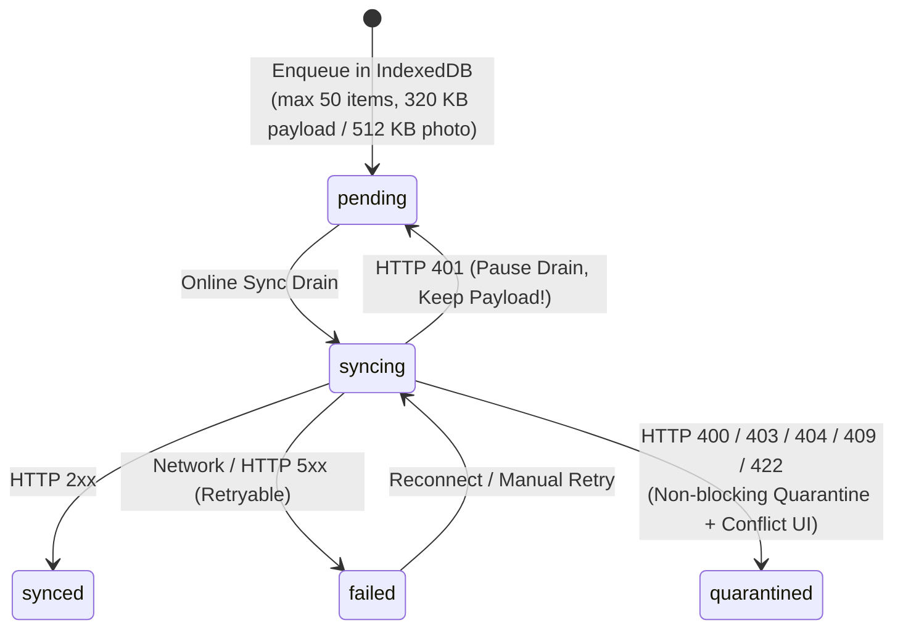

# Unified Approvals, Omnichannel Notify, Public Forms & Mobile PWA

All four operational interaction subsystems in this guide live inside `@latticedx/plugin-lattice-foundation` (`0.4.2`, Apache-2.0), sharing PostgreSQL 16 `FORCE RLS` tenant isolation (`organizationId`), `ldx_pat_*` PaaS API key scope checks, and auditability via the Ed25519 + Merkle PKI ledger.

---

## 1. Unified Approvals Engine (`dxosApprovals`)

`plugins/nocobase/plugin-lattice-foundation/src/server/approval-engine.js` unifies multi-stage business approvals, AI HITL tool confirmations, LatticeFlow v2 `control.approval` pauses, and AI proposals into a single inbox.

### 1.1 Supported Modes & Inbox Sources

- **Stage Execution Modes (`VALID_MODES`):**
  - `sequential`: Advances one stage at a time; every active stage must be approved in order.
  - `parallel` (**M-of-N Quorum**): Dispatches to all eligible approvers in the stage simultaneously and resolves once `requiredApprovals` (`M <= N`) distinct verified decisions are recorded.
- **Unified Inbox Sources (`VALID_INBOX_SOURCES`):** `all`, `business` (`latticeApprovalRequests`), `ai_hitl` (`latticeAiApprovalQueue`), `flow` (LatticeFlow v2 suspended approvals), and `proposals` (`latticeAgentProposals`).
- **Protected Collections (`PROTECTED_TARGET_COLLECTIONS`):** Security tables (`users`, `roles`, `latticeApiKeys`, `latticePkiKeys`, `latticeCryptoLedger`, `latticeConnectors`, `latticeApprovalPolicies`, `latticeApprovalRequests`, etc.) cannot be attached to arbitrary approval policies.
- **Delegation Safety (`FORBIDDEN_DELEGATION_ROLES`):** Privileged roles (`root`, `admin`, `ldx_admin`) cannot be delegated to subordinate users.
- **Direct Guard Middleware (`dxosApprovalsDirectGuard`):** Blocks direct CRUD mutations on `latticeApprovalPolicies` and `latticeApprovalRequests` so all state transitions pass through `dxosApprovals` with `withCanonicalDecisionLock` race protection.

### 1.2 `dxosApprovals` Resource Actions (`8` Actions)

| Action | HTTP | API Key Scope | Description |
| :--- | :---: | :--- | :--- |
| `listInbox` | `GET` | `read` / `write` | Query unified inbox across `all`, `business`, `ai_hitl`, `flow`, `proposals` for the caller's verified roles and active delegations |
| `decide` | `POST` | `write` | Submit `approve` or `reject` (or `review` on proposals) with concurrency lock, self-approval block (unless admin-permitted), and PKI ledger entry |
| `request` | `POST` | `write` | Create a new multi-stage approval request on an allowlisted `lattice*` collection (`sequential` or `parallel` M-of-N, optional SLA & escalation role) |
| `cancel` | `POST` | `write` | Cancel an open approval request with mandatory audit reason |
| `listPolicies` | `GET` | `read` / `write` | List configured approval policies for the tenant |
| `savePolicy` | `POST` | `write` | Create or update an approval policy (`targetCollection`, `operation`, `conditionJson`, `stagesJson`, `slaMinutes`) |
| `deletePolicy` | `POST` | `write` | Delete an approval policy |
| `evaluateSlaNow` | `POST` | `write` (admin) | Evaluate pending approval SLAs immediately (`dryRun` supported) and escalate breached requests |

---

## 2. Omnichannel Notification Hub (`dxosNotify`)

`plugins/nocobase/plugin-lattice-foundation/src/server/omnichannel-notify.js` delivers templated alerts and approval notices across **4 channels** (`SUPPORTED_CHANNELS`):

| Channel | Secret / Connector Source | Key Security & Protocol Guarantees |
| :--- | :--- | :--- |
| `smtp` | Connector Vault (`email_smtp`) | Native `node:net` / `node:tls` SMTP delivery, CRLF header injection guard (`assertNoHeaderInjection`), HTML-escaped <code v-pre>{{variable}}</code> interpolation |
| `telegram` | Connector Vault (`telegram`) | Bot token regex validation (`TELEGRAM_TOKEN_RE`), chat ID validation (`TELEGRAM_CHAT_RE`), HTTPS `api.telegram.org` dispatch |
| `slack` | Connector Vault (`slack`) | OAuth2 PKCE / Bearer Slack Web API or incoming webhook with SSRF URL verification |
| `webhook` | Connector Vault (`webhook` / `partner_webhook`) | Custom JSON template rendering (`renderWebhookPayload`), prototype-pollution stripping, SSRF IP/DNS guard |

- **Retry & Scrubbing:** Uses exponential backoff (`DEFAULT_MAX_ATTEMPTS = 3`, `250 ms` base up to `5,000 ms`, `6,000 ms` timeout) and runs `scrubSecrets` before persisting delivery records to `latticeNotificationDeliveries`.
- **`4` `dxosNotify` Actions:**
  1. `POST dxosNotify:send` (`Operator` / `Admin` role, `write` scope) — Dispatch single-channel (`channel`) or multi-channel (`channels: [...]`) notifications.
  2. `POST dxosNotify:testSend` (`Admin` role, `write` scope) — Send a test notification to verify Connector Vault credentials.
  3. `GET dxosNotify:logs` (`Admin` role, `read`/`write` scope) — Query `latticeNotificationDeliveries` filtered by `channel`, `status`, and `dryRun`.
  4. `GET dxosNotify:channels` (`loggedIn`, `read`/`write` scope) — List active omnichannel connectors configured for the tenant.

---

## 3. Public Intake Forms (`/v/form/:slug` & `dxosForms`)

`plugins/nocobase/plugin-lattice-foundation/src/server/public-forms.js` enables zero-login external intake portals at `/v/form/:slug` while keeping internal business records isolated behind strict allowlists, field blocks, honeypots, and sliding-window rate limiters.

### 3.1 Security & Anti-Abuse Architecture

- **Collection Allowlist (`PUBLIC_FORM_ALLOWLIST_COLLECTIONS`):** Public forms may only write to `latticeRequests`, `latticeOrders`, `latticeServiceTickets`, `latticeParaDocuments`, `latticeIncidentCases`, `latticeLocations`, `latticeAssets`, `latticeAgentProposals`, or `latticeCustom*` tables.
- **Blocked Target Fields (`BLOCKED_TARGET_FIELDS`):** Internal workflow/ownership columns (`id`, `organizationId`, `status`, `version`, `requesterId`, `assigneeId`, `password`, `secret`, `token`, `accessTokenHash`, `statusTokenHash`, `__proto__`, `constructor`, `prototype`) can never be injected via public form submissions.
- **Allowed Field Types & Attachments:** Supports `string`, `text`, `number`, `integer`, `boolean`, `date`, `email`, `select`, and `file` (`MAX_FILE_UPLOAD_BYTES = 2 MB`, MIME allowlist: `application/pdf`, `image/png`, `image/jpeg`, `image/webp`, `text/plain`), with `X-Content-Type-Options: nosniff` on download.
- **Honeypot & Prototype Pollution:** Submissions filling the configured honeypot field are silently rejected; recursive `assertNoPrototypePollution` rejects `__proto__`, `constructor`, and `prototype` keys (`depth <= 20`).
- **Rate Limiting & Constant-Time Token Verification:**
  - `submit`: `20` requests/min per form/IP (`DEFAULT_RATE_LIMIT_PER_MIN`)
  - `status`: `60` requests/min (`STATUS_RATE_LIMIT_PER_MIN`)
  - Pre-lookup IP flood ceiling: `300` requests/min (`PRE_LOOKUP_IP_FLOOD_LIMIT`)
  - Access/status tokens are SHA-256 hashed (`accessTokenHash`, `statusTokenHash`) and verified using `crypto.timingSafeEqual` against a dummy hash to prevent timing side channels.

### 3.2 `dxosForms` Resource Actions (`10` Actions)

| Action | ACL | HTTP | Purpose |
| :--- | :--- | :---: | :--- |
| `meta` | `public` | `GET` | Fetch sanitized public form schema & branding by `slug` (strips internal tokens/hashes) |
| `submit` | `public` | `POST` | Validate honeypot, rate limit, field allowlist, and attachments; create record + return `submissionCode` & status token |
| `status` | `public` | `GET` | Check sanitized submission status using `submissionCode` + `statusToken` (no PII leaked) |
| `list` | `loggedIn` (admin) | `GET` | List public form definitions for the tenant |
| `get` | `loggedIn` (admin) | `GET` | Inspect a single form definition |
| `save` | `loggedIn` (admin) | `POST` | Create or update a form definition (`slug`, `targetCollection`, `allowedFieldsJson`, `honeypotField`, `rateLimitPerMin`) |
| `delete` | `loggedIn` (admin) | `POST` | Remove a public form definition |
| `rotateToken` | `loggedIn` (admin) | `POST` | Rotate form submission access token and invalidate prior token hash |
| `listSubmissions` | `loggedIn` (admin/manager) | `GET` | Paginated submission audit log (`latticePublicFormSubmissions`) |
| `downloadAttachment` | `loggedIn` (admin/manager) | `GET` | Download a validated submission attachment by `submissionCode` + `fieldName` |

---

## 4. Mobile Field PWA (`/v/mobile`)

The Mobile Field PWA (`plugins/nocobase/plugin-lattice-foundation/src/client-v2/mobile-field-pwa.js` + `mobile-offline-db.js`) is optimized for warehouse and cold-chain drivers operating at `390×844` in intermittent-connectivity zones.

### 4.1 IndexedDB Outbox & `quarantined` State Guarantees

- **Offline Store:** Persists queued actions in IndexedDB (`latticedx-mobile-outbox` / store `outbox`), falling back safely to bounded `localStorage` or in-memory queue when IndexedDB is unavailable.
- **Allowlisted Offline Actions (`ALLOWED_OFFLINE_ACTIONS`):**
  1. `wms.epodCapture` → `POST dxosWms:epodCapture` (captures signature + raster photo `<= 512 KB`, blocks SVG data URLs)
  2. `iot.twinSetDesired` → `POST dxosBlocks:twinSetDesired`
  3. `service.ticketCreate` → `POST latticeServiceTickets:create`
  4. `iot.incidentCreate` → `POST dxosBlocks:alarmIngest`
- **Resilient Sync State Machine (`VALID_OUTBOX_STATUSES`: `pending`, `syncing`, `failed`, `quarantined`, `synced`):**
  - **`401 Unauthorized`:** Immediately pauses queue draining (`unauthorized: true`) without discarding or corrupting queued ePOD payloads so drivers can re-authenticate and resume.
  - **`400`, `403`, `404`, `409`, `422` → `quarantined`:** Isolates permanently rejected or conflicting (`409` optimistic concurrency) items into `quarantined` status so one bad item never blocks the rest of the outbox. In the Mobile PWA UI, `409` conflicts render the sanitized server record (`maskConflictMediaFields` masks base64 images) for side-by-side resolution.
- **PWA Manifest & Service Worker (`dxos` resource):** Serves `dxos:manifest`, `dxos:sw.js` / `dxos:sw`, `dxos:icon-192.png`, and `dxos:icon-512.png`.

---

## Related Modules

- [DX-OS AI Studio & App Builder 2.0](/en/modules/ai-studio-app-builder)
- [P.A.R.A. Knowledge Vault & OCR / Hybrid RAG](/en/modules/para-knowledge-ocr)
- [IIoT, 2-Way Digital Twin, Connector Vault, Event Bus & Stock n8n](/en/modules/iiot-digital-twin-n8n)
