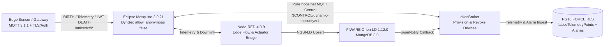

# IIoT, 2-Way Digital Twin, Connector Vault, Event Bus & Stock n8n

LatticeDX connects physical cold-chain assets, edge brokers, and enterprise automation engines using a **100% Pure-OSI** stack (`eclipse-mosquitto:2.0.21`, `fiware/orion-ld:1.12.0`, `nodered/node-red:4.0.9`, `n8nio/n8n:2.48.1`) with zero BSL-1.1 brokers or proprietary telemetry engines.

---

## 1. IIoT Edge Architecture (`dxosBroker`)

`plugins/nocobase/plugin-dxos-blocks/src/server/broker-control.js` manages edge device identity, Mosquitto Dynamic Security ACLs, Last Will and Testament (LWT) offline detection, and FIWARE Orion-LD NGSI-LD subscriptions.

### 1.1 Pure `node:net` MQTT 3.1.1 Control Client (DynSec & LWT)

- **Zero External MQTT Client Risk:** `broker-control.js` implements a pure `node:net` MQTT 3.1.1 packet encoder (`buildConnectPacket`, `buildPublishPacket`, `buildDisconnectPacket`, max packet `65,536` bytes) that publishes directly to `$CONTROL/dynamic-security/v1`.
- **Per-Tenant Device Isolation:** Provisioning a device creates a scoped Mosquitto DynSec role & client (`ldx_<organizationId>_<deviceKey>`) restricted to topic prefix `latticedx/<organizationId>/<deviceKey>/*` (`allow_anonymous false`).
- **Birth & LWT Offline Automation (`deviceStatusIngest`):** Recognizes `BIRTH` / `ONLINE` / `CONNECTED` as `online` and `DEATH` / `OFFLINE` / `LWT` / `DISCONNECTED` as `offline`. An unexpected `offline` transition automatically raises a high-severity `MQTT-LWT-OFFLINE` connectivity alarm and emits a domain event.

### 1.2 `dxosBroker` Resource Actions (`10` Actions)

| Action | HTTP | Role Scope | Purpose |
| :--- | :---: | :--- | :--- |
| `listDevices` | `GET` | `BROKER_READ_ROLES` | List provisioned MQTT edge devices for the tenant |
| `provisionDevice` | `POST` | `BROKER_WRITE_ROLES` | Provision device credentials and push Mosquitto DynSec `createRole` + `addRoleACL` + `createClient` + `addClientRole` |
| `revokeDevice` | `POST` | `BROKER_WRITE_ROLES` | Revoke device token and disable client access in Mosquitto DynSec |
| `deviceStatusIngest` | `POST` | Edge token / writer | Ingest MQTT `BIRTH` or `LWT` `DEATH` transitions and emit `MQTT-LWT-OFFLINE` alarms |
| `orionEntities` | `GET` | `BROKER_READ_ROLES` | Query live NGSI-LD entities from FIWARE Orion-LD (`1.12.0`) scoped to tenant URN prefix `urn:ngsi-ld:Asset:<organizationId>:native:<id>` |
| `orionListSubscriptions` | `GET` | `BROKER_READ_ROLES` | List tenant NGSI-LD Orion-LD subscriptions |
| `orionCreateSubscription` | `POST` | `BROKER_WRITE_ROLES` | Create an NGSI-LD subscription notifying `http://nocobase/api/dxosBroker:orionNotify` |
| `orionToggleSubscription` | `POST` | `BROKER_WRITE_ROLES` | Enable or pause an Orion-LD subscription |
| `orionDeleteSubscription` | `POST` | `BROKER_WRITE_ROLES` | Remove an Orion-LD subscription |
| `orionNotify` | `POST` | Orion callback + secret | Ingest NGSI-LD attribute notifications into `latticeTelemetryPoints` and trigger threshold/MKT alarm evaluation |

---

## 2. 2-Way Digital Twin (`digital-twin.js` & `dxosBlocks`)

`plugins/nocobase/plugin-dxos-blocks/src/server/digital-twin.js` implements a governed **Desired vs. Reported Shadow** model backed by `latticeTwinShadows`, Data Governance lineage edges (`twin_command`), and Ed25519 PKI ledger entries.

- **7 Allowlisted Desired Keys (`ALLOWED_DESIRED_KEYS`):**
  1. `targetTempC` (numeric setpoint)
  2. `maxTempC` (upper alarm/operating threshold)
  3. `minTempC` (lower operating threshold)
  4. `defrostMode` (`auto` | `manual` | `off`)
  5. `fanMode` (`auto` | `high` | `low` | `eco`)
  6. `doorLock` (`locked` | `unlocked`)
  7. `reportingIntervalSec` (telemetry cadence in seconds)
- **Safety HITL Threshold (`HITL_TEMP_THRESHOLD_C = 2.0`):** Any `targetTempC`, `maxTempC`, or `minTempC` delta exceeding `2.0 °C` automatically transitions the twin command into `pending_hitl` instead of dispatching immediately, protecting cold-chain cargo from accidental setpoint spikes.
- **Command Lifecycle (`TWIN_COMMAND_STATUSES`):** `synced`, `pending_hitl`, `dispatched`, `acked`, `failed`.
- **Node-RED `4.0.9` Downlink:** Approved commands dispatch over an SSRF-allowlisted downlink (`DEFAULT_DOWNLINK_ALLOWLIST`: `localhost`, `127.0.0.1`, `::1`, `nodered`, `latticedx-nodered`, `nodered.local`) to Node-RED `4.0.9`, which bridges to field actuators and posts back `dxosBlocks:twinAckCommand`.
- **Associated `dxosBlocks` Twin Actions:** `twinShadow` (`GET`), `twinSetDesired` (`POST`), and `twinAckCommand` (`POST`).

---

## 3. Connector Vault (`dxosVault`)

`plugins/nocobase/plugin-lattice-foundation/src/server/connector-vault.js` provides centralized, tenant-isolated secret storage and OAuth2 lifecycle management across `19` connector types (`n8n`, `webhook`, `mqtt`, `orion_ld`, `http_api`, `smtp_notify`, `n8n_api`, `telegram`, `email_smtp`, `gmail_oauth2`, `google_sheets_oauth2`, `slack`, `discord`, `teams`, `github`, `rustfs_s3`, `partner_webhook`, `oauth2`, `app`).

- **Envelope Encryption:** Connector secrets and OAuth2 refresh tokens are encrypted at rest with **AES-256-GCM** (`aes-256-gcm`) and never serialized in plaintext API responses.
- **OAuth2 PKCE `S256` & Single-Flight Refresh:**
  - `oauthStart` generates a cryptographic state nonce + PKCE `code_verifier` and `S256` `code_challenge`.
  - `oauthCallback` verifies the state nonce in constant time (`timingSafeEqual`), atomically consumes the one-time verifier before outbound token exchange, and stores encrypted tokens.
  - Concurrent callers share a single-flight refresh lock so expiring OAuth2 tokens are refreshed once without race failures.
- **SSRF Protection:** Blocks non-HTTP(S) schemes, embedded credentials, and private/metadata IP ranges while allowing configured internal stack hosts (`n8n`, `orion-ld`, `nodered`, `mosquitto`) only via explicit allowlist policy.

### `dxosVault` Resource Actions (`8` Actions)

| Action | HTTP | Purpose |
| :--- | :---: | :--- |
| `list` | `GET` | List masked connector metadata for the tenant |
| `save` | `POST` | Create or update a connector and encrypt secret fields with AES-256-GCM |
| `rotateSecret` | `POST` | Rotate API keys/secrets for an existing connector |
| `delete` | `POST` | Delete a connector record |
| `testConnection` | `POST` | Execute an SSRF-validated health probe against the connector target |
| `appCatalog` | `GET` | Return the curated Connected Apps catalog (`telegram`, `email_smtp`, `gmail_oauth2`, `google_sheets_oauth2`, `slack`, `discord`, `teams`, etc.) |
| `oauthStart` | `POST` | Initiate an OAuth2 PKCE `S256` authorization URL |
| `oauthCallback` | `POST` / `GET` | Complete PKCE token exchange and persist encrypted refresh tokens |

---

## 4. Enterprise Event Bus & Standard Webhooks (`dxosEvents`)

`plugins/nocobase/plugin-lattice-foundation/src/server/event-bus.js` implements a durable transactional outbox & webhook dispatcher.

- **CloudEvents (`specversion: "1.0"`) + Standard Webhooks Signing:**
  - Secrets prefixed with `whsec_` are base64-decoded and signed with HMAC-SHA256 over `<webhookId>.<timestamp>.<rawBody>`, producing `v1,<base64_hmac>` headers verified with `timingSafeEqual` within a `300 s` replay tolerance window (`toleranceSec = 300`).
- **Circuit Breaker & Exponential Backoff:**
  - **Circuit Breaker:** Opens after **`5` consecutive failures** (`CIRCUIT_FAILURE_THRESHOLD = 5`) for a **`120 s` cooldown** (`CIRCUIT_COOLDOWN_MS = 120_000`) to protect downstream partners and prevent worker starvation.
  - **Retry Schedule:** Up to `DEFAULT_MAX_ATTEMPTS = 5` attempts with exponential backoff (`5,000 ms` base up to `3,600,000 ms` cap; `5,000 ms` HTTP timeout) and periodic drainer polling (`10,000 ms`).

### `dxosEvents` Resource Actions (`10` Actions)

| Action | HTTP | Purpose |
| :--- | :---: | :--- |
| `listEvents` | `GET` | Inspect published `latticeEventBus` events for the tenant |
| `publish` | `POST` | Publish a CloudEvents-formatted domain event to matching subscriptions |
| `listSubscriptions` | `GET` | List `latticeWebhookSubscriptions` |
| `saveSubscription` | `POST` | Create or update an outbound webhook subscription (wildcard pattern matching + `whsec_` signing secret) |
| `toggleSubscription` | `POST` | Enable or pause a webhook subscription |
| `deleteSubscription` | `POST` | Remove a webhook subscription |
| `listDeliveries` | `GET` | Inspect `latticeWebhookDeliveries` attempt statuses and response codes |
| `dispatchNow` | `POST` | Trigger immediate draining of pending event deliveries |
| `replayDlq` | `POST` | Requeue failed/dead-letter deliveries |
| `resetCircuit` | `POST` | Manually close an open circuit breaker after resolving downstream partner issues |

---

## 5. Stock `n8n` `2.48.1` Integration (`dxosN8n`)

LatticeDX integrates **stock `n8nio/n8n:2.48.1`** (external OCI service, `X-N8N-API-KEY` header authentication) via `plugins/nocobase/plugin-dxos-studio/src/server/n8n-api-client.js` and ships **10 ready-to-import workflow blueprints** in `infra/config/n8n/`:

- `dxos-coldchain-alert-orchestrator.json`
- `dxos-enterprise-compliance-orchestrator.json`
- `dxos-enterprise-error-handler.json`
- `dxos-epod-partner-sync.json`
- `dxos-external-app-inbound-callback.json`
- `logistics-order-webhook.json`
- `uc1-handover-sample.json`, `uc1-handover.json`, `uc1-intake.json`, `uc2-observation-review.json`

### `dxosN8n` Resource Actions (`10` Actions)

| Action | HTTP | Purpose |
| :--- | :---: | :--- |
| `status` | `GET` | Check stock `n8n` REST API v1 connectivity and resolved connector status |
| `appCatalog` | `GET` | Return Connector Vault apps mapped to `n8nCredentialType` (`telegramApi`, `smtp`, `gmailOAuth2`, `googleSheetsOAuth2Api`, `slackOAuth2Api`, `s3`, etc.) |
| `workflows` | `GET` | List workflows from the tenant's `n8n` instance |
| `getWorkflow` | `GET` | Retrieve a single `n8n` workflow definition by `workflowId` |
| `createWorkflow` | `POST` | Create a new workflow in `n8n` with optional `idempotencyKey` |
| `updateWorkflow` | `POST` | Update an existing `n8n` workflow |
| `activateWorkflow` | `POST` | Activate or deactivate an `n8n` workflow |
| `executions` | `GET` | List `n8n` workflow executions filtered by `workflowId`, `status`, `limit`, `cursor` |
| `retryExecution` | `POST` | Retry a failed `n8n` execution |
| `syncCredential` | `POST` | Resolve decrypted/refreshed secrets from `dxosVault` (including OAuth2 PKCE tokens), push a matching credential to `n8n`, scrub secrets from logs, and store `n8nCredentialId` |

---

## Related Modules

- [DX-OS AI Studio & App Builder 2.0](/en/modules/ai-studio-app-builder)
- [P.A.R.A. Knowledge Vault & OCR / Hybrid RAG](/en/modules/para-knowledge-ocr)
- [Unified Approvals, Omnichannel Notify, Public Forms & Mobile PWA](/en/modules/approvals-notify-forms-pwa)
