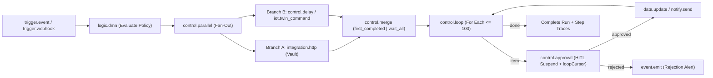

# LatticeFlow v2 Visual DAG Engine

**LatticeFlow v2** is LatticeDX's multi-tenant, database-durable workflow orchestration engine built on `@xyflow/react` (`12.12.1`, MIT) and `@dagrejs/dagre` (`3.1.3`, MIT) inside `@latticedx/plugin-dxos-studio`. Accessible at `/admin/settings/workflow/automation` (and `/admin/settings/dxos-flow-studio`), it executes directed acyclic graphs (DAGs) with **24 nodes across 6 groups**, deterministic `control.loop` HITL suspension/resume via `loopCursor`, parallel `control.merge` semantics (`first_completed` vs `wait_all`), and **19 `dxosAutomations` actions**.

## Execution Architecture & Durable HITL Loops

## Exact 24 Nodes Across 6 Categories

Every node definition is registered and schema-validated in `plugins/nocobase/plugin-dxos-studio/src/server/flow/registry.js`.

| Category | Node Type | Label | Inputs | Output Ports | Key Behavior / Guardrails |
|---|---|---|---|---|---|
| **`trigger` (5)** | `trigger.event` | Domain Event Trigger | — | `main` | Subscribes to `latticeEventBus` / CloudEvents with structured `filterJson` |
| | `trigger.record` | Record Lifecycle Trigger | — | `main` | Fires on collection `create` / `update` hooks with ORM depth tracking |
| | `trigger.schedule` | Scheduled Cron Trigger | — | `main` | Timezone-aware cron scheduling (e.g., `Asia/Ho_Chi_Minh`) via `tickFlowScheduler` |
| | `trigger.webhook` | Inbound Webhook Trigger | — | `main` | Public `/api/dxosAutomations:webhookIngress` with HMAC verification |
| | `trigger.manual` | Manual / API Trigger | — | `main` | Invoked via Studio UI or `dxosAutomations:runNow` |
| **`control` (8)** | `control.if` | Conditional Branch (IF) | `in` | `true`, `false`, `error` | Declarative filter evaluation (zero `eval`) |
| | `control.switch` | Multi-Way Switch | `in` | `case_0`, `case_1`, `case_2`, `default`, `error` | Evaluates ordered cases and routes to first matching port |
| | `control.parallel` | Parallel Fan-Out | `in` | `main`, `error` | Fans execution out to all connected downstream branches |
| | `control.merge` | Branch Merge | `in` | `main`, `error` | Supports `wait_all` and `first_completed` join modes |
| | `control.loop` | Bounded Loop (For Each) | `in` | `item`, `done`, `error` | Iterates arrays up to `MAX_LOOP_CAP = 100` (`strictLimit` option) |
| | `control.delay` | Timer / Delay Suspend | `in` | `main`, `error` | Suspends execution until `durationSec` or ISO-8601 `untilIso` |
| | `control.approval` | Human-in-the-Loop (HITL) | `in` | `approved`, `rejected`, `error` | Creates `latticeAiApprovalQueue` item & suspends run with `resumeTokenHash` |
| | `control.subflow` | Subflow Invocation | `in` | `main`, `error` | Calls another published rule within the same org (`MAX_SUBFLOW_DEPTH = 8`) |
| **`data` (3)** | `data.query` | Query Records | `in` | `main`, `error` | RLS-scoped query against allowlisted collections |
| | `data.create` | Create Record | `in` | `main`, `error` | Validates target collection allowlist & injects `organizationId` |
| | `data.update` | Update Record | `in` | `main`, `error` | Updates allowlisted business records inside an RLS savepoint |
| **`logic` (2)** | `logic.dmn` | Evaluate DMN Table | `in` | `main`, `error` | Evaluates a `latticeDecisionTables` rule table & populates `dmn` context |
| | `logic.transform` | Declarative Data Transform | `in` | `main`, `error` | Row-based declarative field mapping & template interpolation |
| **`ai` (2)** | `ai.llm` | LLM Completion | `in` | `main`, `error` | Calls configured `llmServices` with PII redaction, SSRF guard & `fallbackOutput` |
| | `ai.agent` | AI Triage / ReAct Agent | `in` | `main`, `error` | Supports `single` triage (`latticeAgentProposals`) or multi-turn `react` tool loop (`aiEmployee`, `model`, `temperature`, `maxTokens`, `memoryScope`) |
| **`integration` (4)** | `integration.http` | Vault HTTP Call | `in` | `main`, `error` | Executes outbound HTTP using encrypted `latticeConnectors` secrets & SSRF allowlists |
| | `iot.twin_command` | Digital Twin Command | `in` | `main`, `error` | Pushes desired setpoints to `digital-twin.js` (subject to `> 2.0°C` HITL gate) |
| | `notify.send` | Role-Targeted Notification | `in` | `main`, `error` | Dispatches notifications to roles/users via `latticeNotifications` / `dxosNotify` |
| | `event.emit` | Emit Domain Event | `in` | `main`, `error` | Emits downstream CloudEvents with incremented `depth` against `MAX_HARD_DEPTH` |

::: info Role & Graph Validation Guardrails
- **Role Isolation:** `ldx_employee` is denied (`403 FORBIDDEN`) across all `dxosAutomations` endpoints; mutating endpoints require manager/admin roles (or delegated scope on `resumeRun`), and `saveDraft`, `publishRule`, and `rollbackRuleVersion` require administrator privileges.
- **Graph Validation (`validator.js`):** Rejects multi-trigger graphs, cyclic graphs, unknown node types, forbidden system collections (`TARGET_COLLECTION_FORBIDDEN`), and loops exceeding `100` iterations on both client and server.
:::

## `loopCursor` HITL Suspension & Resume

Traditional workflow engines often lose loop state or duplicate earlier iterations when an approval step pauses inside a `For Each` loop. LatticeFlow v2 solves this deterministically in `flow/loop-resume.js`:

1. **Suspension (`persistSuspendedLoop`):**
   - When any node inside `control.loop` (e.g., `control.approval`, `control.delay`, or `ai.agent`) returns `{ suspend }`, `executeLoopBody` freezes the exact execution frame onto `nodeStatesJson`:
     - `nodeStatesJson.loopCursor`: active innermost frame containing `{ loopNodeId, items, currentIndex, loopResults, loopOutput, iterTraceStart, bodyNodeIds }`.
     - `nodeStatesJson.loopCursors`: full stack supporting nested loops.
   - `finalizeDagRun` persists the run as `status: 'suspended'` in `latticeAutomationRuns` with `suspendedNodeId`, `approvalId`, `graphSnapshotJson`, and a single-use `resumeTokenHash` (`sha256` of `resumeToken`).
2. **Atomic Claim & Resume (`resumeFlowRun` & `resumeLoopStack`):**
   - When an approver (or an authorized role delegate via `allowDelegatedScope: 'latticeAutomationRuns'`) decides the approval or calls `dxosAutomations:resumeRun`, `claimSuspendedRun` atomically claims the run (`409 RUN_ALREADY_RESUMED` on concurrent replays).
   - `resumeLoopStack` completes any remaining downstream nodes in `currentIndex` within `bodyNodeIds`, records the iteration output into `loopResults`, iterates `curIdx + 1` through `items.length - 1` (suspending cleanly again if another item triggers HITL), and finally transitions the `control.loop` node to `completed` and fires its `done` port.

## `control.merge`: `first_completed` vs `wait_all`

In `flow/executor.js` (`traverseDag`), `control.merge` supports two distinct synchronization strategies for parallel branches:

| Mode | Scheduling Condition (`traverseDag`) | Behavior on Partial / Slow Branches | Resume Semantics (`collectPreSettledNodes`) |
|---|---|---|---|
| **`wait_all`** *(default)* | Waits until every non-skipped upstream parent predecessor has settled and delivered an input | Marks the merge `skipped` (`MERGE_WAIT_ALL_INCOMPLETE`) if any active upstream branch fails/halts without reaching the merge | Re-evaluates normally once all pending predecessors settle |
| **`first_completed`** | Fires immediately as soon as `(activeInputs.get(id) \|\| []).length > 0` | Emits the fastest branch's output on `main` without blocking on slower or suspended peer branches | `collectPreSettledNodes` tracks already-settled `first_completed` merges and their completed descendants so resuming a slower branch never re-runs downstream nodes |

## The 19 `dxosAutomations` Actions

| Group | Actions | Details |
|---|---|---|
| **Rule CRUD & Lifecycle (8)** | `listRules`, `saveRule`, `saveDraft`, `publishRule`, `listRuleVersions`, `rollbackRuleVersion`, `toggleRule`, `deleteRule` | Supports separate `draftGraphJson` and immutable `publishedVersion` snapshots in `latticeAutomationRuleVersions` with one-click rollback and timezone-aware `nextRunAt` calculation |
| **Execution, Simulation & Trace (7)** | `testRule`, `runNow`, `listRuns`, `getRunTrace`, `replayRun`, `testNode`, `resumeRun` | `testRule` runs full-graph Dry-Run simulation with live I/O traces; `testNode` tests a single node with `pinnedInputs`; `replayRun` re-runs historical triggers with `depth + 1` |
| **Studio Catalog & AI (3)** | `builderCatalog`, `aiAssist`, `nodeRegistry` | `nodeRegistry` exposes the 24 node schemas; `aiAssist` invokes the Flow Architect AI to generate/patch DAGs with automatic offline fallback |
| **Webhook Ingress (1)** | `webhookIngress` | `public` endpoint validating HMAC signatures and dispatching `trigger.webhook` flows |

## The 7 Production JSON Blueprints

Located in `plugins/nocobase/plugin-dxos-studio/src/server/flow/blueprints/*.json`, seven production blueprints ship ready to inspect, simulate, and publish:

1. **`coldchain-emergency.json`** (`auto_cmms_on_coldchain_fault`, 9 nodes) — Evaluates `cmms_priority_routing_v1`, creates CMMS work orders in `latticeCustomWorkOrders`, and dispatches multi-role alerts.
2. **`enterprise-n8n-compliance.json`** (`auto_enterprise_n8n_compliance`, 7 nodes) — Bridges high-value `latticeRequests` (`> 10,000,000 VND`) with external Stock `n8n` orchestration and PKI ledger verification.
3. **`mkt-quarantine.json`** (`auto_mkt_quarantine_response`, 8 nodes) — Responds to `lot.held_mkt` events using `cold_chain_approval_v1`, opens `latticeIncidentCases`, and synchronizes partner alerts.
4. **`partner-webhook-sync.json`** (`auto_partner_webhook_sync`, 6 nodes) — Accepts HMAC-signed B2B partner webhooks (`trigger.webhook`), transforms line arrays (`logic.transform`), and iterates safely through `control.loop` with an `error` branch.
5. **`procurement-hitl-approval.json`** (`auto_procurement_hitl_approval`, 7 nodes) — Suspends `latticeRequests` exceeding `50,000,000 VND` for `ldx_manager` HITL approval before updating voucher status.
6. **`scheduled-ai-digest.json`** (`auto_scheduled_ai_digest`, 5 nodes) — Runs at `08:00` Monday–Friday (`Asia/Ho_Chi_Minh`), queries up to 20 open `latticeIncidentCases`, and generates an executive AI briefing.
7. **`sla-escalation.json`** (`auto_sla_breach_escalation`, 5 nodes) — Uses `control.switch` on `event.type` to notify `ldx_dispatcher` on `sla.warning` and escalate tickets on `sla.breached`.

## Related Pages

- [Visual DMN Engine & Role Delegations](/en/modules/visual-dmn)
- [OMS, WMS, FEFO, MKT & Ed25519 ePOD](/en/modules/oms-wms-fefo-epod)
- [Unified Approvals, Notify, Forms & Mobile PWA](/en/modules/approvals-notify-forms-pwa)
