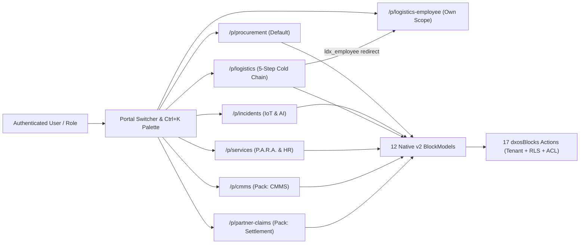

# Multi-Role Portals & 12 Native v2 BlockModels

LatticeDX (`0.4.2`) delivers role-segregated enterprise cockpits over NocoBase `2.2.50` without maintaining separate frontends. Instead of exposing raw CRUD tables to every user, `@latticedx/plugin-lattice-foundation` and `@latticedx/plugin-dxos-blocks` compose **7 Multi-Role Portals** powered by **12 Native v2 BlockModels** and backed by **17 fail-closed `dxosBlocks` actions**.

## Architecture: Portals, Scopes, and Native BlockModels

Every business portal maps a URL slug (`/p/<slug>`) to a dedicated NocoBase desktop layout (`ldx-portal-<slug>`), a curated role ACL list, and an overview cockpit composed by `dxosStudio:composePortals`.

## The 7 Multi-Role Portals

| # | Route Slug | Layout UID | Title | Authorized Roles | Primary Operational Scope |
|---|---|---|---|---|---|
| 1 | `/p/procurement` *(Default)* | `ldx-portal-procurement` | Procurement & Assets | `ldx_employee`, `ldx_manager`, `ldx_director`, `ldx_admin` | Purchase requests (`latticeRequests`), asset ledger (`latticeAssets`), BI procurement metrics |
| 2 | `/p/incidents` | `ldx-portal-incidents` | Operations & IoT Incidents | `ldx_manager`, `ldx_dispatcher`, `ldx_warehouse`, `ldx_director`, `ldx_admin` | IoT incident queue (`latticeIncidentCases`), NGSI-LD rules (`latticeIncidentRules`), WebGIS & AI triage |
| 3 | `/p/logistics` | `ldx-portal-logistics` | Cold-Chain Logistics | `ldx_warehouse`, `ldx_dispatcher`, `ldx_driver`, `ldx_manager`, `ldx_admin` | Cold-chain orders (`latticeOrders`), warehouses (`latticeLocations`), FEFO/MKT/ePOD & Kanban |
| 4 | `/p/logistics-employee` | `ldx-portal-logistics-employee` | Logistics · My Orders | `ldx_employee` | Employee self-service order creation and own-record list (<code v-pre>requester.userId == {{ ctx.user.id }}</code>) |
| 5 | `/p/services` | `ldx-portal-services` | Internal Services & Directory | `ldx_employee`, `ldx_manager`, `ldx_warehouse`, `ldx_dispatcher`, `ldx_driver`, `ldx_director`, `ldx_admin` | Employee directory (`latticeEmployees`), departments, service tickets, and P.A.R.A. knowledge vault |
| 6 | `/p/cmms` | `ldx-portal-cmms` | Cold-Chain CMMS Maintenance | `ldx_admin`, `ldx_manager`, `ldx_dispatcher`, `ldx_warehouse`, `ldx_operator`, `ldx_employee` | Provisioned by `cmms-maintenance` Business Pack over `latticeCustomWorkOrders` |
| 7 | `/p/partner-claims` | `ldx-portal-partner-claims` | Partner Claims & Settlement | `ldx_admin`, `ldx_manager`, `ldx_dispatcher`, `ldx_warehouse`, `ldx_operator`, `ldx_employee` | Provisioned by `coldchain-partner-settlement` Business Pack over `latticeCustomPartnerClaims` |

### Built-In Companion Surfaces & Global Topbar Utilities

- **Admin Workspace Cockpit (`/admin/lattice-workspace`):** Default post-login landing surface for `root` and administrators, featuring quick-launch portal cards and the Unified Approval Inbox.
- **Multi-Portal Manager (`/admin/settings/multi-portal`):** Allows administrators to create, reorder, theme, and assign roles to portals via `latticePortals` and `dxosStudio:composePortals`.
- **Automatic Employee Scoping:** When an `ldx_employee` user navigates directly to `/p/logistics`, the router smoothly redirects to `/p/logistics-employee/...`, ensuring row-level visibility is restricted to orders they requested.
- **Mobile Field PWA (`/v/mobile`) & Legacy Bridge (`/lattice/*`):** Field drivers and technicians operate through the offline-first Mobile PWA (`mobile-layout-model`), while legacy `/lattice/*` routes preserve backward navigation with a `"← Quay lại Workspace v2"` breadcrumb.
- **Global Command Palette (`Ctrl+K`) & Notification Bell:** Powered by `dxosBlocks:globalSearch` and `latticeNotifications` (`markRead`, `markAllRead`) for instant cross-collection lookup and deep-linked alerts.

::: tip Studio Isolation for Operational Roles
Operational roles such as `ldx_employee` are strictly blocked (`403`) from `/admin/settings/dxos-studio`, `/admin/settings/dxos-ai`, and `/admin/settings/workflow/automation` at both the UI route guard and backend resource middleware layers.
:::

## The 12 Native v2 BlockModels

All 12 block classes are registered into NocoBase's FlowEngine (`flowEngine.registerModels`) inside `plugins/nocobase/plugin-dxos-blocks/src/client/block-models.js`. Each block binds a `dxosBlockSettings` configuration dialog (`top: 24px`, `maxHeight: 78vh` scrollable modal) and subscribes to live configuration updates.

| # | BlockModel Class | UI Label | Core Capabilities & Configuration Props |
|---|---|---|---|
| 1 | `DxosPortalHeroBlockModel` | DX-OS Portal Hero & Quick Actions | Role-filtered CTA action buttons (`actionsJson`), accent hex color, badge, and safe app-path navigation |
| 2 | `DxosKpiMetricBlockModel` | DX-OS KPI Metric Grid | 1–4 responsive columns (`columns`), live collection record counts with JSON filters and target route drill-downs |
| 3 | `DxosContextTelemetryBlockModel` | DX-OS NGSI-LD Context & Telemetry | Live asset context from FIWARE Orion-LD (`dxosBlocks:contextTelemetry`), numeric warning threshold highlights, and outbox sync counters |
| 4 | `DxosAiProposalBlockModel` | DX-OS AI Proposal & Evidence | Interactive HITL proposal queue (`dxosBlocks:proposals` / `decideProposal`) with `approve`, `review`, `reject` (min 3-char note), evidence badges, and Poka-yoke self-approval block |
| 5 | `DxosWorkflowTasksBlockModel` | DX-OS Workflow & My Tasks | Personal workflow/approval inbox filtered by `pending`, `resolved`, or `all` with inline action execution |
| 6 | `DxosParaVaultBlockModel` | DX-OS P.A.R.A. Knowledge Vault | Browse and quick-create `active` knowledge documents across `projects`, `areas`, `resources`, and `archives` with full Markdown rendering |
| 7 | `DxosCreativeStudioBlockModel` | DX-OS Creative Studio Micro-App | Declarative JSON DSL micro-app cockpit (`blueprintJson`) for custom operational widgets |
| 8 | `DxosRecordWorkbenchBlockModel` | DX-OS Chatter, Vouchers & Export | Unified record panel combining `RecordChatterView`, `VoucherLifecycleBar`, Ed25519 PKI verification badge, data lineage drawer, printable voucher, and CSV/XLSX/PDF export |
| 9 | `DxosWebGisBlockModel` | DX-OS WebGIS Monitoring Map | Interactive `maplibre-gl` (`6.19.0`, BSD-3-Clause) cold-chain asset map with Digital Twin overlay (`showTwinOverlay`) and setpoint drawer |
| 10 | `DxosKanbanScheduleBlockModel` | DX-OS Kanban & Weekly Schedule | Dual-mode `kanban` stage board and `+07:00` weekly `schedule` view over `latticeOrders`, `latticeRequests`, `latticeServiceTickets`, and `latticeStockLots` |
| 11 | `DxosWmsOpsBlockModel` | DX-OS FEFO WMS & Bulk Import | Two-tab operations console: FEFO/MKT/ePOD/QR voucher management (`fefo`) and 2-phase Dry-Run/Commit bulk import wizard (`import`) |
| 12 | `DxosBiChartBlockModel` | DX-OS BI Analytics & Charting | SQL-accelerated `aggregateQuery` across 5 chart types (`bar`, `line`, `pie`, `kpi`, `pivot`) and 5 metric ops (`count`, `sum`, `avg`, `min`, `max`), up to 500 groups |

### BI Chart & Bulk Import Safeguards

- **Dynamic Metadata Discovery:** `DxosBiChartBlockModel` queries `dxosBlocks:collectionsMeta` to populate human-readable field labels and dynamically filter numeric fields for `sum`/`avg`/`min`/`max` aggregations, while automatically excluding `70+` internal system/security tables (`META_EXCLUDED_COLLECTIONS`) and fields matching `password|secret|token|apikey|privatekey|hash|salt|embedding|searchvector`.
- **SQL-First Aggregation with Safe Fallback:** `aggregateQuery` compiles parameterized SQL `GROUP BY` and 2D pivot queries inside a read-only RLS savepoint and automatically falls back to scoped repository scanning if needed.
- **2-Phase Bulk Import:** `DxosWmsOpsBlockModel` enforces `bulkImportDryRun` validation (schema, tenant `organizationId`, and duplicate checks) before permitting `bulkImportCommit`.

## The 17 `dxosBlocks` Server Actions

Defined in `plugins/nocobase/plugin-dxos-blocks/src/server/blocks-api.js`, every `dxosBlocks` action enforces tenant actor verification, PostgreSQL `FORCE RLS`, and collection-level ACL or PAT scope checks.

| Group | Action Name | Auth Mode | Purpose |
|---|---|---|---|
| **AI & Proposals** | `proposals` | `loggedIn` | Lists AI proposals for allowlisted business collections (`latticeAssets`, `latticeRequests`, `latticeOrders`, `latticeIncidentCases`, `latticeServiceTickets`) |
| | `decideProposal` | `loggedIn` | Executes `approve`, `review`, or `reject` on a proposal with Poka-yoke `SELF_APPROVAL_FORBIDDEN` enforcement |
| **Telemetry & Alarms** | `contextTelemetry` | `loggedIn` | Fetches NGSI-LD entity context, live telemetry attributes, and context outbox delivery counts |
| | `telemetrySeries` | `loggedIn` | Queries time-series points from `latticeTelemetryPoints` for charting |
| | `telemetryIngest` | `public` *(edge token / ACL)* | Fail-closed ingestion requiring valid `X-Lattice-Edge-Token` (`timingSafeEqual`) or authenticated ACL actor |
| | `alarmIngest` | `loggedIn` | Ingests or deduplicates sensor alarms by fingerprint into `latticeIncidentCases` |
| | `alarmAck` | `loggedIn` | Acknowledges an active IoT alarm and records actor metadata |
| | `alarmClear` | `loggedIn` | Clears a resolved IoT alarm |
| **Digital Twin** | `twinShadow` | `loggedIn` | Retrieves `reported` vs `desired` shadow state and pending downlink commands |
| | `twinSetDesired` | `loggedIn` | Submits desired setpoint changes (auto-routes temperature deltas `> 2.0°C` to HITL approval) |
| | `twinAckCommand` | `public` *(edge token / ACL)* | Confirms edge execution status back into the Digital Twin shadow |
| **Data, Search & BI** | `exportReport` | `loggedIn` | Exports governed CSV, XLSX, or Unicode Vietnamese PDF reports while stripping `SENSITIVE_EXPORT_FIELDS` |
| | `globalSearch` | `loggedIn` | Powers the `Ctrl+K` Command Palette across business collections |
| | `bulkImportDryRun` | `loggedIn` | Validates batch CSV/JSON payloads without mutating the database |
| | `bulkImportCommit` | `loggedIn` | Commits validated bulk import rows inside an RLS-scoped transaction |
| | `collectionsMeta` | `loggedIn` | Exposes allowlisted business and `latticeCustom*` collection metadata for BI & blocks |
| | `aggregateQuery` | `loggedIn` | Runs SQL-backed `bar`/`line`/`pie`/`kpi`/`pivot` aggregations with `organizationId` and owner-scope filters |

::: warning Direct CRUD Guard Middleware
To prevent bypassing telemetry normalization, shadow validation, and broker ACLs, `dxosTelemetryDirectGuard` blocks direct CRUD and `charts:queryData` requests against `latticeTelemetryPoints`, `latticeTwinShadows`, `latticeIotDevices`, and `latticeBrokerSubscriptions` (`403 TELEMETRY_DIRECT_CRUD_FORBIDDEN` / `TWIN_DIRECT_CRUD_FORBIDDEN` / `BROKER_DIRECT_CRUD_FORBIDDEN`), routing callers exclusively through `dxosBlocks` and `dxosBroker`.
:::

## Related Pages

- [OMS, WMS, FEFO, MKT & Ed25519 ePOD](/en/modules/oms-wms-fefo-epod)
- [IIoT, 2-Way Digital Twin & Stock n8n](/en/modules/iiot-digital-twin-n8n)
- [Multi-Tenant PostgreSQL FORCE RLS](/en/security/multi-tenant-rls)
