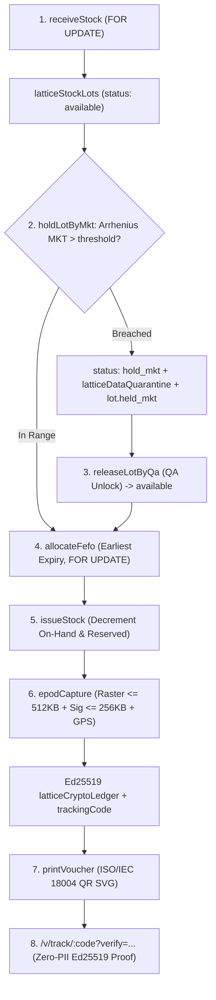

# OMS, WMS, FEFO, ePOD & Ed25519 QR Tracking

`@latticedx/plugin-dxos-studio` includes a cold-chain-grade Order Management & Warehouse Management engine (`wms-engine.js`) engineered for regulated pharmaceuticals, biologics, and perishable logistics. It combines **pessimistic `FOR UPDATE` stock locking**, **Arrhenius Mean Kinetic Temperature (MKT)** quality holds, **`512 KB` raster-only ePOD capture**, **pure-JS ISO/IEC 18004 QR SVG rendering**, and **Zero-PII public cryptographic verification** at `/v/track/:code`.


## Cold-Chain Inventory & ePOD Lifecycle



## The 12 `dxosWms` Resource Actions

All `dxosWms` actions enforce tenant isolation (`resolveTenantActor`), PostgreSQL `FORCE RLS`, PAT scopes (`read`, `write`, `wms`), and `dxosWmsDmnScope` direct-CRUD guards (`wms-direct-guard.js`).

| # | Action | Method | Access | Summary |
|---|---|---|---|---|
| 1 | `orderLines` | `GET` | `loggedIn` | Lists order lines (`latticeOrderLines`) filtered by `orderId`, `orderCode`, `sku`, or `status` |
| 2 | `saveOrderLine` | `POST` | `loggedIn` | Creates or updates an order line with positive `requestedQty` and optional temperature band `[targetTempMinC, targetTempMaxC]` |
| 3 | `receiveStock` | `POST` | `loggedIn` | Receives stock into `latticeStockLots` under `FOR UPDATE`; validates `expiryDate > manufacturedAt` and blocks adding to `hold_mkt` lots |
| 4 | `lots` | `GET` | `loggedIn` | Lists inventory lots sorted by `expiryDate, id` with computed `qtyAvailable = qtyOnHand - qtyReserved` |
| 5 | `allocateFefo` | `POST` | `loggedIn` | Allocates available lots by **First-Expired, First-Out (FEFO)** + temperature compatibility under `FOR UPDATE` and records `latticeDataLineage` edges |
| 6 | `issueStock` | `POST` | `loggedIn` | Dispatches stock from a locked lot, rejects blocked/expired lots, transitions zero-balance lots to `depleted`, and marks lines `dispatched` |
| 7 | `holdLotByMkt` | `POST` | `loggedIn` | Computes Arrhenius MKT from explicit samples or `latticeTelemetryPoints`, locks breached lots as `hold_mkt`, quarantines telemetry, and emits `lot.held_mkt` |
| 8 | `releaseLotByQa` | `POST` | `loggedIn` | Releases a `hold_mkt` or `quarantined` lot back to `available`, logs `wms.lot_qa_released`, and emits `lot.released_qa` |
| 9 | `epodCapture` | `POST` | `loggedIn` | Captures digital signature, raster evidence photo, GPS (or cold-room `gpsUnavailableReason`), signs via Ed25519 ledger, and issues `trackingCode` + `trackingToken` |
| 10 | `printVoucher` | `GET`/`POST` | `loggedIn` | Renders printable HTML (`order`, `delivery_note`, `epod`) with inline ISO/IEC 18004 QR SVG and SHA-256 `htmlSha256`; blocks `draft` orders (`409`) |
| 11 | `publicTrack` | `GET`/`POST` | `public` | Constant-time token-verified tracking endpoint returning Zero-PII status, MKT summary, and Ed25519 verification |
| 12 | `verifyTrackSignature` | `GET`/`POST` | `public` | Verifies Ed25519 ledger signature & entry hash via `?verify=` QR proof or `?token=` without exposing PII or ePOD media |

## Pessimistic `FOR UPDATE` Locking & FEFO Compatibility

High-concurrency warehouses risk race conditions when multiple dispatchers allocate the same cold-chain lot simultaneously. `wms-engine.js` eliminates double-allocation through row-level pessimistic locking (`findLockedLot` and `findLockedLots`):

- **Transaction Lock Mode:** Both helpers invoke Sequelize `lock: transaction.LOCK.UPDATE` (`SELECT ... FOR UPDATE`) inside `runInTx` wrapped by `runWithOptionalRls`.
- **Blocked Statuses (`BLOCKED_LOT_STATUSES`):** Lots in `hold_mkt`, `expired`, or `quarantined` — or where `expiryDate <= now` — are excluded from `allocateFefo` and rejected with `409 WMS_LOT_ON_HOLD` in `issueStock`.
- **Temperature Band Enforcement (`isLotCompatibleForFefo`):** A lot is eligible only if its `targetTempMinC`, `targetTempMaxC`, and measured `mktCelsius` all fall within the requested `[minTempC, maxTempC]` window.
- **Deterministic Sort & Lineage:** Eligible lots are sorted strictly by `expiryDate ASC, id ASC`. Every allocation records an `allocated_to` edge in `latticeDataLineage` linking `latticeStockLots` to `latticeOrderLines` (or `latticeOrders`).

## Arrhenius Mean Kinetic Temperature (MKT) & Lot Holds

Simple arithmetic averages mask dangerous thermal excursions in biologics and vaccines. `computeMeanKineticTemperature` implements the standard pharmaceutical Arrhenius MKT equation with activation energy `ΔH = 83.14472 kJ/mol` and gas constant `R = 0.008314472 kJ/(mol·K)`:

```text
T_MKT (K) = (ΔH / R) / -ln( (1 / n) * Σ exp(-ΔH / (R * T_i)) )
T_MKT (°C) = T_MKT (K) - 273.15
```

- **Telemetry Integration:** If `samplesC` is omitted in `holdLotByMkt`, the engine automatically queries up to 500 recent `temperature` readings from `latticeTelemetryPoints` matching the lot's `assetEntityId`.
- **Threshold Resolution:** Resolves `thresholdCelsius` from explicit `maxAllowedC`, the lot's `targetTempMaxC`, or profile fallback (`-15°C` for `frozen` / `targetTempMinC <= -15°C`, otherwise `8°C`).
- **Automated Quarantine & Eventing:** When `mktCelsius > thresholdCelsius` (or `forceHold: true`), the lot transitions to `hold_mkt`, a quarantine record (`MKT_THRESHOLD_EXCEEDED`) is written to `latticeDataQuarantine`, an audit entry is signed in `latticeCryptoLedger`, and a `lot.held_mkt` domain event is emitted to trigger downstream DMN/CMMS workflows.
- **QA Release (`releaseLotByQa`):** Only `hold_mkt` or `quarantined` lots can be unlocked (`409 WMS_LOT_INVALID_STATE` otherwise). Release records `previousStatus`, `nextStatus: 'available'`, and `releaseReason` in `latticeCryptoLedger` and emits `lot.released_qa`.

## `512 KB` Raster ePOD & Cold-Room Offline GPS

`epodCapture` validates physical delivery evidence before committing an immutable record to `latticeEpodRecords`:

- **Raster-Only Media Policy:** Evidence photos (`evidencePhotoDataUrl`) must match `SAFE_RASTER_DATA_URL_RE` (`data:image/(png|jpeg|jpg|webp|gif);base64,...`) and stay within `MAX_EPOD_PHOTO_BYTES = 512 * 1024` (`512 KB`). `data:image/svg+xml` is explicitly rejected (`400 EPOD_PHOTO_INVALID`) to eliminate SVG script-injection vectors.
- **Signature & Phone Redaction:** Hand-drawn recipient signatures (`signatureDataUrl`, max `256 KB`) are SHA-256 hashed into `signatureSha256`; phone numbers are masked via `maskPhone` (`recipientPhoneMasked`) before storage.
- **Cold-Storage GPS Fallback:** Inside insulated cold rooms or underground docks where GNSS fails, drivers can submit `gpsUnavailable: true` paired with a mandatory `gpsUnavailableReason` (max 255 chars). Otherwise, coordinates are strictly validated (`lat in [-90, 90]`, `lng in [-180, 180]`, `gpsAccuracyM >= 0`).
- **One-Time Tracking Token:** Generates `epodUid` (`EPOD-...`), `trackingCode` (`LDX-TRK-...`), and `trackingToken` (`ldx_trk_...`), persisting only `sha256(trackingToken)` in `trackingTokenHash`.

## ISO/IEC 18004 QR SVG & Zero-PII `/v/track/:code` Verification

### Pure-JS ISO/IEC 18004 Encoder (`qr-svg.js`)

`printVoucher` generates self-contained printable HTML vouchers (`order`, `delivery_note`, or `epod`) embedding an inline SVG QR code rendered by `plugins/nocobase/plugin-dxos-studio/src/server/qr-svg.js` with zero third-party native dependencies:

- Supports **ISO/IEC 18004 Versions 1–12** in UTF-8 Byte mode (`0100`).
- Implements Galois Field `GF(2^8)` (`0x11d`) Reed-Solomon error correction across ECC levels `L`, `M`, `Q`, and `H`, plus BCH(15,5) format and BCH(18,6) version encoding.
- Blocks printing `draft` orders (`409 WMS_VOUCHER_DRAFT_ORDER`) so unapproved vouchers never enter circulation.

### Zero-PII Public Verification & Ed25519 Ledger Checks

The printed QR code points to `/v/track/<trackingCode>?verify=<hex>` (derived via HMAC-SHA256 using `LATTICE_TRACK_VERIFY_SECRET`, `ENCRYPTION_FIELD_KEY`, or `APP_KEY` — failing closed in production if unconfigured).

1. **QR Proof Verification (`dxosWms:verifyTrackSignature` with `?verify=`):**
   - Validates the HMAC proof in constant time (`timingSafeEqualHex`) and loads the matching `latticeCryptoLedger` and `latticePkiKeys` rows.
   - Recomputes `sha256(orgId|seq|eventType|targetCollection|targetRecordId|payloadHash|prevHash|recordedAt)` and verifies the **Ed25519** signature over `${orgId}|${seq}|${entryHash}` using Node's `crypto.verify`.
   - Rejects `revoked` or inactive keys (`PKI_KEY_REVOKED`, `PKI_KEY_INACTIVE`) while allowing `retired` keys so historical deliveries remain verifiable after key rotation.
   - Returns `publicProofOnly: true`, `requiresTokenForDetails: true`, `seq`, `entryHash`, `keyId`, `publicKeyFingerprint`, and `signedAt` — revealing **zero PII**.
2. **Token-Authenticated Tracking (`dxosWms:publicTrack` with `?token=`):**
   - Compares `sha256(token)` against `trackingTokenHash` in constant time (`DUMMY_HASH_HEX` fallback prevents timing side-channels).
   - Returns strictly sanitized delivery metadata (`trackingCode`, `status`, `deliveredAt`, `orderCode`, `tempSummary: { mktCelsius, inRange }`, and `ledgerVerification` including `merkleRoot`), **never** returning `recipientName`, `recipientPhoneMasked`, `gpsLat`/`gpsLng`, `signatureDataUrl`, or `evidencePhotoDataUrl`.

## Related Pages

- [Multi-Role Portals & 12 Native v2 BlockModels](/en/modules/multi-portal-blocks)
- [Mobile Field PWA Offline Outbox & ePOD](/en/modules/approvals-notify-forms-pwa)
- [Ed25519 PKI Ledger & Scoped API Keys](/en/security/pki-ledger-api-keys)
