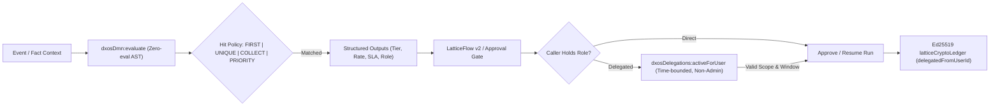

# Visual DMN Engine & Role Delegations

LatticeDX separates volatile business policies from workflow graphs through a **zero-`eval` Decision Model and Notation (DMN) engine** (`dmn-engine.js`) paired with **time-bounded Role Delegations** (`delegation-engine.js`). Business analysts edit decision tables visually in Control Studio (`/admin/settings/dxos-studio?tab=dmn`), simulate draft rules before publishing, and grant audited temporary approval authority without privilege escalation.

## Policy Evaluation & Delegated Approval Flow

## `dxosDmn` Actions (`3`) & Structural Caps

Implemented in `plugins/nocobase/plugin-dxos-studio/src/server/dmn-engine.js`, all `dxosDmn` actions enforce `FORCE RLS` tenant isolation and PAT scopes (`read`, `write`, `dmn`).

| Action | Method | Purpose |
|---|---|---|
| `listTables` | `GET` | Lists `latticeDecisionTables` for the organization (supports `tableKey` and `activeOnly` filters) |
| `saveTable` | `POST` | Validates schema/rules, atomically increments `version`, persists the table, and appends `dmn.table_saved` to `latticeCryptoLedger` |
| `evaluate` | `GET`/`POST` | Evaluates either a published `tableKey` OR an **unsaved inline draft** (`params.table`, returning `simulated: true`) without mutating DB state |

### Hard Validation Caps & Prototype-Pollution Guards

- **Schema Cap:** Both `inputsJson` and `outputsJson` require **1 to 50 fields** (`DMN_SCHEMA_INVALID`), validated against `FIELD_NAME_RE` (`/^[a-zA-Z0-9_.-]{1,64}$/`).
- **Rule Cap:** `rulesJson` allows up to **500 rules** per decision table (`DMN_RULE_INVALID`).
- **Key Safety:** `FORBIDDEN_KEYS` (`__proto__`, `constructor`, `prototype`) are rejected at validation time and blocked during evaluation via `Object.hasOwn`.
- **Zero-`eval` Execution:** Conditions are normalized into structured `{ op, value }` specs; `eval()`, `new Function()`, and arbitrary JS expressions are never used.

## 4 Hit Policies (`HIT_POLICIES`)

| Hit Policy | Evaluation Behavior | Output Shape | Conflict / Edge Handling |
|---|---|---|---|
| **`FIRST`** *(default)* | Evaluates rules top-to-bottom and stops at the first matching rule | `result` / `outputs` (single object) + `matchedRuleIndex` | Returns `matched: false, result: null` if no rule matches |
| **`UNIQUE`** | Evaluates all rules to ensure mutual exclusivity | `result` / `outputs` + `results: [only.outputs]` | Throws **`409 DMN_UNIQUE_POLICY_VIOLATION`** if `matchedRules.length > 1` |
| **`COLLECT`** | Evaluates all rules and gathers every matching rule's outputs | `results: [...]` array + `matchedRules` | Preserves rule order across all matched rows |
| **`PRIORITY`** | Evaluates all rules and sorts matches by numeric `priority` descending (tie-breaker: lowest `ruleIndex`) | `result` / `outputs` of top rule + sorted `matchedRules` | Requires finite numeric `priority` (or `rank`) when specified |

## 11 Zero-`eval` Condition Operators

`dmn-engine.js` supports both structured JSON objects (`{ op: 'gt', value: 8 }`) and shorthand string notation (e.g., `"> 8"`, `"[2..8]"`, `"in [a, b]"`, `"*"`) across **11 deterministic operators**:

| # | Operator | Accepted Aliases | Input / Value Semantics |
|---|---|---|---|
| 1 | `eq` | `==`, `===`, `=` | Exact scalar equality (normalizes finite numbers before comparing) |
| 2 | `neq` | `!=`, `!==` | Negated scalar equality |
| 3 | `gt` | `>` | Strictly greater than finite number |
| 4 | `gte` | `>=` | Greater than or equal to finite number |
| 5 | `lt` | `<` | Strictly less than finite number |
| 6 | `lte` | `<=` | Less than or equal to finite number |
| 7 | `between` | `[min..max]` | Inclusive numeric range `[min, max]` with `min <= max` |
| 8 | `in` | `in [...]` | Matches if actual value equals any element in array |
| 9 | `not_in` | `not_in [...]` | Matches if actual value equals no element in array |
| 10 | `contains` | `contains <str>` | Case-insensitive substring check on stringified value |
| 11 | `any` | `*`, `-`, `""`, `null`, `undefined` | Wildcard match (always `true`) |

## The 3 Production DMN Tables

LatticeDX ships three production DMN tables seeded across showcase and Business Pack installations:

### 1. `cold_chain_approval_v1` — Cold-Chain & MKT Excursion Approval Matrix
- **Hit Policy:** `FIRST` | **Inputs:** `totalAmountM` (number), `maxTempC` (number) | **Outputs:** `approvalTier` (string), `slaMinutes` (number)
- **Rules:**
  1. `maxTempC > 8` → `approvalTier: "quality_hold_director"`, `slaMinutes: 15`
  2. `totalAmountM > 500` → `approvalTier: "director_approval"`, `slaMinutes: 45`
  3. Wildcard (`*`, `*`) → `approvalTier: "manager_approval"`, `slaMinutes: 120`

### 2. `cmms_priority_routing_v1` — Cold-Chain CMMS Incident Priority Routing
- **Hit Policy:** `FIRST` | **Inputs:** `severity` (string), `eventType` (string) | **Outputs:** `workOrderPriority` (string), `assignedRole` (string), `slaHours` (number)
- **Rules (Pack: `cmms-maintenance`):**
  1. `severity == "critical"` AND `eventType == "alarm.triggered"` → `critical`, `ldx_manager`, `2h`
  2. `severity == "high"` AND `eventType == "alarm.triggered"` → `high`, `ldx_operator`, `4h`
  3. `eventType == "lot.held_mkt"` → `critical`, `ldx_manager`, `1h`
  4. Catch-all `{}` → `medium`, `ldx_operator`, `24h`

### 3. `coldchain_settlement_policy_v1` — Cold-Chain Partner Settlement Policy
- **Hit Policy:** `FIRST` | **Inputs:** `severity`, `riskScore`, `temperatureC`, `amount`, `slaOverdueMinutes` | **Outputs:** `settlementTier`, `settlementRatePct`, `approveClaim`, `assignedRole`
- **Rules (Pack: `coldchain-partner-settlement`):**
  1. `severity == "critical"` AND `temperatureC > -12` → `critical`, `85%`, `approveClaim: true`, `ldx_manager`
  2. `riskScore >= 75` → `critical`, `85%`, `approveClaim: true`, `ldx_manager`
  3. `temperatureC > -12` AND `amount >= 15000000` → `escalated`, `40%`, `approveClaim: true`, `ldx_manager`
  4. `riskScore >= 40` → `escalated`, `40%`, `approveClaim: false`, `ldx_operator`
  5. Catch-all `{}` → `standard`, `0%`, `approveClaim: false`, `ldx_operator`

## Role Delegations (`dxosDelegations` — 4 Actions)

When managers or QA leads go on leave, `delegation-engine.js` enables temporary, collection-scoped authority transfer in `latticeDelegations` without sharing passwords or elevating admin privileges.

| Action | Method | Purpose & Authorization |
|---|---|---|
| `list` | `GET` | Lists delegations in the organization (non-admins only see rows where they are `delegatorUserId` or `delegateUserId`) |
| `create` | `POST` | Creates a time-bounded delegation (`DLG-...`) and logs `auth.delegation_created` to `latticeCryptoLedger` |
| `revoke` | `POST` | Revokes an active delegation (`status: 'revoked'`, `active: false`) by `delegatorUserId`, org admin, or `root`; logs `auth.delegation_revoked` |
| `activeForUser` | `GET` | Resolves currently active delegations where `startsAt <= now < endsAt` and returns effective delegated `roles` |

### Anti-Escalation & Multi-Tenant Safeguards

- **Anti-Self-Delegation:** Rejects `delegateUserId === delegatorUserId` (`400 DELEGATION_SELF_FORBIDDEN`).
- **90-Day Window Cap:** Requires `endsAt > startsAt` and `(endsAt - startsAt) <= 90 days` (`400 DELEGATION_WINDOW_EXCEEDED`).
- **Admin & Privilege Block (`FORBIDDEN_DELEGATION_ROLES` & `isElevatedRoleRow`):** Strictly forbids delegating `root`, `admin`, `ldx_admin`, or any role with `allowAll`, `allowConfigure`, `*`, or admin snippets (`pm*`, `acl*`, `app*`, `ui*`) unless executed by `root` (`403 DELEGATION_ESCALATION_FORBIDDEN`).
- **Possession & Same-Org Verification:** Non-root delegators can only delegate roles they actively hold in `rolesUsers` (`403 DELEGATION_ROLE_NOT_HELD`), and both delegator and delegate must be active employees in the exact same `organizationId` (`403 DELEGATION_CROSS_ORG_FORBIDDEN`, `DELEGATION_TARGET_INACTIVE`).
- **Audited Workflow Integration:** `dxosAutomations:resumeRun` (`allowDelegatedScope: 'latticeAutomationRuns'`) and Unified Approvals invoke `resolveEffectiveDelegatedRoles`, attaching `delegatedFromUserId` and `delegationUid` directly to the resumed step output and Ed25519 audit ledger.

## Related Pages

- [LatticeFlow v2 Visual DAG Engine](/en/modules/latticeflow-v2)
- [Unified Approvals, Notify, Forms & Mobile PWA](/en/modules/approvals-notify-forms-pwa)
- [Ed25519 PKI Ledger & Scoped API Keys](/en/security/pki-ledger-api-keys)
