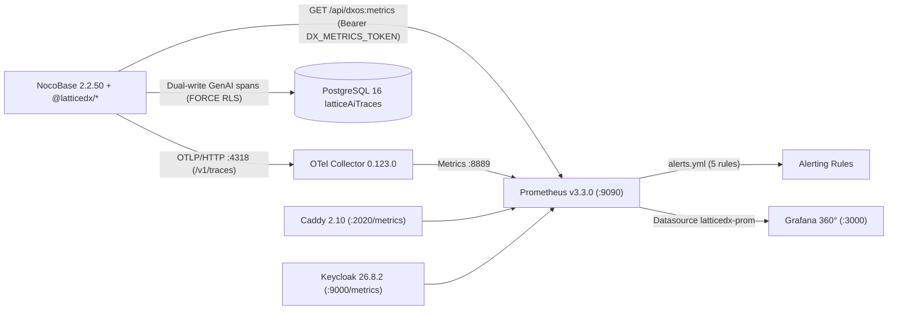

# Observability, OTel GenAI & Alerting (`v0.4.2`)

LatticeDX (`v0.4.2`) provides full-stack, Pure-OSI observability spanning HTTP request telemetry, PostgreSQL-backed outbox/webhook/alarm gauges, OpenTelemetry GenAI (`gen_ai.*`) span tracing, Prometheus alert rules, and a pre-provisioned Grafana 360° dashboard.

---

## 1. Pure-OSI Observability Architecture

The `observability` profile in `infra/compose/prod.yml` wires three containerized telemetry services alongside the NocoBase runtime (`nocobase/nocobase:2.2.50`) and `@latticedx/plugin-lattice-foundation` / `@latticedx/plugin-dxos-ai`:

| Component | OCI Image / Module | License | Role |
| --- | --- | --- | --- |
| **Observability Middleware & Exporter** | `plugins/nocobase/plugin-lattice-foundation/src/server/observability.js` & `otel-exporter.js` | `Apache-2.0` | Exposes `/api/dxos:health`, `/api/dxos:metrics`, `/api/dxos:openapi`, `/api/dxos:asyncapi`; records HTTP metrics, W3C `traceparent`, OTel GenAI spans (`latticeAiTraces` + OTLP/HTTP). |
| **OTel Collector Contrib** | `otel/opentelemetry-collector-contrib:0.123.0` | `Apache-2.0` | Receives OTLP gRPC (`:4317`) and OTLP HTTP (`:4318`), batches spans/metrics/logs, exposes Prometheus scrape endpoint on `:8889` (`namespace: latticedx_otel`), health check on `:13133`. |
| **Prometheus** | `prom/prometheus:v3.3.0` | `Apache-2.0` | Scrapes NocoBase, Caddy, Keycloak, and OTel Collector every `15s` (`15d` TSDB retention) and evaluates `infra/config/prometheus/alerts.yml`. |
| **Grafana OSS** | `grafana/grafana-oss:11.5.8` | `AGPL-3.0` (external OCI container) | Provisions `latticedx-prom` datasource and the 7-panel `LatticeDX 360° Observability` dashboard (`uid: latticedx-360`). |




### Starting the Observability Stack

```sh
docker compose -f infra/compose/prod.yml --profile observability up -d
```

Verify that all observability targets are healthy:

```sh
curl -fsS http://localhost:13014/api/dxos:health
docker compose -f infra/compose/prod.yml --profile observability ps
```

---

## 2. Health, Spec & Prometheus Endpoints

Registered on the `dxos` resource in `plugins/nocobase/plugin-lattice-foundation/src/server/observability.js`:

### `GET /api/dxos:health`

- **Access:** Public (`app.acl.allow('dxos', [...], 'public')`). HTTP methods other than `GET` return `405 METHOD_NOT_ALLOWED`.
- **Database probe (`checkDbHealth`):** Executes `db.sequelize.authenticate()` (or `SELECT 1`). Returns HTTP `200` when healthy or HTTP `503` when degraded.
- **Response payload:**

```json
{
  "status": "ok",
  "version": "0.4.2",
  "uptimeSec": 1420,
  "dbHealthy": true,
  "otel": {
    "serviceName": "latticedx-nocobase",
    "serviceVersion": "0.4.2",
    "enabled": true,
    "endpointConfigured": true,
    "recordedSpans": 48,
    "exportedSpans": 48,
    "droppedSpans": 0,
    "exportBatches": 4,
    "exportFailures": 0,
    "queuedSpans": 0
  }
}
```

### `GET /api/dxos:metrics` (Authentication & RBAC)

Unlike `:health`, `/api/dxos:metrics` enforces **fail-closed authentication** in `authorizeMetricsRequest`:

1. **Bearer Metrics Token (`DX_METRICS_TOKEN`):** Pass `Authorization: Bearer <DX_METRICS_TOKEN>`. The token is compared using SHA-256 digests and constant-time `crypto.timingSafeEqual` (`timingSafeTokenMatch`). In production Compose, Prometheus writes `DX_METRICS_TOKEN` to `/tmp/dx_metrics_token` (`umask 077`) and scrapes with `authorization.credentials_file`.
2. **Host JWT Role Fallback (`root` or `ldx_admin`):** If no matching `DX_METRICS_TOKEN` is supplied, LatticeDX verifies the caller's host session/JWT and queries `rolesUsers` for `root` or `ldx_admin`.
   - Missing/invalid credentials -> `401 METRICS_AUTH_REQUIRED`
   - Authenticated user without `root` or `ldx_admin` -> `403 METRICS_FORBIDDEN`

```sh
# Scrape with static token
curl -fsS -H "Authorization: Bearer ${DX_METRICS_TOKEN}" http://localhost:13014/api/dxos:metrics

# Or via Prometheus inside prod.yml
# metrics_path: /api/dxos:metrics -> target nocobase:80
```

### Live Contract & Security Headers

- **`GET /api/dxos:openapi`** and **`GET /api/dxos:asyncapi`**: Serve live OpenAPI `3.1.0` and AsyncAPI `3.0.0` documents reflecting dynamic `latticeCustom*` collections with `Cache-Control: no-store`.
- **HTTP Security & Strict CORS Middleware (`createObservabilityMiddleware`):** Attaches `X-Content-Type-Options: nosniff`, `X-Frame-Options: SAMEORIGIN`, and `Referrer-Policy: strict-origin-when-cross-origin` on every response, and strips untrusted `Access-Control-Allow-*` headers when `DX_CORS_STRICT` is enabled (allowlist configured via `DX_CORS_ALLOWED_ORIGINS`).

---

## 3. Exported Prometheus Metrics

`/api/dxos:metrics` outputs Prometheus text format (`text/plain; version=0.0.4; charset=utf-8`). Database-backed gauges run through `withSystemRlsBypass` so fleet-wide counts remain accurate under PostgreSQL `FORCE RLS`:

| Metric Name | Type | Labels / Buckets | Source / Meaning |
| --- | --- | --- | --- |
| `latticedx_http_requests_total` | `counter` | `method`, `status_class` (`2xx`, `3xx`, `4xx`, `5xx`, `other`) | Total HTTP requests processed by NocoBase middleware. |
| `latticedx_http_request_duration_seconds` | `histogram` | `le`: `0.025`, `0.1`, `0.5`, `2.0`, `+Inf` | HTTP request latency distribution in seconds. |
| `latticedx_ai_audit_logs_total` | `gauge` | — | Row count in `latticeAiAuditLogs`. |
| `latticedx_outbox_by_state` | `gauge` | `state`: `pending`, `retry`, `processing`, `delivered`, `failed` | Context Outbox delivery backlog (`latticeContextOutbox`). |
| `latticedx_active_alarms_total` | `gauge` | — | Count of `latticeIncidentCases` in `open` or `acknowledged` state. |
| `latticedx_unread_notifications_total` | `gauge` | — | Count of active unread notifications (`latticeNotifications`). |
| `latticedx_sla_policies_active` | `gauge` | — | Active SLA escalation policies (`latticeSlaPolicies`). |
| `latticedx_event_bus_by_status` | `gauge` | `status`: `queued`, `dispatched`, `partial_failed` | CloudEvents bus items (`latticeEventBus`, emitted when collection exists). |
| `latticedx_webhook_deliveries_by_status` | `gauge` | `status`: `pending`, `processing`, `delivered`, `retry_wait`, `dlq` | Outbound Standard Webhooks delivery queue (`latticeWebhookDeliveries`). |
| `latticedx_webhook_circuits_by_state` | `gauge` | `state`: `closed`, `open`, `half_open` | Webhook subscription circuit-breaker states (`latticeWebhookSubscriptions`). |
| `latticedx_uptime_seconds` | `gauge` | — | Node.js process uptime in seconds. |
| `latticedx_otel_spans_recorded_total` | `counter` | — | Total OTel spans queued by `otel-exporter.js`. |
| `latticedx_otel_spans_exported_total` | `counter` | — | Total OTel spans flushed via OTLP/HTTP `/v1/traces`. |
| `latticedx_otel_spans_dropped_total` | `counter` | — | Spans dropped when the bounded queue (`256` spans) is full. |
| `latticedx_otel_export_failures_total` | `counter` | — | Failed OTLP/HTTP export batches (`2000ms` timeout). |
| `latticedx_otel_queue_size` | `gauge` | — | Current buffered span queue depth. |

### Prometheus Scrape Jobs (`infra/config/prometheus/prometheus.yml`)

| Job | Target | Metrics Path | Auth |
| --- | --- | --- | --- |
| `nocobase` | `nocobase:80` | `/api/dxos:metrics` | Bearer token (`/tmp/dx_metrics_token`) |
| `caddy` | `caddy:2020` | `/metrics` | Internal `app` network |
| `keycloak` | `keycloak:9000` | `/metrics` | Internal `app` network |
| `otel-collector` | `otel-collector:8889` | `/metrics` | Internal `app` network |

---

## 4. OTel GenAI Tracing (`latticeAiTraces` & `gen_ai.*`)

Every AI Agent execution, tool call, and chat completion is normalized by `buildNormalizedGenAiSpan` in `plugins/nocobase/plugin-lattice-foundation/src/server/otel-exporter.js` and dual-written to:
1. **PostgreSQL (`latticeAiTraces`):** Protected by PostgreSQL `FORCE ROW LEVEL SECURITY` (`withTenantRlsContext` / `runInRlsSavepoint`). Direct CRUD access to `latticeaitraces` is blocked (`403 DXOS_TRACES_DIRECT_CRUD_FORBIDDEN`); inspect traces via `dxosAi:listAgentTraces` and `dxosAi:getAgentTraceDetail` or in **AI Studio → Tab 8 (Trace Waterfall & Eval Lab)**.
2. **OTLP/HTTP Exporter:** Batched (`maxQueueSize: 256`, `batchSize: 64`, `flushIntervalMs: 5000`, `exportTimeoutMs: 2000`) to `${OTEL_EXPORTER_OTLP_ENDPOINT}/v1/traces` (`http://otel-collector:4318/v1/traces` in `prod.yml`) with W3C `traceparent` propagation.

### Semantic Attributes (`gen_ai.*` & `dxos.*`)

| Attribute | Source / Values |
| --- | --- |
| `gen_ai.operation.name` | `chat`, `invoke_agent`, or `execute_tool` |
| `gen_ai.system` | Provider/system identifier (default `latticedx`) |
| `gen_ai.request.model` | Target model ID (e.g., `ag/gemini-3.8-flash`) |
| `gen_ai.usage.input_tokens` | Non-negative integer input/prompt token count |
| `gen_ai.usage.output_tokens` | Non-negative integer output/completion token count |
| `gen_ai.agent.name` | AI Profile username (e.g., `dxos-architect`, `dxos-ops`) |
| `gen_ai.tool.name` | Unified AI Tool name (e.g., `dxos_graph_impact_analysis`) |
| `dxos.run_uid` | Correlated execution run UID |
| `dxos.org` | Tenant `organizationId` |
| `dxos.status` | `ok`, `error`, or `suspended` |
| `dxos.pii.redacted_count` | Number of redacted secrets/PII values counted on this span |
| `dxos.input_preview` / `dxos.output_preview` | Truncated (512-char) scrubbed payload previews |

### Automatic PII & Secret Redaction

Before storing in `latticeAiTraces` or exporting via OTLP, `redactPiiText` and `redactPiiDeep` scrub:
- JWTs (`[REDACTED_JWT]`), `Bearer` tokens (`Bearer [REDACTED]`), `sk-*` and `ldx_pat_*` keys (`[REDACTED_KEY]`)
- Sensitive key-value keys (`authorization`, `api_key`, `secret`, `token`, `password`, `credential`, `private_key`, `jwt`, `client_secret`) while explicitly whitelisting `gen_ai.usage.*_tokens`
- Email addresses (`[REDACTED_EMAIL]`)
- Vietnamese Citizen IDs (`CCCD`/`CMND`, 9–12 digits -> `[REDACTED_CCCD]`)
- Vietnamese phone numbers (`+84`/`0` + `3|5|7|8|9` + 8 digits -> `[REDACTED_PHONE]`)
- Bank accounts / IBAN (`STK` -> `[REDACTED_BANK]`) and Vietnamese tax IDs (`MST` -> `[REDACTED_MST]`)

---

## 5. Prometheus Alert Rules (5 Rules)

Defined in `infra/config/prometheus/alerts.yml` under group `latticedx-core-alerts` (`interval: 30s`):

| Alert Name | PromQL Expression | `for` | Severity | Component | Action / Triage |
| --- | --- | --- | --- | --- | --- |
| `LatticeDxNocoBaseDown` | `up{job="nocobase"} == 0` | `1m` | `critical` | `core-runtime` | Check `nocobase` container health, `/api/dxos:health`, and `DX_METRICS_TOKEN` mount. |
| `LatticeDxHigh5xxRate` | `(sum(rate(latticedx_http_requests_total{status_class="5xx"}[5m])) / clamp_min(sum(rate(latticedx_http_requests_total[5m])), 0.001)) > 0.05 and sum(rate(latticedx_http_requests_total[5m])) > 0.01` | `2m` | `critical` | `http-api` | Inspect `nocobase` / `nocobase-db` logs and recent plugin or upstream LLM errors. |
| `LatticeDxOutboxBacklogHigh` | `sum(latticedx_outbox_by_state{state=~"pending|retry|failed"}) > 50` | `5m` | `warning` | `context-outbox` | Verify `orion-ld` and `n8n` reachability; inspect **Control Studio → Outbox/DLQ** (`dxosStudio:outboxDlqList` / `outboxDlqReplay`). |
| `LatticeDxCriticalColdAlarmsActive` | `latticedx_active_alarms_total > 0` | `3m` | `critical` | `cold-chain-alarms` | Triage active cold-chain/IIoT incidents in `/p/incidents` or run `dxosAi:triageScan`. |
| `LatticeDxQuotaSpike` | `delta(latticedx_ai_audit_logs_total[15m]) > 200` | `5m` | `warning` | `ai-mcp-quota` | Review per-tenant AI token/cost quotas in **AI Studio → Tab 9** (`latticeAiQuotaPolicies`). |

---

## 6. Grafana 360° Dashboard

Provisioned automatically via `infra/config/grafana/provisioning/datasources/prometheus.yml` (`uid: latticedx-prom`) and `dashboards.yml` from `infra/config/grafana/dashboards/latticedx-360.json` (`uid: latticedx-360`, timezone `Asia/Ho_Chi_Minh`, `15s` auto-refresh):

| Panel ID | Title | Type | Key Query |
| :---: | --- | --- | --- |
| `1` | **HTTP Request Rate & 5xx Errors** | `timeseries` | `sum by (status_class) (rate(latticedx_http_requests_total[5m]))` |
| `2` | **HTTP Latency p95 / p50** | `timeseries` | `histogram_quantile(0.95 / 0.50, sum by (le) (rate(latticedx_http_request_duration_seconds_bucket[5m])))` |
| `3` | **Active Critical / Total Alarms** | `stat` | `latticedx_active_alarms_total` & `latticedx_sla_policies_active` |
| `4` | **Notification Inbox Queue** | `stat` | `latticedx_unread_notifications_total` |
| `5` | **Database & Engine Health** | `stat` | `up{job="nocobase"}` (`UP`/`DOWN`) & `latticedx_uptime_seconds` |
| `6` | **Context Outbox Backlog (Pending / Retry / Failed)** | `timeseries` | `latticedx_outbox_by_state{state="pending\|retry\|failed\|delivered"}` |
| `7` | **AI / MCP Audit Volume & Stack Targets** | `timeseries` | `latticedx_ai_audit_logs_total` & `up{job=~"caddy\|keycloak\|otel-collector"}` |

---

## Related Documentation

- [Production Zero-Trust Deployment](/en/getting-started/production-deployment)
- [DX-OS AI Studio & App Builder 2.0](/en/modules/ai-studio-app-builder)
- [Full-Stack Backup, PITR WAL Archiving & DR](/en/operations/backup-pitr-dr)
- [Complete Automated & E2E Testing Guide](/en/operations/testing-e2e-guide)
- [Clean-Install Demo Pack, 15-Min Finals & Troubleshooting](/en/operations/demo-pack-troubleshooting)
