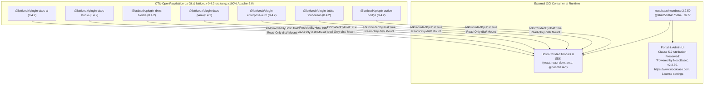

# NocoBase `2.2.50` Clause 5.2 Attribution & Source Boundary

LatticeDX separates its **100% Pure-OSI `Apache-2.0` source repository** from the external **NocoBase `2.2.50` OCI host runtime**. Understanding this boundary is critical for open-source license compliance under OLP PMNM 2026 and NocoBase's upstream license terms.

---

## 1. Why a Strict Git & Tarball Boundary Exists

During initial platform evaluation on **2026-10-06** (upstream reference commit `5b47bec116c52239348c09d360e4bd2649c99efc` on `https://github.com/nocobase/nocobase.git`), CTU-OpenPaw audited the upstream NocoBase licensing structure (`docs/nocobase-source-review.md`):

- Although upstream `package.json` declares `Apache-2.0` alongside `LICENSE-APACHE.txt`, upstream `LICENSE.txt` (updated **2026-02-24**) introduces supplementary terms under **Clause 4.2** (which override `Apache-2.0` in case of conflict):
  - **Clause 5.4:** Restricts public distribution as a hosted no-code, low-code, or AI SaaS/PaaS platform.
  - **Clause 5.2:** Prohibits removing or altering NocoBase brand attribution in the user interface.
- Additionally, upstream `packages/core/server/src/application.ts` carries `AGPL-3.0` and `NocoBase Commercial License` file headers.

Because these supplementary restrictions fall outside the Open Source Definition (OSD) Pure-OSI standard, LatticeDX enforces **zero upstream code inclusion** in Git and release archives:

- **Zero `upstream/nocobase/`:** Before `v0.4.2` (`v0.4.0` onward), an earlier read-only survey submodule at `upstream/nocobase/` was **completely removed** from the repository.
- **Zero `.gitmodules`:** Both root and nested `.gitmodules` files are prohibited and automatically rejected by `pnpm pof:check` (`upstream-clean`) and `scripts/build-oss-release-tarball.mjs` (`assertTarballEntries`).
- **Zero Upstream Modification or Redistribution:** `CTU-OpenPaw/lattice-dx` and `latticedx-0.4.2-src.tar.gz` never store, patch, compile, or bundle NocoBase upstream source code.

---

## 2. External OCI Host Runtime (`nocobase/nocobase:2.2.50`)

At runtime, NocoBase runs strictly as an **external OCI container** loaded outside the Git repository, pinned by an immutable SHA-256 digest across `infra/compose/nocobase.yml`, `infra/compose/native-rehearsal.yml`, and `infra/compose/prod.yml`:

```yaml
image: nocobase/nocobase:2.2.50@sha256:04b75164936e7314ef74d82844bc56c9f34ed7ff1ca976ca53ffac2d3c88d777
```



LatticeDX's `Apache-2.0` license applies to CTU-OpenPaw's first-party code and **does not replace** the upstream license governing the external `nocobase/nocobase:2.2.50` container image.

---

## 3. Seven First-Party `Apache-2.0` Plugins (`sdkProvidedByHost: true`)

All **7** NocoBase plugins under `plugins/nocobase/*` are original first-party packages authored by CTU-OpenPaw, each containing its own `LICENSE` (`Apache-2.0`) and `README.md`, and each declaring:

```json
{
  "version": "0.4.2",
  "license": "Apache-2.0",
  "nocobase": {
    "sdkProvidedByHost": true,
    "testedRuntime": "2.2.50"
  }
}
```

| Plugin Package | Path | Role Across DX-OS Planes | Build-Time / Bundled OSI Dependencies |
| --- | --- | --- | --- |
| `@latticedx/plugin-action-bridge` | `plugins/nocobase/action-bridge` | Legacy bridge & `dxActions` proxy contracts | Node.js built-ins + Host SDK only |
| `@latticedx/plugin-lattice-foundation` | `plugins/nocobase/plugin-lattice-foundation` | Core ERP collections, 7 `ldx_*` roles, Multi-Portal, `/v/mobile`, `/v/form/:slug`, Approvals, `dxosNotify`, PaaS API Keys, Ed25519/Merkle PKI, Data Governance/MKT, 56-table PG16 `FORCE RLS`, OTel GenAI, `dxosVault`, `dxosEvents`, OpenAPI 3.1/AsyncAPI 3.0, Clause 5.2 attribution | Node.js built-ins + Host SDK only |
| `@latticedx/plugin-enterprise-auth` | `plugins/nocobase/plugin-enterprise-auth` | Keycloak OIDC + PKCE S256, Valkey `8.1` session cache, Backchannel Logout, 2-way role sync | Bundles `openid-client@6.8.9`, `jose@6.2.15`, `oauth4webapi@3.8.8` (all `MIT`) via `package-lock.json` |
| `@latticedx/plugin-dxos-para` | `plugins/nocobase/plugin-dxos-para` | `[H]` P.A.R.A. Knowledge Vault, `pgvector` HNSW RRF, PDF (`ToUnicode` CMap)/DOCX/XLSX/PPTX extractor & OCR Form Autofill | Node.js built-ins + Host SDK only |
| `@latticedx/plugin-dxos-blocks` | `plugins/nocobase/plugin-dxos-blocks` | `[H][P][D][I]` **12 Native v2 BlockModels** (`DxosBiChartBlockModel`, `DxosWebGisBlockModel`, `DxosWmsOpsBlockModel`, etc.), 2-Way Digital Twin, Mosquitto DynSec/LWT & Orion-LD (`dxosBroker`), 2-phase Bulk Import, Governed Export, `Ctrl+K` | `devDependencies`: `maplibre-gl@6.19.0` (`BSD-3-Clause`) bundled into `dist/client/index.js` via `esbuild@0.28.2` (`MIT`); host `react`/`antd`/`@nocobase/client` stay external |
| `@latticedx/plugin-dxos-studio` | `plugins/nocobase/plugin-dxos-studio` | `[P][H][D]` Control Studio (11 tabs + 6 consoles + Approvals + Forms + Visual DMN), LatticeFlow v2 DAG Studio (24 nodes, Draft/Publish, ReAct `ai.agent`, durable HITL), OMS/WMS/FEFO/ePOD, Stock `n8n` REST v1 (`dxosN8n`), Rich Schema Domain Builder, GitOps Bundle v3 | `devDependencies`: `@xyflow/react@12.12.1` (`MIT`), `@dagrejs/dagre@3.1.3` (`MIT`) bundled into `dist/client/index.js` via `esbuild@0.28.2` (`MIT`); host `react`/`antd`/`@nocobase/client` stay external |
| `@latticedx/plugin-dxos-ai` | `plugins/nocobase/plugin-dxos-ai` | `[I][P][D][H]` 7 Starter AI Profiles, 20 Unified AI Tools (App Builder 2.0 `plan`/`patch`/`rollback`/`verify`, Memory, Flow Architect), A2A Protocol, Trace Waterfall & Eval Lab UI, Proactive Triage, HITL Queue, Quota + PII Redaction, 2-Way MCP Gateway | Node.js built-ins + Host SDK only |

---

## 4. Clause 5.2 UI Attribution Preservation

LatticeDX strictly preserves **NocoBase Clause 5.2** branding and copyright notices across every portal and admin surface:

1. **Global Portal Shell Footer (`plugins/nocobase/plugin-lattice-foundation/src/client/native-builder-navigation.js`):**
   - Renders the `ldx-clause52-attribution` footer on portal pages displaying **`Powered by NocoBase`** with a direct link to `https://www.nocobase.com`.
2. **Multi-Portal Settings Footer (`plugins/nocobase/plugin-lattice-foundation/src/client/native-portal-settings.js`):**
   - Renders `LatticeDX Open-Core (Apache-2.0) · Powered by NocoBase` linking `https://www.nocobase.com`.
3. **Host Runtime Metadata:**
   - Preserves host version **`v2.2.50`**, **`https://www.nocobase.com`**, and **`License settings`** inside the NocoBase host admin shell.
4. **Automated Regression Guard (`pnpm pof:check`):**
   - The `plugin-isolation` check in `scripts/verify-pof-readiness.mjs` scans `plugins/nocobase/plugin-lattice-foundation/src/client/` using `NOCOBASE_ATTRIBUTION_RE` (`/(?:https?:\/\/(?:www\.)?nocobase\.com|Powered by NocoBase)/i`) and fails the build if attribution is removed.

### Related Governance Pages

- [Pure-OSI `Apache-2.0` Policy & PoF Matrix](/en/oss/pure-osi-policy)
- [CycloneDX 1.5 SBOM & Build from Source](/en/oss/sbom-and-build-from-source)
- [Contributing, Security Policy & Release Changelog](/en/oss/contributing-security-changelog)
