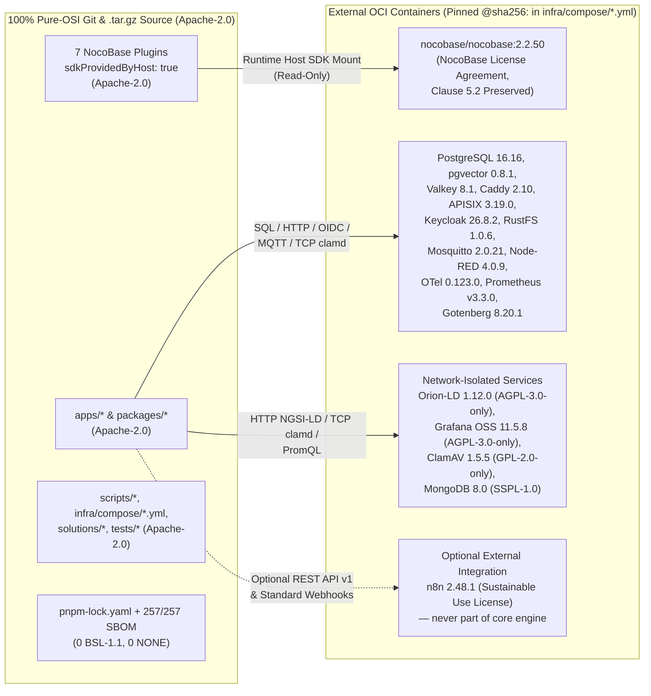

# Pure-OSI `Apache-2.0` Policy & OLP PMNM 2026 PoF Matrix

**LatticeDX `v0.4.2`** ("DX-OS Open-Core Championship Edition") is authored and distributed by **CTU-OpenPaw** under the **Apache License, Version 2.0 (`Apache-2.0`)**. Every file inside the official source repository ([`CTU-OpenPaw/lattice-dx`](https://github.com/CTU-OpenPaw/lattice-dx)) and the official source release archive (`latticedx-0.4.2-src.tar.gz`) is strictly **100% Pure-OSI open-source software**.

> **Pre-GA Version Lock:** LatticeDX operates strictly under `< 1.0.0` semantic versioning at **`0.4.2`**.

---

## 1. Pure-OSI License Purity Guarantee

From the `v0.3.0` architecture consolidation through **`v0.4.2`**, LatticeDX enforces a hard technical and legal boundary prohibiting proprietary or Business Source License (`BSL-1.1`) software from the codebase, dependency lockfiles, and container topologies:

1. **Zero `BSL-1.1`, Zero ThingsBoard, Zero EMQX:**
   - LatticeDX excludes ThingsBoard, EMQX, and any `BSL-1.1` / Business Source License component to eliminate commercial-use and redistribution restrictions.
   - This rule is enforced deterministically in code by [`scripts/generate-sbom.mjs`](https://github.com/CTU-OpenPaw/lattice-dx/blob/main/scripts/generate-sbom.mjs) (`BANNED_LICENSE_RE` and `BANNED_TECH_RE`), which fails CI immediately if any workspace package, npm dependency, or container image matches `BSL-1.1`, `Business Source License`, `thingsboard`, or `emqx`.
2. **Pure-OSI Source Tree (`Apache-2.0` + OSI Dependencies):**
   - All original first-party source code under `apps/`, `packages/`, `plugins/nocobase/`, `scripts/`, `infra/`, `solutions/`, `tests/`, and `.github/` is licensed under `Apache-2.0` with explicit `@copyright (C) 2026 CTU-OpenPaw` and `SPDX-License-Identifier: Apache-2.0` headers verified across **`1,098` files**.
   - The repository contains **zero** `upstream/nocobase/` source directories and **zero** `.gitmodules` files. See [NocoBase Clause 5.2 & Source Boundary](/en/oss/nocobase-clause-5-2).
3. **Pure-OSI Replacements Across Cache, IIoT, and Edge:**
   - **Cache & Pub/Sub:** **Valkey `8.1`** (`valkey/valkey:8.1-alpine`, `BSD-3-Clause`) provides Redis-protocol-compatible session caching, `PUBSUB_ADAPTER=redis` event streaming, and APISIX rate limiting without non-OSI Redis 8 licensing.
   - **IIoT MQTT Broker:** **Eclipse Mosquitto `2.0.21`** (`eclipse-mosquitto:2.0.21`, `EPL-2.0 OR BSD-3-Clause`) provides tenant-scoped Dynamic Security (`allow_anonymous false`, `$CONTROL/dynamic-security/v1`) and `BIRTH`/`DEATH` LWT monitoring.
   - **IIoT Edge & Time-Series:** **Node-RED `4.0.9`** (`nodered/node-red:4.0.9`, `Apache-2.0`) handles payload normalization and Digital Twin downlink commands, while IIoT time-series telemetry persists directly into **PostgreSQL `16.16`** / **`pgvector 0.8.1`** (`latticeTelemetryPoints`) — requiring **no** separate `timescaledb` container.

---

## 2. Repository vs. External OCI Container Boundary

External infrastructure services run strictly as **standalone OCI containers** defined in `infra/compose/*.yml` (all **19** images pinned by immutable `@sha256:` digests) and communicate with LatticeDX only over standard network protocols (SQL, HTTP/REST, OIDC, NGSI-LD, MQTT, TCP `clamd`). None of these external containers are copied, statically linked, or relicensed as `Apache-2.0` by LatticeDX.



### Complete External OCI Service Inventory (19 Pinned Images)

All 19 images below are synchronized 1-to-1 across `NOTICE`, `docs/third-party.md`, `infra/compose/*.yml`, and `docs/sbom-cyclonedx.json`:

| Service | OCI Image & Tag | License / SPDX | Boundary & Role |
| --- | --- | --- | --- |
| **PostgreSQL** | `postgres:16.16-alpine` | `PostgreSQL` | Core relational database (`core.yml`, `prod.yml`) |
| **pgvector (PG 16)** | `pgvector/pgvector:0.8.1-pg16` | `PostgreSQL` | HNSW vector search & IIoT `latticeTelemetryPoints` (`nocobase.yml`, `native-rehearsal.yml`, `prod.yml`) |
| **Valkey** | `valkey/valkey:8.1-alpine` | `BSD-3-Clause` | Pure-OSI Redis-compatible cache, pub/sub, and rate limiter (`nocobase.yml`, `prod.yml`) |
| **RustFS** | `rustfs/rustfs:1.0.6` | `Apache-2.0` | S3-compatible object storage (`prod.yml`) |
| **Caddy** | `caddy:2.10-alpine` | `Apache-2.0` | Zero-Trust TLS ingress & security headers (`prod.yml`) |
| **Keycloak** | `quay.io/keycloak/keycloak:26.8.2` | `Apache-2.0` | OIDC + PKCE Identity & Access Management (`core.yml`, `prod.yml`) |
| **keycloak-config-cli** | `adorsys/keycloak-config-cli:6.5.1-26` | `Apache-2.0` | Declarative Keycloak realm bootstrapper (`prod.yml`) |
| **Apache APISIX** | `apache/apisix:3.19.0-debian` | `Apache-2.0` | Zero-Trust API Gateway (`/api/*`, JWKS, rate-limit) (`core.yml`, `prod.yml`) |
| **Eclipse Mosquitto** | `eclipse-mosquitto:2.0.21` | `EPL-2.0 OR BSD-3-Clause` | Pure-OSI IIoT MQTT broker with Dynamic Security & LWT (`iiot.yml`, `prod.yml`) |
| **Node-RED** | `nodered/node-red:4.0.9` | `Apache-2.0` | IIoT payload normalization, LWT bridge, Twin downlink (`iiot.yml`, `prod.yml`) |
| **OTel Collector Contrib** | `otel/opentelemetry-collector-contrib:0.123.0` | `Apache-2.0` | OTLP/HTTP GenAI & system telemetry collector (`prod.yml`) |
| **Prometheus** | `prom/prometheus:v3.3.0` | `Apache-2.0` | Metrics scraper (`/api/dxos:metrics`) & alert evaluator (`prod.yml`) |
| **Gotenberg** | `gotenberg/gotenberg:8.20.1` | `MIT` | Optional headless PDF renderer (`prod.yml`, profile `pdf`) |
| **NocoBase Host** | `nocobase/nocobase:2.2.50` | `NocoBase License Agreement (2026-02-24; Apache-2.0 + Clauses 4.2, 5.1-5.4)` | External OCI host runtime outside Git/tarball (`nocobase.yml`, `native-rehearsal.yml`, `prod.yml`) |
| **FIWARE Orion-LD** | `fiware/orion-ld:1.12.0` | `AGPL-3.0-only` | Standalone NGSI-LD Context Broker over HTTP (`integration.yml`, `prod.yml`) |
| **MongoDB** | `mongo:8.0` | `SSPL-1.0` | Standalone backing database container for Orion-LD (`integration.yml`, `prod.yml`) |
| **Grafana OSS** | `grafana/grafana-oss:11.5.8` | `AGPL-3.0-only` | Standalone 360-degree observability dashboard (`prod.yml`, profile `observability`) |
| **ClamAV** | `clamav/clamav:1.5.5` | `GPL-2.0-only` | Standalone antivirus scanner daemon via TCP `clamd` (`core.yml`, `prod.yml`) |
| **n8n** *(optional)* | `n8nio/n8n:2.48.1` | `Sustainable Use License` | Optional standalone external integration container — never part of LatticeDX core engine (`integration.yml`, `prod.yml`) |

---

## 3. OLP PMNM 2026 50-Point PoF Matrix

The **Open-Source Readiness (PoF — 50 points)** criteria follow the [VFOSSA OLP PMNM 2026 rules](https://www.vfossa.vn/tin-tuc/the-le-olp-phan-mem-nguon-mo-nam-2026-760.html) and [problem specification](https://vfossa.vn/tin-tuc/de-thi-phan-mem-nguon-mo-olp-2026-798.html) (submission deadline: **17:00 on 2026-12-06**), verified on release **`v0.4.2`**:

| PoF Criterion (Points) | Verification Evidence on `v0.4.2` | Implementation Files & Docs | Automated Verification |
| --- | --- | --- | --- |
| **1. Public Repository (5 pts)** | Public GitHub repository `https://github.com/CTU-OpenPaw/lattice-dx` accessible unauthenticated, with full commit history, Issue templates, Contributing, Security policy, and Changelog. | `.github/ISSUE_TEMPLATE/bug_report.yml`, `feature_request.yml`, `config.yml`, `CONTRIBUTING.md`, `SECURITY.md`, `CHANGELOG.md` | `pnpm pof:check` (`governance-files`), unauthenticated URL & Releases check |
| **2. OSI-Approved License & Clause 5.2 (10 pts)** | Full `LICENSE` (`Apache-2.0`), `COPYRIGHT.txt`, `NOTICE`, `@copyright (C) 2026 CTU-OpenPaw` + `SPDX-License-Identifier: Apache-2.0` headers on 100% of first-party code (`1,098` files), zero `upstream/nocobase` or `.gitmodules`, host `nocobase/nocobase:2.2.50` external OCI only with Clause 5.2 attribution preserved, and **0 `BSL-1.1` / ThingsBoard / EMQX**. | `LICENSE`, `NOTICE`, `COPYRIGHT.txt`, `scripts/source-headers.mjs`, `plugins/nocobase/plugin-lattice-foundation/src/client/native-builder-navigation.js`, `docs/nocobase-source-review.md` | `node scripts/source-headers.mjs --check`, `pnpm pof:check` (`spdx-headers`, `plugin-isolation`, `upstream-clean`), `node --test scripts/tests/oss-pof-audit.test.mjs` |
| **3. Source Release Package (5 pts)** | Deterministic `git archive` tarball `latticedx-0.4.2-src.tar.gz` + `.sha256` checksum + `docs/sbom-cyclonedx.json` attached to GitHub Release `v0.4.2`; excludes `node_modules/`, `output/`, `.env`, `.git/`, `.gitmodules`, and `upstream/`. | `scripts/build-oss-release-tarball.mjs`, `package.json` (`release:tarball`) | `pnpm release:tarball --ref=v0.4.2`, `node --test scripts/tests/oss-pof-audit.test.mjs`, extract outside Git & run `pnpm pof:check` |
| **4. Build from Source & Clean Install (10 pts)** | Reproducible offline build from extracted `latticedx-0.4.2-src.tar.gz` (no `.git/`) using `Node 24.x` + `pnpm 10.23.0`: `pnpm install --frozen-lockfile`, `pnpm check`, 7 plugin `build.mjs` bundles, clean NocoBase `2.2.50` bootstrap (`pnpm native:clean`), blank-slate (`LATTICE_SKIP_DEMO_SEED=1`) & showcase seeding (`pnpm seed:v100-showcase`), and E2E acceptance suites. | `docs/build-from-source.md`, `scripts/native-clean-install.mjs`, `plugins/nocobase/*/build.mjs`, `docs/DEMO_PACK.md`, `docs/FINALS_15MIN_SCRIPT.md` | `pnpm check`, `node --test plugins/nocobase/*/tests/*.test.cjs scripts/tests/*.test.mjs tests/nocobase-externals.test.mjs`, `pnpm native:clean --port=13014 --blank-slate` |
| **5. Dependencies & CycloneDX 1.5 SBOM (10 pts)** | Locked `pnpm-lock.yaml`, `@sha256:` digests on all **19** Compose OCI images, per-plugin `LICENSE` + `README.md`, and deterministic CycloneDX 1.5 SBOM with **`257/257`** resolved licenses (`workspace=12, npm=226, oci=19`, `0 NONE`). | `docs/sbom-cyclonedx.json`, `scripts/generate-sbom.mjs`, `docs/third-party.md`, `docs/dependency-inventory.md`, `infra/compose/*.yml` | `pnpm release:sbom -- --check`, `node --test scripts/tests/generate-sbom.test.mjs`, `pnpm audit --prod --audit-level=low`, `pnpm pof:check` (`compose-digests`) |
| **6. Documentation & Communication (10 pts)** | Complete bilingual documentation, system report, 15-minute Finals script, 1-to-1 OLP 2026 architecture matrix, E2E testing guide, Contributing guide, and active GitHub Issues/PR history. | `README.md`, `README.en.md`, `docs/olp-2026-architecture-matrix.md`, `docs/system-report-and-guide.md`, `docs/FINALS_15MIN_SCRIPT.md`, `docs/E2E_TESTING_GUIDE_HUNG.md`, `CTU-OpenPaw/lattice-docs` | `pnpm pof:check`, `.github/workflows/ci.yml` & `codeql.yml` |

---

## 4. Automated PoF Verification (`pnpm pof:check` — `6/6 PASS`)

Running `pnpm pof:check` (`node scripts/verify-pof-readiness.mjs`) executes **6 deterministic checks** in both Git checkouts and extracted `.tar.gz` directories (no `.git/` required):

```sh
node scripts/source-headers.mjs --check
pnpm pof:check
node --test scripts/tests/oss-pof-audit.test.mjs
pnpm release:sbom -- --check
pnpm audit --prod --audit-level=low
```

| Check ID | Result | What It Verifies |
| --- | --- | --- |
| `spdx-headers` | `PASS` | Every human-authored first-party code file (`.ts`, `.tsx`, `.js`, `.jsx`, `.cjs`, `.mjs`, `.css`, `.sql`, `.yml`, `.yaml`, `.ps1`, `.sh`, `Dockerfile`) contains `SPDX-License-Identifier: Apache-2.0` (`1,098` files verified; ignores auto-generated `apps/web/next-env.d.ts`). |
| `governance-files` | `PASS` | All required governance files (`LICENSE`, `NOTICE`, `COPYRIGHT.txt`, `README.md`, `CHANGELOG.md`, `CONTRIBUTING.md`, `SECURITY.md`, `docs/build-from-source.md`, `docs/oss-pof-compliance.md`, `docs/third-party.md`, `.github/ISSUE_TEMPLATE/bug_report.yml`) are non-empty and free of stale legacy repo URLs. |
| `plugin-isolation` | `PASS` | Every plugin in `plugins/nocobase/*` declares `"license": "Apache-2.0"`, `"nocobase": { "sdkProvidedByHost": true }`, its own `LICENSE` and `README.md`, and `plugin-lattice-foundation/src/client/` preserves NocoBase Clause 5.2 attribution (`Powered by NocoBase` / `https://www.nocobase.com`). |
| `compose-digests` | `PASS` | Every `image:` line across `infra/compose/*.yml` is pinned with an immutable `@sha256:` 64-hex digest. |
| `upstream-clean` | `PASS` | Zero `.gitmodules` (root or nested) and zero `upstream/` or `upstream/nocobase/` entries exist in Git tracked files, untracked workspace files, or extracted archives. |
| `no-secrets` | `PASS` | Zero tracked `.env*` (excluding `.env.example`), `*.pem`, `*.key`, `sk-*`, `ghp_*`, `github_pat_*`, or private key blocks exist anywhere in the tree. |

### CI/CD Enforcement

Every push and Pull Request to `main` in `CTU-OpenPaw/lattice-dx` runs `.github/workflows/ci.yml` (4 jobs: `check`, `dependency-audit`, `compose-validate` across 9 Compose combinations, and `trivy-scan` for `CRITICAL`/`HIGH` vulnerabilities, misconfigurations, and secrets) alongside `.github/workflows/codeql.yml` (`javascript-typescript`, `security-extended`).

### Related Governance Pages

- [NocoBase `2.2.50` Clause 5.2 Attribution & Source Boundary](/en/oss/nocobase-clause-5-2)
- [CycloneDX 1.5 SBOM & Build from Source](/en/oss/sbom-and-build-from-source)
- [Contributing, Security Policy & Release Changelog](/en/oss/contributing-security-changelog)
