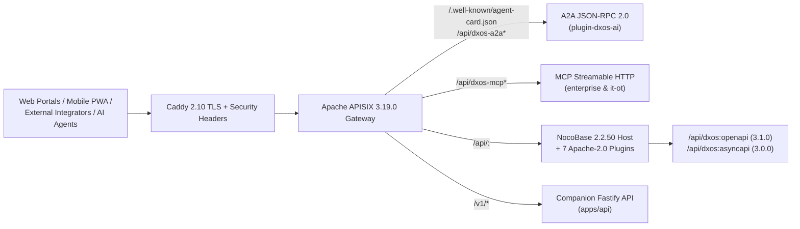

# API Contracts & Endpoint Reference

LatticeDX `0.4.2` exposes self-describing machine contracts (**OpenAPI 3.1.0** and **AsyncAPI 3.0.0**), NocoBase plugin resource actions (`/api/<resource>:<action>`), standardized AI agent protocols (**MCP** and **A2A**), and companion Fastify backend contracts (`/v1/*`).

## Gateway & Protocol Topology

## OpenAPI 3.1.0 & AsyncAPI 3.0.0 Endpoints

Implemented in `plugins/nocobase/plugin-lattice-foundation/src/server/observability.js` and `openapi-spec.js`:

| Endpoint | Method | Auth | Specification |
| --- | --- | --- | --- |
| `/api/dxos:openapi` | `GET` | Public | Live **OpenAPI 3.1.0** JSON specification (`bearerAuth` JWT/`ldx_pat_*` + `X-Lattice-API-Key` security schemes, core `API_OPERATIONS`, plus dynamically introspected `latticeCustom*` collection schemas and CRUD paths) |
| `/api/dxos:asyncapi` | `GET` | Public | Live **AsyncAPI 3.0.0** JSON specification describing 3 servers (`mqttBroker`, `httpGateway`, `redisPubSub`), 5 channels (`iotTelemetry`, `iotDownlinkCommand`, `surfaceEventsSse`, `redisSurfaceUpdates`, `contextOutboxWebhooks`), 5 operations, and 4 message schemas |
| `/api/dxos:health` | `GET` | Public | Platform health check (`status`, `version: "0.4.2"`, `uptimeSec`, `dbHealthy`, `otel` stats) |
| `/api/dxos:metrics` | `GET` | `DX_METRICS_TOKEN` or `root` / `ldx_admin` | Prometheus text exposition (`latticedx_http_requests_total`, latency histogram, outbox/event-bus/webhook/OTel gauges) |

## Companion Fastify Backend Contracts (`/v1/*`, `apps/api`)

Authoritative backend domain contracts in `apps/api` (indexed in `docs/backend-api-index.md` and `docs/studio-context-api.openapi.json`):

| Capability | Main API Family |
| --- | --- |
| Typed schema and entity lifecycle | `/v1/entity-schemas`, `/v1/entities` |
| Person / department grants | `/v1/entities/:id/shares` |
| Frozen reports with current source access | `/v1/entity-report-snapshots/*` |
| Full-text entity search | `/v1/entities/search` |
| Exact scoped aggregates | `/v1/entities/aggregate` |
| Typed query and API data blocks | `/v1/entities/query`, `/v1/blocks` |
| Contextual documents and batch data | `/v1/entities/:id/attachments`, `/v1/entity-imports/*`, `/v1/entities/export` |
| Task lifecycle and department queues | `/v1/tasks`, `/v1/task-queues` |
| Workflow authoring and publication | `/v1/workflow-drafts`, `/v1/workflow-definitions` |
| Workflow execution, waiting, cancellation | `/v1/workflows`, `/v1/workflow-waits` |
| Business entity / workflow context | `/v1/entities/:id/workflows`, `/v1/workflows/:id/entity-context` |
| Private projection, calculation, assertions | `/v1/workflow-blocks` |
| Committed-event automations | `/v1/entity-automations/*` |
| Committed business data events | `/v1/entities/:id/events` |
| Durable designated-service timers | `/v1/workflow-services`, `/v1/workflows/:id/timers` |
| Organization metadata & directory snapshot | `/v1/organization/*` |
| Signed ingress and subscriptions | `/v1/workflow-events`, `/v1/workflow-event-subscriptions` |
| Incident rules, proposals & durable agent jobs | `/v1/agent-jobs`, `/v1/workflows`, `/v1/entities?schemaId=incident-rule` |
| Portable workflow bundles | `/v1/workflow-bundles/*` |
| Declarative business bindings | `/v1/enterprise-modules/:id/versions/:version/bindings/:bindingId/start` |
| Versioned enterprise modules | `/v1/enterprise-modules/*` |
| Readiness, diagnostics & retention preview | `/health`, `/ready`, `/v1/operations/*` |
| Process telemetry & tenant queue diagnostics | `/v1/operations/metrics`, `/v1/operations/queues` |

### Shared `/v1/*` Request Rules

- **Token Authority**: Send a verified Bearer token to the gateway; actor, organization, and roles are extracted strictly from the verified token—never trust actor/org fields in payloads.
- **Idempotency & Optimistic Concurrency**: Mutating commands require `Idempotency-Key` and expected version/revision; stale versions return `409`.
- **Pagination & Diagnostics**: Always follow `page.hasMore` and `page.nextOffset` (default 100-row pages). Use `X-Request-Id` for correlation (`401` auth failed, `403` permission denied, `404` invisible/missing, `409` conflict, `503` capability unavailable).

## NocoBase Resource & Action Index (`/api/<resource>:<action>`)

All resource actions registered by the 7 Apache-2.0 plugins (`0.4.2`):

| Plugin | Resource | Verified Actions |
| --- | --- | --- |
| `@latticedx/plugin-action-bridge` | `dxActions` | `connect`, `callback` (public), `status`, `catalog`, `list`, `run`, `files`, `workflow`, `studio`, `entity`, `agent`, `logistics`, `disconnect` |
| `@latticedx/plugin-enterprise-auth` | `enterpriseAuth` | `start` (public), `callback` (public), `finish` (public/bound), `backchannelLogout` (public/signed JWT), `configuration` (`root`), `link` (`root`), `listLinkTargets` (`root`), `listMappings` (`root`), `unlink` (`root`) |
| `@latticedx/plugin-lattice-foundation` | `dxos` | `health` (public), `metrics` (token/admin), `openapi` (public), `asyncapi` (public), `manifest` (public), `sw.js` (public), `sw` (public), `icon-192.png` (public), `icon-512.png` (public) |
| `@latticedx/plugin-lattice-foundation` | `dxosApiKeys` | `issue`, `list`, `revoke` |
| `@latticedx/plugin-lattice-foundation` | `dxosLedger` | `publicKey`, `entries`, `status`, `verify`, `signDocument`, `verifySignature`, `rotateKey`, `exportProof` |
| `@latticedx/plugin-lattice-foundation` | `dxosDataGov` | `tierSummary`, `freezeSnapshot`, `listSnapshots`, `getSnapshot`, `lineageTrace`, `lineage`, `quarantineList`, `listQuarantine`, `quarantineResolve`, `resolveQuarantine`, `computeMkt` |
| `@latticedx/plugin-lattice-foundation` | `dxosVault` | `list`, `save`, `rotateSecret`, `delete`, `testConnection`, `appCatalog`, `oauthStart`, `oauthCallback` |
| `@latticedx/plugin-lattice-foundation` | `dxosEvents` | `listEvents`, `publish`, `listSubscriptions`, `saveSubscription`, `toggleSubscription`, `deleteSubscription`, `listDeliveries`, `dispatchNow`, `replayDlq`, `resetCircuit` |
| `@latticedx/plugin-lattice-foundation` | `dxosApprovals` | `listInbox`, `decide`, `request`, `cancel`, `listPolicies`, `savePolicy`, `deletePolicy`, `evaluateSlaNow` |
| `@latticedx/plugin-lattice-foundation` | `dxosNotify` | `send`, `testSend`, `logs`, `channels` |
| `@latticedx/plugin-lattice-foundation` | `dxosForms` | `meta` (public), `submit` (public), `status` (public), `list`, `get`, `save`, `delete`, `rotateToken`, `listSubmissions`, `downloadAttachment` |
| `@latticedx/plugin-lattice-foundation` | `latticeVoucher` | `submit`, `cancel`, `amend`, `lineage` |
| `@latticedx/plugin-lattice-foundation` | `latticeNotifications` | `listMine`, `unreadCount`, `markRead`, `markAllRead` |
| `@latticedx/plugin-lattice-foundation` | `latticeSla` | `summary`, `policies`, `savePolicy`, `evaluateNow` |
| `@latticedx/plugin-lattice-foundation` | `latticeRecordChatter` | `list`, `post` |
| `@latticedx/plugin-lattice-foundation` | `latticePortals` | `list`, `listAccessible`, `save`, `destroy`, `exportBlueprint` |
| `@latticedx/plugin-lattice-foundation` | `latticeApps` | `list`, `get` |
| `@latticedx/plugin-lattice-foundation` | `latticeNative` | `context` |
| `@latticedx/plugin-lattice-foundation` | `latticeContextSync` | `dispatch` (`root`), `status` (`root`), `retry` (`root`) |
| `@latticedx/plugin-lattice-foundation` | `latticeIntegrations` | `receive`, `receiveAlert`, `record`, `context`, `proposals`, `propose`, `proposalReceipt` |
| `@latticedx/plugin-lattice-foundation` | `latticeRequestAttachments` | `list`, `upload`, `download` |
| `@latticedx/plugin-dxos-para` | `latticePara` | `summary`, `hybridSearch`, `reindex`, `extractAttachment`, `extractFormFields`, `indexHealth` |
| `@latticedx/plugin-dxos-blocks` | `dxosBlocks` | `proposals`, `decideProposal`, `contextTelemetry`, `telemetrySeries`, `telemetryIngest` (public/edge), `alarmIngest`, `alarmAck`, `alarmClear`, `exportReport`, `globalSearch`, `twinShadow`, `twinSetDesired`, `twinAckCommand` (public/edge), `bulkImportDryRun`, `bulkImportCommit`, `collectionsMeta`, `aggregateQuery` |
| `@latticedx/plugin-dxos-blocks` | `dxosBroker` | `listDevices`, `provisionDevice`, `revokeDevice`, `deviceStatusIngest` (public/edge), `orionEntities`, `orionListSubscriptions`, `orionCreateSubscription`, `orionToggleSubscription`, `orionDeleteSubscription`, `orionNotify` (public/webhook) |
| `@latticedx/plugin-dxos-studio` | `dxosStudio` | `listTemplates`, `listEmployees`, `installWorkflow`, `composePortals`, `pluginStatus`, `readiness`, `outboxDlqList`, `outboxDlqPurge`, `outboxDlqReplay`, `solutionBundleExport`, `solutionBundleDiff`, `solutionBundleImport`, `solutionBundleRollback`, `listAutomationRules`, `seedShowcaseData` |
| `@latticedx/plugin-dxos-studio` | `dxosWms` | `orderLines`, `saveOrderLine`, `receiveStock`, `lots`, `allocateFefo`, `issueStock`, `holdLotByMkt`, `releaseLotByQa`, `epodCapture`, `publicTrack` (public), `verifyTrackSignature` (public), `printVoucher` |
| `@latticedx/plugin-dxos-studio` | `dxosDmn` | `listTables`, `saveTable`, `evaluate` |
| `@latticedx/plugin-dxos-studio` | `dxosDelegations` | `list`, `create`, `revoke`, `activeForUser` |
| `@latticedx/plugin-dxos-studio` | `dxosAutomations` | `listRules`, `saveRule`, `saveDraft`, `publishRule`, `listRuleVersions`, `rollbackRuleVersion`, `toggleRule`, `deleteRule`, `testRule`, `runNow`, `listRuns`, `getRunTrace`, `replayRun`, `builderCatalog`, `aiAssist`, `nodeRegistry`, `testNode`, `resumeRun`, `webhookIngress` (public/token) |
| `@latticedx/plugin-dxos-studio` | `dxosBuilder` | `listDomains`, `createDomain`, `listBusinessPacks`, `installBusinessPack`, `listTenants`, `provisionTenant` |
| `@latticedx/plugin-dxos-studio` | `dxosN8n` | `status`, `appCatalog`, `workflows`, `getWorkflow`, `createWorkflow`, `updateWorkflow`, `activateWorkflow`, `executions`, `retryExecution`, `syncCredential` |
| `@latticedx/plugin-dxos-ai` | `dxosAi` | 41 actions covering AI profiles (`listProfiles`, `saveProfile`, `deleteProfile`, `bootstrapDefaults`, `portalAgents`), governance & traces (`auditLogs`, `quotaSummary`, `saveQuotaPolicy`, `listAgentTraces`, `getAgentTraceDetail`), MCP & topology (`mcpCatalog`, `testMcpEndpoint`, `enterpriseTopology`), UI Time-Machine (`pageSurfaceState`, `surfaceEvents`, `inspectPageBlocks`, `rollbackPageSnapshot`), HITL (`listApprovals`, `triageScan`, `approveAction`, `rejectAction`), LLM health (`checkLlmHealth`, `quickConnectLlm`, `listLlmServices`, `deleteLlmService`, `switchLlmServiceModel`), App Builder 2.0 (`listBuiltApps`, `planBuiltApp`, `buildBuiltApp`, `patchBuiltApp`, `rollbackBuiltApp`, `rebuildBuiltApp`, `listBuiltAppVersions`, `exportBuiltAppBundle`, `teardownBuiltApp`), Persistent Memory (`listMemories`, `rememberFact`, `recallMemories`, `forgetMemory`), and Eval Lab (`listEvalSuites`, `runEvalBenchmark`) |

## Model Context Protocol (MCP) & Agent-to-Agent (A2A) Endpoints

### MCP Streamable HTTP JSON-RPC 2.0 (`mcp-gateway.js`)

- **Endpoints**:
  - `POST /api/dxos-mcp` (`latticedx-enterprise-mcp` — 20 Unified AI Tools filtered by caller RBAC).
  - `POST /api/dxos-mcp/it-ot` (`latticedx-itot-mcp` — IT/OT telemetry, twin, and workflow tools).
- **Authentication**: Requires Bearer JWT or `ldx_pat_*` token with the `ai` scope (`GET`/`DELETE` return `405`).
- **Protocol Versions**: `2025-03-26`, `2024-11-05`.
- **JSON-RPC Methods**: `initialize`, `notifications/initialized`, `ping`, `tools/list`, `tools/call`, `prompts/list`, `prompts/get`, `resources/templates/list`, `resources/list`, `resources/read`.
- **Prompts (`4`)**: `dxos-cold-chain-incident-triage`, `dxos-fefo-dispatch-audit`, `dxos-executive-radar-brief`, `dxos-system-blueprint-architect` (`adminOnly: true`).
- **Resource URIs**:
  - `dxos://org/<organizationId>/alarms/active`
  - `dxos://org/<organizationId>/lineage/<collection>/<recordId>`
  - `dxos://topology/planes` and `dxos://itot/health` (Admin-only).

### A2A Protocol (`a2a-gateway.js`)

- **Discovery Agent Cards**: `GET /.well-known/agent-card.json` and `GET /api/dxos-a2a/agent-card.json`.
- **JSON-RPC 2.0 Endpoint**: `POST /api/dxos-a2a` supporting `tasks/send`, `tasks/get`, and `tasks/cancel`.
- **7 Starter Agents**: `dxos-coordinator`, `dxos-architect` (`adminOnly`), `dxos-ops`, `dxos-logistics`, `dxos-workspace`, `dxos-operator`, `dxos-analyst`.
- **Task Lifecycle States**: `submitted`, `working`, `input-required`, `completed`, `failed`, `canceled`.

## Related Documentation

- [Multi-Tenant PostgreSQL 16 RLS](/en/security/multi-tenant-rls)
- [PKI, Crypto Ledger & Scoped PaaS API Keys](/en/security/pki-ledger-api-keys)
- [OIDC/PKCE Authentication & Hardening](/en/security/auth-oidc-hardening)
