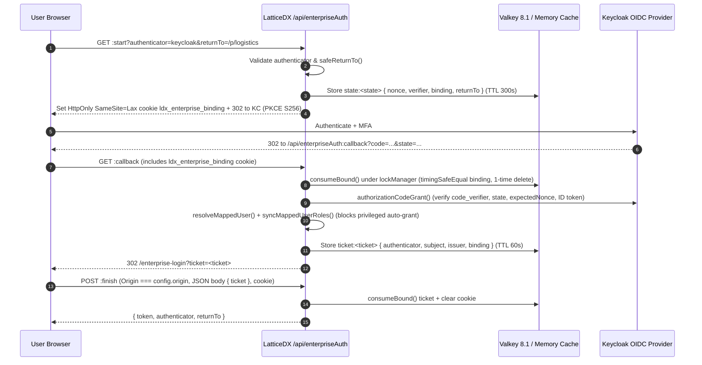

# OIDC/PKCE Authentication & Security Hardening

LatticeDX `0.4.2` pairs standards-compliant enterprise SSO (`@latticedx/plugin-enterprise-auth`) with defense-in-depth protections against SSRF, SVG/XSS payloads, prototype pollution, and AI prompt injection.

## Keycloak OIDC / PKCE S256 (`@latticedx/plugin-enterprise-auth`)

`@latticedx/plugin-enterprise-auth` (`0.4.2`) uses **Pure-OSI MIT** cryptographic and OIDC libraries (`openid-client@6.8.9`, `jose@6.2.15`, `oauth4webapi@3.8.8`) to bridge Keycloak identities into native NocoBase sessions without auto-provisioning privileged accounts.



### 9 `enterpriseAuth` Resource Actions

| Action | Method | Access | Security Controls |
| --- | --- | --- | --- |
| `/api/enterpriseAuth:start` | `GET` | Public | Validates enabled `lattice-keycloak` authenticator, generates 32-byte `state`/`nonce`/`binding`, PKCE S256 (`code_challenge_method=S256`), `safeReturnTo` path check |
| `/api/enterpriseAuth:callback` | `GET` | Public | Atomic `consumeBound()` with `app.lockManager`, exchanges authorization code, verifies `sub`+`iss` mapping in `usersAuthenticators` and active `latticeEmployees`, syncs safe `ldx_*` roles, issues 60s one-time `ticket` |
| `/api/enterpriseAuth:finish` | `POST` | Public (Bound) | Enforces `Origin === config().origin`, `application/json`, `consumeBound()` on `ticket` + `ldx_enterprise_binding` cookie, mints native NocoBase JWT |
| `/api/enterpriseAuth:backchannelLogout` | `POST` | Public (Signed JWT) | Verifies `logout_token` signature (`RS256/384/512`, `PS256`, `ES256/384/512`) against Keycloak JWKS + validates `iss`, `aud`, `jti`, `iat`, `events`, absence of `nonce`, populates revocation cache |
| `/api/enterpriseAuth:configuration` | `GET` | `root` | Returns `configured`, `issuer`, `clientId`, `callback`, and sanitized diagnostics |
| `/api/enterpriseAuth:link` | `POST` | `root` | Explicitly links `(authenticator, subject, issuer)` to a verified `users` + active `latticeEmployees` row under exclusive lock (`409` on conflict) |
| `/api/enterpriseAuth:listLinkTargets` | `GET` | `root` | Lists `lattice-keycloak` authenticators, users, and active organization memberships |
| `/api/enterpriseAuth:listMappings` | `GET` | `root` | Lists current `usersAuthenticators` OIDC identity mappings |
| `/api/enterpriseAuth:unlink` | `POST` | `root` | Removes mapping and marks `revoked:<userId>` in session revocation cache for 24h |

### Hardening Invariants in `plugin-enterprise-auth`

- **Transport & URL Policy**: `deploymentConfig()` requires `https:` for both `DX_NATIVE_AUTH_ISSUER` and `DX_NATIVE_AUTH_ORIGIN` (`http:` is allowed strictly for loopback `localhost`, `127.0.0.1`, `[::1]`). Docker-internal backchannel discovery (`DX_NATIVE_AUTH_INTERNAL_ISSUER`) is locked strictly to `http://keycloak:8080` with `redirect: 'error'` and 10s timeouts.
- **Open-Redirect Prevention**: `safeReturnTo()` only permits relative paths matching `^\/(?:admin|p|mobile|v\/mobile)(?:[/?]|$)` with zero backslashes, control characters, `%`, or `..`, falling back to `/admin`.
- **Group-to-Role Privilege Guard**: `syncMappedUserRoles()` parses `DX_NATIVE_AUTH_GROUP_ROLE_MAP` but enforces `SAFE_LDX_ROLE_RE` (`^ldx_[a-z][a-z0-9_]{1,40}$`) and `isPrivilegedRole()`, refusing to auto-grant `ldx_admin` or any role with `allowConfigure: true` or `pm.*` snippets.
- **Backchannel Logout & Revocation Guard**: `createRevocationGuard(cache)` (backed by Valkey 8.1 Redis or in-memory store) rejects any bearer JWT whose `iat` precedes `revoked:<userId>` or whose `sid` appears in `revoked_sid:<sid>` with HTTP `401`.
- **Response Headers**: All auth actions set `Cache-Control: no-store` and `Referrer-Policy: no-referrer`.

## Edge & Transport Security Headers

- **Caddy Edge (`infra/config/caddy/Caddyfile`)**: Injects `Strict-Transport-Security "max-age=63072000; includeSubDomains; preload"`, `X-Content-Type-Options "nosniff"`, `X-Frame-Options "SAMEORIGIN"`, `Referrer-Policy "strict-origin-when-cross-origin"`, `Permissions-Policy "camera=(self), microphone=(), geolocation=(self)"`, and strips `-Server`.
- **API Middleware (`observability.js`)**: Enforces `X-Content-Type-Options: nosniff`, `X-Frame-Options: SAMEORIGIN`, `Referrer-Policy: strict-origin-when-cross-origin`, and strict CORS (`DX_CORS_STRICT=true`) that strips reflected `Access-Control-Allow-*` headers for untrusted origins.

## SSRF Protection (Sync + Async DNS Rebinding Guards)

Outbound HTTP, webhook, MQTT, SMTP, and OAuth2 requests in `connector-vault.js`, `notification-center.js`, `omnichannel-notify.js`, and `ai-builder-security.js` enforce multi-stage SSRF validation:

1. **Protocol & Credential Lock**: Only `http:` / `https:` (plus `mqtt:` / `mqtts:` for MQTT and `smtp:` / `smtps:` for SMTP connectors) are allowed. Embedded `username:password@` in URLs, whitespace, control chars, and URLs `> 2048` chars are rejected (`CONNECTOR_URL_UNSAFE`).
2. **Non-Canonical IP Normalization Blocking**: Rejects integer (`2130706433`), hexadecimal (`0x7f000001`), octal (`0177.0.0.1`), and short-form IPv4 notations (`isNonCanonicalNumericHost`).
3. **Private IPv4 & IPv6 Range Blocking**:
   - IPv4: `0.0.0.0/8`, `10.0.0.0/8`, `127.0.0.0/8`, `169.254.0.0/16` (link-local/cloud metadata), `172.16.0.0/12`, `192.168.0.0/16`, `100.64.0.0/10` (CGNAT).
   - IPv6: `::`, `::1`, IPv4-mapped `::ffff:0:0/96`, IPv4-compatible `::/96`, IPv4-translated `::ffff:0:0:0/96`, NAT64 `64:ff9b::/96` & `64:ff9b:1::/48`, 6to4 `2002::/16`, link-local `fe80::/10`, ULA `fc00::/7` (including `fd00:ec2::254`), multicast `ff00::/8`, zone IDs (`%`).
4. **Cloud Metadata & Internal Hostname Blocking**: Unconditionally blocks `169.254.*`, `fd00:ec2::254`, `metadata.google.internal`, `metadata.azure.com`, `metadata.aws.internal`, `instance-data`, `localhost`, `*.local`, and `*.internal` (even if `allowInternal=true`). Docker-compose service hostnames (`n8n`, `orion-ld`, `nodered`, `mosquitto`) are permitted only when explicitly allowlisted and permitted by `resolveAllowInternalConnectorHosts()`.
5. **DNS Rebinding Protection (`assertSafeConnectorUrlAsync`)**: Resolves all `A`/`AAAA` records via `dns.promises.lookup(bare, { all: true })` immediately prior to connection and rejects the request if **any** resolved IP fails `isBlockedIpAddress()`.

## SVG / XSS & Content Security Policy Defenses

- **Strict Nonce-Based CSP on Public Portals (`/v/form/:slug`, `/v/track/:code`)**:
  `public-form-html.js` and `public-track-html.js` generate a per-response cryptographic nonce and emit:
  ```http
  Content-Security-Policy: default-src 'none'; script-src 'nonce-<nonce>'; style-src 'nonce-<nonce>'; img-src data:; connect-src 'self'; form-action 'self'; base-uri 'none'; frame-ancestors 'self'
  ```
  All interpolated metadata passes through `escapeHtml()`, and embedded JSON bootstrap blocks pass through `serializeSafeJsonForScript()` (escaping `<`, `>`, `&`, U+2028, U+2029).
- **SVG Upload & Data-URL Rejection**:
  - `wms-engine.js` (`isSafeRasterImageDataUrl`): ePOD photo captures enforce `MAX_EPOD_PHOTO_BYTES = 524,288` (512 KiB) and explicitly block `data:image/svg+xml` (`SAFE_RASTER_DATA_URL_RE` permits only `png`, `jpeg`, `jpg`, `webp`, `gif`).
  - `public-forms.js`: File uploads are capped at `2 MB`, restricted to `application/pdf`, `image/png`, `image/jpeg`, `image/webp`, and `text/plain`, and inspected with magic-byte / header checks that reject `<svg`, `<script`, `<html`, `<iframe`, `<object`, `<embed`, `<!doctype`, `<?xml`, and `<!--`.
- **Zero `dangerouslySetInnerHTML` in React UI**: Client UI components (`plugin-dxos-blocks`, `plugin-dxos-ai`) render Markdown via `renderSafeMarkdown()`, neutralizing `javascript:`, `vbscript:`, `data:text/html`, and protocol-relative `//` links.

## Prototype Pollution Defenses

Across `pg-rls.js`, `native-scope.js`, `public-forms.js`, `connector-vault.js`, `ai-builder-security.js`, and `a2a-gateway.js`, object traversal and payload sanitization enforce:

- Explicit rejection of `__proto__`, `constructor`, and `prototype` keys (`PROTO_POLLUTION_KEYS` / `FORBIDDEN_AUTOMATION_KEYS`) in filters, `values`, JSON schemas, secrets objects, and `Object.getOwnPropertyNames()` deep scans (`hasForbiddenProtoKeys`).
- Safe template evaluation in LatticeFlow v2 (`hasUnsafeAutomationTemplate` & `getSafePathLocal`): permits only simple dot-paths matching `^[a-zA-Z0-9_.\-$]+$` inside <code v-pre>{{...}}</code> delimiters, blocking backticks, `${...}`, `process.env`, `globalThis`, `eval(`, `Function(`, `require(`, and `child_process`.

## Prompt-Injection, PII Redaction & 30 `security-refusal` Eval Cases

LatticeDX `0.4.2` protects AI agents, MCP/A2A endpoints, and Flow Architect tools (`ai-builder-security.js`, `ai-tools-core.js`, `otel-exporter.js`) through:

- **Deterministic Adversarial Pattern & Table Guards**: `assertSafeAutomationInput()` strips Vietnamese diacritics (`stripDiacriticsSimple`) and blocks prompt-injection phrases (`ignore previous`, `bo qua huong dan`, `system prompt`, `jailbreak`, `bypass rbac/acl/auth/hitl`, `drop table`, `union select`, `.env`, `secret_key`, `private_key`) as well as references to sensitive system tables (`users`, `rolesUsers`, `apiKeys`, `authenticators`, `latticePkiKeys`, `latticeCryptoLedger`, `latticeConnectors`, `latticeApiKeys`, `latticeAiAuditLogs`, etc.).
- **Strict Tool RBAC Split**: Only 6 operational tools and 3 memory tools are visible to standard roles; the 11 structural/admin builder tools (`adminOnly: true`) require verified Studio Admin privileges and are omitted from `tools/list` and `tools/call` for non-admin callers.
- **PII & Secret Redaction (`otel-exporter.js`, `ai-governance.js`)**: Automatically masks JWTs, `Bearer` tokens, `sk-*` keys, `ldx_pat_*` tokens, emails, Vietnamese CCCD/CMND (`9..12` digits), Vietnamese phone numbers (`+84`/`0` + `3|5|7|8|9` + 8 digits), bank accounts (`STK`), and tax IDs (`MST`) before telemetry/audit persistence.
- **Automated Security Benchmark (`30` `security-refusal` cases)**: `scripts/eval-vietnamese-nl-agent.mjs` includes **30 dedicated `security-refusal` cases** (within the 163-case Vietnamese NL evaluation suite, `163/163` passing) covering prompt injection, secret/`.env`/JWT exfiltration, SQL injection (`DROP TABLE` / `UNION SELECT`), unauthorized privilege escalation (`root` / role creation), HITL/RBAC bypass, and SSRF webhook targeting (`http://169.254.169.254/...`).

```bash
# Run the full 163-case Vietnamese NL & 30-case security-refusal benchmark
node scripts/eval-vietnamese-nl-agent.mjs --min-pass=95
```

## Related Documentation

- [Multi-Tenant PostgreSQL 16 RLS](/en/security/multi-tenant-rls)
- [PKI, Crypto Ledger & Scoped PaaS API Keys](/en/security/pki-ledger-api-keys)
- [API Contracts & Endpoint Reference](/en/security/api-contracts)
