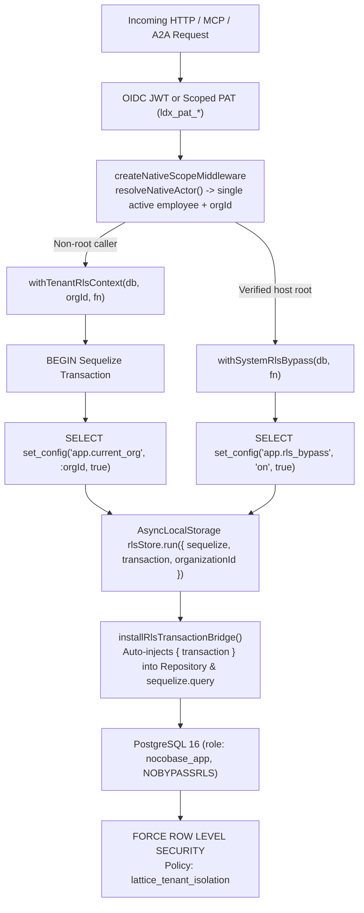

# Multi-Tenant PostgreSQL 16 Row-Level Security (RLS)

LatticeDX `0.4.2` enforces hard database-level multi-tenant isolation in PostgreSQL 16 (`pgvector/pgvector:0.8.1-pg16`) using **`ENABLE` + `FORCE ROW LEVEL SECURITY`**, a non-superuser runtime role (`nocobase_app`), and an `AsyncLocalStorage` transaction bridge that binds every query in a request lifecycle to a verified tenant organization.

Application-layer `WHERE organizationId = ...` filters (`createNativeScopeMiddleware`) act as the first line of defense, while PostgreSQL RLS ensures that even raw SQL queries, Sequelize repositories, or custom plugin handlers cannot read or mutate another organization's rows.

## Isolation Architecture



## Non-Superuser Database Role (`nocobase_app`)

In PostgreSQL, table owners and roles with `SUPERUSER` or `BYPASSRLS` silently bypass standard row-level security unless `FORCE ROW LEVEL SECURITY` is enabled—and `SUPERUSER` bypasses even `FORCE ROW LEVEL SECURITY`.

During database bootstrap (`infra/config/postgres/init-nocobase-db.sh`), LatticeDX provisions the application runtime role from `NOCOBASE_APP_DB_USER` (default `nocobase_app`) with strict non-privileged attributes:

```sql
CREATE ROLE nocobase_app LOGIN PASSWORD '<app_pw>'
  NOSUPERUSER NOCREATEDB NOCREATEROLE NOINHERIT NOBYPASSRLS;
```

Key invariants enforced by the init script and compose security tests:

- `NOCOBASE_APP_DB_USER` **must differ** from `POSTGRES_USER`; otherwise initialization aborts immediately because superuser connections bypass `FORCE ROW LEVEL SECURITY`.
- `PUBLIC` privileges on the target database and `public` schema `CREATE` rights are revoked and granted explicitly to `nocobase_app`.
- All tenant tables have both `ENABLE ROW LEVEL SECURITY` and `FORCE ROW LEVEL SECURITY` applied so even `nocobase_app` (as table owner) is subject to `lattice_tenant_isolation`.

## The `lattice_tenant_isolation` Policy

Implemented in `plugins/nocobase/plugin-lattice-foundation/src/server/pg-rls.js` (`buildRlsPolicySql`), every tenant-scoped table receives an identical permissive policy for `ALL` commands (`SELECT`, `INSERT`, `UPDATE`, `DELETE`) targeting `PUBLIC`:

```sql
ALTER TABLE "public"."<tableName>" ENABLE ROW LEVEL SECURITY;
ALTER TABLE "public"."<tableName>" FORCE ROW LEVEL SECURITY;

DROP POLICY IF EXISTS lattice_tenant_isolation ON "public"."<tableName>";

CREATE POLICY lattice_tenant_isolation
  ON "public"."<tableName>"
  AS PERMISSIVE
  FOR ALL
  TO PUBLIC
  USING (
    current_setting('app.rls_bypass', true) = 'on'
    OR current_setting('app.current_org', true) = '*'
    OR "<orgColumn>" = nullif(current_setting('app.current_org', true), '')
  )
  WITH CHECK (
    current_setting('app.rls_bypass', true) = 'on'
    OR current_setting('app.current_org', true) = '*'
    OR "<orgColumn>" = nullif(current_setting('app.current_org', true), '')
  );
```

### Fail-Closed GUC Semantics

- Both `set_config('app.current_org', :orgId, true)` and `set_config('app.rls_bypass', 'on', true)` pass `is_local = true`, scoping the PostgreSQL GUC strictly to the current transaction. When the transaction commits or rolls back—even with connection pooling—the setting automatically resets.
- If `app.current_org` is unset or empty (`''`), `nullif(current_setting('app.current_org', true), '')` evaluates to `NULL`. Because `col = NULL` yields `UNKNOWN` in SQL, unauthenticated or un-scoped queries **fail closed** and return zero rows.
- `assertValidOrganizationId()` enforces `ORG_ID_RE` (`/^[a-zA-Z0-9_-]{1,80}$/`) and rejects `'all'` as well as prototype-pollution keys (`__proto__`, `constructor`, `prototype`).
- Dynamic SQL table/column identifiers pass through `assertSafeSqlIdentifier()` (`/^[A-Za-z_][A-Za-z0-9_]*$/`) before quoting.

## 56 Static `FORCE RLS` Tables + Dynamic `latticeCustom*`

`TENANT_RLS_TABLES` in `pg-rls.js` protects **56 static tables**: **54** camelCase collections keyed by `"organizationId"` and **2** snake_case attachment/upload tables keyed by `"organization_id"`.

| Domain | Tables (`organizationId` unless noted) | Count |
| --- | --- | --- |
| **Core Directory & Work** | `latticeRequests`, `latticeOrders`, `latticeAssets`, `latticeEmployees`, `latticeDepartments`, `latticeLocations`, `latticeServiceTickets`, `latticeRecordChatter`, `latticeNotifications`, `latticeSlaPolicies` | 10 |
| **Attachments & Uploads (`organization_id`)** | `lattice_native_request_attachments`, `lattice_native_request_uploads` | 2 |
| **OMS / WMS / FEFO / ePOD** | `latticeOrderLines`, `latticeStockLots`, `latticeEpodRecords` | 3 |
| **Incidents, IoT & Digital Twin** | `latticeIncidentCases`, `latticeIncidentRules`, `latticeAgentProposals`, `latticeTelemetryPoints`, `latticeTwinShadows`, `latticeIotDevices`, `latticeBrokerSubscriptions` | 7 |
| **LatticeFlow v2, DMN & Approvals** | `latticeDecisionTables`, `latticeDelegations`, `latticeAutomationRules`, `latticeAutomationRuns`, `latticeAutomationRuleVersions`, `latticeApprovalPolicies`, `latticeApprovalRequests`, `latticePublicForms`, `latticePublicFormSubmissions` | 9 |
| **AI Workforce, RAG, MCP & A2A** | `latticeParaDocuments`, `latticeParaChunks`, `latticeAiProfiles`, `latticeAiAuditLogs`, `latticeAiQuotaUsage`, `latticeAiQuotaPolicies`, `latticeAiApprovalQueue`, `latticeAiMemory`, `latticeAiTraces`, `latticeA2aTasks`, `latticeBuiltApps`, `latticeUiSnapshots` | 12 |
| **Connectors, Events & Outbox** | `latticeContextOutbox`, `latticeIntegrationInbox`, `latticeConnectors`, `latticeEventBus`, `latticeWebhookSubscriptions`, `latticeWebhookDeliveries`, `latticeNotificationDeliveries` | 7 |
| **Security, PKI & Data Governance** | `latticeApiKeys`, `latticePkiKeys`, `latticeCryptoLedger`, `latticeFrozenSnapshots`, `latticeDataLineage`, `latticeDataQuarantine` | 6 |
| **Total Static Tables** | — | **56** |

### Dynamic `latticeCustom*` Domain Tables

When an administrator creates custom business entities via `/api/dxosBuilder:createDomain` (or `dxos_extend_collection_schema` / App Builder 2.0), tables matching `^latticeCustom[A-Za-z0-9_]*$` are automatically protected:

- `discoverTenantRlsTables(db)` scans `information_schema.columns` in `public` for `organizationId` / `organization_id` on `lattice%` tables matching either `TENANT_RLS_TABLE_SET` or `CUSTOM_RLS_TABLE_RE`.
- `attachRlsPolicyToTable(db, tableName)` applies `ENABLE ROW LEVEL SECURITY`, `FORCE ROW LEVEL SECURITY`, and `CREATE POLICY lattice_tenant_isolation` inside the provisioning transaction.
- Migrations `20261123000600-postgresql-rls-policies.js`, `20261127000100-force-rls-and-oauth2-connectors.js`, `20261202000300-public-forms-rls.js`, and `20261203000100-snake-case-rls-attachments-uploads.js` run `on = 'afterSync'` to re-verify RLS policies after schema synchronization.

## `AsyncLocalStorage` Transaction Bridge

NocoBase plugins and internal service helpers frequently call `db.getRepository(...).find(...)` or `db.sequelize.query(...)` without threading an explicit `{ transaction }` parameter through every intermediate function. If a query executes on a different pool connection outside the transaction that ran `set_config('app.current_org', ..., true)`, PostgreSQL RLS would see an empty `app.current_org` and fail.

LatticeDX solves this with `rlsStore` (`node:async_hooks` `AsyncLocalStorage`) and `installRlsTransactionBridge(db)`:

1. **`withTenantRlsContext(db, organizationId, fn)`** starts a Sequelize transaction, runs `SELECT set_config('app.current_org', :orgId, true)`, and executes `fn(transaction)` inside `rlsStore.run({ sequelize, transaction, organizationId }, ...)`.
2. **`withSystemRlsBypass(db, fn)`** is restricted strictly to verified host `root` operations or internal identity/PK/auth lookups (such as resolving an unauthenticated user's `latticeEmployees` row before `organizationId` is known). It runs `SELECT set_config('app.rls_bypass', 'on', true)` within a transaction-local scope.
3. **`installRlsTransactionBridge(db)`** wraps `Repository.prototype` (`find`, `findOne`, `findAndCount`, `count`, `create`, `update`, `destroy`, `query`), dynamically returned repositories from `db.getRepository()`, and `sequelize.query()`. Whenever an active `rlsStore` transaction matches the target Sequelize instance and no explicit `transaction` was passed, the bridge automatically injects `{ transaction: store.transaction }`.
4. **`runInRlsSavepoint(db, fn)`** wraps optional/recoverable sub-operations (e.g., safe metrics gauges or non-fatal chatter/ledger writes) in `SAVEPOINT "ldx_sp_<n>"` so a SQL error inside a sub-step rolls back only to the savepoint without aborting the enclosing RLS transaction.
5. **`setContextRlsTransaction(ctx, transaction)`** attaches `ctx.state.latticeRlsTransaction` with `enumerable: false` so NocoBase `2.2.50` context serialization (`JSON.stringify(ctx.state)`) skips the Sequelize `Transaction` graph.

## Application-Layer Scope Enforcement (`native-scope.js`)

Before queries even reach PostgreSQL, `createNativeScopeMiddleware(db, definitions)` enforces defense-in-depth on every NocoBase collection CRUD and chart request:

- **Single Active Membership**: `resolveNativeActor(db, user)` requires exactly one active `latticeEmployees` record with a valid `organizationId`. Zero memberships yield `NATIVE_MEMBERSHIP_REQUIRED` (403); multiple active memberships yield `NATIVE_MEMBERSHIP_AMBIGUOUS` (403).
- **Relation Expansion & Filter Sanitization**: Rejects `appends`, dotted `fields`, `$where` / `$raw` / `$sql`, prototype-pollution keys, and filters on sensitive key patterns (`password|secret|token|apikey|api_key|identitySubject|privateKey|hash|salt`), while clamping `limit` / `pageSize` to `1..200`.
- **Voucher Immutability & Optimistic Locking**: `latticeRequests` and `latticeOrders` cannot be `destroy`ed directly, block direct writes to protected workflow fields (`status`, `version`, `requesterId`, `assigneeId`, `submittedAt`, `cancelledAt`, etc.), require `expectedVersion` (`If-Match` / `X-Expected-Version` / body) with `SELECT ... FOR UPDATE` (`409 VERSION_CONFLICT` on mismatch), and reject direct `update` once `status` is `submitted`, `approved`, `completed`, or `cancelled`.
- **Chart Query Guard**: Non-root `charts:queryData` requests are restricted to `mode === 'builder'` and blocked from sensitive collections (`users`, `roles`, `authenticators`, `applicationTokens`, `apiKeys`, `sessions`, and internal `lattice*` audit/AI/approval/secret collections).

## Activation & Verification

Set `DX_PG_RLS_SESSION=true` in the runtime environment (enabled by default in `infra/compose/prod.yml` and clean installs).

```bash
# Verify RLS unit & isolation tests
node --test plugins/nocobase/plugin-lattice-foundation/tests/pg-rls.test.cjs

# Inspect active RLS policies in PostgreSQL
psql "$DATABASE_URL" -c "
  SELECT tablename, rowsecurity, relforcerowsecurity
  FROM pg_tables t
  JOIN pg_class c ON c.relname = t.tablename
  WHERE schemaname = 'public' AND tablename LIKE 'lattice%'
  ORDER BY tablename;
"
```

## Related Documentation

- [PKI, Crypto Ledger & Scoped PaaS API Keys](/en/security/pki-ledger-api-keys)
- [OIDC/PKCE Authentication & Hardening](/en/security/auth-oidc-hardening)
- [API Contracts & Endpoint Reference](/en/security/api-contracts)
