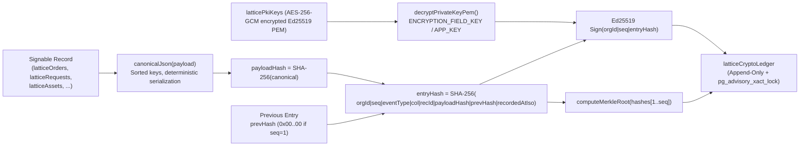

# Ed25519 PKI, Merkle Crypto Ledger & Scoped PaaS API Keys

LatticeDX `0.4.2` provides two complementary cryptographic trust mechanisms inside `@latticedx/plugin-lattice-foundation`:

1. **Per-Organization Ed25519 PKI & Merkle Hash-Chained Ledger** (`pki-ledger.js`) for tamper-evident document signing, ePOD/shipment verification, and zero-trust audit trails.
2. **Scoped PaaS Personal Access Tokens** (`paas-api-keys.js`) using `ldx_pat_<8hex>_<32hex>` credentials hashed with SHA-256 at rest and bound to verified roles, memberships, and least-privilege scopes.

## Ed25519 PKI & Merkle Crypto Ledger



### Per-Organization Keypair Storage (`latticePkiKeys`)

- Each organization automatically provisions an **Ed25519** keypair (`generateKeyPairSync('ed25519')`) on first signing or key inspection via `ensureOrgSigningKey()`.
- **Key Identifier**: `keyId` is deterministically derived from the SPKI DER public key fingerprint: `ed25519-${fingerprintSha256.slice(0, 16)}`.
- **At-Rest Private Key Encryption**: Private keys (PKCS#8 PEM) are encrypted with **AES-256-GCM** using a 256-bit key derived from `SHA-256(ENCRYPTION_FIELD_KEY || APP_KEY)` and stored as `<ivHex>:<tagHex>:<ciphertextHex>` with a fresh 12-byte random IV per encryption.
- **Production Fail-Closed Guarantee**: When `NODE_ENV=production` and neither `ENCRYPTION_FIELD_KEY` nor `APP_KEY` is configured, `resolvePkiMasterKey()` throws `PKI_MASTER_KEY_MISSING` (HTTP `500`) instead of falling back to a development key.

### Append-Only Hash Chain & Merkle Tree (`latticeCryptoLedger`)

Every ledger entry is appended atomically inside an organization-scoped serialization boundary:

- **Concurrency Control**: Writes acquire both an in-process per-organization promise mutex (`runWithOrgMutex`) and a PostgreSQL transaction-scoped advisory lock (`SELECT pg_advisory_xact_lock(hashtext('latticedx:ledger:' || orgId))`) to guarantee contiguous `seq` (`1, 2, 3, ...`) without race conditions.
- **Chained Entry Digest**:
  ```text
  payloadHash = sha256(canonicalJson(payload))
  entryHash   = sha256(`${orgId}|${seq}|${eventType}|${targetCollection}|${targetRecordId}|${payloadHash}|${prevHash}|${recordedAtIso}`)
  ```
  Genesis entries (`seq = 1`) use `ZERO_HASH` (`'0'.repeat(64)`) for `prevHash`.
- **Ed25519 Signature & Merkle Root**:
  - `signatureBase64` signs `${orgId}|${seq}|${entryHash}` with the organization's active Ed25519 private key.
  - `merkleRoot` is computed via `computeMerkleRoot([...priorHashes, entryHash])` (pairwise SHA-256 tree, duplicating odd leaf nodes at each level).
- **Immutability Hooks**: `registerLedgerHooks(db)` attaches `beforeUpdate`, `beforeDestroy`, `beforeBulkUpdate`, and `beforeBulkDestroy` listeners on `latticeCryptoLedger` that throw `LEDGER_IMMUTABLE` (HTTP `403`).
- **Savepoint Isolation**: `appendLedgerEntrySafely()` wraps ledger appends inside a PostgreSQL `SAVEPOINT` (`sp_dxos_ledger_<n>`) so non-critical callers can degrade gracefully on transient errors while still rethrowing security invariants (`PKI_MASTER_KEY_MISSING`, `PKI_KEY_INACTIVE`, `PKI_CIPHERTEXT_INVALID`, `LEDGER_IMMUTABLE`, `NATIVE_ORGANIZATION_MISMATCH`, `NATIVE_TENANT_REQUIRED`).

### Key Rotation & Verification Semantics (`rotateKey`, `expectedKeyId`)

- **`dxosLedger:rotateKey`** (admin or `root` only; requires `write` or `ledger` PAT scope):
  1. Marks all currently active rows in `latticePkiKeys` for the organization as `active: false`, `status: 'retired'`, `retiredAt: <timestamp>`.
  2. Generates a fresh Ed25519 keypair, encrypts the private key with AES-256-GCM, and persists it as `status: 'active'`.
  3. Appends a `pki.key_rotated` audit entry to `latticeCryptoLedger` recording `retiredKeyId`, `newKeyId`, and `fingerprintSha256`.
- **`verifyPayloadSignature(..., expectedKeyId)`**:
  - When `expectedKeyId` is provided (for example, on a signed document or QR tracking proof), `retired` keys remain valid for verifying historical signatures created prior to rotation.
  - If `keyStatus === 'revoked'`, verification fails immediately with `KEY_REVOKED`.
  - If `expectedKeyId` does not match the resolved key, verification returns `KEY_ID_MISMATCH`.
  - `verifyLedgerChain()` walks every entry from `seq = 1` to head, validating sequence continuity, organization match, `prevHash`, `entryHash` recomputation, Ed25519 signature against the `keyId` recorded on that entry, and `merkleRoot` at every step.

### Signable Collections & `dxosLedger` Actions

`SIGNABLE_COLLECTIONS` allows cryptographic document signing on 6 core business collections: `latticeRequests`, `latticeOrders`, `latticeServiceTickets`, `latticeAssets`, `latticeParaDocuments`, and `latticeIncidentCases`.

| Action | Method | Auth / Role | Scope (if PAT) | Purpose |
| --- | --- | --- | --- | --- |
| `/api/dxosLedger:publicKey` | `GET` | `loggedIn` | `read` | Retrieve active org Ed25519 `publicKeyPem`, `keyId`, `fingerprintSha256`, `status` |
| `/api/dxosLedger:entries` | `GET` | `loggedIn` | `read` | Paginated ledger entries filtered by `targetCollection`, `targetRecordId`, `eventType` |
| `/api/dxosLedger:status` | `GET` | `loggedIn` | `read` | Current `latestSeq`, `headHash`, `merkleRoot`, `entryCount`, active `keyId` |
| `/api/dxosLedger:verify` | `GET` / `POST` | `loggedIn` | `read` | Full hash-chain, Ed25519 signature, and Merkle root audit (`valid`, `checkedCount`, `brokenAtSeq`) |
| `/api/dxosLedger:signDocument` | `POST` | Owner or Admin | `write` or `ledger` | Sign record snapshot, append `document.signed` ledger entry, return signatures + `merkleRoot` |
| `/api/dxosLedger:verifySignature` | `POST` | `loggedIn` | `read` | Verify Ed25519 `signatureBase64` over `canonicalJson(payload)` with optional `keyId` |
| `/api/dxosLedger:rotateKey` | `POST` | Admin or `root` | `write` or `ledger` | Retire active keypair, generate new Ed25519 key, log `pki.key_rotated` |
| `/api/dxosLedger:exportProof` | `GET` / `POST` | `loggedIn` | `read` | Export self-contained JSON proof bundle (public keys, chain report, entries, entry proof) |

## Scoped PaaS API Keys (`ldx_pat_*`)

`paas-api-keys.js` implements tenant-bound Personal Access Tokens for headless integrations, CI pipelines, IIoT edge collectors, and MCP/AI clients.

### Token Format, Storage & Lifecycle

- **Token Format**: `ldx_pat_<8hex>_<32hex>` (`PAT_TOKEN_RE = /^ldx_pat_([0-9a-f]{8})_([0-9a-f]{32})$/`), generated from `randomBytes(4)` + `randomBytes(16)`.
- **At-Rest Hashing**: Only `keyPrefix` (`ldx_pat_<8hex>`) and `keyHash` (`SHA-256` hex digest of the full token) are persisted in `latticeApiKeys`. The plaintext token is returned **once** on `dxosApiKeys:issue` and never stored or retrievable afterward.
- **Constant-Time Verification**: Incoming tokens are hashed with SHA-256 and compared using `crypto.timingSafeEqual`.
- **Expiration (TTL)**: `expiresInDays` accepts an integer from `1` to `365` days (or `null` when omitted). Expired, inactive, or revoked (`revokedAt != null`) tokens fail with `401` (`API_KEY_EXPIRED` / `API_KEY_REVOKED`).
- **Transport Headers**: Send either `X-Lattice-API-Key: ldx_pat_<8hex>_<32hex>` or `Authorization: Bearer ldx_pat_<8hex>_<32hex>`.

### 7 Least-Privilege Scopes

Every token requires a non-empty `scopes` array (up to 20 items) drawn strictly from `ALLOWED_PAT_SCOPES`:

| Scope | Permitted Operations |
| --- | --- |
| `read` | Safe HTTP reads (`GET`, `HEAD`, `OPTIONS`) and allowlisted read-only `POST` queries (`list`, `get`, `count`, `dxosLedger:verify`, `dxosLedger:verifySignature`, `latticePara:hybridSearch`, `dxosDmn:evaluate`, `dxosStudio:solutionBundleDiff`, `charts:queryData`, `dxosDataGov:computeMkt`, `latticeIntegrations:{record,context,proposals,proposalReceipt}`). Blocked from `/api/dxos-mcp*`. |
| `write` | General mutating resource actions across organization-scoped endpoints (unless further restricted by role). |
| `wms` | Mutating operations on `dxosWms` (`receiveStock`, `allocateFefo`, `issueStock`, `epodCapture`, `holdLotByMkt`, `releaseLotByQa`, etc.). |
| `dmn` | Mutating operations on `dxosDmn:saveTable` and `dxosDmn:saveDelegation`. |
| `iot` | Mutating operations on `dxosBroker`, `dxosAutomations`, and `dxosBlocks` IoT actions (`telemetryIngest`, `twinSetDesired`, `twinAckCommand`, `alarmIngest`, `alarmAck`, `alarmClear`, `provisionDevice`, `revokeDevice`, `deviceStatusIngest`). |
| `ai` | Mutating operations on `dxosAi`, `dxosMcp`, `/api/dxos-mcp`, `/api/dxos-mcp/it-ot`, `dxosN8n`, `dxosAutomations`, and `dxosApprovals:decide`. |
| `ledger` | Cryptographic signing and key rotation (`dxosLedger:signDocument`, `dxosLedger:rotateKey`). |

### Defense-in-Depth Checks on Every PAT Request

During `createPaasApiKeyAuthMiddleware(db)`, the platform verifies:

1. **Owner & Role Binding**: The owning `users` account must be active, the bound `roleName` must still exist in `rolesUsers`, and non-`root` keys must still hold an active `latticeEmployees` membership in the token's `organizationId` (matching `employeeId` if bound).
2. **Header Clamping**: `clampHeaderRole(ctx, roleName)` overwrites `x-role` so callers cannot escalate privileges via request headers.
3. **Anti-Escalation on Issuance**: Non-admins can issue keys only for themselves and non-elevated roles they hold (`API_KEY_ROLE_ESCALATION` 403); only `root` can issue a `root`-role API key.
4. **Private Collection Guard**: `registerPaasPrivateCollectionGuard(app)` blocks non-`root` callers from querying or mutating `latticeApiKeys`, `latticePkiKeys`, `latticeCryptoLedger`, `latticeConnectors`, and `latticeWebhookSubscriptions` via generic CRUD or `charts:queryData`, forcing all access through `dxosApiKeys`, `dxosLedger`, `dxosVault`, and `dxosEvents`.

### `dxosApiKeys` Management Endpoints

| Action | Method | Scope | Purpose |
| --- | --- | --- | --- |
| `/api/dxosApiKeys:issue` | `POST` | `write` | Issue a new `ldx_pat_<8hex>_<32hex>` token with `name`, `scopes`, optional `expiresInDays` (`1..365`), `roleName` |
| `/api/dxosApiKeys:list` | `GET` | `read` | List key metadata (`keyPrefix`, `scopes`, `expiresAt`, `lastUsedAt`, `active`) — never exposes `keyHash` or token |
| `/api/dxosApiKeys:revoke` | `POST` | `write` | Revoke a key by `id` (sets `active: false`, `revokedAt`, `revokedBy`) |

## Related Documentation

- [Multi-Tenant PostgreSQL 16 RLS](/en/security/multi-tenant-rls)
- [OIDC/PKCE Authentication & Hardening](/en/security/auth-oidc-hardening)
- [API Contracts & Endpoint Reference](/en/security/api-contracts)
