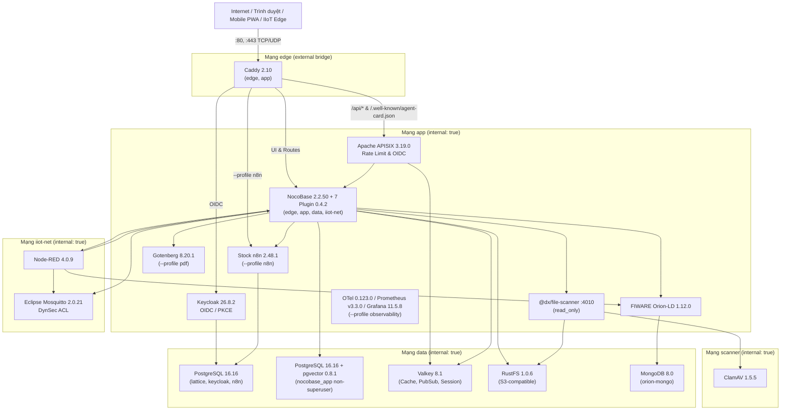

# Triển khai Production Zero-Trust (`infra/compose/prod.yml`)

Tài liệu này hướng dẫn kiến trúc và quy trình vận hành stack **Production Zero-Trust** của **LatticeDX `v0.4.2`** theo định nghĩa chính thức trong `infra/compose/prod.yml` (`name: lattice-dx-prod`).

---

## 1. Kiến trúc 5 Mạng Cô lập & Container Hardening

Mỗi container trong `infra/compose/prod.yml` kế thừa cấu hình tăng cường bảo mật `x-hardened` và chỉ được gắn vào đúng các phân vùng mạng cần thiết:

- **`security_opt: [no-new-privileges:true]`** và **`cap_drop: [ALL]`** trên toàn bộ dịch vụ; chỉ cấp lại quyền kernel tối thiểu (`cap_add`) cho từng service đặc thù (ví dụ `NET_BIND_SERVICE` cho `caddy`/`nocobase`, `SETUID`/`SETGID`/`CHOWN` cho database/Valkey/ClamAV).
- **`read_only: true` + `tmpfs`** cho các dịch vụ không cần ghi persistent trực tiếp lên rootfs (`file-scanner`, `otel-collector`, `prometheus`, `gotenberg`).
- **Khóa `@sha256:` digest bất biến** trên toàn bộ OCI images nhằm ngăn chặn tấn công thay thế image tag.
- **5 Docker Networks cô lập** (4 mạng đặt `internal: true`, hoàn toàn không có đường ra Internet trực tiếp):
  1. **`edge`**: Kết nối mặt ngoài — duy nhất `caddy` mở cổng `80`, `443` (TCP) và `443/udp`; điều phối tới `gateway` (APISIX), `keycloak`, `nocobase`.
  2. **`app` (`internal: true`)**: Kênh giao tiếp nội bộ tầng ứng dụng, API Gateway, OIDC, workflow (`n8n`), quan sát (`otel-collector`, `prometheus`, `grafana`), tạo PDF (`gotenberg`) và Digital Twin (`orion-ld`, `nodered`).
  3. **`data` (`internal: true`)**: Phân vùng lưu trữ dữ liệu — cô lập `postgres`, `nocobase-db`, `redis` (Valkey), `rustfs`, `orion-mongo` khỏi vùng `edge`.
  4. **`scanner` (`internal: true`)**: Cô lập hoàn toàn daemon chống mã độc `clamav` chỉ để `file-scanner` gọi quét tệp.
  5. **`iiot-net` (`internal: true`)**: Cô lập hạ tầng IIoT (`mosquitto`, `nodered`, `nocobase`), ngăn truy cập trực tiếp từ mạng ngoài hay từ lớp dữ liệu.



---

## 2. Danh mục Dịch vụ & Profile Triển khai

Toàn bộ các dịch vụ trong `infra/compose/prod.yml` đều tuân thủ chuẩn cấp phép Pure-OSI và sử dụng ảnh container chính thức khóa digest `@sha256:`:

### 2.1. Thành phần Lõi (Luôn bật mặc định)

| Dịch vụ | Image / Phiên bản | Mạng gắn | Giới hạn mặc định | Vai trò trong kiến trúc Zero-Trust |
| --- | --- | --- | --- | --- |
| `caddy` | `caddy:2.10-alpine` | `edge`, `app` | `256m` / `0.5` CPU | TLS terminator, Security Headers (HSTS, `nosniff`, `SAMEORIGIN`), định tuyến `/api/*` & `/.well-known/agent-card.json` qua `gateway`, UI qua `nocobase` |
| `gateway` | `apache/apisix:3.19.0-debian` | `edge`, `app` | `512m` / `1.0` CPU | API Gateway kiểm soát CORS (`LATTICE_ALLOWED_ORIGIN`), `X-Request-Id`, `limit-count` qua Valkey (`120 req/phút` cho route công khai), OIDC |
| `keycloak` | `quay.io/keycloak/keycloak:26.8.2` | `edge`, `app`, `data` | `1536m` / `1.5` CPU | Identity Provider phát hành token OIDC/PKCE (`--proxy-headers=xforwarded`), dùng DB `keycloak` trên `postgres` |
| `nocobase` | `nocobase/nocobase:2.2.50` | `edge`, `app`, `data`, `iiot-net` | `2048m` / `2.0` CPU | Host runtime nạp read-only 7 plugin `@latticedx/*` `0.4.2`, kết nối DB qua non-superuser `nocobase_app` |
| `nocobase-db` | `pgvector/pgvector:0.8.1-pg16` | `data` | `2048m` / `2.0` CPU | PostgreSQL 16 + `pgvector 0.8.1`, bật PITR (`wal_level=replica`, `archive_mode=on`, `archive_timeout=300`), khởi tạo role **`nocobase_app`** |
| `postgres` | `postgres:16.16-alpine` | `data` | `1536m` / `1.5` CPU | PostgreSQL 16 riêng cho `lattice` (`lattice_app`), `keycloak` (`keycloak_app`) và `n8n` (`n8n_app`), bật PITR |
| `redis` | `valkey/valkey:8.1-alpine` | `app`, `data` | `640m` / `0.5` CPU | Valkey `8.1` (`BSD-3-Clause`) với `--appendonly yes` & `--requirepass` cho Cache, Pub/Sub, Auth Session & APISIX rate-limit |
| `rustfs` | `rustfs/rustfs:1.0.6` | `data` | `1024m` / `1.0` CPU | Kho lưu trữ đối tượng S3-compatible nội bộ cổng `9000` (`RUSTFS_CONSOLE_ENABLE: "false"`) |
| `clamav` | `clamav/clamav:1.5.5` | `scanner` | `2048m` / `1.0` CPU | Engine quét virus cô lập hoàn toàn trên mạng `scanner` |
| `file-scanner` | Build từ `apps/file-scanner/Dockerfile` | `app`, `data`, `scanner` | `256m` / `0.5` CPU | Dịch vụ trung gian (`read_only: true`) tiếp nhận upload, quét qua `clamav` trước khi lưu vào `rustfs` |
| `orion-ld` | `fiware/orion-ld:1.12.0` | `app`, `data` | `768m` / `1.0` CPU | Context Broker chuẩn NGSI-LD kết nối `orion-mongo` với `SCRAM-SHA-256` |
| `orion-mongo` | `mongo:8.0` | `data` | `1024m` / `1.0` CPU | Cơ sở dữ liệu của Orion-LD, bắt buộc `--auth` |

### 2.2. Các Profile Tùy chọn (`--profile`)

| Profile | Dịch vụ & Phiên bản | Mạng gắn | Chức năng |
| --- | --- | --- | --- |
| `iam-sync` | `adorsys/keycloak-config-cli:6.5.1-26` | `app` | Container chạy một lần (`restart: "no"`) để đồng bộ realm `lattice-realm.prod.json` vào Keycloak |
| `n8n` | `n8nio/n8n:2.48.1` | `app`, `data` | Stock `n8n` dùng DB Postgres (`n8n_app`), `N8N_RUNNERS_ENABLED="true"`, `N8N_SECURE_COOKIE="true"`, truy cập qua `N8N_DOMAIN` |
| `observability` | `otel/opentelemetry-collector-contrib:0.123.0`, `prom/prometheus:v3.3.0`, `grafana/grafana-oss:11.5.8` | `app`, `data` | Thu thập trace OTel GenAI (`/v1/traces`), scrape `/api/dxos:metrics` bằng `DX_METRICS_TOKEN`, hiển thị dashboard Grafana 360° |
| `pdf` | `gotenberg/gotenberg:8.20.1` | `app` | Dịch vụ xuất PDF (`--chromium-disable-javascript=true`, `read_only: true`), kích hoạt qua `DXOS_GOTENBERG_URL=http://gotenberg:3000` |
| `iiot` | `eclipse-mosquitto:2.0.21`, `nodered/node-red:4.0.9` | `iiot-net`, `app` (`nodered`) | MQTT Broker bật Dynamic Security ACL (`allow_anonymous false`) và Node-RED cầu nối telemetry / LWT / Digital Twin downlink |

---

## 3. Vai trò `nocobase_app` & Chính sách `FORCE ROW LEVEL SECURITY`

Trong `infra/config/postgres/init-nocobase-db.sh`, khi `nocobase-db` khởi tạo lần đầu, script tạo role ứng dụng **`nocobase_app`** tách biệt hoàn toàn khỏi `POSTGRES_USER`:

```sql
CREATE ROLE nocobase_app LOGIN PASSWORD '...'
  NOSUPERUSER NOCREATEDB NOCREATEROLE NOINHERIT NOBYPASSRLS;
```

- Script kiểm tra nghiêm ngặt `NOCOBASE_APP_DB_USER` **không được trùng** với `POSTGRES_USER`.
- Vì `nocobase_app` mang thuộc tính `NOSUPERUSER` và `NOBYPASSRLS`, mọi chính sách `ENABLE` + `FORCE ROW LEVEL SECURITY` trên **56 bảng tĩnh** và các bảng động `latticeCustom*` đều được PostgreSQL cưỡng chế ở tầng nhân CSDL, kết hợp với `DX_PG_RLS_SESSION=true` thiết lập `app.current_org` theo từng transaction (`AsyncLocalStorage`). Xem chi tiết cơ chế này tại [Đa khách hàng & PostgreSQL RLS](/security/multi-tenant-rls).

---

## 4. Quy trình Triển khai Từng bước

### Bước 1: Chuẩn bị tệp môi trường `.env.prod` (ngoài Git)

Sao chép mẫu cấu hình chuẩn từ `infra/compose/prod.env.example` sang một tệp không nằm trong Git (ví dụ `.env.prod` với quyền `chmod 600 .env.prod`) và thay toàn bộ các giá trị `CHANGE_ME_*` bằng mật khẩu/khóa ngẫu nhiên đạt chuẩn mật mã (xem chi tiết từng biến ở trang [Cấu hình Biến môi trường](/getting-started/configuration)).

### Bước 2: Kiểm tra hợp lệ cấu hình Compose

```sh
docker compose --env-file .env.prod -f infra/compose/prod.yml config --quiet
```

*(Nếu dùng các profile bổ sung, thêm `--profile n8n --profile observability --profile pdf --profile iiot` khi kiểm tra.)*

### Bước 3: Build plugin cục bộ & Khởi chạy Stack Lõi

`infra/compose/prod.yml` mount read-only 7 thư mục plugin từ `../../plugins/nocobase/*` vào container `nocobase`. Trước khi khởi động, hãy build đầy đủ 7 plugin ở máy host (hoặc CI artifact):

```sh
pnpm install --frozen-lockfile
npm ci --prefix plugins/nocobase/plugin-enterprise-auth --ignore-scripts --no-audit --no-fund
node plugins/nocobase/action-bridge/build.mjs
node plugins/nocobase/plugin-lattice-foundation/scripts/build.mjs
node plugins/nocobase/plugin-enterprise-auth/build.mjs
node plugins/nocobase/plugin-dxos-para/build.mjs
node plugins/nocobase/plugin-dxos-blocks/build.mjs
node plugins/nocobase/plugin-dxos-studio/build.mjs
node plugins/nocobase/plugin-dxos-ai/build.mjs
```

Sau đó khởi chạy các dịch vụ lõi (và các profile bạn cần):

```sh
docker compose --env-file .env.prod -f infra/compose/prod.yml up -d --build
```

### Bước 4: Đồng bộ Keycloak Realm & Kiểm tra Sức khỏe

```sh
# Chạy one-shot iam-sync để nạp cấu hình realm Keycloak & client secret
docker compose --env-file .env.prod -f infra/compose/prod.yml --profile iam-sync up --abort-on-container-exit

# Cài đặt và kích hoạt 7 plugin nếu là DB mới khởi tạo
docker compose --env-file .env.prod -f infra/compose/prod.yml exec -T nocobase yarn nocobase upgrade

# Kiểm tra trạng thái tất cả container
docker compose --env-file .env.prod -f infra/compose/prod.yml ps
```

### Bước 5: Xác nhận Endpoint Sẵn sàng

- Kiểm tra qua Caddy/APISIX từ bên ngoài: `curl -fsS https://<LATTICE_DOMAIN>/health` (được APISIX rewrite về `/api/dxos:health`).
- Kiểm tra chứng chỉ TLS tự động của Caddy cho `LATTICE_DOMAIN`, `KEYCLOAK_DOMAIN`, và (nếu bật `--profile n8n`) `N8N_DOMAIN`.
- Thiết lập lịch sao lưu & diễn tập PITR theo hướng dẫn tại [Sao lưu & Phục hồi Thảm họa PITR](/operations/backup-pitr-dr).
