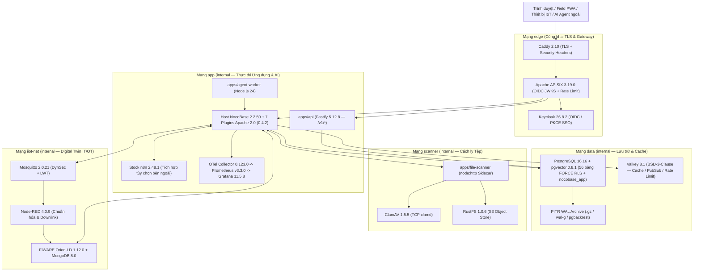
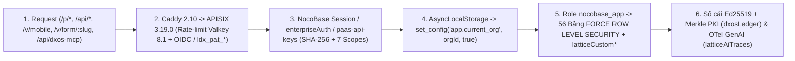

# Kiến trúc 6-Plane DX-OS (`v0.4.2`)

Kiến trúc của **LatticeDX `v0.4.2`** được thiết kế theo mô hình **6 Phân hệ Điều phối (6-Plane DX-OS)** kết hợp **5 lớp mạng Docker cô lập** (`edge`, `app`, `data`, `scanner`, `iiot-net`) nhằm đảm bảo ranh giới Zero-Trust từ lớp biên HTTP/TLS, tầng thực thi plugin NocoBase `2.2.50`, tầng tự động hóa và IIoT đến lõi dữ liệu PostgreSQL `16` `FORCE ROW LEVEL SECURITY`.

---

## Tổng quan 6 Phân hệ Điều phối (Planes 1–6)

| Phân hệ | Tên gọi | Thành phần & Dịch vụ cốt lõi | Giao thức / Tuyến kiểm chứng |
| --- | --- | --- | --- |
| **Plane 1** | **Identity, Zero-Trust Edge & Security Guardrails** | Caddy `2.10`, Apache APISIX `3.19.0`, Keycloak `26.8.2` (OIDC + PKCE), Valkey `8.1` (session cache & rate-limit), `@latticedx/plugin-enterprise-auth`, PaaS API Keys (`ldx_pat_*`), Sổ cái **Ed25519 / Merkle PKI** (`dxosLedger`), `apps/file-scanner` + ClamAV `1.5.5` + RustFS `1.0.6`, **Connector Vault** (`dxosVault` AES-256-GCM, 11 connector apps, OAuth2 PKCE S256), **56 bảng tĩnh `FORCE RLS`** + `nocobase_app` | `/enterprise-login`, `/api/dxosApiKeys:*`, `/api/dxosLedger:*`, `/api/dxosVault:*`, `/api/dxosDataGov:*` |
| **Plane 2** | **IT/OT Digital Twin, Mosquitto DynSec/LWT & Orion-LD 2-Way** | Eclipse Mosquitto `2.0.21` Dynamic Security (`allow_anonymous false`, `$CONTROL/dynamic-security/v1` qua `node:net` MQTT 3.1.1, ACL `latticedx/<orgId>/<deviceKey>/*`, `BIRTH`/`DEATH` LWT `device.offline`), Node-RED `4.0.9`, FIWARE Orion-LD `1.12.0` + MongoDB `8.0`, PostgreSQL `16` `latticeTelemetryPoints`, Arrhenius MKT, Quarantine & **2-Way Digital Twin Shadow** (`HITL_TEMP_THRESHOLD_C = 2.0`) | `/api/dxosBroker:*`, `/api/dxosBroker:orionNotify`, `/api/dxosBlocks:twin*`, `/api/dxosBlocks:telemetry*`, `/api/dxosBlocks:alarm*` |
| **Plane 3** | **Unified Event Bus, LatticeFlow v2, Approvals, Omnichannel & Stock `n8n`** | `dxosEvents` (**CloudEvents 1.0 + Standard Webhooks**, PG Outbox `FOR UPDATE SKIP LOCKED`, HMAC-SHA256 `whsec_`, Circuit Breaker `5` lỗi / `120s`, DLQ replay), **LatticeFlow v2 DAG** (`dxosAutomations`: 24 node / 6 nhóm, `draftGraphJson` vs `publishedGraphJson`, `latticeAutomationRuleVersions`, `ai.agent` ReAct & `latticeflow.approval`), `dxosApprovals` (`sequential` / `parallel` `M-of-N` + `dxosDelegations`), `dxosNotify` (`smtp`, `telegram`, `slack`, `webhook`), **Visual DMN** (`dxosDmn`), **OMS/WMS/FEFO/ePOD** (`dxosWms`), và tùy chọn **Stock `n8n` `2.48.1`** (`dxosN8n`) | `/admin/settings/workflow/automation`, `/api/dxosEvents:*`, `/api/dxosAutomations:*`, `/api/dxosApprovals:*`, `/api/dxosDmn:*`, `/api/dxosWms:*`, `/v/track/:code`, `/api/dxosN8n:*` |
| **Plane 4** | **Multi-Portal, Field PWA, Public Forms, 12 BlockModels, WebGIS & GitOps v3** | Các cổng đa vai trò `/p/*` (`procurement`, `incidents`, `logistics`, `services`, `cmms`, `partner-claims`), **Mobile Field PWA** (`/v/mobile` với IndexedDB Outbox + trạng thái `quarantined`), **Public Forms** (`/v/form/:slug` fail-closed zero-PII), **12 Native v2 `BlockModel`s** (bao gồm `DxosBiChartBlockModel`, `DxosWebGisBlockModel` + `maplibre-gl@6.19.0`, `DxosWmsOpsBlockModel`, `DxosKanbanScheduleBlockModel`...), **Rich Schema Builder** (`dxosBuilder`), **P.A.R.A. + OCR + Hybrid RAG** (`latticePara` với `pgvector 0.8.1` HNSW + RRF) và **GitOps Solution Bundle v3** (`latticedx.solution-bundle/v3`) | `/p/<slug>`, `/v/mobile`, `/v/form/:slug`, `/admin/settings/dxos-studio`, `/admin/settings/dxos-para`, `/api/dxosBlocks:*`, `/api/latticePara:*`, `/api/dxosBuilder:*` |
| **Plane 5** | **AI Workforce, App Builder 2.0, A2A, OTel GenAI & 2-Way MCP** | **7 Starter AI Profiles** (`dxos-coordinator`, `dxos-architect`, `dxos-ops`, `dxos-logistics`, `dxos-workspace`, `dxos-operator`, `dxos-analyst`), **20 Unified AI Tools** (`11` Admin Builder gồm **App Builder 2.0** `dxos_provision_role_workspace`, `6` Operational, `3` Persistent Memory `dxos_memory_*`), **Google/LF A2A Protocol**, **2-Way Streamable MCP Gateway**, **Proactive Triage LLM thật**, hàng chờ **HITL**, che PII VN (CCCD/MST/STK/SĐT), hạn mức PG và **Eval Lab `163/163`** | `/admin/settings/dxos-ai`, `/.well-known/agent-card.json`, `/api/dxos-a2a`, `/api/dxos-mcp`, `/api/dxos-mcp/it-ot`, `/api/dxosAi:*` |
| **Plane 6** | **Application Data, OTel Tracing & PITR WAL Observability Substrate** | Host **NocoBase `2.2.50`** + **7 plugin `Apache-2.0`** (`sdkProvidedByHost: true`), đặc tả sống **OpenAPI 3.1.0 / AsyncAPI 3.0.0**, **OTel Collector Contrib `0.123.0`** (OTLP/HTTP JSON + W3C `traceparent` + `latticeAiTraces`), **Prometheus `v3.3.0`** (`5` rules cảnh báo trong `alerts.yml`), **Grafana OSS `11.5.8` Dashboard 360°**, **Gotenberg `8.20.1`** (tùy chọn profile `pdf`) và sao lưu **PostgreSQL PITR WAL `.gz`** (`wal_level=replica`, `archive_timeout=300`) | `/api/dxos:health`, `/api/dxos:metrics`, `/api/dxos:openapi`, `/api/dxos:asyncapi`, `scripts/stack-recovery.mjs`, `scripts/pitr-backup.mjs` |

---

## Sơ đồ Kiến trúc 6-Plane DX-OS & 5 Vùng Mạng Cô lập (`prod.yml`)

Trong cấu hình triển khai sản xuất (`infra/compose/prod.yml`), toàn bộ các dịch vụ được cô lập vào **5 mạng Docker riêng biệt**, khóa quyền nâng đặc quyền (`no-new-privileges: true`, `cap_drop: [ALL]`):

---

## Luồng Dữ liệu Zero-Trust từ Biên tới PostgreSQL `FORCE RLS` & OTel GenAI

Mọi yêu cầu từ người dùng nội bộ, người dùng di động, biểu mẫu công khai hay tác nhân AI đều đi qua chuỗi xác thực, tiêm ngữ cảnh tổ chức và ghi vết kiểm toán bất biến:

### Bảo chứng Fail-Closed tại Tầng Cơ sở Dữ liệu
- **Role không có đặc quyền superuser (`nocobase_app`):** Ngăn chặn hoàn toàn khả năng vượt qua chính sách RLS ngay cả khi có lỗi ở tầng ORM hoặc truy vấn động.
- **Cầu nối giao dịch `AsyncLocalStorage` (`pg-rls.js`):** Thiết lập `set_config('app.current_org', ..., true)` cục bộ theo từng giao dịch (`LOCAL`), tự động giải phóng sau `COMMIT`/`ROLLBACK` để tránh rò rỉ ngữ cảnh qua connection pool.
- **56 bảng tĩnh + bảng động `latticeCustom*`:** Gồm `54` bảng camelCase dùng cột `organizationId` và `2` bảng snake_case (`lattice_native_request_attachments`, `lattice_native_request_uploads`) dùng cột `organization_id`, cộng các bảng nối `belongsToMany` sinh bởi Rich Schema Engine.

---

## 5 Mô thức Tương tác Nền tảng (Platform Interaction Patterns)

Tương ứng với sơ đồ kiến trúc 6-Plane, mọi nghiệp vụ trên LatticeDX `v0.4.2` vận hành theo 5 mô thức tương tác chuẩn hóa:

### 1. Portal & Native Block Interaction
- Người dùng 7 vai trò `ldx_*` truy cập các cổng `/p/<slug>` hoặc thiết bị hiện trường `/v/mobile`, trong khi đối tác/khách bên ngoài chỉ chạm tới `/v/form/:slug` và `/v/track/:code` (lọc bỏ `recipientName`, `recipientPhone`, `signatureDataUrl`, `trackingTokenHash`).
- 12 Native v2 `BlockModel`s (`plugin-dxos-blocks`) gọi các action RBAC trên `dxosBlocks` (`aggregateQuery`, `collectionsMeta`, `exportReport`, `bulkImportDryRun`/`Commit`).
- Mobile Field PWA (`/v/mobile`) lưu hàng đợi ngoại tuyến vào IndexedDB (`mobile-offline-db.js`); các payload bị từ chối `400/403/404/409/422` được chuyển sang trạng thái `quarantined` và tạm dừng đồng bộ khi gặp `401` để không làm mất dữ liệu chứng cứ ePOD.

### 2. Process, Event Bus & Async Outbox
- Thay đổi nghiệp vụ phát sinh sự kiện chuẩn **CloudEvents 1.0** thông qua `dxosEvents` (`event-bus.js`), ghi vào bảng PG Outbox dùng khóa `FOR UPDATE SKIP LOCKED`, ký **Standard Webhooks** (`whsec_`, chữ ký `v1,<hmac>`), tự ngắt mạch (**Circuit Breaker**: `5` lỗi / `120s` cooldown) và hỗ trợ phát lại từ DLQ (`replayDlq`).
- **LatticeFlow v2** (`dxosAutomations`) điều phối 24 loại node trên đồ thị DAG, lưu trạng thái tạm dừng vòng lặp (`loopCursor` & `loopCursors` stack) trong `nodeStatesJson` để nối lại chính xác sau bước phê duyệt con người (`control.approval` / HITL), hỗ trợ hợp nhất nhánh `first_completed` mà không bị treo bởi nhánh chậm.
- **Visual DMN** (`dxosDmn`) định giá bảng quyết định không dùng `eval` (giới hạn an toàn tối đa 50 trường schema và 500 luật), kết hợp **Unified Approvals** (`dxosApprovals` chế độ `sequential` hoặc `parallel` `M-of-N`) và ủy quyền có thời hạn (`dxosDelegations`).

### 3. IIoT Telemetry & 2-Way Digital Twin
- Thiết bị biên kết nối tới **Mosquitto `2.0.21`** qua xác thực Dynamic Security (`allow_anonymous false`, ACL theo từng thiết bị `latticedx/<orgId>/<deviceKey>/*`). Khi mất kết nối đột ngột, thông điệp `DEATH` (LWT) phát sinh sự kiện `device.offline`.
- **Node-RED `4.0.9`** chuẩn hóa bản tin lên **FIWARE Orion-LD `1.12.0`**, sau đó Orion-LD đẩy ngược thông báo thay đổi qua `/api/dxosBroker:orionNotify` vào bảng chuỗi thời gian PostgreSQL `16` (`latticeTelemetryPoints`) và phát sự kiện `orion.notification`.
- Hệ thống tính chỉ số suy biến nhiệt độ **Arrhenius MKT** (`dxosDataGov:computeMkt`), tự động cách ly lô hàng vượt ngưỡng (`dxosWms:holdLotByMkt`) và gửi lệnh điều chỉnh thiết bị 2 chiều (`twinSetDesired` -> Node-RED downlink) với ngưỡng bảo vệ con người `HITL_TEMP_THRESHOLD_C = 2.0`.

### 4. Agentic AI, Hybrid GraphRAG & MCP / A2A
- Nút nổi duy nhất `PortalAgentLauncher` trên các cổng `/p/*`, máy khách MCP ngoài (`/api/dxos-mcp`, `/api/dxos-mcp/it-ot`) và agent đối tác chuẩn **Google/LF A2A** (`/.well-known/agent-card.json`, `/api/dxos-a2a`) đều đi qua lớp kiểm soát của `plugin-dxos-ai`.
- Ngữ cảnh doanh nghiệp được truy hồi bằng **Hybrid RAG** (`latticePara:hybridSearch`): kết hợp `tsvector` toàn văn và `pgvector 0.8.1` HNSW (`8..8192` chiều linh hoạt) theo thuật toán **RRF** trên tài liệu đã lọc `status = 'active'`, cùng đồ thị quan hệ (`dxos_graph_impact_analysis`).
- Mọi thao tác quản trị (như **App Builder 2.0** `plan`/`build`/`patch`/`rollback`) hoặc thao tác ghi nhạy cảm đi qua hàng chờ **HITL**, ghi vết đầy đủ theo chuẩn **OTel GenAI Semantic Conventions** (`gen_ai.*`, `execute_tool`, `invoke_agent`) vào `latticeAiTraces` sau khi đã che PII Việt Nam.

### 5. File Quarantine & Cryptographic Audit
- Tệp đính kèm từ người dùng hoặc Public Forms (`/v/form/:slug` tối đa 2MB, kiểm tra MIME allowlist + honeypot + chống prototype pollution) được đẩy qua sidecar `apps/file-scanner` trên mạng `scanner` nội bộ để **ClamAV `1.5.5`** quét mã độc qua TCP trước khi lưu xuống **RustFS `1.0.6`** (S3-compatible).
- Chứng từ quan trọng (phiếu xuất/nhập kho FEFO, ePOD, nghiệm thu) được băm chuẩn hóa JSON, ký số bằng khóa **Ed25519** (khóa riêng được mã hóa AES-256-GCM trong `latticePkiKeys`) và nối chuỗi băm `prevHash`/`entryHash` kèm **Merkle Root** (`dxosLedger`), cho phép tra cứu công khai tính toàn vẹn mà không lộ dữ liệu nhạy cảm.
