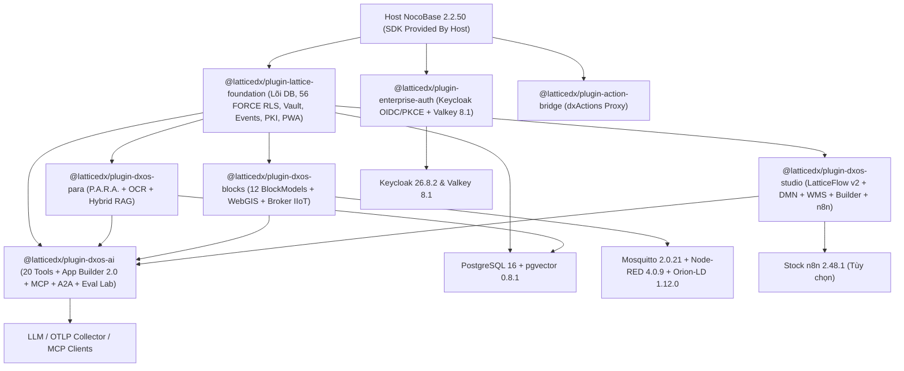

# Kiến trúc Mô-đun 7 Plugin (`0.4.2`)

Toàn bộ năng lực mở rộng của **LatticeDX `v0.4.2`** trên nền tảng **NocoBase `2.2.50`** được tổ chức thành **7 plugin độc lập** đặt trong thư mục `plugins/nocobase/*`. Cả 7 package đều mang giấy phép **Apache-2.0**, đồng bộ phiên bản **`0.4.2`**, khai báo `"testedRuntime": "2.2.50"` và `"nocobase": { "sdkProvidedByHost": true }`.

::: tip Nguyên tắc Cô lập Host-External & Điều 5.2 NocoBase
Kho Git `CTU-OpenPaw/lattice-dx` **không chứa** Git submodule `upstream/nocobase` hay tệp `.gitmodules`. Host NocoBase `2.2.50` chỉ được nạp lúc chạy dưới dạng OCI container độc lập (`nocobase/nocobase:2.2.50`). Các plugin chỉ gọi SDK từ host lúc thực thi (`sdkProvidedByHost: true`) và bảo toàn nguyên vẹn nhận diện **Điều 5.2 NocoBase** (`Powered by NocoBase`, `v2.2.50`, `https://www.nocobase.com`, `License settings`).
:::

---

## Bảng Tổng hợp 7 Plugin NocoBase (`Apache-2.0`)

| Package (`0.4.2`) | Thư mục nguồn | Trụ cột | Resources / Middleware chính | Phụ thuộc Build / Runtime đáng chú ý |
| --- | --- | :---: | --- | --- |
| **`@latticedx/plugin-action-bridge`** | `plugins/nocobase/action-bridge` | `[P][I]` | Resource `dxActions` (13 actions) | Zero external npm; `server.cjs` + `externalVersion.js` |
| **`@latticedx/plugin-lattice-foundation`** | `plugins/nocobase/plugin-lattice-foundation` | `[D][H][I]` | `dxosApiKeys`, `dxosLedger`, `dxosDataGov`, `dxosVault`, `dxosEvents`, `dxosApprovals`, `dxosNotify`, `dxosForms`, `dxos`, `latticeVoucher`, `latticeNotifications`, `latticeSla`, `latticeChatter`, `latticePortals`, `latticeApps`, `latticeNative` | Internal zero-dep module bundler cho `client` & `client-v2`; 56 bảng tĩnh `FORCE RLS` |
| **`@latticedx/plugin-enterprise-auth`** | `plugins/nocobase/plugin-enterprise-auth` | `[H]` | Resource `enterpriseAuth` (9 actions); route `/enterprise-login`; settings `auth.enterprise-mappings` | `bundleDependencies`: `openid-client@6.8.9`, `jose@6.2.15`, `oauth4webapi@3.8.8` (`MIT`) |
| **`@latticedx/plugin-dxos-para`** | `plugins/nocobase/plugin-dxos-para` | `[H]` | Resource `latticePara` (6 actions); settings `/admin/settings/dxos-para` | `pgvector 0.8.1` HNSW + `tsvector` RRF; trích xuất PDF `ToUnicode`/DOCX/XLSX/PPTX |
| **`@latticedx/plugin-dxos-blocks`** | `plugins/nocobase/plugin-dxos-blocks` | `[H][P][D][I]` | **12 Native v2 `BlockModel`s**; resources `dxosBlocks` (17 actions) & `dxosBroker` (10 actions) | `devDependencies`: `maplibre-gl@6.19.0` (`BSD-3-Clause`), `esbuild@0.28.2` (`MIT`) -> UMD bundle |
| **`@latticedx/plugin-dxos-studio`** | `plugins/nocobase/plugin-dxos-studio` | `[P][H][D]` | `dxosStudio` (15), `dxosWms` (12), `dxosDmn` (3), `dxosDelegations` (4), `dxosAutomations` (19), `dxosBuilder` (6), `dxosN8n` (10); settings `dxos-studio` & `workflow.automation` | `devDependencies`: `@xyflow/react@12.12.1` (`MIT`), `@dagrejs/dagre@3.1.3` (`MIT`), `esbuild@0.28.2` (`MIT`) -> UMD bundle |
| **`@latticedx/plugin-dxos-ai`** | `plugins/nocobase/plugin-dxos-ai` | `[I][P][D][H]` | Resource `dxosAi` (41 actions); middleware `/api/dxos-mcp`, `/api/dxos-mcp/it-ot`, `/.well-known/agent-card.json`, `/api/dxos-a2a/agent-card.json`, `/api/dxos-a2a`; settings `/admin/settings/dxos-ai` | Internal zero-dep module bundler cho `client`; 20 Unified AI Tools & 7 Starter Profiles |

---

## Sơ đồ Phụ thuộc giữa 7 Plugin, Host Runtime & Dịch vụ Ngoài



---

## Chi tiết Resources, Actions & Middleware từng Plugin

### 1. `@latticedx/plugin-lattice-foundation`
Là nền tảng lõi cho toàn bộ dữ liệu, bảo mật đa tenant và giao diện `client-v2`:
- **Bảo mật & API PaaS:** `dxosApiKeys` (cấp phát và thu hồi PAT định dạng `ldx_pat_<8hex>_<32hex>`, 7 scope `read`, `write`, `wms`, `dmn`, `iot`, `ai`, `ledger`), `dxosLedger` (`8` actions: `publicKey`, `entries`, `status`, `verify`, `signDocument`, `verifySignature`, `rotateKey`, `exportProof`).
- **Quản trị Dữ liệu & Tích hợp:** `dxosDataGov` (Hot–Warm–Cold Tiering, Lineage, Quarantine, Arrhenius MKT), `dxosVault` (`8` actions: `list`, `save`, `rotateSecret`, `delete`, `testConnection`, `appCatalog`, `oauthStart`, `oauthCallback` với AES-256-GCM và SSRF allowlist), `dxosEvents` (`10` actions: `listEvents`, `publish`, `listSubscriptions`, `saveSubscription`, `toggleSubscription`, `deleteSubscription`, `listDeliveries`, `dispatchNow`, `replayDlq`, `resetCircuit`).
- **Quy trình Con người & Giao diện Công khai:** `dxosApprovals` (`8` actions: `listInbox`, `decide`, `request`, `cancel`, `listPolicies`, `savePolicy`, `deletePolicy`, `evaluateSlaNow`), `dxosNotify` (`4` actions: `send`, `testSend`, `logs`, `channels`), `dxosForms` (`10` actions: `meta`, `submit`, `status`, `list`, `get`, `save`, `delete`, `rotateToken`, `listSubmissions`, `downloadAttachment`), cùng `latticeVoucher`, `latticeNotifications`, `latticeSla`, `latticeChatter`, `latticePortals`, `latticeApps`, `latticeNative`.
- **Quan sát & Mobile Field PWA:** `dxos` (`9` actions: `health`, `metrics`, `openapi`, `asyncapi`, `manifest`, `sw.js`, `sw`, `icon-192.png`, `icon-512.png`), đăng ký các tuyến `client-v2`: `/v/mobile`, `/v/mobile/*`, `/v/track/:code`, `/v/track`, `/v/form/:slug`, `/v/form`.
- **Attribution Điều 5.2:** Hiển thị chân trang `Powered by NocoBase` (`v2.2.50`, `https://www.nocobase.com`) trong `native-builder-navigation.js` và `native-portal-settings.js`.

### 2. `@latticedx/plugin-enterprise-auth`
- **Resource `enterpriseAuth` (`9` actions):** `start`, `callback`, `finish`, `backchannelLogout`, `configuration`, `link`, `listLinkTargets`, `listMappings`, `unlink`.
- **Tuyến & Cài đặt:** Trang đăng nhập `/enterprise-login` và trang cấu hình `auth.enterprise-mappings`, đồng bộ nhóm Keycloak sang 7 vai trò `ldx_*` hai chiều chống leo thang đặc quyền, lưu session cache trên **Valkey `8.1`**.

### 3. `@latticedx/plugin-action-bridge`
- **Resource `dxActions` (`13` actions):** `connect`, `callback`, `status`, `catalog`, `list`, `run`, `files`, `workflow`, `studio`, `entity`, `agent`, `logistics`, `disconnect` — đóng vai trò cầu nối tài khoản PKCE phía máy chủ và proxy hành động có phạm vi quyền cho giao diện `/lattice/*` và tích hợp API lõi (`server.cjs`).

### 4. `@latticedx/plugin-dxos-para`
- **Resource `latticePara` (`6` actions):** `summary`, `hybridSearch`, `reindex`, `extractAttachment`, `extractFormFields`, `indexHealth`.
- **Tuyến cài đặt:** `/admin/settings/dxos-para` — quản trị không gian tri thức **P.A.R.A.** (`latticeParaDocuments`, `latticeParaChunks`), trích xuất tệp văn phòng (`10 MB` ZIP guard, chống XXE, hỗ trợ PDF `ToUnicode` CMap tiếng Việt) và tìm kiếm kết hợp `pgvector` HNSW + `tsvector` RRF.

### 5. `@latticedx/plugin-dxos-blocks`
- **12 Native v2 `BlockModel`s** (`src/client/block-models.js`):
  `DxosPortalHeroBlockModel`, `DxosKpiMetricBlockModel`, `DxosContextTelemetryBlockModel`, `DxosAiProposalBlockModel`, `DxosWorkflowTasksBlockModel`, `DxosParaVaultBlockModel`, `DxosCreativeStudioBlockModel`, `DxosRecordWorkbenchBlockModel`, `DxosWebGisBlockModel`, `DxosKanbanScheduleBlockModel`, `DxosWmsOpsBlockModel`, `DxosBiChartBlockModel`.
- **Resource `dxosBlocks` (`17` actions):** `proposals`, `decideProposal`, `contextTelemetry`, `telemetrySeries`, `telemetryIngest`, `alarmIngest`, `alarmAck`, `alarmClear`, `exportReport`, `globalSearch`, `twinShadow`, `twinSetDesired`, `twinAckCommand`, `bulkImportDryRun`, `bulkImportCommit`, `collectionsMeta`, `aggregateQuery`.
- **Resource `dxosBroker` (`10` actions):** `listDevices`, `provisionDevice`, `revokeDevice`, `deviceStatusIngest`, `orionEntities`, `orionListSubscriptions`, `orionCreateSubscription`, `orionToggleSubscription`, `orionDeleteSubscription`, `orionNotify`.

### 6. `@latticedx/plugin-dxos-studio`
- **Tuyến cài đặt:** `/admin/settings/dxos-studio` (11 tab Studio + 6 Governance Consoles + Unified Approvals + Public Forms + Visual DMN) và `/admin/settings/workflow/automation` (alias `/admin/settings/dxos-flow-studio`) cho **LatticeFlow v2 Studio**.
- **7 Resources chính:**
  - `dxosAutomations` (`19` actions): `listRules`, `saveRule`, `saveDraft`, `publishRule`, `listRuleVersions`, `rollbackRuleVersion`, `toggleRule`, `deleteRule`, `testRule`, `runNow`, `listRuns`, `getRunTrace`, `replayRun`, `builderCatalog`, `aiAssist`, `nodeRegistry`, `testNode`, `resumeRun`, `webhookIngress`.
  - `dxosStudio` (`15` actions): `listTemplates`, `listEmployees`, `installWorkflow`, `composePortals`, `pluginStatus`, `readiness`, `outboxDlqList`, `outboxDlqPurge`, `outboxDlqReplay`, `solutionBundleExport`, `solutionBundleDiff`, `solutionBundleImport`, `solutionBundleRollback`, `listAutomationRules`, `seedShowcaseData`.
  - `dxosWms` (`12` actions): `orderLines`, `saveOrderLine`, `receiveStock`, `lots`, `allocateFefo`, `issueStock`, `holdLotByMkt`, `releaseLotByQa`, `epodCapture`, `publicTrack`, `verifyTrackSignature`, `printVoucher`.
  - `dxosN8n` (`10` actions): `status`, `appCatalog`, `workflows`, `getWorkflow`, `createWorkflow`, `updateWorkflow`, `activateWorkflow`, `executions`, `retryExecution`, `syncCredential`.
  - `dxosBuilder` (`6` actions): `listDomains`, `createDomain`, `listBusinessPacks`, `installBusinessPack`, `listTenants`, `provisionTenant`.
  - `dxosDelegations` (`4` actions): `list`, `create`, `revoke`, `activeForUser`.
  - `dxosDmn` (`3` actions): `listTables`, `saveTable`, `evaluate`.

### 7. `@latticedx/plugin-dxos-ai`
- **Resource `dxosAi` (`41` actions):** Bao phủ quản lý hồ sơ AI (`listProfiles`, `saveProfile`, `deleteProfile`, `bootstrapDefaults`, `portalAgents`), kiểm toán & hạn mức (`auditLogs`, `quotaSummary`, `saveQuotaPolicy`), MCP & topology (`mcpCatalog`, `testMcpEndpoint`, `enterpriseTopology`), ngữ cảnh bề mặt & HITL (`pageSurfaceState`, `surfaceEvents`, `inspectPageBlocks`, `rollbackPageSnapshot`, `listApprovals`, `triageScan`, `approveAction`, `rejectAction`), kết nối LLM (`checkLlmHealth`, `quickConnectLlm`, `listLlmServices`, `deleteLlmService`, `switchLlmServiceModel`), **App Builder 2.0** (`listBuiltApps`, `rebuildBuiltApp`, `buildBuiltApp`, `planBuiltApp`, `patchBuiltApp`, `rollbackBuiltApp`, `listBuiltAppVersions`, `exportBuiltAppBundle`, `teardownBuiltApp`), **Bộ nhớ dài hạn** (`listMemories`, `rememberFact`, `recallMemories`, `forgetMemory`), và **Trace / Eval Lab** (`listAgentTraces`, `getAgentTraceDetail`, `listEvalSuites`, `runEvalBenchmark`).
- **Middleware chuẩn mở:** `/api/dxos-mcp` (`enterprise`), `/api/dxos-mcp/it-ot` (`itot`), `/.well-known/agent-card.json`, `/api/dxos-a2a/agent-card.json`, và JSON-RPC `/api/dxos-a2a`.
- **Tuyến cài đặt:** `/admin/settings/dxos-ai` (gồm Tab 7 Built Apps + Visual ER / Plan-Diff / Rollback, Trace Waterfall & Eval Lab UI).

---

## Cơ chế Build Độc lập (`esbuild`, Host Externals & UMD)

Mỗi plugin có script `build.mjs` (hoặc `scripts/build.mjs` ở `plugin-lattice-foundation`) tự đóng gói hoàn toàn độc lập mà **không cần kéo mã nguồn NocoBase vào cây build**:

```sh
node plugins/nocobase/action-bridge/build.mjs
node plugins/nocobase/plugin-lattice-foundation/scripts/build.mjs
node plugins/nocobase/plugin-enterprise-auth/build.mjs
node plugins/nocobase/plugin-dxos-para/build.mjs
node plugins/nocobase/plugin-dxos-blocks/build.mjs
node plugins/nocobase/plugin-dxos-studio/build.mjs
node plugins/nocobase/plugin-dxos-ai/build.mjs
```

1. **Kiểm tra cú pháp tiền build:** Toàn bộ tệp `.js` trong `src/` được kiểm tra bằng `node --check` trước khi sao chép sang `dist/`.
2. **Tạo `dist/externalVersion.js`:** Gọi `externalVersionSource(...)` từ `scripts/lib/nocobase-externals.mjs` để khai báo tường minh các package do host NocoBase `2.2.50` cung cấp (`@nocobase/server`, `@nocobase/database`, `@nocobase/client`, `@nocobase/client-v2`, `react`, `react-dom`, `antd`, `@nocobase/auth`, `@nocobase/plugin-auth`, `@nocobase/plugin-workflow` tùy plugin).
3. **Đóng gói Client bằng `esbuild@0.28.2` (`plugin-dxos-blocks` & `plugin-dxos-studio`):**
   - Thư viện giao diện nặng (`maplibre-gl@6.19.0` kèm CSS & Web Worker IIFE cho `plugin-dxos-blocks`; `@xyflow/react@12.12.1` + `@dagrejs/dagre@3.1.3` kèm CSS cho `plugin-dxos-studio`) được khai báo trong `devDependencies` và gộp tĩnh vào `dist/client/index.js` ở định dạng **UMD** (`wrapUmdClientBundle`) hỗ trợ AMD (`define`), CommonJS và Global.
   - Plugin `esbuild` nội bộ ánh xạ `react`, `react-dom`, `react-dom/client`, `react/jsx-runtime`, `antd`, `@nocobase/client` (và `@nocobase/client-v2`) vào biến cầu nối `__dxosHostExternals` lấy trực tiếp từ runtime host, tránh xung đột hai phiên bản React/Antd trên cùng trình duyệt.
4. **Đóng gói zero-dependency (`plugin-lattice-foundation` & `plugin-dxos-ai`):** Dùng hàm `bundle()` nội bộ kiểm soát nghiêm ngặt `SAFE_MODULE_ID_RE`, cấm `require()` package ngoài không hợp lệ khi gộp các module tương đối vào `dist/client/index.js` (và `dist/client-v2/index.js`).
5. **Đóng gói thư viện OIDC (`plugin-enterprise-auth`):** Khóa phiên bản `openid-client@6.8.9` (`jose@6.2.15`, `oauth4webapi@3.8.8`) trong `package-lock.json` riêng kèm `bundleDependencies` và toàn văn `LICENSE.md`.
6. **Xác minh hậu build:** Chạy lại `node --check` trên `dist/client/index.js` và kiểm thử toàn bộ bằng `node --test plugins/nocobase/*/tests/*.test.cjs tests/nocobase-externals.test.mjs`.
