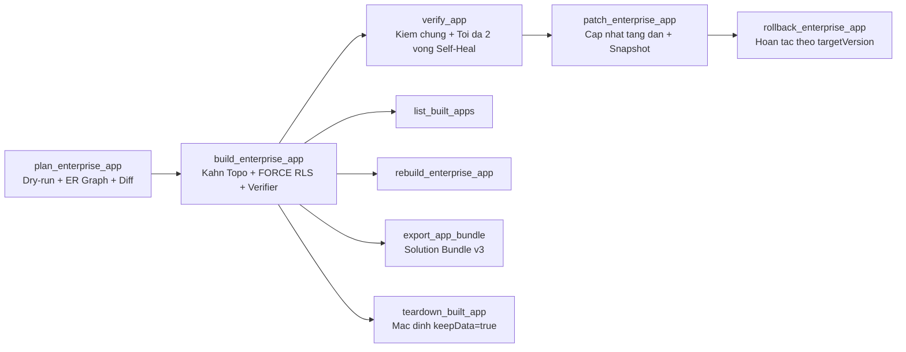

# DX-OS AI Studio & App Builder 2.0

**DX-OS AI Studio** (`@latticedx/plugin-dxos-ai`, route `/admin/settings/dxos-ai`) là trung tâm điều phối lực lượng tác nhân AI, trình kiến tạo ứng dụng doanh nghiệp đa thực thể **App Builder 2.0**, cổng giao tiếp **2-Way Streamable MCP**, giao thức **Google/LF A2A**, phòng thí nghiệm kiểm chuẩn tiếng Việt **Eval Lab (`163/163`)** và bộ kiểm soát **Quota + Che PII Việt Nam** trên LatticeDX `v0.4.2`.

::: info Nguyên tắc thiết kế cốt lõi
Mọi tác vụ AI trong LatticeDX đều tuân theo cơ chế **Fail-Closed Tenant Isolation**: xác thực vai trò thực từ `rolesUsers`, chạy bên trong ngữ cảnh `FORCE RLS` theo `organizationId`, lọc quyền công cụ theo `adminOnly` / `ALLOW` / `ASK` / `OFF`, và ghi vết OpenTelemetry GenAI (`latticeAiTraces`) kèm nhật ký kiểm toán (`latticeAiAuditLogs`).
:::

---

## 1. Bảng điều khiển 9 Tab trong DX-OS AI Studio

Giao diện quản trị tại `/admin/settings/dxos-ai` (`ai-studio-page.js`) tổ chức **9 tab** thành **3 nhóm chức năng** trên thanh điều hướng `dxos-studio-sidebar`:

| Nhóm chức năng | STT | Key Tab | Tên hiển thị & Vai trò chính |
| --- | :---: | --- | --- |
| **Tổng quan & Kết nối** | 1 | `topology` | **1. Hệ điều hành 6 Phân hệ** — Xem topology 6-Plane, phiên bản runtime NocoBase `2.2.50` (Điều 5.2), kết nối nhanh LLM (Quick-Connect: OpenAI, 9router/OpenAI-compatible, Google Gemini, Anthropic Claude, DeepSeek, Ollama) |
| **Tổng quan & Kết nối** | 2 | `workforce` | **2. Quản trị Nhân sự AI Động** — Tạo/sao chép hồ sơ AI, gán `allowedRoles`, `portalBindings`, ma trận quyền từng công cụ (`ALLOW` / `ASK` / `OFF`) và đồng bộ 7 Starter Blueprints |
| **Tổng quan & Kết nối** | 3 | `mcp` | **3. Cổng Enterprise MCP 2 Chiều** — Tra cứu danh mục tool Enterprise & IT/OT, Resource URIs, 4 Prompts, Agent Card A2A và kiểm thử JSON-RPC MCP trực tiếp |
| **Xây dựng & Đánh giá AI** | 4 | `built-apps` | **4. Ứng dụng Đã dựng (Built Apps)** — Chạy 3 Quick-Start Suites, lập kế hoạch (`plan`), xem đồ thị ER, nâng cấp (`patch`), hoàn tác (`rollback`), xuất Solution Bundle v3 và gỡ bỏ (`teardown`) |
| **Xây dựng & Đánh giá AI** | 5 | `audit` | **5. Nhật ký Kiểm toán** — Theo dõi toàn bộ lời gọi tool/MCP/A2A theo múi giờ `GMT+7`, bộ lọc theo kênh, nhân sự AI và trạng thái (`allowed`, `denied`, `degraded`, `error`) |
| **Xây dựng & Đánh giá AI** | 6 | `traces` | **6. Agent Trace Waterfall** — Quan sát cây span OpenTelemetry GenAI (`invoke_agent`, `execute_tool`), độ trễ từng bước, token đầu vào/đầu ra và dữ liệu đã được che PII |
| **Xây dựng & Đánh giá AI** | 7 | `eval-lab` | **7. Eval Lab** — Thực thi bộ kiểm chuẩn **`163/163`** câu lệnh tiếng Việt tự nhiên trên **23** nhóm ý định & bảo mật |
| **Kiểm soát & Phê duyệt** | 8 | `hitl` | **8. Duyệt AI (HITL)** — Hàng chờ phê duyệt các thao tác rủi ro (`latticeAiApprovalQueue`), xem diff trước/sau và thời hạn `expiresAt` |
| **Kiểm soát & Phê duyệt** | 9 | `quota` | **9. Hạn mức & Chi phí AI** — Thiết lập trần gọi/token/USD theo ngày cho từng `organizationId` và theo dõi mức tiêu thụ thực tế |

---

## 2. Hệ thống 20 Unified AI Tools

Backend đăng ký chính xác **20 Unified AI Tools** (`ai-tools-core.js` và `ai-memory.js`), phân thành **3 nhóm rõ ràng** với ranh giới đặc quyền `adminOnly`:

### 2.1. Nhóm 11 Công cụ Admin Builder (`adminOnly: true`)

Chỉ tài khoản có quyền quản trị (`root`, `admin` hoặc vai trò có `allowConfigure: true` / snippet `pm`) mới nhìn thấy và gọi được nhóm này:

| Công cụ | Chức năng chính |
| --- | --- |
| `dxos_inspect_architecture` | Đọc topology 6-Plane, trạng thái plugin, sức khỏe dịch vụ và số liệu các phân hệ |
| `dxos_recommend_page_blueprint` | Phân tích cấu trúc trang cổng hiện tại và đề xuất bố cục/BlockModel phù hợp |
| `dxos_design_creative_block` | Thiết kế `DxosCreativeStudioBlockModel` (gauge, nhiệt kế cảnh báo, `timeseries-line`, `stage-pipeline`) với 5 theme (`industrial-cockpit`, `emerald-ops`, `amber-alert`, `royal-indigo`, `clean-light`) và hỗ trợ đặt cạnh khối khác (`placeBesideTitle`) |
| `dxos_compose_page_blocks` | Liệt kê, thêm hoặc cấu hình 12 Native v2 `BlockModel`s và block chuẩn NocoBase trên portal |
| `dxos_snapshot_or_rollback_page` | Chụp bản lưu (Time-Machine snapshot) hoặc hoàn tác giao diện cổng về trạng thái trước |
| `dxos_provision_role_workspace` | Bộ điều phối **10 operations** của App Builder 2.0 & tạo không gian làm việc theo vai trò `ldx_*` |
| `dxos_manage_portal_and_acl` | Quản lý trang cổng `/p/<portalSlug>`, menu điều hướng và gắn quyền truy cập theo vai trò |
| `dxos_extend_collection_schema` | Mở rộng bảng/trường Rich Schema (`latticeCustom*`, công thức `formula`, quan hệ `belongsTo`/`hasOne`/`belongsToMany`) |
| `dxos_manage_rbac_permissions` | Cấu hình phân quyền chi tiết cấp collection, action và khóa trường (`lockedFields`) cho vai trò `ldx_*` |
| `dxos_deploy_workflow` | Triển khai mẫu quy trình chuẩn lên động cơ tự động hóa |
| `dxos_configure_workflow` | Quản trị 2 chiều LatticeFlow v2 (`draftAutomation`, `patchAutomation`, `suggestAutomation`, `testAutomation`, `resumeAutomation`, `saveAutomation`, `runAutomation`), bảng DMN (`dmn_list_tables`, `dmn_save_table`, `dmn_evaluate`) và Stock `n8n` REST v1 |

### 2.2. Nhóm 6 Công cụ Vận hành (`adminOnly: false`)

Thực thi theo đúng quyền `RBAC` và phạm vi `organizationId` của người dùng gọi:

| Công cụ | Chức năng chính |
| --- | --- |
| `dxos_search_enterprise_context` | Tìm kiếm ngữ cảnh đa bảng nghiệp vụ (`latticeOrders`, `latticeRequests`, `latticeServiceTickets`, `latticeIncidentCases`, `latticeAssets`, `latticeParaDocuments`) kèm trích dẫn `[collection:code#id]` |
| `dxos_execute_record_action` | Thao tác bản ghi trên các bảng nghiệp vụ cho phép ghi (`latticeServiceTickets`, `latticeOrders`, `latticeRequests`, `latticeParaDocuments`), khóa cứng các trường hệ thống bảo vệ (`PROTECTED_SERVER_FIELDS`) |
| `dxos_my_workflow_tasks` | Liệt kê và xử lý tác vụ quy trình/phê duyệt đang giao cho người dùng |
| `dxos_orchestrate_enterprise_case` | Chạy radar tổng hợp điểm nghẽn liên phòng ban hoặc điều phối chuỗi phiếu xử lý sự cố 360° |
| `dxos_graph_impact_analysis` | Truy vết đồ thị phả hệ & ảnh hưởng (GraphRAG) từ thiết bị, sự cố hoặc lô hàng (`maxDepth`), có tùy chọn kèm telemetry `includeTelemetry` |
| `dxos_alarm_action` | Tiếp nhận (`ack`) hoặc giải tỏa (`clear`) cảnh báo chuỗi lạnh/IoT theo thẩm quyền |

### 2.3. Nhóm 3 Công cụ Bộ nhớ Bền vững (`adminOnly: false`)

Lưu trữ trên collection `latticeAiMemory` (`ai-memory.js`), xếp hạng truy hồi theo TF-IDF, từ khóa, thẻ (`tags`), độ quan trọng (`importance`) và độ mới (`recency`):

| Công cụ | Quyền mặc định | 4 Phạm vi (`scope`) & Ràng buộc |
| --- | :---: | --- |
| `dxos_memory_remember` | `ALLOW` | Lưu/cập nhật sự kiện theo `memoryKey` + `ttlSeconds`/`expiresAt`. Ghi vào `org` chỉ dành cho Admin; `agent` chỉ Admin được truy cập |
| `dxos_memory_recall` | `ALLOW` | Truy hồi ký ức qua 1 hoặc nhiều `scopes` (`org`, `agent`, `user`, `session`) trong đúng `organizationId` |
| `dxos_memory_forget` | `ASK` | Xóa ký ức lỗi thời theo `id` hoặc `memoryKey` (yêu cầu xác nhận người dùng; xóa scope `org` chỉ dành cho Admin) |

---

## 3. App Builder 2.0: 10 Operations & 3 Quick-Start Suites

### 3.1. Vòng đời 10 Operations của `dxos_provision_role_workspace`

Toàn bộ **10 giá trị `operation`** được hỗ trợ bởi `dxos_provision_role_workspace`:

1. `provision_role_workspace` — Cấp phát nhanh một vai trò `ldx_*`, trang `/p/<portalSlug>`, khóa cột nhạy cảm và trợ lý AI riêng.
2. `plan_enterprise_app` — Lập kế hoạch khô (*dry-run*, không ghi DB), trả về đồ thị thực thể **ER Graph** và bảng sai khác **Diff**.
3. `build_enterprise_app` — Dựng trọn bộ ứng dụng đa thực thể: sắp xếp thứ tự phụ thuộc bảng theo thuật toán **Kahn topological sort**, tạo bảng `latticeCustom*` + `FORCE RLS`, gắn vai trò `ldx_*`, portal `/p/<portalSlug>`, 12 Native v2 `BlockModel`s, DMN, LatticeFlow v2 và tự kiểm chứng (`maxHealRounds: 2`).
4. `patch_enterprise_app` — Áp dụng bản vá tăng dần (thêm/sửa/ẩn trường, thêm quan hệ `belongsTo`, gắn thêm block/role/flow/DMN) có lưu snapshot phiên bản.
5. `rollback_enterprise_app` — Hoàn tác 1 chạm về `targetVersion` trước đó.
6. `verify_app` — Kiểm tra độc lập schema, RLS, RBAC, route portal, DMN, flow và `n8n` workflow của ứng dụng.
7. `list_built_apps` — Liệt kê các ứng dụng đã dựng trong bảng `latticeBuiltApps` theo `organizationId`.
8. `rebuild_enterprise_app` — Dựng lại ứng dụng từ spec hiện tại hoặc kết hợp `specPatch`.
9. `export_app_bundle` — Đóng gói thành **Solution Bundle v3** (`latticedx.solution-bundle/v3`) để chuyển giao GitOps.
10. `teardown_built_app` — Gỡ bỏ portal/route/ứng dụng (mặc định **`keepData: true`** để bảo toàn dữ liệu nghiệp vụ trong CSDL).

::: warning Bảo vệ bảng hệ thống (System Protected Collections)
App Builder 2.0 chỉ cho phép khởi tạo và sửa đổi các bảng khớp mẫu `^latticeCustom[A-Z][A-Za-z0-9]{1,40}$`. Mọi yêu cầu tác động lên `SYSTEM_PROTECTED_COLLECTIONS` (`users`, `roles`, `latticeBuiltApps`, `latticeAiAuditLogs`, `latticeAiMemory`, `latticeAiTraces`, `workflows`, `collections`, ...) đều bị từ chối ở tầng server.
:::

### 3.2. 3 Quick-Start Suites dựng sẵn

Tại tab `4. Ứng dụng Đã dựng (Built Apps)` (`BUILT_APP_QUICKSTART_PRESETS` trong `ai-studio-page.js` và `buildDraftSpecFromNaturalPrompt` trong `app-builder-planner.js`), quản trị viên có thể khởi tạo ngay **3 bộ ứng dụng mẫu**:

| `appKey` | Tên ứng dụng | Bảng dữ liệu `latticeCustom*` | Vai trò & Portal | Điểm nhấn BlockModel & Công thức |
| --- | --- | --- | --- | --- |
| `clinic-suite` | **Phòng khám Đa khoa** | `latticeCustomClinicPatients`, `latticeCustomClinicVisits`, `latticeCustomClinicPrescriptions` | `ldx_clinic_staff` · `/p/clinic-ops` | Theme `clean-light`, formula `quantity * unitPrice`, `DxosRecordWorkbenchBlockModel`, `DxosBiChartBlockModel` (`bar`) |
| `b2b-crm-suite` | **CRM Bán hàng B2B** | `latticeCustomCrmAccounts`, `latticeCustomCrmDeals` | `ldx_crm_sales` · `/p/b2b-crm` | Theme `royal-indigo`, formula `valueVnd * probability / 100`, `DxosKanbanScheduleBlockModel`, `DxosBiChartBlockModel` (`bar` sum `valueVnd`) |
| `internal-itsm-suite` | **ITSM Hỗ trợ Nội bộ** | `latticeCustomItAssets`, `latticeCustomItTickets` | `ldx_itsm_agent` · `/p/itsm-desk` | Theme `industrial-cockpit`, `DxosRecordWorkbenchBlockModel`, `DxosBiChartBlockModel` (`pie` theo `priority`) |

---

## 4. 7 Starter AI Profiles

Khi bấm **Cài 7 Starter Blueprints & IT/OT MCP** (`dxosAi:bootstrapDefaults`), hệ thống đồng bộ **7 hồ sơ nhân sự AI chuẩn** (`ai-schemas.js` & `a2a-gateway.js`):

| Username | Vai trò / Chức danh | `isAdminBuilder` | Phạm vi Portal (`portalBindings`) |
| --- | --- | :---: | --- |
| `dxos-coordinator` | Tổng Điều phối viên DX-OS (`allowSubAgentDispatch: true`) | `false` | `*` (Điều phối liên phòng ban) |
| `dxos-architect` | Kiến trúc sư Hệ thống - Block AI (Chỉ `root` / `admin`) | `true` | `*` (App Builder 2.0, Creative Block, Flow/DMN) |
| `dxos-ops` | Chuyên viên Kho lạnh - Sự cố IoT AI | `false` | `incidents`, `procurement` |
| `dxos-logistics` | Điều phối viên Chuỗi lạnh 5 Bước AI | `false` | `logistics` |
| `dxos-workspace` | Trợ lý Dịch vụ, Mua sắm & P.A.R.A. | `false` | `services`, `procurement` |
| `dxos-operator` | DX-OS Operations Executor | `false` | Tác vụ vận hành & xử lý IT/OT có kiểm soát |
| `dxos-analyst` | DX-OS Enterprise Analyst | `false` | Phân tích BI, GraphRAG lineage & chẩn đoán SLA |

---

## 5. Cổng 2-Way MCP Gateway & Giao thức A2A

### 5.1. 2-Way Streamable MCP Gateway (`mcp-gateway.js`)

LatticeDX cung cấp 2 endpoint MCP stateless qua JSON-RPC `POST` (yêu cầu Bearer token JWT hoặc `ldx_pat_*`; từ chối `GET`/`DELETE` với HTTP `405`, thiếu xác thực trả HTTP `401` kèm `WWW-Authenticate`):

- **`/api/dxos-mcp`** (`latticedx-enterprise-mcp`): Phơi bày danh mục công cụ doanh nghiệp được lọc theo quyền người gọi (`isAdmin || !t.adminOnly`).
- **`/api/dxos-mcp/it-ot`** (`latticedx-itot-mcp`): Phơi bày bộ công cụ chuyên biệt IT/OT (`get_live_ngsi_telemetry`, `get_sensor_and_incident_timeline`, v.v.).
- **Phiên bản giao thức hỗ trợ (`SUPPORTED_PROTOCOL_VERSIONS`):** **`2025-03-26`** và **`2024-11-05`**.
- **4 Prompts chuẩn (`prompts/list`, `prompts/get`):**
  1. `dxos-cold-chain-incident-triage` (tham số `assetCode`, tùy chọn `incidentCode`)
  2. `dxos-fefo-dispatch-audit` (tham số `lotCode`, tùy chọn `sku`)
  3. `dxos-executive-radar-brief` (tùy chọn `focusArea`)
  4. `dxos-system-blueprint-architect` (`adminOnly: true`, tham số `portalSlug`, `goal`)
- **Resource URIs & Resource Templates (`resources/list`, `resources/read`, `resources/templates/list`):**
  - `dxos://org/{organizationId}/alarms/active` — Danh sách cảnh báo chưa đóng của tổ chức (đã che PII và kiểm tra cross-org fail-closed).
  - `dxos://org/{organizationId}/lineage/{collection}/{recordId}` — Đồ thị truy vết ảnh hưởng GraphRAG của bản ghi.
  - `dxos://topology/planes` & `dxos://itot/health` — Tài nguyên hạ tầng (chỉ Admin).

### 5.2. Giao thức Google/LF A2A (`a2a-gateway.js`)

- **Agent Card discovery:** `/.well-known/agent-card.json` và `/api/dxos-a2a/agent-card.json`.
- **JSON-RPC endpoint:** `/api/dxos-a2a`.
- **6 Trạng thái tác vụ (`A2A_VALID_STATUSES`):** `submitted`, `working`, `input-required`, `completed`, `failed`, `canceled` (trạng thái kết thúc: `completed`, `failed`, `canceled`).

---

## 6. Eval Lab `163/163`, Hạn mức Quota & Che PII Việt Nam

### 6.1. Bộ kiểm chuẩn Tiếng Việt Tự nhiên (`163/163`)

Script `node scripts/eval-vietnamese-nl-agent.mjs --min-pass=95` (và tab `7. Eval Lab` trên UI) đánh giá **163 kịch bản** (`VIETNAMESE_NL_EVAL_CASES`) đạt **`163/163` (`100%`)** trên **23 nhóm ý định và từ chối bảo mật**:

- Nhóm ý định nghiệp vụ & kiến trúc: `rag-search`, `workflow-tasks`, `orchestration`, `alarm-ops`, `creative-architect`, `admin-provision`, `admin-rollback`, `graphrag-impact`, `wms-coldchain`, `automation-architect`, `app-builder`, `dmn-governance`, `n8n-api-hub`, `built-apps-lifecycle`, `app-builder-2.0`, `bi-chart-block`, `react-agent-memory`, `a2a-protocol`, `workflow-lifecycle`, `approvals-inbox`, `omnichannel-notify`, `public-forms`.
- Nhóm phòng thủ tấn công (`security-refusal`): chặn prompt injection ("bỏ qua hướng dẫn trước đó"), leo thang đặc quyền (`root`), rò rỉ `.env` / JWT / `AGENT_API_KEY`, và SQL injection (`DROP TABLE`, `UNION SELECT`).

### 6.2. Hạn mức Quota theo Ngày (`ai-governance.js`)

Hệ thống theo dõi và cưỡng chế hạn mức trên `latticeAiQuotaPolicies` và `latticeAiQuotaUsage`. Khi vượt ngưỡng sẽ từ chối ngay với HTTP `429` (`AI_QUOTA_EXCEEDED`):

| Tham số | Biến môi trường | Mặc định |
| --- | --- | :---: |
| `orgDailyCalls` | `DXOS_AI_DAILY_ORG_CALL_LIMIT` | `5,000` lượt/ngày |
| `userDailyCalls` | `DXOS_AI_DAILY_USER_CALL_LIMIT` | `500` lượt/ngày |
| `orgDailyTokens` | `DXOS_AI_DAILY_ORG_TOKEN_LIMIT` | `5,000,000` tokens/ngày |
| `orgDailyUsd` | `DXOS_AI_DAILY_ORG_USD_LIMIT` | `$50` / ngày |

### 6.3. Che PII Việt Nam & Bí mật Hệ thống (`otel-exporter.js`)

Trước khi lưu vết `latticeAiTraces`, nhật ký `latticeAiAuditLogs` hoặc gửi sang LLM/OTLP, hàm `redactPiiText` và `redactPiiDeep` tự động che:

- **Token & Khóa xác thực:** `JWT` (`eyJ...` -> `[REDACTED_JWT]`), `Bearer ...` (`[REDACTED]`), OpenAI key `sk-*` và PaaS PAT **`ldx_pat_*`** (`[REDACTED_KEY]`).
- **Định danh & Liên hệ Việt Nam:** Email (`[REDACTED_EMAIL]`), **CCCD / CMND** (`9–12` chữ số hoặc bắt đầu bằng `0` đủ 12 số -> `[REDACTED_CCCD]`), **Số điện thoại Việt Nam** (`+84` hoặc `0` + đầu số `3|5|7|8|9` + 8 số -> `[REDACTED_PHONE]`), **Số tài khoản ngân hàng / IBAN (`STK`)** (`[REDACTED_BANK]`), và **Mã số thuế (`MST`)** (`10` số hoặc `10-3` số -> `[REDACTED_MST]`).

---

## Tài liệu liên quan

- [P.A.R.A. Knowledge Vault & OCR/Hybrid RAG](/modules/para-knowledge-ocr)
- [Unified Approvals, dxosNotify, Public Forms & Mobile PWA](/modules/approvals-notify-forms-pwa)
- [Kiến trúc Mô-đun 7 Plugin](/guide/plugins-modularity)
