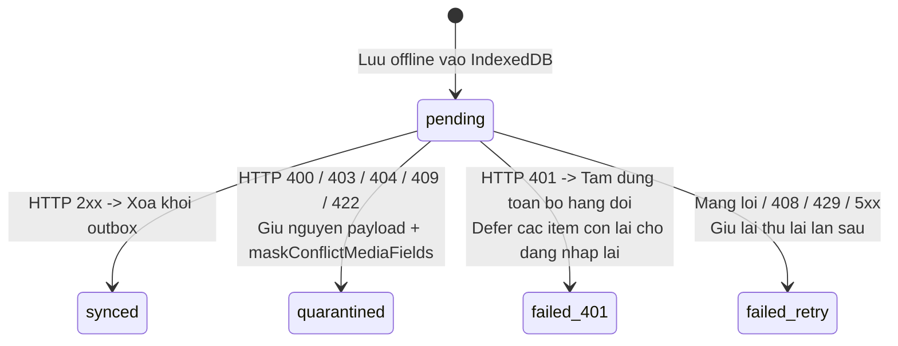

# Unified Approvals, `dxosNotify`, Public Forms & Mobile Field PWA

Phân hệ Con người & Hiện trường trong `@latticedx/plugin-lattice-foundation` kết nối trọn vẹn luồng phê duyệt hợp nhất (**`dxosApprovals`**), cảnh báo đa kênh (**`dxosNotify`**), thu thập dữ liệu công khai không lộ PII (**`dxosForms`** tại `/v/form/:slug`) và ứng dụng tác nghiệp ngoại tuyến cho tài xế/kỹ thuật viên (**Mobile Field PWA** tại `/v/mobile`).

---

## 1. Động cơ Phê duyệt Hợp nhất (`dxosApprovals`)

`approval-engine.js` hợp nhất toàn bộ yêu cầu cần con người ra quyết định vào một hộp thư chung (`listInbox`) và xử lý nhất quán thông qua **8 actions**:

| Action | Phương thức | Mô tả chức năng |
| --- | :---: | --- |
| `listInbox` | `GET` | Tổng hợp hộp thư cần duyệt theo 5 nguồn (`all`, `business`, `ai_hitl`, `flow`, `proposals`), tự động tính cả quyền được ủy quyền từ `latticeDelegations` |
| `decide` | `POST` | Phê duyệt (`approve`) hoặc từ chối (`reject`) mục bất kỳ trong 5 nguồn (riêng `proposals` hỗ trợ thêm `review`); sử dụng khóa tuần tự hóa `withCanonicalDecisionLock` chống duyệt trùng |
| `request` | `POST` | Tạo yêu cầu phê duyệt nghiệp vụ mới gắn với một bản ghi thuộc bảng `lattice*` được allowlist (chặn `PROTECTED_TARGET_COLLECTIONS`) |
| `cancel` | `POST` | Hủy yêu cầu phê duyệt đang chờ bởi người tạo hoặc quản trị viên |
| `listPolicies` | `GET` | Liệt kê các chính sách phê duyệt (`latticeApprovalPolicies`) trong tổ chức |
| `savePolicy` | `POST` | Tạo/cập nhật chính sách nhiều chặng (`stagesJson`) với điều kiện kích hoạt (`conditionJson`) |
| `deletePolicy` | `POST` | Xóa chính sách phê duyệt |
| `evaluateSlaNow` | `POST` | Đánh giá SLA quá hạn và leo thang/nhắc việc (chỉ Admin) |

### 1.1. Hai chế độ Chặng (`sequential` & `parallel` M-of-N)

Mỗi chặng phê duyệt trong `stagesJson` hỗ trợ 1 trong 2 chế độ (`VALID_MODES`):

- **`sequential`:** Duyệt tuần tự từng bước; mặc định `requiredApprovals = 1`.
- **`parallel` (`M-of-N`):** Cho phép nhiều người phê duyệt song song và chỉ chuyển bước khi đạt đủ số phiếu thuận **`requiredApprovals`** (`1..50`). Hệ thống kiểm tra ngay khi lưu policy nếu danh sách `approverUserIds` ít hơn `requiredApprovals`.

### 1.2. 5 Nguồn Hộp thư Hợp nhất (`VALID_INBOX_SOURCES`)

| Giá trị `source` | Phạm vi dữ liệu |
| --- | --- |
| `all` | Tổng hợp toàn bộ 4 nguồn bên dưới kèm bộ đếm `counts` từng loại |
| `business` | Yêu cầu phê duyệt từ `latticeApprovalRequests` |
| `ai_hitl` | Hàng chờ công cụ AI có rủi ro từ `latticeAiApprovalQueue` |
| `flow` | Nút `control.approval` đang tạm dừng trong LatticeFlow v2 |
| `proposals` | Đề xuất thay đổi của AI Agent từ `latticeAgentProposals` |

::: info Bảo mật Ủy quyền (`latticeDelegations`)
Khi `approval-engine.js` tính quyền thay mặt cho người nhận ủy quyền, `FORBIDDEN_DELEGATION_ROLES` và `isElevatedRoleRow` **chặn cứng** việc ủy quyền các vai trò đặc quyền (`root`, `admin`, `ldx_admin`, `allowAll`, `allowConfigure`) để ngăn leo thang đặc quyền gián tiếp.
:::

---

## 2. Thông báo Đa kênh (`dxosNotify`)

`omnichannel-notify.js` định nghĩa resource **`dxosNotify`** gồm **4 actions**:

| Action | Phương thức | Chức năng |
| --- | :---: | --- |
| `send` | `POST` | Gửi thông báo qua 1 hoặc nhiều kênh cấu hình trong `latticeConnectors` |
| `testSend` | `POST` | Gửi tin kiểm thử kênh (chỉ Admin) |
| `logs` | `GET` | Tra cứu nhật ký gửi `latticeNotificationDeliveries` đã che mật khẩu/token (chỉ Admin) |
| `channels` | `GET` | Liệt kê các kênh đang hoạt động của tổ chức |

### 4 Kênh hỗ trợ (`SUPPORTED_CHANNELS`) & Cơ chế Phòng thủ

1. **`smtp`:** Gửi email qua TCP/TLS thuần Node.js (`node:net` / `node:tls`); chặn tấn công **SMTP Header Injection** bằng `assertNoHeaderInjection` (từ chối mọi ký tự `\r`, `\n`, `\0` với mã lỗi `SMTP_HEADER_INJECTION_BLOCKED`).
2. **`telegram`:** Gửi tin qua Telegram Bot API (kiểm tra định dạng `TELEGRAM_TOKEN_RE` và `TELEGRAM_CHAT_RE`, tự che `bot<token>` trong log).
3. **`slack`:** Gửi thông điệp tới Slack Webhook / Bot API.
4. **`webhook`:** Gửi HTTP JSON payload tùy biến (`renderWebhookPayload`) tới URL đã qua kiểm tra SSRF của Connector Vault (`assertSafeConnectorUrlAsync`).

Mọi template <code v-pre>{{variable}}</code> đều đi qua `safeResolvePath` (chặn `__proto__`, `constructor`, `prototype`), hỗ trợ `escapeHtml` chống XSS, thử lại theo cấp số nhân (`DEFAULT_MAX_ATTEMPTS = 3`, backoff `250 ms` → `5000 ms`) và che toàn bộ bí mật (`scrubSecrets`, `maskTarget`) trước khi ghi `latticeNotificationDeliveries`.

---

## 3. Biểu mẫu Công khai `/v/form/:slug` (`dxosForms`)

`public-forms.js` cung cấp cổng thu thập dữ liệu bên ngoài không cần đăng nhập tại `/v/form/:slug` với **10 actions** (chia thành `3` action công khai và `7` action nội bộ):

| Nhóm | Actions |
| --- | --- |
| **Công khai (`public`)** | `meta` (lấy cấu trúc trường được phép hiển thị), `submit` (nộp biểu mẫu), `status` (tra cứu trạng thái xử lý theo `submissionCode` + token) |
| **Nội bộ (`loggedIn`)** | `list`, `get`, `save`, `delete`, `rotateToken`, `listSubmissions`, `downloadAttachment` |

### Hàng rào Bảo mật 6 Lớp trên `/v/form/:slug`

| Lớp bảo vệ | Thông số & Cơ chế xác thực trong `public-forms.js` |
| --- | --- |
| **1. Allowlist Collection & Blocked Fields** | Chỉ cho phép ghi vào `8` bảng chuẩn (`latticeRequests`, `latticeOrders`, `latticeServiceTickets`, `latticeParaDocuments`, `latticeIncidentCases`, `latticeLocations`, `latticeAssets`, `latticeAgentProposals`) hoặc `latticeCustom*`. Chặn truy cập trực tiếp `latticePublicForms` / `latticePublicFormSubmissions` và khóa cứng `BLOCKED_TARGET_FIELDS` (`id`, `organizationId`, `status`, `version`, `accessTokenHash`, `statusTokenHash`, ...). |
| **2. 9 Loại Trường cho phép (`ALLOWED_FIELD_TYPES`)** | `string`, `text`, `number`, `integer`, `boolean`, `date`, `email`, `select`, `file` (tối đa `50` trường/form, độ dài chuỗi tối đa mặc định `2,000` và trần `10,000` ký tự; biểu thức regex phải qua `compileBoundedPattern` chống ReDoS). |
| **3. Tệp đính kèm tối đa `2 MB`** | `MAX_FILE_UPLOAD_BYTES = 2 * 1024 * 1024` (`2 MB`). Chỉ chấp nhận 5 MIME an toàn (`application/pdf`, `image/png`, `image/jpeg`, `image/webp`, `text/plain`). Khi tải xuống (`downloadAttachment`) luôn gắn `X-Content-Type-Options: nosniff`. |
| **4. Giới hạn Tần suất (Rate Limiting)** | Sliding-window limiter: **`20` lượt/phút** (`DEFAULT_RATE_LIMIT_PER_MIN`) cho `submit`, **`60` lượt/phút** (`STATUS_RATE_LIMIT_PER_MIN`) cho `status`, và lớp chặn IP flood **`300` lượt/phút** trước khi tra cứu DB. |
| **5. Honeypot & Token băm Timing-Safe** | Hỗ trợ trường bẫy bot (`HONEYPOT_NAME_RE`) và xác thực access/status token bằng SHA-256 kết hợp `timingSafeEqualHex` (kèm `DUMMY_HASH_HEX` tránh timing oracle). |
| **6. Chống Prototype Pollution** | Hàm `assertNoPrototypePollution` duyệt đệ quy toàn bộ payload (độ sâu tối đa `20`), chặn mọi khóa `__proto__`, `constructor`, `prototype` (`FORM_PROTOTYPE_POLLUTION_BLOCKED`). |

---

## 4. Mobile Field PWA (`/v/mobile`) & IndexedDB Outbox

Tuyến `/v/mobile` (`mobile-field-pwa.js` + `mobile-offline-db.js`) cùng resource `dxos` (`health`, `metrics`, `openapi`, `asyncapi`, `manifest`, `sw.js`, `sw`, `icon-192.png`, `icon-512.png`) phục vụ nhân sự hiện trường (tài xế, thủ kho, kỹ thuật viên) với tối ưu màn hình di động (`390×844`) và hoạt động ổn định khi mất mạng.

### 4.1. Cấu trúc IndexedDB Outbox (`latticedx-mobile-outbox`)

- Lưu bền vững tối đa **`50` bản ghi** (`MAX_OUTBOX_ITEMS = 50`) trong IndexedDB store `outbox` (tự động fallback về `localStorage` nếu IndexedDB không khả dụng).
- Chỉ cho phép **4 hành động ngoại tuyến an toàn (`ALLOWED_OFFLINE_ACTIONS`)**:
  1. `wms.epodCapture` → `dxosWms:epodCapture` (Xác nhận ePOD)
  2. `iot.twinSetDesired` → `dxosBlocks:twinSetDesired` (Đặt ngưỡng Twin)
  3. `service.ticketCreate` → `latticeServiceTickets:create` (Tạo ticket dịch vụ)
  4. `iot.incidentCreate` → `dxosBlocks:alarmIngest` (Báo cáo sự cố)
- Ràng buộc dung lượng & media: payload JSON tối đa `320 KB`, ảnh minh chứng ePOD raster tối đa **`512 KB`** (`MAX_PHOTO_DATA_URL_BYTES`), **từ chối tuyệt đối `data:image/svg+xml`** để tránh XSS qua ảnh, tổng gói kèm ảnh tối đa `768 KB`.

### 4.2. Máy trạng thái Đồng bộ Outbox (`flushOfflineQueue`)

- **Trạng thái `quarantined` trên `400/403/404/409/422`:** Các giao dịch bị máy chủ từ chối vĩnh viễn hoặc xung đột phiên bản (`409` Conflict) **không bao giờ bị tự động xóa mất**. Chúng chuyển sang `quarantined` kèm `lastError` và `conflictData` (đã che chuỗi base64 ảnh/chữ ký bằng `maskConflictMediaFields`) để nhân viên hiện trường kiểm tra, sửa lại hoặc xuất dữ liệu đối soát.
- **Tạm dừng an toàn trên `401`:** Nếu phiên đăng nhập hết hạn (`HTTP 401`), hàm `flushOfflineQueue` đặt cờ `unauthorized: true`, chuyển mục đang gửi sang `failed` (`httpStatus: 401`) và **dừng ngay vòng lặp** (`break`), đánh dấu toàn bộ các mục còn lại là `deferred` để chờ người dùng đăng nhập lại mà không làm mất hay gây lỗi hàng loạt cho dữ liệu ePOD đã chụp.

---

## Tài liệu liên quan

- [DX-OS AI Studio & App Builder 2.0](/modules/ai-studio-app-builder)
- [IIoT, 2-Way Digital Twin, Connector Vault, Event Bus & Stock n8n](/modules/iiot-digital-twin-n8n)
- [P.A.R.A. Knowledge Vault & OCR/Hybrid RAG](/modules/para-knowledge-ocr)
