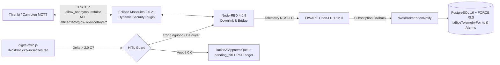

# IIoT, 2-Way Digital Twin, Connector Vault, Event Bus & Stock `n8n`

LatticeDX `v0.4.2` cung cấp hạ tầng kết nối công nghiệp và tích hợp mở hoàn toàn theo giấy phép **Pure-OSI** (không ThingsBoard, không EMQX BSL-1.1): từ cấp phát thiết bị **Eclipse Mosquitto `2.0.21`** bằng **MQTT 3.1.1 thuần `node:net`**, bản sao số 2 chiều (**FIWARE Orion-LD `1.12.0`** + **Node-RED `4.0.9`** + **HITL `±2.0°C`**), kho bí mật **Connector Vault AES-256-GCM + OAuth2 PKCE S256**, **Event Bus CloudEvents + Standard Webhooks + Circuit Breaker** đến cầu nối **Stock `n8nio/n8n:2.48.1`**.

---

## 1. Kiến trúc IIoT & Bản sao số 2 Chiều (2-Way Digital Twin)

---

## 2. Broker Control & Orion-LD (`dxosBroker`)

Resource **`dxosBroker`** (`broker-control.js`, thuộc `@latticedx/plugin-dxos-blocks`) quản trị vòng đời thiết bị MQTT và đồng bộ NGSI-LD với **10 actions**:

| Nhóm | Actions (`10`) | Chức năng chính |
| --- | --- | --- |
| **Mosquitto DynSec & Thiết bị** | `listDevices`, `provisionDevice`, `revokeDevice`, `deviceStatusIngest` | Quản lý thiết bị, cấp phát/thu hồi động user & role trên Mosquitto, nhận trạng thái online/offline (LWT) |
| **FIWARE Orion-LD 1.12.0** | `orionEntities`, `orionListSubscriptions`, `orionCreateSubscription`, `orionToggleSubscription`, `orionDeleteSubscription`, `orionNotify` | Truy vấn thực thể NGSI-LD, quản lý subscription và tiếp nhận webhook telemetry (`orionNotify`) đưa vào `latticeTelemetryPoints` + kích hoạt cảnh báo |

### Pure `node:net` MQTT 3.1.1 → `$CONTROL/dynamic-security/v1`

- Không cài thêm client MQTT nặng ở tầng server: `broker-control.js` tự đóng gói gói tin nhị phân MQTT 3.1.1 (`buildConnectPacket`, `buildPublishPacket`, `buildDisconnectPacket`, giới hạn gói `65,536` bytes) trực tiếp qua `node:net` (`publishMqttControl`).
- Khi gọi `provisionDevice`, LatticeDX gửi lệnh JSON tới topic điều khiển **`$CONTROL/dynamic-security/v1`** của Mosquitto (`mosquitto.conf` bật `allow_anonymous false` và `mosquitto_dynamic_security.so`):
  - Tạo role riêng `role_<orgId>_<deviceKey>` và gắn **ACL nghiêm ngặt** trong không gian tên `latticedx/<orgId>/<deviceKey>/*`:
    - `publishClientSend`: `latticedx/<orgId>/<deviceKey>/#`
    - `subscribePattern` & `publishClientReceive`: `latticedx/<orgId>/<deviceKey>/command` và `latticedx/<orgId>/<deviceKey>/ack`.
- Khi gọi `revokeDevice`, tài khoản MQTT bị vô hiệu hóa tức thì trên Dynamic Security để cắt kết nối thiết bị không hợp lệ.

---

## 3. 2-Way Digital Twin (`digital-twin.js`) & Node-RED `4.0.9`

Module `digital-twin.js` (phục vụ các action `twinShadow`, `twinSetDesired`, `twinAckCommand` trên `dxosBlocks`) quản lý trạng thái mong muốn (`desiredJson`) và trạng thái thực tế (`reportedJson`) trong `latticeTwinShadows`:

### 3.1. 7 Khóa Điều khiển Cho phép (`ALLOWED_DESIRED_KEYS`)

Mọi khóa lạ hoặc khóa gây prototype pollution (`__proto__`, `constructor`, `prototype`) đều bị từ chối với mã `TWIN_FIELD_FORBIDDEN`. Chỉ **7 tham số** sau được phép gửi xuống thiết bị:

| Khóa `desiredPatch` | Kiểu / Ràng buộc hợp lệ |
| --- | --- |
| `targetTempC` | Số hữu hạn trong `[-80, 120]` °C |
| `maxTempC` | Số hữu hạn trong `[-80, 120]` °C (`>= minTempC`) |
| `minTempC` | Số hữu hạn trong `[-80, 120]` °C (`<= maxTempC`) |
| `defrostMode` | `'auto'`, `'manual'`, `'off'` |
| `fanMode` | `'auto'`, `'high'`, `'low'`, `'eco'` |
| `doorLock` | `'locked'`, `'unlocked'` |
| `reportingIntervalSec` | Số nguyên chu kỳ gửi báo cáo cảm biến |

### 3.2. Ngưỡng Duyệt Con người `HITL_TEMP_THRESHOLD_C = 2.0`

- Khi thay đổi `targetTempC` và độ chênh lệch tuyệt đối `|targetTempC - baselineTemp|` vượt quá **`2.0°C`** (`HITL_TEMP_THRESHOLD_C = 2.0`) mà chưa có xác nhận `hitlApproved: true`, hệ thống **không đẩy lệnh xuống Node-RED ngay**:
  1. Tạo bản ghi chờ duyệt trong `latticeAiApprovalQueue` (`toolName: 'dxos_twin_set_desired'`, `riskLevel: 'high'`).
  2. Chuyển trạng thái shadow sang `pending_hitl` và ghi dấu vết bất biến vào sổ cái Ed25519 PKI (`eventType: 'iot.twin_hitl_required'`).
- Khi đạt ngưỡng an toàn hoặc sau khi quản lý phê duyệt, lệnh được gửi qua HTTP tới **Node-RED `4.0.9`** (`DX_NODERED_COMMAND_URL`, kiểm tra qua `DEFAULT_DOWNLINK_ALLOWLIST` chống SSRF), Node-RED chuyển tiếp qua MQTT xuống thiết bị và phản hồi `ack` để khớp delta (`computeShadowDelta`).

---

## 4. Kho Bí mật Kết nối (`dxosVault`)

Resource **`dxosVault`** (`connector-vault.js`, thuộc `@latticedx/plugin-lattice-foundation`) quản lý an toàn thông tin xác thực tích hợp ngoài với **8 actions**:

`list`, `save`, `rotateSecret`, `delete`, `testConnection`, `appCatalog`, `oauthStart`, `oauthCallback`.

- **Mã hóa AES-256-GCM:** Toàn bộ thông tin nhạy cảm (`apiKey`, `botToken`, `clientSecret`, `webhookSecret`, `_oauthPkce`, `accessToken`, `refreshToken`) được mã hóa bằng **`aes-256-gcm`** trước khi lưu vào `latticeConnectors`. Giao diện chỉ nhận dữ liệu đã ẩn bí mật (`serializeConnector`).
- **SSRF Allowlist (`assertSafeConnectorUrlAsync`):** Chặn toàn bộ IP nội bộ, loopback, link-local và metadata cloud; chỉ cho phép các host dịch vụ nội bộ trong danh mục tin cậy (`DEFAULT_INTERNAL_SERVICE_HOSTS`: `n8n`, `orion-ld`, `nodered`, `mosquitto`) khi được cấp phép rõ ràng.
- **OAuth2 PKCE `S256` & Single-Flight Refresh:** Hỗ trợ sẵn các connector OAuth2 (`gmail_oauth2`, `google_sheets_oauth2`, `slack`, `teams`, `github`) với cặp khóa `code_challenge` chuẩn **`S256`** (`generatePkcePair`), xác thực `stateNonce` bằng `timingSafeEqual`, và làm mới token đơn luồng (`getFreshConnectorToken`) tránh xung đột nhiều request cùng refresh một lúc.

---

## 5. Event Bus & Standard Webhooks (`dxosEvents`)

Resource **`dxosEvents`** (`event-bus.js`, thuộc `@latticedx/plugin-lattice-foundation`) cung cấp **10 actions**:

`listEvents`, `publish`, `listSubscriptions`, `saveSubscription`, `toggleSubscription`, `deleteSubscription`, `listDeliveries`, `dispatchNow`, `replayDlq`, `resetCircuit`.

- **CloudEvents & Standard Webhooks:** Chuẩn hóa sự kiện nghiệp vụ (`specVersion: "1.0"` theo đặc tả CloudEvents) và ký webhook gửi đi theo chuẩn **Standard Webhooks**:
  - Bí mật ký sử dụng tiền tố **`whsec_`** (base64 key).
  - Chữ ký HMAC-SHA256 định dạng **`v1,<hmac>`** tính trên `<webhookId>.<timestamp>.<rawBody>`, kèm kiểm tra cửa sổ thời gian chống replay (`toleranceSec = 300`).
- **Circuit Breaker & DLQ (`replayDlq`, `resetCircuit`):**
  - Timeout mỗi lần gửi: `WEBHOOK_TIMEOUT_MS = 5000` ms, thử lại tối đa `5` lần với exponential backoff + jitter (`5s` → `3600s`).
  - Tự động **mở cầu dao (Open Circuit)** sau **`5` lần lỗi liên tiếp** (`CIRCUIT_FAILURE_THRESHOLD = 5`) và nghỉ **`120s`** (`CIRCUIT_COOLDOWN_MS = 120_000`) trước khi cho phép thử lại hoặc đặt lại thủ công qua `resetCircuit`. Các bản tin hết lượt thử được đưa vào Dead-Letter Queue để phục hồi bằng `replayDlq`.

---

## 6. Cầu nối Stock `n8n` (`dxosN8n`, `n8nio/n8n:2.48.1`)

Khác với việc nhúng/fork mã nguồn phức tạp, LatticeDX giữ **Stock `n8nio/n8n:2.48.1`** (chạy qua Docker profile `n8n` độc lập trong `prod.yml`) và điều phối hai chiều qua REST API v1 (`n8n-api-client.js`, thuộc `@latticedx/plugin-dxos-studio`) với **10 actions**:

| Action `dxosN8n` | Phương thức | Chức năng qua Stock `n8n` REST v1 (`X-N8N-API-KEY`) |
| --- | :---: | --- |
| `status` | `GET` | Kiểm tra kết nối và trạng thái sẵn sàng của instance `n8n` |
| `appCatalog` | `GET` | Trả về danh mục mẫu kết nối và workflow gắn với Connector Vault |
| `workflows` | `GET` | Liệt kê danh sách workflow trên Stock `n8n` |
| `getWorkflow` | `GET` | Đọc chi tiết định nghĩa JSON của một workflow |
| `createWorkflow` | `POST` | Tạo mới workflow trên `n8n` (kèm `Idempotency-Key`) |
| `updateWorkflow` | `POST` | Cập nhật workflow hiện có trên `n8n` |
| `activateWorkflow` | `POST` | Bật hoặc tắt (`active`) workflow trên `n8n` |
| `executions` | `GET` | Tra cứu lịch sử thực thi (`executions`) của workflow |
| `retryExecution` | `POST` | Chạy lại (`retry`) một lượt thực thi bị lỗi |
| `syncCredential` | `POST` | Giải mã bí mật từ `dxosVault` (tự làm mới OAuth2 token nếu cần), chuyển đổi sang credential type tương ứng của `n8n` (`telegramApi`, `smtp`, `gmailOAuth2`, `googleSheetsOAuth2Api`, `slackOAuth2Api`, `microsoftTeamsOAuth2Api`, `githubOAuth2Api`, `s3`, `httpHeaderAuth`) và đồng bộ lên `n8n` rồi lưu lại `n8nCredentialId` |

Kho mã nguồn đi kèm sẵn **10 tệp workflow JSON mẫu** trong `infra/config/n8n/` (như `dxos-coldchain-alert-orchestrator.json`, `dxos-enterprise-compliance-orchestrator.json`, `dxos-enterprise-error-handler.json`, `dxos-epod-partner-sync.json`, `dxos-external-app-inbound-callback.json`, `logistics-order-webhook.json`, `uc1-intake.json`, `uc1-handover.json`, `uc1-handover-sample.json`, `uc2-observation-review.json`).

---

## Tài liệu liên quan

- [Unified Approvals, dxosNotify, Public Forms & Mobile PWA](/modules/approvals-notify-forms-pwa)
- [DX-OS AI Studio & App Builder 2.0](/modules/ai-studio-app-builder)
- [Tech Stack & Ranh giới Pure-OSI](/guide/tech-stack-and-osi)
