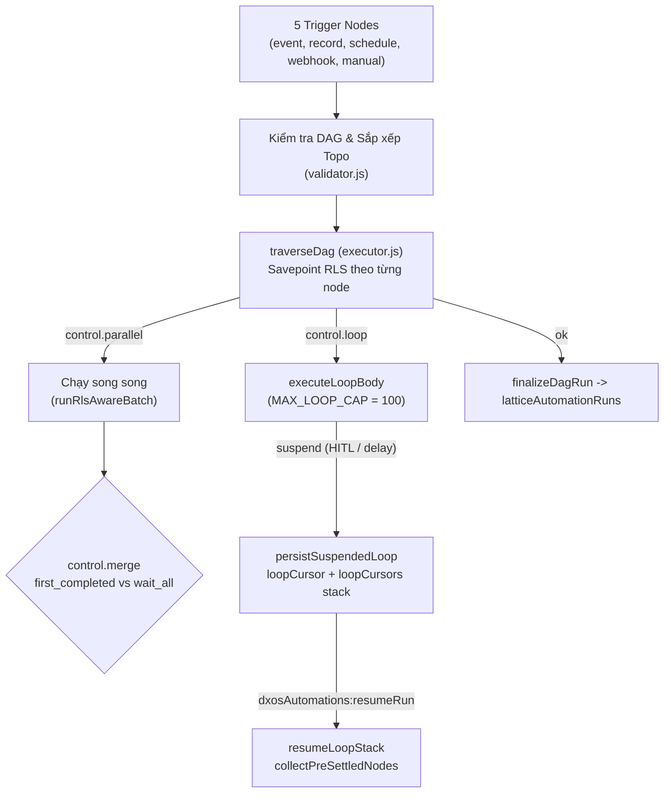

# Động cơ Quy trình DAG LatticeFlow v2

**LatticeFlow v2** là động cơ điều phối quy trình dạng đồ thị có hướng không chu trình (DAG) được xây dựng trực tiếp trong `@latticedx/plugin-dxos-studio` (`src/server/flow/*`) với giao diện thiết kế kéo-thả trên `@xyflow/react` và `@dagrejs/dagre`. Phiên bản `v0.4.2` hỗ trợ thực thi bền vững (durable suspend/resume), phê duyệt con người (HITL), vòng lặp có lưu trạng thái con trỏ, tác nhân AI ReAct, và quản lý phiên bản nháp/phát hành/rollback.

---

## 1. Kiến trúc Thực thi DAG & Biểu đồ Luồng

---

## 2. Chính xác 24 Nodes chia 6 Nhóm (`flow/registry.js`)

Toàn bộ node được đăng ký và kiểm tra cấu trúc qua `validateNodeDefinition` trong `plugins/nocobase/plugin-dxos-studio/src/server/flow/registry.js`.

### 2.1 Nhóm `trigger` — 5 Nodes (`nodes/triggers.js`)

| # | Node Type | Nhãn hiển thị | Cơ chế kích hoạt & Cấu hình chính |
|---|---|---|---|
| 1 | `trigger.event` | Kích hoạt Sự kiện Miền | Lắng nghe CloudEvents trên Lattice Event Bus theo `eventType` (hỗ trợ wildcard, danh sách phân tách dấu phẩy) và `filterJson`. |
| 2 | `trigger.record` | Kích hoạt Vòng đời Bản ghi | Kích hoạt qua ORM hook khi `create`, `update`, hoặc `delete` trên bảng cho phép (`collection`, `operation`, `filterJson`). |
| 3 | `trigger.schedule` | Kích hoạt Theo lịch | Chạy định kỳ theo biểu thức `cron` 5 trường và `timezone` (điều phối qua `tickFlowScheduler`). |
| 4 | `trigger.webhook` | Kích hoạt Webhook Đến | Tiếp nhận HTTP POST qua `dxosAutomations:webhookIngress` với xác thực `hmac` (`X-Lattice-Signature-256` hoặc Standard Webhooks) hoặc `bearer`. |
| 5 | `trigger.manual` | Kích hoạt Thủ công / API | Chạy trực tiếp từ Studio hoặc API `dxosAutomations:runNow` kèm `inputSchemaJson`. |

### 2.2 Nhóm `control` — 8 Nodes (`nodes/control.js`)

| # | Node Type | Cổng ra (`outputs`) | Cơ chế hoạt động & Giới hạn |
|---|---|---|---|
| 6 | `control.if` | `true`, `false`, `error` | Đánh giá điều kiện có cấu trúc (`condition`) qua `matchesFilter` (hỗ trợ `$eq`, `$ne`, `$gt`, `$gte`, `$lt`, `$lte`, `$in`, `$nin`, `$exists`, `$contains`, `$and`, `$or`, `$not`). |
| 7 | `control.switch` | `case_0`, `case_1`, `case_2`, `default`, `error` | Đánh giá biểu thức `expression` lần lượt qua mảng `cases`, chuyển tới cổng đầu tiên khớp. |
| 8 | `control.parallel` | `main`, `error` | Fan-out đồng thời tới tất cả nhánh đầu ra đang nối qua `runRlsAwareBatch`. |
| 9 | `control.merge` | `main`, `error` | Hợp nhất kết quả các nhánh song song theo `mode`: `wait_all` hoặc `first_completed`. |
| 10 | `control.loop` | `item`, `done`, `error` | Lặp qua mảng `itemsPath` với giới hạn cứng `MAX_LOOP_CAP = 100` (`strictLimit` tùy chọn báo lỗi nếu vượt). |
| 11 | `control.delay` | `main`, `error` | Tạm dừng luồng theo `durationSec` hoặc mốc ISO-8601 `untilIso`; `tickDueDelayedRuns` đánh thức khi đến hạn. |
| 12 | `control.approval` | `approved`, `rejected`, `error` | Tạo yêu cầu trong `latticeAiApprovalQueue` cho `approverRole`, treo luồng bền vững kèm `resumeTokenHash` và `ttlHours` (1–720h). |
| 13 | `control.subflow` | `main`, `error` | Gọi quy trình khác (`ruleKey`) trong cùng `organizationId` với giới hạn độ sâu đệ quy `MAX_SUBFLOW_DEPTH = 8`. |

### 2.3 Nhóm `data` — 3 Nodes (`nodes/data.js`)

Chỉ được phép thao tác trên `ALLOWLISTED_BUSINESS_COLLECTIONS` (`latticeRequests`, `latticeOrders`, `latticeOrderLines`, `latticeServiceTickets`, `latticeParaDocuments`, `latticeIncidentCases`, `latticeLocations`, `latticeAssets`, `latticeAgentProposals`) hoặc `latticeCustom*`; chặn tuyệt đối `SYSTEM_PROTECTED_COLLECTIONS`, `SENSITIVE_COLLECTIONS` và xóa/ghi đè `PROTECTED_VOUCHER_FIELDS` trên chứng từ lõi.

| # | Node Type | Cổng ra | Chức năng |
|---|---|---|---|
| 14 | `data.query` | `main`, `error` | Truy vấn bản ghi trong phạm vi `organizationId` (`filter`, `limit` 1..200, `sort`). |
| 15 | `data.create` | `main`, `error` | Tạo bản ghi mới với `organizationId` cưỡng chế và tăng `ormDepth`. |
| 16 | `data.update` | `main`, `error` | Cập nhật bản ghi theo `recordId` hoặc `filter` (bắt buộc không rỗng để tránh cập nhật nhầm toàn bảng). |

### 2.4 Nhóm `logic` — 2 Nodes (`nodes/logic.js`)

| # | Node Type | Cổng ra | Chức năng |
|---|---|---|---|
| 17 | `logic.dmn` | `main`, `error` | Đánh giá bảng quyết định `tableKey` trong cùng tổ chức qua `evaluateDecisionTable` và ghi kết quả vào `context.dmn` và `context.dmnResult`. |
| 18 | `logic.transform` | `main`, `error` | Biến đổi dữ liệu khai báo không dùng `eval()` với 9 phép toán an toàn: `set`, `template`, `coerceNumber`, `coerceBoolean`, `math` (`add`, `sub`, `mul`, `div`), `concat`, `rename`, `pick`, `omit`. |

### 2.5 Nhóm `ai` — 2 Nodes (`nodes/ai.js`)

| # | Node Type | Cổng ra | Chức năng |
|---|---|---|---|
| 19 | `ai.llm` | `main`, `error` | Gọi model qua `llmServices` tương thích OpenAI, tự động ẩn danh PII và kiểm tra SSRF (`assertSafeLlmUrl`); hỗ trợ `fallbackOutput` khi chưa cấu hình LLM. |
| 20 | `ai.agent` | `main`, `error` | Hỗ trợ 2 chế độ: `single` (tạo đề xuất trên `latticeAgentProposals` / `latticeAiApprovalQueue`) và `react` (`executeReactAgent` đa vòng với `maxTurns`, `tools`, `memoryScope`, `outputSchema`). |

### 2.6 Nhóm `integration` — 4 Nodes (`nodes/integrations.js`)

| # | Node Type | Cổng ra | Chức năng |
|---|---|---|---|
| 21 | `integration.http` | `main`, `error` | Gọi HTTP connector lưu trong Vault (`connectorKey`), khóa origin (`buildConnectorUrl`), chặn SSRF, ký `X-Lattice-Signature-256` & Standard Webhooks (`webhook-signature`), ẩn bí mật khỏi log lỗi/response. |
| 22 | `iot.twin_command` | `main`, `error` | Gửi lệnh thay đổi trạng thái mong muốn (`desiredPatch`) xuống `digitalTwinMod.requestDesiredSetpoint` (tự động đưa vào HITL nếu vượt ngưỡng). |
| 23 | `notify.send` | `main`, `error` | Gửi thông báo đa kênh (`in_app`, `email_smtp`, `telegram`, `slack`, `webhook`) tới danh sách `roleNames` qua `notificationCenter`. |
| 24 | `event.emit` | `main`, `error` | Phát CloudEvent lên Lattice Event Bus (`publishDomainEvent`), tự động tăng `depth` và chặn nếu vượt `MAX_HARD_DEPTH = 8`. |

---

## 3. Cơ chế Treo/Tiếp tục Vòng lặp HITL (`loopCursor` / `loopCursors` Stack)

Khi một nhánh bên trong `control.loop` chứa node có khả năng tạm dừng (như `control.approval`, `control.delay` hoặc `ai.agent` ở chế độ HITL), `plugins/nocobase/plugin-dxos-studio/src/server/flow/loop-resume.js` bảo toàn toàn bộ ngữ cảnh lặp kể cả khi các vòng lặp lồng nhau:

1. **Khi gặp trạng thái `suspend` (`persistSuspendedLoop`)**:
   - Đóng gói `cursor` cho vòng lặp hiện tại: `{ loopNodeId, items, currentIndex, loopResults, loopOutput, iterTraceStart, bodyNodeIds }`.
   - Ghép `childStack` (từ vòng lặp con nếu có), `cursor` hiện tại và `rawRest` (từ vòng lặp cha) thành ngăn xếp `loopStack`.
   - Ghi cả `nodeStatesJson.loopCursor = loopStack[0]` (vòng lặp trong cùng vừa treo) và `nodeStatesJson.loopCursors = loopStack` (toàn bộ stack từ trong ra ngoài) vào bản ghi `latticeAutomationRuns`.
2. **Khi nhận quyết định `resumeRun` (`resumeLoopStack`)**:
   - Đọc `loopCursors` (hoặc fallback `[loopCursor]`) và duyệt từng tầng `k = 0 .. rawStack.length - 1`:
     - Khôi phục `execState.loop = { item: items[curIdx], index: curIdx, count: items.length }`.
     - Tính phần đồ thị con còn lại của lần lặp `curIdx` (`remTopo`), xác định các node đã chốt qua `collectPreSettledNodes`, khởi tạo đầu vào qua `buildResumeInitInputs` và chạy tiếp `traverseDag`.
     - Nếu lại gặp một node treo tiếp theo trong vòng lặp, cập nhật lại `loopCursors` stack và tiếp tục treo mà không mất các phần tử đã xử lý trước đó.
     - Sau khi xong `curIdx`, lưu kết quả vào `loopResults` rồi lặp tiếp `idx = curIdx + 1 .. items.length - 1`.
   - Khi hoàn thành toàn bộ stack, xóa `nodeStatesJson.loopCursor` & `nodeStatesJson.loopCursors`, ghi `status: 'completed'` cho `control.loop` và đẩy luồng sang cổng `done`.

---

## 4. Chế độ `control.merge`: `first_completed` vs `wait_all`

Cơ chế điều phối tại `traverseDag` (`executor.js`) và `collectPreSettledNodes` (`loop-resume.js`) phân biệt rõ 2 chế độ của `control.merge`:

| Tiêu chí | `wait_all` *(mặc định)* | `first_completed` |
|---|---|---|
| **Điều kiện kích hoạt** | Chờ toàn bộ node tiền nhiệm (`inEdges`) hoàn thành (trừ các tiền nhiệm đã bị đánh dấu `skipped` do nhánh `if`/`switch` không đi qua). | Sẵn sàng thực thi ngay khi có **ít nhất 1 nhánh** đẩy dữ liệu vào `activeInputs` (`(activeInputs.get(id) || []).length > 0`). |
| **Xử lý nhánh thiếu** | Nếu tồn tại ít nhất 1 tiền nhiệm active chưa cung cấp đầu vào, `control.merge` bị đánh dấu `skipped` với lý do `MERGE_WAIT_ALL_INCOMPLETE`. | Không bị chặn bởi các nhánh chậm hoặc nhánh đang treo ở node khác. |
| **Cách gộp dữ liệu** | Gộp (`Object.assign`) toàn bộ object đầu ra từ các nhánh trong `branches`. | Lấy đầu ra của nhánh đầu tiên hoàn thành (`branches.find(...)`). |
| **Hành vi khi Resume** | Chờ các nhánh chưa xong hoàn tất sau khi resume rồi mới chạy `control.merge`. | `collectPreSettledNodes` đưa node `control.merge` (`first_completed`) đã `completed` cùng các node hậu duệ đã hoàn thành của nó vào tập `preSettled`, ngăn việc kích hoạt lại luồng sau khi một nhánh chậm hoàn tất muộn. |

---

## 5. Chính xác 19 `dxosAutomations` Actions & 7 Blueprints JSON

### 5.1 Danh sách 19 `dxosAutomations` Actions (`automation-engine.js`)

- **Quản trị Rule & Phiên bản (10 actions `loggedIn`):** `listRules`, `saveRule`, `saveDraft`, `publishRule`, `listRuleVersions`, `rollbackRuleVersion`, `toggleRule`, `deleteRule`, `builderCatalog`, `nodeRegistry`.
- **Chạy thử, Thực thi & Vết (7 actions `loggedIn`):** `testRule` (dry-run toàn đồ thị), `testNode` (chạy thử 1 node với `pinnedInputs`), `runNow` (chạy ngay), `listRuns`, `getRunTrace`, `replayRun` (tăng `depth`), `resumeRun` (hỗ trợ `allowDelegatedApprovals` theo ủy quyền `latticeDelegations`).
- **Trợ lý AI (1 action `loggedIn`):** `aiAssist` (gọi `runFlowArchitect` sinh/sửa đồ thị hoặc chẩn đoán lỗi từ `runTrace`).
- **Cổng Webhook Công khai (1 action `public`):** `webhookIngress` (xác thực HMAC/Standard Webhook/Bearer từ Connector Vault hoặc secret của rule).

### 5.2 Danh sách 7 Blueprints JSON (`flow/blueprints/*.json`)

| # | Tệp Blueprint | `blueprintKey` / `ruleKey` | Trigger | Số node | Mô tả nghiệp vụ |
|---|---|---|---|---|---|
| 1 | `coldchain-emergency.json` | `auto_cmms_on_coldchain_fault` | `alarm.triggered,device.offline` | 9 | Đánh giá DMN `cmms_priority_routing_v1`, tạo phiếu CMMS, báo vai trò phụ trách; nếu `critical` thì fan-out hạ nhiệt Digital Twin + AI Triage + đẩy `n8n`. |
| 2 | `enterprise-n8n-compliance.json` | `auto_enterprise_n8n_compliance` | `record.latticeRequests.create` | 7 | Nếu `amount > 10.000.000`, gọi `n8n-enterprise-orchestrator` (26 nút) điều phối Settlement, PKI Ed25519, Orion-LD, MQTT và 5 app ngoài kèm rẽ nhánh thông báo. |
| 3 | `mkt-quarantine.json` | `auto_mkt_quarantine_response` | `lot.held_mkt` | 8 | Đánh giá `cold_chain_approval_v1`, mở hồ sơ `latticeIncidentCases`, chạy AI Triage và đồng bộ `n8n` nếu cấp duyệt là `quality_hold_director`. |
| 4 | `partner-webhook-sync.json` | `auto_partner_webhook_sync` | `webhook.inbound` | 6 | Nhận webhook xác thực HMAC, trích xuất mảng `items` bằng `logic.transform`, lặp qua `control.loop` (max 50) gọi `erp-webhook-sync` kèm nhánh `error` và `done`. |
| 5 | `procurement-hitl-approval.json` | `auto_procurement_hitl_approval` | `record.latticeRequests.create` | 7 | Kiểm tra `amount > 50.000.000`: nếu vượt ngưỡng thì treo tại `control.approval` chờ `ldx_manager`; duyệt thì cập nhật `latticeRequests`, từ chối thì báo `ldx_employee`. |
| 6 | `scheduled-ai-digest.json` | `auto_scheduled_ai_digest` | `schedule.cron` | 5 | Lịch 08:00 Thứ 2–Thứ 6 (`0 8 * * 1-5`, `Asia/Ho_Chi_Minh`) truy vấn sự cố mở, chuẩn hóa danh sách, tổng hợp JSON qua `ai.llm` và gửi báo cáo cho `ldx_manager`. |
| 7 | `sla-escalation.json` | `auto_sla_breach_escalation` | `sla.warning,sla.breached` | 5 | Dùng `control.switch` theo `event.type`: `sla.warning` nhắc `ldx_dispatcher`; `sla.breached` tạo phiếu xử lý trên `latticeServiceTickets` và leo thang tới `ldx_manager`. |
