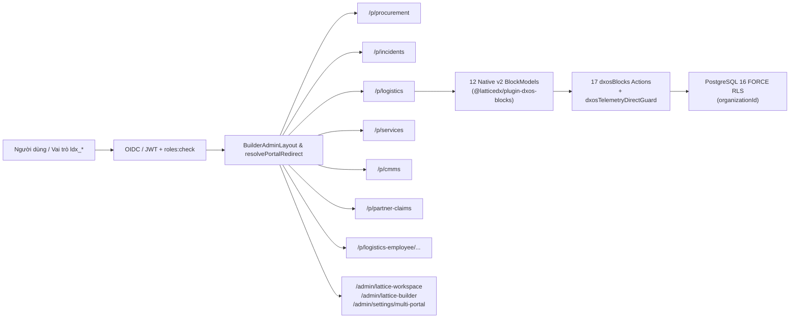

# Multi-Role Portals & 12 Native v2 BlockModels

LatticeDX (`v0.4.2`) triển khai kiến trúc **Multi-Role Portal** thuần NocoBase `2.2.50` kết hợp **12 Native v2 BlockModels** trong plugin `@latticedx/plugin-dxos-blocks` và bộ định tuyến `@latticedx/plugin-lattice-foundation`. Mỗi vai trò nghiệp vụ làm việc trong một cổng không gian độc lập với cây menu, phân quyền RBAC, layout kéo-thả và luồng dữ liệu được cách ly đa tổ chức (`organizationId`).

---

## 1. Hệ thống 7 Multi-Role Portals & 3 Không gian Quản trị

Toàn bộ cổng nghiệp vụ và công cụ quản trị được đăng ký qua `latticePortals` (`portal-composer.js`, `multi-portal-demo-catalog.mjs`, `domain-packs.js`) và được bảo vệ đồng thời ở tầng UI (`BuilderAdminLayout`, `MultiPortalSettingsPage`) lẫn tầng PostgreSQL RLS.

### 1.1 Danh sách 7 Multi-Role Portals

| # | Đường dẫn Portal | Layout UID | Tên hiển thị | Vai trò được cấp quyền | Nguồn khởi tạo & Trang chính |
|---|---|---|---|---|---|
| 1 | `/p/procurement` | `ldx-portal-procurement` | Mua sắm & Tài sản *(mặc định)* | `ldx_employee`, `ldx_manager`, `ldx_director`, `ldx_admin` | Built-in (`composePortals`): Tổng quan Điều hành Mua sắm, Tạo yêu cầu (`latticeRequests`), Danh sách Yêu cầu, Sổ cái Tài sản (`latticeAssets`) |
| 2 | `/p/incidents` | `ldx-portal-incidents` | Vận hành & Sự cố IoT | `ldx_manager`, `ldx_dispatcher`, `ldx_warehouse`, `ldx_director`, `ldx_admin` | Built-in (`composePortals`): Trung tâm Sự cố & AI (`DxosContextTelemetryBlockModel`, `DxosAiProposalBlockModel`, `DxosWebGisBlockModel`), Hàng đợi Sự cố (`latticeIncidentCases`), Luật Cảm biến (`latticeIncidentRules`) |
| 3 | `/p/logistics` | `ldx-portal-logistics` | Logistics Chuỗi lạnh | `ldx_warehouse`, `ldx_dispatcher`, `ldx_driver`, `ldx_manager`, `ldx_admin` | Built-in (`composePortals`): Điều hành Logistics 5 bước (7 BlockModels gồm Kanban, WMS FEFO, BI Chart, Workbench), Đơn hàng (`latticeOrders`), Kho lạnh (`latticeLocations`) |
| 4 | `/p/services` | `ldx-portal-services` | Dịch vụ Nội bộ & Danh bạ | 7 vai trò (`ldx_employee`, `ldx_manager`, `ldx_warehouse`, `ldx_dispatcher`, `ldx_driver`, `ldx_director`, `ldx_admin`) | Built-in (`composePortals`): Không gian P.A.R.A. & Dịch vụ, Danh bạ Nhân viên (`latticeEmployees`), Phòng ban (`latticeDepartments`), Phiếu Dịch vụ (`latticeServiceTickets`), Tài liệu P.A.R.A. (`latticeParaDocuments`) |
| 5 | `/p/cmms` | `ldx-portal-cmms` | Bảo trì CMMS | `ldx_admin`, `ldx_manager`, `ldx_dispatcher`, `ldx_warehouse`, `ldx_operator`, `ldx_employee` | Business Pack `cmms-maintenance` (`dxosBuilder:installBusinessPack`): Lệnh công việc bảo trì (`latticeCustomWorkOrders`) gắn DMN `cmms_priority_routing_v1` |
| 6 | `/p/partner-claims` | `ldx-portal-partner-claims` | Đối soát Đối tác | `ldx_admin`, `ldx_manager`, `ldx_dispatcher`, `ldx_warehouse`, `ldx_operator`, `ldx_employee` | Business Pack `coldchain-partner-settlement` (`dxosBuilder:installBusinessPack`): Hồ sơ bồi thường (`latticeCustomPartnerClaims`) & n8n 2 chiều |
| 7 | `/p/logistics-employee/...` | `ldx-portal-logistics-employee` | Logistics · Đơn của tôi | `ldx_employee` | Demo Catalog (`multi-portal-demo-catalog.mjs`): 2 trang `Đơn của tôi` (lọc `requester.userId` theo người dùng hiện tại) & `Tạo đơn` (`latticeOrders`) |

::: tip Cơ chế điều hướng thông minh (`/p/<slug>`)
Hàm `resolvePortalRedirect` trong `native-builder-navigation.js` tự động chuyển hướng người dùng truy cập `/p/<slug>` về `firstPagePath` của cổng đó. Nếu người dùng không có quyền vào cổng gốc nhưng có quyền trên cổng anh em cùng tiền tố (ví dụ `/p/logistics` tự động chuyển sang `/p/logistics-employee/...` đối với vai trò `ldx_employee`), hệ thống điều hướng an toàn thay vì trả về trang trắng.
:::

### 1.2 Ba không gian Quản trị, Builder & Cấu hình

- **`/admin/lattice-workspace`** (`WORKSPACE_PATH`): Không gian Điều hành hợp nhất cho quản trị viên và điều phối viên, tích hợp danh sách trang theo cây menu (`pageTree`), nút tạo nhanh (`quickCreate`), hộp duyệt hợp nhất (`dxosApprovals`) và lối tắt sang các portal.
- **`/admin/lattice-builder`** (`BUILDER_PATH`): Trình dựng giao diện trực quan chạy trên `BuilderAdminLayout` và `@nocobase/flow-engine`, cho phép kéo-thả lưới Grid và cấu hình trực tiếp từng Native v2 BlockModel qua flow `dxosBlockSettings`.
- **`/admin/settings/multi-portal`**: Màn hình **Multi-Portal Manager** (`createMultiPortalSettingsPage`) gọi API `latticePortals:list`, `latticePortals:save`, `latticePortals:destroy`, `latticePortals:exportBlueprint` để tạo cổng mới, bật/tắt trạng thái, đặt cổng mặc định, gán vai trò kinh doanh (`FALLBACK_LDX_ROLES` / `isBusinessPortalRole`) và xuất Blueprint JSON.

> **Tuân thủ NocoBase Clause 5.2:** Cả `BuilderShell` (`native-builder-navigation.js`) lẫn `MultiPortalSettingsPage` (`native-portal-settings.js`) đều giữ nguyên dòng ghi nhận `Powered by NocoBase` trỏ tới `https://www.nocobase.com` theo đúng điều khoản giấy phép máy chủ NocoBase `2.2.50`.

---

## 2. Chính xác 12 Native v2 BlockModels

Toàn bộ 12 BlockModel kế thừa `BaseBlockModel` (`@nocobase/client-v2`), được đăng ký vào `flowEngine.registerModels(models)` trong `plugins/nocobase/plugin-dxos-blocks/src/client/block-models.js` và kiểm soát danh sách cho phép qua `ALLOWED_DXOS_BLOCK_USES` trong `portal-composer.js`. Mỗi BlockModel đều sở hữu flow `dxosBlockSettings` (`on: 'beforeRender'`, mở hộp thoại `uiMode: { type: 'dialog' }`) để tùy biến cấu hình ngay trên trình duyệt.

| # | Tên lớp BlockModel | Nhãn hiển thị trên UI | Chức năng & Thuộc tính cấu hình chính |
|---|---|---|---|
| 1 | `DxosPortalHeroBlockModel` | `DX-OS Portal Hero & Quick Actions` | Banner đầu cổng kèm badge, `accentColor` (Hex), `title`, `subtitle` và danh sách nút thao tác nhanh `actionsJson`. |
| 2 | `DxosKpiMetricBlockModel` | `DX-OS KPI Metric Grid` | Lưới thẻ KPI từ 1–4 cột (`columns`), cấu hình truy vấn đếm bản ghi theo từng collection và `filter` trong `metricsJson`. |
| 3 | `DxosContextTelemetryBlockModel` | `DX-OS NGSI-LD Context & Telemetry` | Hiển thị trạng thái thực thể NGSI-LD (`assetEntityId`), ngưỡng cảnh báo (`warningThreshold`), trạng thái đồng bộ Outbox (`showSyncStatus`) và chuỗi thời gian cảm biến. |
| 4 | `DxosAiProposalBlockModel` | `DX-OS AI Proposal & Evidence` | Danh sách đề xuất AI (`targetCollection`, `state`: `all`/`proposed`/`reviewed`, `pageSize`) kèm nguồn bằng chứng (`showEvidence`) và thao tác duyệt/từ chối HITL. |
| 5 | `DxosWorkflowTasksBlockModel` | `DX-OS Workflow & My Tasks` | Hộp việc quy trình Poka-yoke của người dùng hiện tại, lọc theo `statusFilter` (`pending`/`resolved`/`all`) và `pageSize`. |
| 6 | `DxosParaVaultBlockModel` | `DX-OS P.A.R.A. Knowledge Vault` | Kho tri thức P.A.R.A. lọc theo phân vùng (`all`, `projects`, `areas`, `resources`, `archives`), hỗ trợ tạo nhanh (`enableQuickCreate`) và tìm kiếm lai. |
| 7 | `DxosCreativeStudioBlockModel` | `DX-OS Creative Studio Micro-App` | Micro-App dựng giao diện khai báo an toàn từ `blueprintJson` (DSL JSON không dùng `eval()`). |
| 8 | `DxosRecordWorkbenchBlockModel` | `DX-OS Chatter, Chứng từ & Xuất báo cáo` | Bàn làm việc bản ghi đa năng: vòng đời chứng từ (`showVoucherActions`), nhật ký trao đổi (`showChatter`), xuất CSV/XLSX có kiểm soát (`showExport`), huy hiệu chữ ký Ed25519 (`showPkiBadge`), phả hệ dữ liệu (`showLineage`) và in chứng từ QR (`showPrintVoucher`). |
| 9 | `DxosWebGisBlockModel` | `DX-OS Bản đồ Giám sát WebGIS [D]` | Bản đồ tương tác dùng `maplibre-gl` (`centerLat`, `centerLng`), lớp trạng thái Digital Twin (`showTwinOverlay`) và ánh xạ trường tọa độ (`collection`, `latField`, `lngField`, `labelField`, `statusField`). |
| 10 | `DxosKanbanScheduleBlockModel` | `DX-OS Bảng Kanban & Lịch [H]` | Chuyển đổi linh hoạt giữa bảng Kanban theo giai đoạn (`viewMode: 'kanban'`) và lịch biểu theo tuần (`'schedule'`), tùy biến `statusField`, `dateField`, `titleField`. |
| 11 | `DxosWmsOpsBlockModel` | `DX-OS Vận hành Kho FEFO & Bulk Import [W]` | Hai thẻ tác nghiệp: xuất kho FEFO & kiểm tra MKT (`defaultTab: 'fefo'`) và trình nhập lô 2 pha Dry-Run/Commit (`defaultTab: 'import'`, `defaultImportCollection`). |
| 12 | `DxosBiChartBlockModel` | `DX-OS Biểu đồ & Phân tích BI [D]` | Biểu đồ tổng hợp server-side hỗ trợ 5 dạng (`bar`, `line`, `pie`, `kpi`, `pivot`), `groupBy`, `secondaryGroupBy` (Pivot), `metricOp` (`count`, `sum`, `avg`, `min`, `max`), `metricField`, `limit` (1–500) và `filterJson`. |

::: info Đồng bộ Collection động trên Visual Builder
Khi khởi động, `block-models.js` gọi `dxosBlocks:collectionsMeta` để nạp danh sách bảng nghiệp vụ chuẩn lẫn bảng mở rộng `latticeCustom*` (loại bỏ các trường nhạy cảm như `password`, `secret`, `token`, `hash`, `embedding`) vào các dropdown cấu hình của `DxosRecordWorkbenchBlockModel`, `DxosKanbanScheduleBlockModel` và `DxosBiChartBlockModel`.
:::

---

## 3. Chính xác 17 `dxosBlocks` Actions & Cơ chế Bảo vệ Dữ liệu

Resource `dxosBlocks` trong `plugins/nocobase/plugin-dxos-blocks/src/server/blocks-api.js` cung cấp **17 action** chia làm 2 nhóm phân quyền trong `index.js`:

### 3.1 Nhóm 15 Action yêu cầu đăng nhập (`loggedIn`)

| Nhóm chức năng | Action | Phương thức | Mô tả kỹ thuật & Cơ chế kiểm soát |
|---|---|---|---|
| **AI Proposals** | `proposals` | `GET` / `POST` | Truy vấn `latticeAgentProposals` cho 5 collection cho phép (`latticeAssets`, `latticeRequests`, `latticeOrders`, `latticeIncidentCases`, `latticeServiceTickets`), áp dụng own-scope cho vai trò nhân viên. |
| | `decideProposal` | `POST` | Ủy quyền xử lý phê duyệt/từ chối về `approval-engine.decideUnifiedInboxItem(..., { source: 'proposals' })`. |
| **NGSI-LD & Telemetry** | `contextTelemetry` | `GET` / `POST` | Đọc ngữ cảnh tài sản từ `latticeAssets`, đồng bộ thực thể từ FIWARE Orion-LD (`/ngsi-ld/v1/entities/...`) và tóm tắt hàng đợi `latticeContextOutbox`. |
| | `telemetrySeries` | `GET` / `POST` | Truy vấn chuỗi thời gian từ `latticeTelemetryPoints` theo `assetEntityId` / `assetId`, `attribute`, `windowHours`, `bucketMinutes`. |
| **Cảnh báo IoT** | `alarmIngest` | `POST` | Tiếp nhận và chống trùng lặp cảnh báo (`ingestOrDeduplicateAlarm`) tạo/cập nhật `latticeIncidentCases`. |
| | `alarmAck` | `POST` | Xác nhận cảnh báo (`acknowledgeAlarm`) kèm ghi chú và tên tác nhân. |
| | `alarmClear` | `POST` | Đóng cảnh báo (`clearAlarm`) kèm `closeNote`. |
| **Báo cáo & Tìm kiếm** | `exportReport` | `GET` / `POST` | Xuất báo cáo có quản trị (`executeGovernedExport`), loại bỏ các cột nhạy cảm (`SENSITIVE_EXPORT_FIELDS`), trả về header `X-Lattice-Export-Columns`, `X-Lattice-Export-Omitted`, `X-Lattice-Export-Sha256`. |
| | `globalSearch` | `GET` / `POST` | Tìm kiếm toàn cục bỏ dấu tiếng Việt (`foldSearchVi`), quét tối đa `MAX_SCAN = 2000` bản ghi/collection theo đúng quyền RLS & ACL của vai trò hiện tại. |
| **Digital Twin** | `twinShadow` | `GET` / `POST` | Lấy trạng thái `desired`/`reported` và lịch sử lệnh từ `latticeTwinShadows`. |
| | `twinSetDesired` | `POST` | Gửi lệnh thay đổi setpoint (`requestDesiredSetpoint`); nếu vượt ngưỡng an toàn (chênh lệch lớn hơn `HITL_TEMP_THRESHOLD_C = 2.0°C`) sẽ đưa vào hàng đợi HITL trừ khi được xác nhận hợp lệ. |
| **Bulk Import 2 Pha** | `bulkImportDryRun` | `POST` | Phân tích và kiểm thử dữ liệu CSV/JSON cho các collection cho phép (`latticeStockLots`, `latticeAssets`, `latticeOrders`, `latticeRequests`), sinh `previewToken`. |
| | `bulkImportCommit` | `POST` | Xác nhận ghi dữ liệu hàng loạt dựa trên `previewToken` trong phạm vi `organizationId`. |
| **Metadata & BI** | `collectionsMeta` | `GET` | Trả về metadata các collection nghiệp vụ và `latticeCustom*` theo quyền `view` của người dùng, lọc bỏ `META_EXCLUDED_COLLECTIONS` và trường nhạy cảm. |
| | `aggregateQuery` | `GET` / `POST` | Tổng hợp dữ liệu SQL/Repository server-side cho 5 loại biểu đồ (`bar`, `line`, `pie`, `kpi`, `pivot`) trên `META_ALLOWED_BUSINESS_COLLECTIONS` và `latticeCustom*`. |

### 3.2 Nhóm 2 Action `public` (Fail-Closed Edge Token hoặc User ACL)

| Action | Phương thức | Cơ chế xác thực Fail-Closed (`resolveTelemetryIngestAuth`) |
|---|---|---|
| `telemetryIngest` | `POST` | Nếu có header `X-Lattice-Edge-Token`, kiểm tra độ dài tối thiểu 16 ký tự và so sánh hằng thời gian (`crypto.timingSafeEqual`) với `DX_IIOT_INGEST_TOKEN`. Nếu không có Edge Token, bắt buộc JWT người dùng hợp lệ có quyền `create` trên `latticeIncidentCases` hoặc `update` trên `latticeAssets`. |
| `twinAckCommand` | `POST` | Cùng cơ chế xác thực `resolveTelemetryIngestAuth`; xử lý xác nhận lệnh downlink (`ackCommandFromEdge`) từ Node-RED / gateway IIoT về `latticeTwinShadows`. |

### 3.3 Hàng rào `dxosTelemetryDirectGuard`

Trong `plugins/nocobase/plugin-dxos-blocks/src/server/index.js`, middleware `dxosTelemetryDirectGuard` (chạy trước `latticeNativeScope`, sau `acl`) chặn mọi thao tác CRUD trực tiếp hoặc `charts:queryData` từ vai trò không phải `root` nhắm vào:
- `latticeTelemetryPoints` (`TELEMETRY_DIRECT_CRUD_FORBIDDEN`, mã 403) — buộc đi qua `dxosBlocks:telemetrySeries` và `dxosBlocks:telemetryIngest`.
- `latticeTwinShadows` (`TWIN_DIRECT_CRUD_FORBIDDEN`, mã 403) — buộc đi qua `dxosBlocks:twinShadow`, `dxosBlocks:twinSetDesired`, `dxosBlocks:twinAckCommand`.
- `latticeIotDevices`, `latticeBrokerSubscriptions` (`BROKER_DIRECT_CRUD_FORBIDDEN`, mã 403) — buộc đi qua resource `dxosBroker`.
