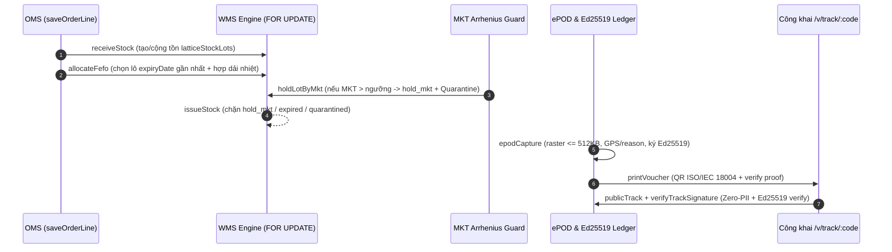

# OMS / WMS / FEFO / ePOD Chuỗi lạnh & Xác thực QR Ed25519

Phân hệ Logistics & Kho lạnh của LatticeDX (`v0.4.2`) nằm trong `@latticedx/plugin-dxos-studio` (`wms-engine.js`, `qr-svg.js`, `wms-direct-guard.js`) kết hợp giao diện công khai Zero-PII trong `@latticedx/plugin-lattice-foundation` (`client-v2/public-track-page.js`). Hệ thống giải quyết trọn vẹn chu trình từ đặt hàng (OMS), nhập kho theo lô, phân bổ **FEFO**, giám sát **MKT Arrhenius**, bàn giao điện tử **ePOD**, in chứng từ QR **ISO/IEC 18004** tới tra cứu công khai xác thực chữ ký **Ed25519**.


---

## 1. Luồng Nghiệp vụ Tổng thể & 12 `dxosWms` Actions



### Danh sách chính xác 12 `dxosWms` Actions

| # | Action | Phương thức | Quyền | Chức năng chính |
|---|---|---|---|---|
| 1 | `orderLines` | `GET` | `loggedIn` | Liệt kê dòng hàng đơn vận chuyển (`latticeOrderLines`) theo `orderId`, `orderCode`, `sku`, `status`. |
| 2 | `saveOrderLine` | `POST` | `loggedIn` | Tạo/cập nhật dòng đơn hàng với dải nhiệt độ yêu cầu (`targetTempMinC`, `targetTempMaxC`) và số lượng `requestedQty > 0`. |
| 3 | `receiveStock` | `POST` | `loggedIn` | Nhập kho theo lô (`latticeStockLots`), kiểm tra `expiryDate > manufacturedAt`, liên kết `assetEntityId` cùng tổ chức, chặn nhập vào lô đang `hold_mkt`, ghi sổ cái `wms.stock_received`. |
| 4 | `lots` | `GET` | `loggedIn` | Tra cứu danh sách lô hàng sắp xếp theo `['expiryDate', 'id']`, tự động tính `qtyAvailable = qtyOnHand - qtyReserved`. |
| 5 | `allocateFefo` | `POST` | `loggedIn` | Phân bổ tự động theo FEFO trong transaction khóa hàng `FOR UPDATE`, cập nhật `qtyReserved`, dòng đơn hàng và ghi phả hệ `latticeDataLineage` (`allocated_to`). |
| 6 | `issueStock` | `POST` | `loggedIn` | Xuất kho thực tế từ lô đã chỉ định (`lotId`/`lotCode`), chặn xuất lô hết hạn hoặc nằm trong `BLOCKED_LOT_STATUSES`, cập nhật `depleted` nếu tồn về `0`. |
| 7 | `holdLotByMkt` | `POST` | `loggedIn` | Tính MKT từ mẫu `samplesC` hoặc chuỗi `latticeTelemetryPoints`; nếu vượt ngưỡng hoặc `forceHold = true` thì khóa lô (`hold_mkt`), đưa vào `latticeDataQuarantine` và phát sự kiện `lot.held_mkt`. |
| 8 | `releaseLotByQa` | `POST` | `loggedIn` | Mở khóa lô từ `hold_mkt` hoặc `quarantined` về `available` kèm `releaseReason`, ghi sổ cái `wms.lot_qa_released` và phát `lot.released_qa`. |
| 9 | `epodCapture` | `POST` | `loggedIn` | Ghi nhận biên bản giao nhận điện tử (`latticeEpodRecords`), ký số lên `latticeCryptoLedger`, sinh `trackingCode` & `trackingToken`, đóng đơn hàng (`completed`). |
| 10 | `printVoucher` | `GET` / `POST` | `loggedIn` | Kết xuất HTML in ấn cho `order`, `delivery_note` hoặc `epod` (chặn đơn `draft`) kèm mã QR SVG ISO/IEC 18004 và hash xác thực. |
| 11 | `publicTrack` | `GET` / `POST` | `public` | Tra cứu trạng thái vận đơn công khai Zero-PII khi cung cấp đúng `trackingCode` + `token`. |
| 12 | `verifyTrackSignature` | `GET` / `POST` | `public` | Xác thực chữ ký mật mã Ed25519 trên sổ cái bằng `token` hoặc mã `verify` từ QR (không lộ PII). |

---

## 2. Khóa hàng Bi quan (`FOR UPDATE`) & Cơ chế FEFO Chặn lô

### 2.1 Khóa hàng bi quan `transaction.LOCK.UPDATE`

Để loại bỏ hoàn toàn xung đột đồng thời (hai đơn hàng cùng phân bổ một lô cuối cùng hoặc xuất kho song song với lệnh tạm giữ MKT), mọi thao tác thay đổi tồn kho (`receiveStock`, `allocateFefo`, `issueStock`, `holdLotByMkt`, `releaseLotByQa`) đều chạy trong `runWithOptionalRls` + `runInTx` và khóa bản ghi qua hai hàm:
- `findLockedLot`: gọi `model.findOne({ where: filter, transaction, lock: transaction.LOCK.UPDATE })`.
- `findLockedLots`: gọi `model.findAll({ where: filter, order, limit, transaction, lock: transaction.LOCK.UPDATE })`.

Trong PostgreSQL 16, tùy chọn `transaction.LOCK.UPDATE` sinh mệnh đề `SELECT ... FOR UPDATE`, buộc các giao dịch cạnh tranh phải tuần tự hóa trên đúng các dòng lô bị khóa cho đến khi giao dịch trước `COMMIT` hoặc `ROLLBACK`.

### 2.2 Bộ lọc FEFO & Tập trạng thái chặn lô (`BLOCKED_LOT_STATUSES`)

Khi `allocateFefo` tìm các lô khả dụng cho một `sku`, hàm `isLotCompatibleForFefo` chỉ chấp nhận các lô thỏa mãn đồng thời:
1. Cùng `organizationId`, đúng `sku`, `active !== false` và `status === 'available'`.
2. `expiryDate > nowMs` (chưa hết hạn tại thời điểm phân bổ).
3. `qtyOnHand - qtyReserved > 0` (còn tồn khả dụng).
4. Tương thích dải nhiệt độ: `targetTempMinC`, `targetTempMaxC` và `mktCelsius` (nếu có) đều nằm trong khoảng `[minTempC, maxTempC]` yêu cầu của đơn hàng.

Các lô đạt chuẩn được sắp xếp tăng dần theo `expiryDate` (nếu trùng ngày hết hạn thì ưu tiên `id` nhỏ hơn). Đồng thời, tập hằng số chặn lô được cưỡng chế nghiêm ngặt:

```js
const BLOCKED_LOT_STATUSES = new Set(['hold_mkt', 'expired', 'quarantined']);
```

- `issueStock` từ chối xuất kho (`409 WMS_LOT_ON_HOLD`) nếu trạng thái lô nằm trong `BLOCKED_LOT_STATUSES` hoặc `expiryDate <= Date.now()`.
- `receiveStock` từ chối cộng dồn số lượng vào lô đang `hold_mkt` (`409 WMS_LOT_ON_HOLD`).
- `releaseLotByQa` chỉ cho phép mở khóa về `available` khi lô đang ở `hold_mkt` hoặc `quarantined` (ngăn mở khóa nhầm lô `expired` hoặc `depleted`).

---

## 3. Tính MKT (Mean Kinetic Temperature) theo Công thức Arrhenius

Hàm `computeMeanKineticTemperature` (trong `wms-engine.js` và `data-governance.js`) tính **Nhiệt độ Động học Trung bình (MKT)** dùng để đánh giá tác động tích lũy của dao động nhiệt độ lên dược phẩm/vắc-xin theo phương trình Arrhenius:

```text
T_MKT (K) = (deltaH / R) / -ln( (1 / n) * sum( exp(-deltaH / (R * T_i)) ) )
T_MKT (°C) = T_MKT (K) - 273.15
```

Trong đó:
- `R_KJ_MOL_K = 0.008314472` kJ/(mol·K) là hằng số khí lý tưởng.
- `deltaH_kJ_mol = 83.14472` kJ/mol là năng lượng hoạt hóa mặc định.
- `T_i` là các mẫu nhiệt độ quy đổi sang Kelvin (`tempC + 273.15`, bắt buộc `> -273.15°C`).
- Thuật toán dùng kỹ thuật **log-sum-exp** (`maxExp + Math.log(meanExp)`) để tránh lỗi tràn số dấu phẩy động (`underflow`/`overflow`) khi số mẫu lớn (lên tới 500 điểm đo từ `latticeTelemetryPoints`).

Nếu `mktCelsius > thresholdCelsius` (ưu tiên `maxAllowedC`, tiếp theo là `targetTempMaxC` của lô, hoặc mặc định `-15°C` với profile `frozen` và `8°C` với hàng lạnh mát) hoặc `forceHold === true`:
1. Chuyển trạng thái lô sang `hold_mkt`, lưu `mktCelsius`, `holdReason`, `heldAt`, `heldBy`.
2. Tạo bản ghi cách ly trong `latticeDataQuarantine` với `reasonCode: 'MKT_THRESHOLD_EXCEEDED'`, `severity: 'high'`.
3. Ghi nhận sổ cái bất biến `wms.lot_mkt_hold` và phát CloudEvent `lot.held_mkt`.

---

## 4. Quy chuẩn ePOD (`512 KB` Raster) & Mã QR ISO/IEC 18004

### 4.1 Ràng buộc dữ liệu & An toàn ảnh ePOD

Action `epodCapture` thực thi kiểm tra đầu vào chặt chẽ trước khi ghi vào `latticeEpodRecords`:

| Trường dữ liệu | Giới hạn & Quy tắc xác thực |
|---|---|
| `recipientName` | Bắt buộc, cắt tối đa 128 ký tự; số điện thoại được che một phần (`maskPhone` -> `recipientPhoneMasked`). |
| `gpsLat`, `gpsLng` | Bắt buộc nằm trong `[-90, 90]` và `[-180, 180]`; nếu giao trong kho lạnh/hầm mất sóng (`gpsUnavailable = true`), bắt buộc cung cấp `gpsUnavailableReason`. |
| `signatureDataUrl` | Bắt buộc là chuỗi hợp lệ tối đa `256 KB` (`256 * 1024` byte); lưu kèm mã băm `signatureSha256`. |
| `evidencePhotoDataUrl` | Kiểm tra qua `isSafeRasterImageDataUrl`: **tối đa `512 KB`** (`MAX_EPOD_PHOTO_BYTES = 512 * 1024`), chỉ chấp nhận ảnh raster base64 (`png`, `jpeg`, `jpg`, `webp`, `gif`), **từ chối tuyệt đối `data:image/svg+xml`** để ngăn chặn Stored XSS khi nhúng vào chứng từ in HTML. |

Mỗi ePOD sinh ra:
- `epodUid` (`EPOD-...`) và `trackingCode` (`LDX-TRK-...`).
- `trackingToken` (`ldx_trk_<32 hex>`) chỉ trả về 1 lần cho người tạo vận đơn; DB chỉ lưu `trackingTokenHash = sha256Hex(trackingToken)`.
- Bút tích sổ cái mật mã `appendAuditLedger` (`scope: 'dxos:epod'`), trả về `ledgerSeq`, `ledgerSignatureBase64` và `keyId`.

### 4.2 Mã QR chuẩn ISO/IEC 18004 (`qr-svg.js`)

Khi gọi `dxosWms:printVoucher` (`documentType` là `order`, `delivery_note` hoặc `epod`), hệ thống từ chối nếu đơn hàng còn ở trạng thái `draft` (`409 WMS_VOUCHER_DRAFT_ORDER`), sau đó gọi `renderQrSvg(trackUrl, { size: 132, margin: 2 })`.

Module `plugins/nocobase/plugin-dxos-studio/src/server/qr-svg.js` là bộ mã hóa **QR Code chuẩn ISO/IEC 18004 thuần JavaScript** (không phụ thuộc thư viện ngoài), hỗ trợ QR Versions 1–12 ở chế độ Byte mode với đa thức sinh trường Galois `GF(256)` (`0x11d`) cho 4 mức sửa lỗi Reed-Solomon (`L`, `M`, `Q`, `H`). Đường dẫn mã hóa trong QR có dạng:
- Nếu có `trackingToken` hợp lệ: `/v/track/<trackingCode>?token=<trackingToken>`
- Nếu in chứng từ công khai không kèm token bí mật: `/v/track/<trackingCode>?verify=<24-hex-HMAC-proof>`

---

## 5. Trang Tra cứu Công khai Zero-PII `/v/track/:code` & Xác thực Ed25519

Trang tra cứu công khai được đăng ký tại `/v/track/:code` và `/v/track` trên `client-v2` (có redirect tự động từ đường dẫn cũ `/track/:code` trong `src/client/index.js`).

### 5.1 Bảo vệ Zero-PII & Chống Timing Attack

1. **So sánh hằng thời gian (`timingSafeEqualHex`)**: Cả `publicTrack` lẫn `verifyTrackSignature` đều băm token cung cấp rồi so sánh hằng thời gian với `trackingTokenHash` (hoặc `DUMMY_HASH_HEX` nếu không tìm thấy vận đơn) để ngăn dò mã vận đơn qua thời gian phản hồi.
2. **Chiếu lọc Zero-PII (`projectZeroPiiPayload` & response của `publicTrack`)**: API và frontend chỉ trả về đúng các trường công khai phi định danh:
   - `trackingCode`, `status`, `deliveredAt`, `orderCode`
   - `tempSummary`: chỉ gồm `mktCelsius` và `inRange` (boolean)
   - `ledgerVerification`: `seq`, `keyId`, `verifiedFormat`, `verified`, `merkleRoot`
   - **Tuyệt đối không** trả về `recipientName`, `recipientPhoneMasked`, `gpsLat`/`gpsLng`, `signatureDataUrl` hay `evidencePhotoDataUrl`.

### 5.2 Hai chế độ Xác thực Chữ ký Ed25519 (`verifyTrackSignature`)

Hàm `verifyEpodLedgerSignature` kiểm tra toàn vẹn sổ cái theo 3 bước:
1. Kiểm tra `pkiKeyRow` không bị thu hồi (`status !== 'revoked'`) và khớp `organizationId` + `keyId`.
2. Tính lại `entryHash` từ `orgId|seq|eventType|targetCollection|targetRecordId|payloadHash|prevHash|recordedAt`.
3. Xác thực chữ ký Ed25519 bằng `node:crypto` `verify(null, Buffer.from(\`${orgId}|${seq}|${entryHash}\`, 'utf8'), createPublicKey(publicKeyPem), Buffer.from(ledgerSig, 'base64'))`.

Khi quét mã QR chỉ chứa tham số `?verify=<proof>`, hàm `loadPublicTrackByVerifyProof` xác thực mã HMAC-SHA256 (`computeTrackVerificationProof`, yêu cầu biến `LATTICE_TRACK_VERIFY_SECRET` trong production) và trả về chứng nhận chữ ký công khai (`publicProofOnly: true`, `requiresTokenForDetails: true`) mà không làm rò rỉ `trackingToken` hay dữ liệu chi tiết.
