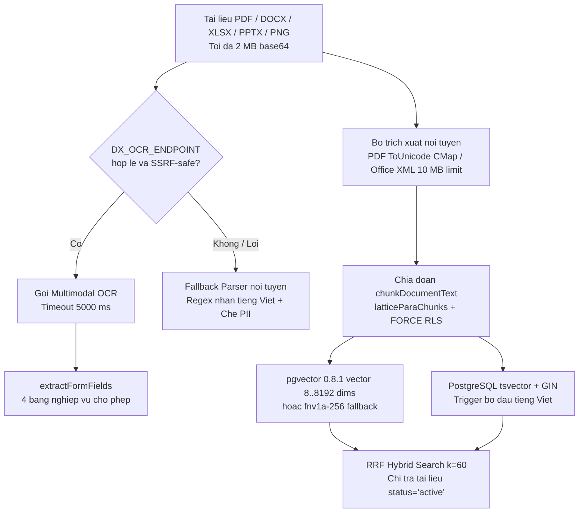

# P.A.R.A. Knowledge Vault & OCR/Hybrid RAG

**P.A.R.A. Knowledge Vault** (`@latticedx/plugin-dxos-para`, cấu hình tại `/admin/settings/dxos-para`) quản lý tri thức doanh nghiệp theo 4 không gian chuẩn **Projects – Areas – Resources – Archives**, kết hợp bộ trích xuất tài liệu nội tuyến đa định dạng (PDF có bảng mã tiếng Việt, DOCX/XLSX/PPTX chống zip-bomb/XXE), trích xuất trường biểu mẫu qua **OCR** và tìm kiếm lai **Hybrid RAG** trên `pgvector 0.8.1` + PostgreSQL `tsvector` + **Reciprocal Rank Fusion (RRF)**.

---

## 1. Kiến trúc Đường ống Tri thức & Hybrid RAG

---

## 2. 6 Actions của Resource `latticePara`

Resource `latticePara` (`para-resource.js`) cung cấp **6 actions** được kiểm soát theo vai trò và `organizationId`:

| Action | Phương thức | Phân quyền / Phạm vi | Chức năng chi tiết |
| --- | :---: | --- | --- |
| `summary` | `GET` | Người dùng đã đăng nhập trong tổ chức | Thống kê số lượng tài liệu và chunk theo 4 không gian P.A.R.A. (`projects`, `areas`, `resources`, `archives`) |
| `hybridSearch` | `GET` / `POST` | Người dùng đã đăng nhập (`status = 'active'`) | Truy vấn kết hợp tìm kiếm ngữ nghĩa vector và từ khóa `tsvector` qua RRF (`limit` tối đa 30), trả về đoạn trích và citation `[latticeParaDocuments:<code>#<id> · đoạn #<n>]` |
| `reindex` | `POST` | Chỉ `root`, `admin`, `ldx_admin`, `ldx_director`, `ldx_manager` | Chia lại đoạn (`latticeParaChunks`) và tính lại vector nhúng (neural hoặc `fnv1a-256` fallback) cho tài liệu trong tổ chức |
| `extractAttachment` | `POST` | Người dùng có quyền đọc trong tổ chức | Nhận `contentBase64` (tối đa `2 MB` binary), trích xuất văn bản sạch từ PDF, DOCX, XLSX, PPTX hoặc ảnh PNG và trả về `textPreview` đã che PII |
| `extractFormFields` | `POST` | Kiểm tra ACL `view`/`list` qua `hasFormExtractionAcl` | Trích xuất các trường có cấu trúc cho 4 bảng nghiệp vụ (`latticeOrders`, `latticeRequests`, `latticeStockLots`, `latticeServiceTickets`) từ tệp đính kèm hoặc `documentId` |
| `indexHealth` | `GET` | Người dùng tổ chức (`root` có thể chỉ định `organizationId`) | Báo cáo `documentsCount`, `chunksCount`, `neuralChunks`, `fallbackChunks`, `targetEmbeddingDim`, `embeddingDims`, `pgvectorAvailable`, `embeddingConfigured`, `ocrConfigured` và danh sách `pendingRetries` |

::: tip Bảo mật truy xuất khi tách form tự động (`extractFormFields`)
Hàm `hasFormExtractionAcl` xác minh quyền thực từ `rolesUsers` và `dataSourcesRolesResources` (không tin mù quáng `X-Role` header). Khi truyền `documentId`, người gọi bắt buộc phải có quyền `view` hoặc `list` trên `latticeParaDocuments`; đồng thời `targetCollection` phải nằm trong `ALLOWED_FORM_COLLECTIONS`: `latticeOrders`, `latticeRequests`, `latticeStockLots`, `latticeServiceTickets`.
:::

---

## 3. Bộ Trích xuất Tài liệu Nội tuyến (`document-extractor.js`)

Thay vì phụ thuộc thư viện nặng có rủi ro lỗ hổng, LatticeDX cài đặt bộ giải mã thuần Node.js với các rào cản an toàn nghiêm ngặt:

### 3.1. Giải mã PDF & Tiếng Việt `/ToUnicode` CMap

- Hàm `parseToUnicodeCMap` và `mergeToUnicodeCMaps` đọc trực tiếp các luồng CMap trong PDF (`begincodespacerange`, `beginbfchar`, `beginbfrange`) để ánh xạ chính xác mã glyph sang Unicode tiếng Việt có dấu.
- Các ngưỡng bảo vệ chống cạn kiệt tài nguyên:
  - `MAX_PDF_PAGE_COUNT = 5000` trang tối đa mỗi tệp.
  - `MAX_CMAP_ENTRIES = 65536` mục ánh xạ tối đa.
  - `MAX_BFRANGE_SPAN = 4096` phần tử tối đa cho một dải `bfrange`.

### 3.2. Giải nén DOCX / XLSX / PPTX an toàn (`10 MB` Limit & Chống XXE)

- **Giới hạn kích thước nén & giải nén:** Tệp tải lên dạng base64 giới hạn **`2 MB`** (`MAX_UPLOAD_BYTES = 2 * 1024 * 1024`). Khi đọc các entry XML bên trong tệp Office ZIP (`extractDocxText`, `extractXlsxText`, `extractPptxText`), tổng dung lượng giải nén tối đa được giới hạn cứng ở **`10 MB`** (`MAX_INFLATED_BYTES = 10 * 1024 * 1024`) và tối đa `10,000` entry (`MAX_ZIP_ENTRIES`), chặn ngay lỗi `OFFICE_ZIP_BOMB` nếu vượt ngưỡng.
- **Chống Directory Traversal & Tệp mã hóa:** Kiểm tra toàn bộ tên entry trong Central Directory và Local Header (`assertSafeEntryPath`) để chặn ký tự `\0` hoặc `..`; từ chối tệp Office có cờ mã hóa mật khẩu (`OFFICE_ENCRYPTED_ARCHIVE`).
- **Chống tấn công XXE (XML External Entity):** Hàm `assertSafeOfficeXml` quét mọi XML đã giải mã (kể cả UTF-16LE/BE và UTF-8) và từ chối ngay nếu chứa `<!DOCTYPE` hoặc `<!ENTITY` (`OFFICE_XML_ENTITY_FORBIDDEN`).

---

## 4. `DX_OCR_ENDPOINT` SSRF-Guarded & Fallback Parser Nội tuyến

Khi gọi `extractWithMultimodalOcr` (`extractFormFields`), hệ thống xử lý theo 2 lớp:

### 4.1. Kiểm tra SSRF cho `DX_OCR_ENDPOINT`

Địa chỉ dịch vụ OCR cấu hình qua biến môi trường `DX_OCR_ENDPOINT` phải vượt qua toàn bộ bộ lọc bảo vệ SSRF trước khi gửi yêu cầu HTTP (`OCR_TIMEOUT_MS = 5000` ms, `redirect: 'error'`):

| Điều kiện kiểm tra | Mã lỗi khi vi phạm |
| --- | --- |
| Chứa ký tự điều khiển hoặc URL không hợp lệ | `OCR_ENDPOINT_INVALID` |
| Giao thức khác `http:` / `https:` | `OCR_ENDPOINT_PROTOCOL_INVALID` |
| Nhúng `username:password` trong URL | `OCR_ENDPOINT_CREDENTIALS_FORBIDDEN` |
| Thuộc dải IP nội bộ / cloud metadata bị chặn (`169.254.*`, `10.*`, `172.16-31.*`, `192.168.*`, `100.64-127.*`, `metadata.google.internal`, `metadata.azure.com`, IPv6 link-local/ULA) | `OCR_ENDPOINT_SSRF_BLOCKED` |
| Endpoint bên ngoài nhưng không dùng HTTPS (ngoại trừ `TRUSTED_OCR_HTTP_HOSTS`: `localhost`, `127.0.0.1`, `::1`, `host.docker.internal`, `ocr`, `ocr-service`, `dxos-ocr`, `paddleocr`, `tesseract`, `vllm`, `ollama`, `ninerouter`, `9router`) | `OCR_ENDPOINT_HTTPS_REQUIRED` |

### 4.2. Fallback Parser Nội tuyến & Che PII

- Nếu `DX_OCR_ENDPOINT` chưa được cấu hình hoặc dịch vụ OCR ngoài trả lỗi/timeout, LatticeDX tự động kích hoạt **fallback parser nội tuyến** (`extractStructuredFormFields`, kết hợp `extractOfflinePngText` cho ảnh PNG chứa metadata/text chunks).
- Bộ parser nội tuyến bóc tách các trường theo nhãn tiếng Việt và tiếng Anh (`Mã đơn`, `Khách hàng`, `Số lượng`, `Nhiệt độ`, `Mô tả`, `Notes`, ...) với giới hạn độ dài an toàn (`MAX_EXTRACTED_FIELD_LEN = 240`, `MAX_EXTRACTED_DESC_LEN = 1000`).
- Mọi bản xem trước văn bản (`buildSafeTextPreview`) đều chạy qua bộ lọc che JWT, Bearer token, API key `sk-*`, email, CCCD/CMND, số điện thoại Việt Nam, số tài khoản ngân hàng (`STK`/`IBAN`) và mã số thuế (`MST`).

---

## 5. `pgvector 0.8.1` HNSW (`8..8192` Dims), `tsvector` & RRF Hybrid Search

### 5.1. Kiến trúc CSDL & Chiều Vector Linh hoạt (`8..8192`)

- Bảng `latticeParaChunks` (migration `20261123000300` & `20261127000200`) được gắn chính sách `FORCE ROW LEVEL SECURITY` theo `organizationId`:
  - **Tìm kiếm từ khóa tiếng Việt (`tsvector`):** Trigger `trg_lattice_para_chunks_tsv` tự động chuẩn hóa và bỏ dấu tiếng Việt (`áàảãạ...` → `aaaaa...`, `đ` → `d`) trước khi lưu vào cột `searchVector` kèm chỉ mục GIN `idx_lattice_para_chunks_tsv`.
  - **Tìm kiếm ngữ nghĩa (`pgvector 0.8.1`):** Hỗ trợ kích thước vector linh hoạt trong khoảng **`8..8192` chiều** (`resolveEmbeddingDim`, mặc định `1536` khi kết nối endpoint neural `DXOS_EMBEDDING_URL` / `DX_EMBEDDING_URL` / `AGENT_BASE_URL`, hoặc fallback xác định `fnv1a-256` gồm `256` chiều khi chạy offline). Trên cột vector cố định chiều, hệ thống dùng chỉ mục **HNSW (`vector_cosine_ops`)** (tự động chuyển sang `ivfflat` nếu môi trường không hỗ trợ HNSW).

### 5.2. Hợp nhất thứ hạng RRF & Lọc `status = 'active'`

Hàm `executeHybridSearch` (`para-hybrid-search.js`) thực hiện quy trình tìm kiếm 2 nhánh song song rồi gộp hạng bằng **Reciprocal Rank Fusion (RRF, hằng số `k = 60`)**:

1. **Nhánh ngữ nghĩa:** Truy vấn PostgreSQL bằng toán tử khoảng cách cosine `embedding <=> CAST(:vec AS vector)` khớp đúng `"embeddingDim" = :dim` (tối đa `200` ứng viên), hoặc tính cosine trên `embeddingJson` khi chạy fallback/mock.
2. **Nhánh từ khóa:** Truy vấn `ts_rank_cd("searchVector", plainto_tsquery('simple', :qNorm))` kết hợp truy vấn có dấu `:qRaw`.
3. **Lọc trạng thái nghiêm ngặt (`status = 'active'`):** Cả câu SQL lẫn lớp kiểm tra trong bộ nhớ đều loại bỏ mọi chunk không hoạt động (`active = false`) hoặc thuộc tài liệu cha có trạng thái khác `'active'` (chặn tài liệu nháp `draft` hoặc đã lưu trữ `archived` lọt vào ngữ cảnh AI).

---

## Tài liệu liên quan

- [DX-OS AI Studio & App Builder 2.0](/modules/ai-studio-app-builder)
- [Unified Approvals, dxosNotify, Public Forms & Mobile PWA](/modules/approvals-notify-forms-pwa)
- [Tech Stack & Ranh giới Pure-OSI](/guide/tech-stack-and-osi)
