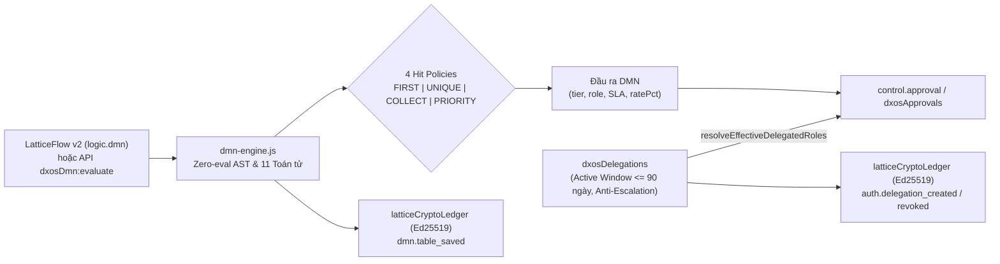

# Visual DMN Engine & Delegation (Ủy quyền Phê duyệt)

LatticeDX (`v0.4.2`) cung cấp bộ máy **Visual DMN (Decision Model and Notation)** thuần JavaScript không sử dụng `eval()` kết hợp cơ chế **Ủy quyền có thời hạn (`dxosDelegations`)** trong `@latticedx/plugin-dxos-studio` (`dmn-engine.js`, `dmn-visual-editor.js`, `delegation-engine.js`). Toàn bộ thay đổi bảng luật và ủy quyền đều được ghi nhận vào sổ cái mật mã Ed25519 (`latticeCryptoLedger`).

---

## 1. Kiến trúc Phối hợp DMN & Delegation

---

## 2. API `dxosDmn` (3 Actions) & `dxosDelegations` (4 Actions)

### 2.1 Ba `dxosDmn` Actions (`dmn-engine.js`)

| # | Action | Phương thức | Quyền & PAT Scopes | Chức năng |
|---|---|---|---|---|
| 1 | `listTables` | `GET` | `loggedIn` + ACL `latticeDecisionTables:view` (`read`, `write`, `dmn`) | Liệt kê bảng quyết định của tổ chức theo `tableKey`, `activeOnly`, `limit` (1–200). |
| 2 | `saveTable` | `POST` | `loggedIn` + `root`/`isOrgAdmin`/ACL `create`/`update` (`write`, `dmn`) | Chuẩn hóa schema & luật, tự động tăng `version`, lưu `latticeDecisionTables` và ghi sổ cái `dmn.table_saved`. |
| 3 | `evaluate` | `GET` / `POST` | `loggedIn` (`read`, `write`, `dmn`) | Đánh giá bảng theo `tableKey` đang `active`, hoặc mô phỏng bảng nháp truyền qua `params.table` (`simulated: true`, yêu cầu quyền `view`/`update`). |

### 2.2 Bốn `dxosDelegations` Actions (`delegation-engine.js`)

| # | Action | Phương thức | Quyền & Ràng buộc bảo mật | Chức năng |
|---|---|---|---|---|
| 1 | `list` | `GET` | `loggedIn` (`read`, `write`) | Liệt kê bản ghi `latticeDelegations`; admin xem toàn tổ chức, người dùng thường chỉ xem bản ghi mình là `delegatorUserId` hoặc `delegateUserId`. |
| 2 | `create` | `POST` | `loggedIn` (`write`) | Tạo ủy quyền (`DLG-...`) có kiểm tra chống tự ủy quyền, chống leo thang đặc quyền, kiểm tra sở hữu vai trò và cùng `organizationId`. |
| 3 | `revoke` | `POST` | `loggedIn` (`write`) | Thu hồi ủy quyền trước hạn (chỉ `delegatorUserId`, org admin hoặc `root` được phép), ghi sổ cái `auth.delegation_revoked`. |
| 4 | `activeForUser` | `GET` | `loggedIn` (`read`, `write`) | Trả về các ủy quyền còn hiệu lực (`startsAt <= now < endsAt`) và danh sách `roles` hiệu lực cho `userId`. |

#### Cơ chế chống leo thang đặc quyền trong `dxosDelegations`
1. **Cấm tự ủy quyền:** `delegateUserId === delegatorUserId` bị chặn (`400 DELEGATION_SELF_FORBIDDEN`).
2. **Giới hạn thời gian tối đa 90 ngày:** `MAX_DELEGATION_MS = 90 * 86_400_000` (`400 DELEGATION_WINDOW_EXCEEDED`).
3. **Cấm ủy quyền vai trò đặc quyền (`FORBIDDEN_DELEGATION_ROLES` & `isElevatedRoleRow`):** Chặn `root`, `admin`, `ldx_admin` và mọi vai trò có `allowAll`, `allowConfigure`, hoặc snippet `pm`/`pm.*`/`acl.*`/`app.*`/`ui.*`/`*` (trừ khi người gọi là `root`).
4. **Chỉ ủy quyền vai trò đang nắm giữ:** Kiểm tra bảng `rolesUsers` xác nhận `delegatorUserId` thực sự giữ `roleName` (`403 DELEGATION_ROLE_NOT_HELD`).
5. **Cách ly tổ chức & trạng thái nhân sự:** Cả người ủy quyền lẫn người nhận ủy quyền đều phải là nhân sự `active: true` trong cùng `organizationId` trên `latticeEmployees`.

---

## 3. Bốn Hit Policies (`HIT_POLICIES`)

Bộ máy `evaluateDecisionTable` hỗ trợ đúng **4 Hit Policies** theo chuẩn DMN:

| Hit Policy | Hành vi đánh giá | Kết quả trả về & Xử lý xung đột |
|---|---|---|
| `FIRST` | Duyệt các luật từ trên xuống dưới và **dừng ngay** tại luật khớp đầu tiên. | Trả về `matchedRuleIndex`, `result` / `outputs` của luật đầu tiên. |
| `UNIQUE` | Đánh giá toàn bộ luật; yêu cầu tối đa chỉ **1 luật** được phép khớp. | Nếu có `>= 2` luật cùng khớp, ném lỗi `409 DMN_UNIQUE_POLICY_VIOLATION` kèm danh sách `ruleIndex` xung đột. |
| `COLLECT` | Đánh giá toàn bộ luật và thu thập mọi luật khớp theo thứ tự. | Trả về mảng `results` chứa tất cả các `outputs` khớp và mảng `matchedRules`. |
| `PRIORITY` | Đánh giá toàn bộ luật khớp rồi sắp xếp theo `priority` (hoặc `rank`) **giảm dần**; nếu bằng nhau ưu tiên `ruleIndex` nhỏ hơn. | Trả về luật có độ ưu tiên cao nhất ở `result` / `outputs` và danh sách `matchedRules` đã sắp xếp. |

---

## 4. Mười một Toán tử Không dùng `eval()` & Giới hạn Cấu trúc

### 4.1 Giới hạn Schema & Bảo vệ Prototype Pollution
- **Số trường tối đa (`inputsJson`, `outputsJson`):** Từ `1` đến **50 trường** (`validateAndNormalizeSchemaList`). Tên trường phải khớp `/^[a-zA-Z0-9_.-]{1,64}$/` và không thuộc `FORBIDDEN_KEYS` (`__proto__`, `constructor`, `prototype`).
- **Số luật tối đa (`rulesJson`):** Tối đa **500 luật** trên một bảng (`validateAndNormalizeRules`).
- **Zero-`eval` Execution:** Toàn bộ điều kiện được phân tích cú pháp bằng bộ tách biểu thức FEEL an toàn (`parseStringConditionSpec` / `normalizeConditionSpec`) và thực thi qua `matchCondition`, tuyệt đối không gọi `eval()` hay `new Function()`.

### 4.2 Danh sách 11 Toán tử (`ALLOWED_OPERATORS`)

| # | Toán tử chính | Bí danh / Cú pháp FEEL hỗ trợ | Mô tả phép kiểm tra |
|---|---|---|---|
| 1 | `eq` | `==`, `===`, `=` hoặc giá trị đơn | So sánh bằng (ép kiểu số hữu hạn nếu cả hai vế là số). |
| 2 | `neq` | `!=`, `!==` | So sánh khác (`!valuesEqual`). |
| 3 | `gt` | `>` | Lớn hơn (yêu cầu số hữu hạn). |
| 4 | `gte` | `>=` | Lớn hơn hoặc bằng (yêu cầu số hữu hạn). |
| 5 | `lt` | `<` | Nhỏ hơn (yêu cầu số hữu hạn). |
| 6 | `lte` | `<=` | Nhỏ hơn hoặc bằng (yêu cầu số hữu hạn). |
| 7 | `between` | `[min..max]` | Kiểm tra giá trị số nằm trong đoạn đóng `[min, max]`. |
| 8 | `in` | `in [a, b, ...]` | Giá trị thuộc danh sách cho phép (`valuesEqual`). |
| 9 | `not_in` | `not_in [a, b, ...]`, `not in ...` | Giá trị không nằm trong danh sách. |
| 10 | `contains` | `contains <text>` | Chuỗi đầu vào chứa chuỗi con (không phân biệt hoa/thường). |
| 11 | `any` | `*`, `-`, chuỗi rỗng | Wildcard khớp mọi giá trị (kể cả `undefined`/`null`). |

---

## 5. Ba Bảng DMN Thực tế trong Hệ thống

### 5.1 `cold_chain_approval_v1` — Ma trận Phê duyệt Chuỗi lạnh & Vượt ngưỡng MKT

Được sử dụng trong blueprint `mkt-quarantine.json` (`auto_mkt_quarantine_response`) và seeder showcase (`seed-v100-championship-showcase.mjs`), áp dụng `hitPolicy: "FIRST"`:
- **Inputs:** `totalAmountM` (`number`), `maxTempC` (`number`).
- **Outputs:** `approvalTier` (`string`), `slaMinutes` (`number`).

| STT | `maxTempC` | `totalAmountM` | `approvalTier` | `slaMinutes` |
|---|---|---|---|---|
| 1 | `> 8` (`{ op: 'gt', value: 8 }`) | `*` | `quality_hold_director` | `15` |
| 2 | `*` | `> 500` (`{ op: 'gt', value: 500 }`) | `director_approval` | `45` |
| 3 | `*` | `*` | `manager_approval` | `120` |

### 5.2 `cmms_priority_routing_v1` — Định tuyến Ưu tiên Sự cố CMMS Chuỗi lạnh

Được cài đặt tự động bởi Business Pack `cmms-maintenance` (`domain-packs.js`) và gọi từ blueprint `coldchain-emergency.json`, áp dụng `hitPolicy: "FIRST"`:
- **Inputs:** `severity` (`string`), `eventType` (`string`).
- **Outputs:** `workOrderPriority` (`string`), `assignedRole` (`string`), `slaHours` (`number`).

| STT | `severity` | `eventType` | `workOrderPriority` | `assignedRole` | `slaHours` |
|---|---|---|---|---|---|
| 1 | `critical` | `alarm.triggered` | `critical` | `ldx_manager` | `2` |
| 2 | `high` | `alarm.triggered` | `high` | `ldx_operator` | `4` |
| 3 | `*` | `lot.held_mkt` | `critical` | `ldx_manager` | `1` |
| 4 | `*` | `*` | `medium` | `ldx_operator` | `24` |

### 5.3 `coldchain_settlement_policy_v1` — Chính sách Đối soát Bồi thường Chuỗi lạnh

Được cài đặt bởi Business Pack `coldchain-partner-settlement` (`domain-packs.js`) và phối hợp với luồng n8n 26 nút (`auto_coldchain_partner_settlement` / `auto_enterprise_n8n_compliance`), áp dụng `hitPolicy: "FIRST"`:
- **Inputs:** `severity` (`string`), `riskScore` (`number`), `temperatureC` (`number`), `amount` (`number`), `slaOverdueMinutes` (`number`).
- **Outputs:** `settlementTier` (`string`), `settlementRatePct` (`number`), `approveClaim` (`boolean`), `assignedRole` (`string`).

| Luật | Điều kiện (`when`) | `settlementTier` | `settlementRatePct` | `approveClaim` | `assignedRole` |
|---|---|---|---|---|---|
| `r1` | `severity == "critical"` AND `temperatureC > -12` | `critical` | `85` | `true` | `ldx_manager` |
| `r2` | `riskScore >= 75` | `critical` | `85` | `true` | `ldx_manager` |
| `r3` | `temperatureC > -12` AND `amount >= 15000000` | `escalated` | `40` | `true` | `ldx_manager` |
| `r4` | `riskScore >= 40` | `escalated` | `40` | `false` | `ldx_operator` |
| `r5` | `{}` (mặc định) | `standard` | `0` | `false` | `ldx_operator` |
