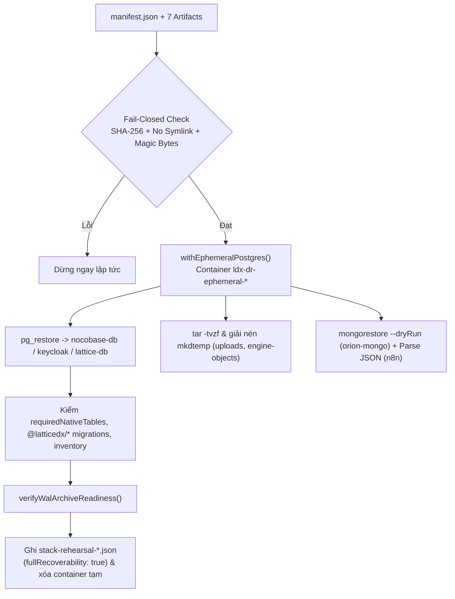

# Sao lưu Toàn stack, PITR WAL `.gz` & Diễn tập DR

**LatticeDX `v0.4.2`** cung cấp bộ công cụ Sao lưu và Phục hồi Thảm họa (DR) theo nguyên tắc **fail-closed**, cho phép chụp snapshot đầy đủ **7 thành phần có trạng thái** qua `scripts/stack-recovery.mjs`, diễn tập khôi phục không phá hủy trong container PostgreSQL tạm (`--ephemeral`), và sao lưu WAL liên tục **Point-in-Time Recovery (PITR)** trên PostgreSQL `16.16` bằng `wal-g`, `pgbackrest` hoặc `local-gz`.

---

## 1. Mục tiêu Khôi phục (RPO & RTO)

| Chỉ tiêu | Ngưỡng mục tiêu | Cơ chế bảo đảm |
| --- | --- | --- |
| **RPO (Snapshot định kỳ toàn stack)** | `<= 24 giờ` | Gói snapshot 7 thành phần kèm kiểm tra `SHA-256` qua `scripts/stack-recovery.mjs` |
| **RPO (Production WAL PITR)** | `<= 5 phút` | `wal_level=replica`, `archive_mode=on`, `archive_timeout=300` trong `infra/config/postgres/pitr.conf` |
| **RTO (Khôi phục toàn stack)** | `<= 30 phút` | Khôi phục có khóa xác nhận `--confirm-restore` sau khi đã kiểm chứng diễn tập `--ephemeral` |

---

## 2. Snapshot Toàn stack 7 Thành phần (`scripts/stack-recovery.mjs`)

Thư mục xuất mặc định nằm tại `output/backups/stack/stack-<32hex>/` (đã được `.gitignore` loại trừ). Lệnh `backup` bảo vệ toàn bộ **7 thành phần** trong `STACK_COMPONENTS`:

| # | Thành phần | Artifact tạo ra | Container mặc định / Biến ghi đè | Cơ chế xuất & Kiểm chứng |
| --- | --- | --- | --- | --- |
| 1 | `nocobase-db` | `nocobase/*.dump` (+ metadata JSON) | `NATIVE_DATABASE_CONTAINER` (`lattice-dx-nocobase-db-1`) | Gọi `backupNative()` (`pg_dump --format=custom`), kiểm đếm bảng & fingerprint |
| 2 | `uploads` | `uploads.tar.gz` | `NATIVE_APP_CONTAINER` (`lattice-dx-nocobase-1`) | Nén `/app/nocobase/storage/uploads`, kiểm magic gzip & `tar -tvzf` |
| 3 | `keycloak` | `keycloak.dump` + `keycloak-realm.json` | `KEYCLOAK_DB_CONTAINER` (`lattice-dx-postgres-1`, DB `keycloak`) | `pg_dump --format=custom` + lưu `infra/config/keycloak/lattice-realm.json` |
| 4 | `orion-mongo` | `orion-mongo.archive.gz` | `ORION_MONGO_CONTAINER` (`lattice-dx-orion-mongo-1`) | `mongodump --archive --gzip` (dùng `ORION_MONGO_USER`/`ORION_MONGO_PASSWORD` nếu có) |
| 5 | `n8n` | `n8n-workflows.json` + `n8n-credentials.json` | `N8N_CONTAINER` (`lattice-dx-n8n-1`) | `n8n export:workflow --all` & `n8n export:credentials --all` |
| 6 | `lattice-db` | `lattice.dump` | `LATTICE_DB_CONTAINER` (mặc định theo `KEYCLOAK_DB_CONTAINER`, DB `lattice`) | `pg_dump --format=custom` cho companion `/v1` API PostgreSQL |
| 7 | `engine-objects` | `engine-objects.tar.gz` | `API_CONTAINER` (`lattice-dx-api-1`, đường dẫn `FILE_STORAGE_ROOT` mặc định `/var/lib/latticedx/objects`) | Stream `tar -czf -`, kiểm magic gzip & lọc đường dẫn an toàn |

### An toàn Stream, Checksum & Bảo mật Secret

- Dữ liệu nhị phân stream trực tiếp giữa Docker và ổ đĩa qua `streamDockerToFile` / `streamFileToDocker`, giới hạn mặc định **`10 GiB`** (`maxStreamingBackupBytes`, có thể ghi đè qua `LATTICE_MAX_BACKUP_BYTES`).
- Mọi tệp đầu ra đều có quyền `0o600` (thư mục bundle `0o700`), kiểm tra chống symlink (`lstatSync`/`realpathSync`), magic header (`PGDMP` cho PostgreSQL dump, `1f 8b` cho `.gz`) và đối soát `SHA-256`.
- Hàm `validateTarVerboseEntries` kiểm tra `tar -tvzf` để **từ chối tuyệt đối** symlink, hardlink, device node, ký tự điều khiển và path traversal (`..` hoặc đường dẫn tuyệt đối).
- Trong `manifest.json`, trường `envPresence` chỉ ghi cờ `true`/`false` cho sự hiện diện của `APP_KEY`, `ENCRYPTION_FIELD_KEY`, `DB_PASSWORD`, `N8N_ENCRYPTION_KEY`, `AGENT_API_KEY` — **không bao giờ ghi giá trị bí mật** ra đĩa hay stdout.

### Lệnh chạy Snapshot

```sh
# Sao lưu đủ 7 thành phần
pnpm backup:stack

# Hoặc chọn lọc thành phần cụ thể
node scripts/stack-recovery.mjs backup --components=nocobase-db,uploads,keycloak
```

Khi chạy trên môi trường lab sạch (`pnpm native:clean`), truyền tên container tương ứng (trên PowerShell):

```powershell
$env:NATIVE_DATABASE_CONTAINER = "lattice-native-clean-<id>-nocobase-db-1"
$env:NATIVE_APP_CONTAINER = "lattice-native-clean-<id>-nocobase-1"
pnpm backup:stack
```

---

## 3. Diễn tập DR Không phá hủy (`--ephemeral`)

Không bao giờ kiểm thử khôi phục trực tiếp lên database production đang chạy. Chế độ `--ephemeral` trong `scripts/stack-recovery.mjs` tự động khởi tạo một container PostgreSQL cô lập (`ldx-dr-ephemeral-<12hex>` dùng image `postgres:16.16-alpine` khóa `@sha256:`), nạp toàn bộ dump SQL vào các DB thử `dx_restore_<32hex>`, kiểm tra tính toàn vẹn rồi tự động hủy container tạm trong khối `finally`.



### Tiêu chí `fullRecoverability: true`

Báo cáo `stack-rehearsal-<32hex>.json` chỉ đặt `fullRecoverability: true` khi đồng thời thỏa:
1. `fullStackVerified: true` (đủ cả 7/7 thành phần, `skippedComponents` rỗng).
2. `ephemeralContainerVerified: true` (chạy qua container PostgreSQL ephemeral độc lập).
3. `objectsVerified: true` (`uploads` và `engine-objects` qua kiểm tra entry + giải nén thử sạch).
4. `applicationHealthVerified: true` (kiểm bảng bắt buộc `requiredNativeTables`, đếm `migrations` của `@latticedx/` và `collections > 0`, cùng `records`, `foundation_tasks`, `enterprise_entities`, `workflow_runs` của `lattice-db`).

### Lệnh Diễn tập

```sh
# Diễn tập không phá hủy bằng container PostgreSQL tạm (khuyến nghị)
node scripts/stack-recovery.mjs rehearse output/backups/stack/stack-<32hex> --ephemeral

# Diễn tập chuẩn qua pnpm script
pnpm backup:rehearse-stack -- "output/backups/stack/stack-<32hex>"
```

> Nếu chỉ cần sao lưu và diễn tập riêng PostgreSQL NocoBase, sử dụng `pnpm backup:native`, `pnpm backup:rehearse-native -- "<path-to-dump>"`, và `pnpm test:native-recovery`.

---

## 4. Khôi phục Production Có Khóa Xác nhận (`restore`)

Lệnh `restore` áp dụng cơ chế khóa kép fail-closed: bắt buộc xác thực `SHA-256` + header toàn bộ artifact trước khi ghi, đồng thời tham số `--confirm-restore=<stack-id>` phải trùng khớp chính xác tên thư mục `stack-<32hex>`.

```sh
# Bước 1: Chạy thử kiểm tra toàn bộ artifact (Dry-run)
node scripts/stack-recovery.mjs restore output/backups/stack/stack-<32hex> --confirm-restore=stack-<32hex> --dry-run

# Bước 2: Tắt worker/outbox và lưu lượng trước khi áp dụng thật
node scripts/stack-recovery.mjs restore output/backups/stack/stack-<32hex> --confirm-restore=stack-<32hex>
```

---

## 5. PITR Liên tục với PG16 WAL (`pitr.conf`, `pitr-archive.sh`, `pitr-backup.mjs`)

Trong `infra/compose/prod.yml`, cả hai dịch vụ **`postgres`** (volume `postgres-wal-archive`) và **`nocobase-db`** (volume `nocobase-wal-archive`) đều bật sẵn cấu hình PostgreSQL 16 PITR qua `infra/config/postgres/pitr.conf`:

```ini
wal_level = replica
archive_mode = on
archive_command = '/bin/sh /etc/postgresql/pitr-archive.sh %p %f'
archive_timeout = 300
max_wal_senders = 4
wal_compression = on
wal_keep_size = 512MB
checkpoint_timeout = 10min
shared_preload_libraries = 'pg_stat_statements'
```

### 5.1. Cơ chế lưu trữ WAL (`infra/config/postgres/pitr-archive.sh`)

- Nếu biến `WALG_S3_PREFIX` được cấu hình và có binary `wal-g`, script ủy quyền trực tiếp cho `exec wal-g wal-push "<wal_path>"` (hướng tới **RustFS S3** `http://rustfs:9000`).
- Nếu không dùng S3, script nén WAL thành tệp `<PITR_WAL_DIR>/<wal-filename>.gz`:
  - Chặn đường dẫn độc hại (`/` `\` `..` hoặc bắt đầu bằng `-`).
  - Idempotent: nếu tệp `.gz` đích đã tồn tại, chạy `gzip -t` + `gzip -dc | cmp -s` để xác minh nội dung trùng khớp thay vì ghi đè sai.
  - Ghi an toàn bằng `umask 077` vào tệp tạm `.tmp.$$` rồi `mv` nguyên tử, và tự động dọn WAL `.gz` cũ hơn `PITR_WAL_RETENTION_DAYS` (mặc định `7` ngày).

### 5.2. Ba Backend trong `scripts/pitr-backup.mjs`

`scripts/pitr-backup.mjs` hỗ trợ 4 hành động (`check-config`, `base-backup`, `list`, `restore-plan`) trên 3 backend:

| Backend | Biến môi trường bắt buộc | Ghi chú bảo mật & Lệnh thực thi |
| --- | --- | --- |
| **`wal-g`** (mặc định) | `WALG_S3_PREFIX` (`s3://...`), `AWS_ENDPOINT` (ví dụ `http://rustfs:9000`) | Bắt buộc mã hóa phía client qua `WALG_LIBSODIUM_KEY*` hoặc `WALG_PGP_KEY*` (trừ khi truyền `--allow-unencrypted-local`) |
| **`pgbackrest`** | `PGBACKREST_STANZA`, `PGBACKREST_REPO1_S3_BUCKET` hoặc `PGBACKREST_REPO1_PATH` | Bắt buộc `PGBACKREST_REPO1_CIPHER_PASS` (trừ khi truyền `--allow-unencrypted-local`) |
| **`local-gz`** | `PITR_WAL_DIR` (mặc định `/var/lib/postgresql/wal-archive`), `PITR_BASEBACKUP_DIR` (mặc định `/var/lib/postgresql/basebackups`) | **Bắt buộc** truyền cờ `--allow-unencrypted-local`; dùng `pg_basebackup -Ft -z -X stream -c fast` và `gzip -dc` |

```sh
# 1. Kiểm tra sẵn sàng WAL-G với RustFS S3 (mã hóa client-side libsodium)
WALG_S3_PREFIX=s3://lattice-dr/nocobase \
WALG_LIBSODIUM_KEY_PATH=/etc/latticedx/walg.key \
AWS_ENDPOINT=http://rustfs:9000 \
node scripts/pitr-backup.mjs check-config --backend=wal-g

# 2. Lập kế hoạch PITR tới thời điểm ISO-8601 (chỉ xuất plan JSON, an toàn không ghi đè)
WALG_S3_PREFIX=s3://lattice-dr/nocobase \
WALG_LIBSODIUM_KEY_PATH=/etc/latticedx/walg.key \
node scripts/pitr-backup.mjs restore-plan --backend=wal-g --target-time=2026-11-26T06:00:00Z

# 3. Kiểm tra và lập base-backup cho backend local-gz (môi trường lab/nội bộ)
node scripts/pitr-backup.mjs check-config --backend=local-gz --allow-unencrypted-local
node scripts/pitr-backup.mjs base-backup --backend=local-gz --allow-unencrypted-local
node scripts/pitr-backup.mjs restore-plan --backend=local-gz --allow-unencrypted-local --target-time=2026-11-26T06:00:00Z
```

> Lưu ý: theo mặc định `scripts/pitr-backup.mjs` chỉ in kế hoạch lệnh (`executed: false`). Chỉ khi truyền thêm cờ `--execute` mới thực thi trực tiếp `wal-g`, `pgbackrest` hoặc `pg_basebackup`/`tar` trên máy chủ DB.

Xem thêm: [Giám sát OTel GenAI, Prometheus & Grafana 360°](/operations/observability) · [Demo Pack, Kịch bản 15 phút Chung kết & Khắc phục Sự cố](/operations/demo-pack-troubleshooting)
