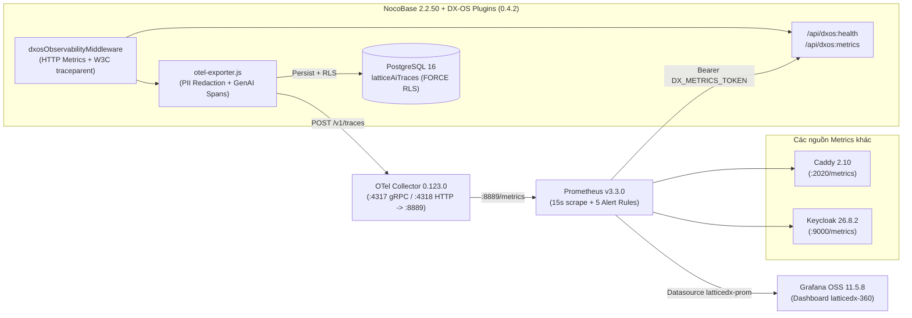

# Giám sát OTel GenAI, Prometheus & Grafana 360°

**LatticeDX `v0.4.2`** tích hợp hệ thống quan sát (Observability) 360° tuân thủ **100% chuẩn mở Pure-OSI**, kết hợp thu thập chỉ số Prometheus tại ứng dụng, truy vết phân tán **OpenTelemetry (OTel) GenAI Semantic Conventions**, che lọc dữ liệu nhạy cảm & PII Việt Nam tự động, cảnh báo chủ động trên Prometheus và bảng điều khiển Grafana dựng sẵn.


---

## 1. Kiến trúc Thu thập Telemetry 360°

Toàn bộ stack giám sát trong [`infra/compose/prod.yml`](https://github.com/CTU-OpenPaw/lattice-dx/blob/main/infra/compose/prod.yml) sử dụng các OCI image khóa digest `@sha256:` và tách biệt trên các mạng Docker nội bộ (`app`, `data`):

| Thành phần | Image & Phiên bản (`prod.yml`) | Giấy phép | Cổng & Vai trò |
| --- | --- | --- | --- |
| **NocoBase + DX-OS Runtime** | `nocobase/nocobase:2.2.50` + 7 plugin `@latticedx/*` (`0.4.2`) | Pure-OSI (`Apache-2.0` plugins) | Xuất `/api/dxos:health`, `/api/dxos:metrics`, lưu `latticeAiTraces`, phát OTLP/HTTP `/v1/traces` |
| **OTel Collector Contrib** | `otel/opentelemetry-collector-contrib:0.123.0` | `Apache-2.0` | Nhận OTLP gRPC (`:4317`) & HTTP (`:4318`), xuất Prometheus (`:8889`, namespace `latticedx_otel`), health check `:13133` |
| **Prometheus** | `prom/prometheus:v3.3.0` | `Apache-2.0` | Scrape mỗi `15s` (`evaluation_interval: 15s`), lưu TSDB `15d`, nạp `infra/config/prometheus/alerts.yml` |
| **Grafana OSS** | `grafana/grafana-oss:11.5.8` | `AGPL-3.0` (OSS container độc lập) | Tự động nạp datasource `Prometheus` (`uid: latticedx-prom`) và dashboard `LatticeDX 360° Observability` |



---

## 2. Endpoint `/api/dxos:health` & `/api/dxos:metrics`

Cài đặt tại `plugins/nocobase/plugin-lattice-foundation/src/server/observability.js` và mở quyền định tuyến qua `dxos` resource.

### 2.1. Kiểm tra sức khỏe `/api/dxos:health`

- **Phương thức:** `GET` (các phương thức khác trả `405 METHOD_NOT_ALLOWED`).
- **Kiểm tra:** gọi `checkDbHealth(db)` (`sequelize.authenticate()` hoặc `SELECT 1`).
- **Phản hồi:**
  - `HTTP 200` khi DB khỏe (`status: "ok"`), hoặc `HTTP 503` khi mất kết nối DB (`status: "degraded"`).
  - Gồm các trường: `version` (`0.4.2`), `uptimeSec`, `dbHealthy`, và khối `otel` (`enabled`, `serviceName`, `endpoint`, `queuedSpans`, `recordedSpans`, `exportedSpans`, `droppedSpans`, `exportBatches`, `exportFailures`, `lastExportAt`, `lastError`).

```json
{
  "status": "ok",
  "version": "0.4.2",
  "uptimeSec": 1842,
  "dbHealthy": true,
  "otel": {
    "enabled": true,
    "serviceName": "latticedx-nocobase",
    "endpoint": "http://otel-collector:4318/v1/traces",
    "queuedSpans": 0,
    "recordedSpans": 412,
    "exportedSpans": 412,
    "droppedSpans": 0,
    "exportBatches": 19,
    "exportFailures": 0,
    "lastExportAt": "2026-11-26T10:15:00.000Z",
    "lastError": null
  }
}
```

### 2.2. Bảo vệ `/api/dxos:metrics` (Fail-Closed)

Hàm `authorizeMetricsRequest` chỉ cho phép truy cập `/api/dxos:metrics` (`text/plain; version=0.0.4; charset=utf-8`, `Cache-Control: no-store`) khi thỏa **1 trong 2 điều kiện**:

1. **Bearer Token dịch vụ (`DX_METRICS_TOKEN`):** Header `Authorization: Bearer <DX_METRICS_TOKEN>` khớp với biến môi trường `DX_METRICS_TOKEN` thông qua hàm so khớp hằng thời gian `timingSafeTokenMatch` (băm SHA-256 + `crypto.timingSafeEqual`). Trong `infra/compose/prod.yml`, container `prometheus` ghi biến này vào `/tmp/dx_metrics_token` với `umask 077` và đọc qua `credentials_file: /tmp/dx_metrics_token`.
2. **Phiên người dùng quản trị NocoBase:** Người dùng đã đăng nhập có vai trò thuộc tập `METRICS_ALLOWED_ROLES` gồm **`root`** hoặc **`ldx_admin`**.
   - Nếu chưa xác thực: trả `HTTP 401` (`METRICS_AUTH_REQUIRED`).
   - Nếu đã đăng nhập nhưng không có quyền `root`/`ldx_admin`: trả `HTTP 403` (`METRICS_FORBIDDEN`).

### 2.3. Danh mục Prometheus Metrics đầy đủ

Toàn bộ metric thống kê DB đều chạy trong `withSystemRlsBypass` để đọc tổng số toàn cục an toàn qua phiên PostgreSQL `FORCE RLS`:

| Metric Name | Kiểu | Nhãn (Labels) / Nguồn dữ liệu |
| --- | --- | --- |
| `latticedx_http_requests_total` | `counter` | `method` (`GET`, `POST`, `PUT`, `PATCH`, `DELETE`, `HEAD`, `OPTIONS`, `OTHER`), `status_class` (`2xx`, `3xx`, `4xx`, `5xx`, `other`) |
| `latticedx_http_request_duration_seconds` | `histogram` | Các bucket `le="0.025"`, `"0.1"`, `"0.5"`, `"2.0"`, `"+Inf"`, kèm `_sum` và `_count` |
| `latticedx_ai_audit_logs_total` | `gauge` | Tổng bản ghi trong `latticeAiAuditLogs` |
| `latticedx_outbox_by_state` | `gauge` | `state` thuộc `pending`, `retry`, `processing`, `delivered`, `failed` (`latticeContextOutbox`) |
| `latticedx_active_alarms_total` | `gauge` | Số sự cố `latticeIncidentCases` ở trạng thái `open` hoặc `acknowledged` |
| `latticedx_unread_notifications_total` | `gauge` | Thông báo `latticeNotifications` có `readAt: null, active: true` |
| `latticedx_sla_policies_active` | `gauge` | Chính sách SLA `latticeSlaPolicies` đang bật (`active: true`) |
| `latticedx_event_bus_by_status` | `gauge` | `status` thuộc `queued`, `dispatched`, `partial_failed` (`latticeEventBus`) |
| `latticedx_webhook_deliveries_by_status` | `gauge` | `status` thuộc `pending`, `processing`, `delivered`, `retry_wait`, `dlq` (`latticeWebhookDeliveries`) |
| `latticedx_webhook_circuits_by_state` | `gauge` | `state` thuộc `closed`, `open`, `half_open` (`latticeWebhookSubscriptions`) |
| `latticedx_uptime_seconds` | `gauge` | Thời gian hoạt động tiến trình Node.js (`Math.floor(process.uptime())`) |
| `latticedx_otel_spans_recorded_total` | `counter` | Tổng số OTel span đã ghi vào hàng đợi |
| `latticedx_otel_spans_exported_total` | `counter` | Tổng số OTel span đã xuất thành công qua OTLP/HTTP |
| `latticedx_otel_spans_dropped_total` | `counter` | Tổng số span bị loại bỏ do đầy hàng đợi (`DEFAULT_MAX_QUEUE_SIZE = 256`) |
| `latticedx_otel_export_failures_total` | `counter` | Số lần xuất batch tới `/v1/traces` gặp lỗi HTTP hoặc timeout |
| `latticedx_otel_queue_size` | `gauge` | Độ sâu hàng đợi OTel span hiện tại |

Ngoài job `nocobase` (`/api/dxos:metrics`), `infra/config/prometheus/prometheus.yml` còn cấu hình scrape `caddy` (`caddy:2020/metrics`), `keycloak` (`keycloak:9000/metrics`) và `otel-collector` (`otel-collector:8889/metrics`).

---

## 3. OTel GenAI Spans, `latticeAiTraces` & OTLP/HTTP `/v1/traces`

Module `plugins/nocobase/plugin-lattice-foundation/src/server/otel-exporter.js` cung cấp trình xuất OTLP/HTTP JSON thuần Node (không phụ thuộc SDK nặng bên ngoài) và chuẩn hóa span theo **OpenTelemetry GenAI Semantic Conventions**:

### 3.1. Lan truyền ngữ cảnh W3C `traceparent`

- Middleware `traceMiddleware()` đọc header `traceparent` theo chuẩn W3C (`00-<traceId>-<spanId>-<traceFlags>`), tạo `traceId` (16 byte hex) / `spanId` (8 byte hex) nếu chưa có, gán lại `traceparent` vào response header và ghi nhận HTTP server span (`http.request.method`, `url.path`, `http.response.status_code`, `dxos.request_id`).

### 3.2. Các loại GenAI Span & Thuộc tính chuẩn

Hai API nội bộ `recordGenAiSpan` và `startGenAiSpan` tự động suy diễn `gen_ai.operation.name` (`execute_tool`, `invoke_agent`, hoặc `chat`) và chuẩn hóa các thuộc tính sau:

- `gen_ai.operation.name`: `chat` | `invoke_agent` | `execute_tool`
- `gen_ai.system`: mặc định `latticedx` (hoặc tên provider như `google-genai`, `anthropic`, `openai`, `ollama`, `deepseek`)
- `gen_ai.request.model`: tên mô hình LLM đã chuẩn hóa & che PII
- `gen_ai.usage.input_tokens` & `gen_ai.usage.output_tokens`: số token đầu vào/đầu ra
- `gen_ai.agent.name` & `gen_ai.tool.name`: tên AI Employee (ví dụ `dxos-architect`) và tên công cụ thực thi (ví dụ `dxos_graph_impact_analysis`)
- Thuộc tính mở rộng DX-OS: `dxos.run_uid`, `dxos.org`, `dxos.status` (`ok`, `error`, `suspended`), `dxos.pii.redacted_count`, `dxos.input_preview`, `dxos.output_preview` (giới hạn `512` ký tự sau khi che PII).

### 3.3. Lưu trữ `latticeAiTraces` & Xuất OTLP/HTTP `/v1/traces`

1. **Lưu bền vững vào PostgreSQL (`latticeAiTraces`):**
   - Bảng `latticeAiTraces` (tạo bởi migration `20261201000010-ai-traces.js`) được gắn **`FORCE ROW LEVEL SECURITY`** theo `organizationId` cùng các chỉ mục tối ưu truy vấn (`traceId`, `runUid`, `startedAt`, `operationName`, `status`).
   - Xem trực quan dạng **Trace Waterfall** tại AI Studio (`/admin/settings/dxos-ai` → **Tab 8 — Trace Waterfall & Eval Lab**), gọi qua `GET /api/dxosAi:listAgentTraces` và `GET /api/dxosAi:getAgentTraceDetail` (chỉ dành cho Admin trong phạm vi tổ chức).
2. **Xuất OTLP/HTTP JSON tới Collector:**
   - Kích hoạt khi đặt `OTEL_EXPORTER_OTLP_ENDPOINT` (ví dụ `http://otel-collector:4318` → hàm `normalizeEndpoint` tự chuẩn hóa thành `http://otel-collector:4318/v1/traces`).
   - Tham số mặc định trong `createOtelExporter`: `maxQueueSize = 256`, `batchSize = 64`, `exportTimeoutMs = 2000` ms, `flushIntervalMs = 5000` ms.

---

## 4. Che lọc PII & Bí mật Tự động (`redactPiiText` / `redactPiiDeep`)

Trước khi ghi vào `latticeAiTraces` hay đẩy payload OTLP ra mạng, mọi chuỗi, error message, preview và nested attributes (độ sâu tối đa `8`, tối đa `50` phần tử mảng, chuỗi tối đa `2048`/`4096` ký tự) đều đi qua bộ lọc `redactPiiText` và `redactPiiDeep`:

| Đối tượng phát hiện | Mẫu nhận diện | Chuỗi thay thế |
| --- | --- | --- |
| **JWT Token** | `eyJ<header>.<payload>.<sig>` | `[REDACTED_JWT]` |
| **Bearer Header** | `Bearer <token>` | `Bearer [REDACTED]` |
| **API / PaaS Keys** | `sk-...`, `ldx_pat_...` | `[REDACTED_KEY]` |
| **Email** | `<local>@<domain>.<tld>` | `[REDACTED_EMAIL]` |
| **CCCD / CMND Việt Nam** | `cccd`/`cmnd`/`căn cước công dân` + `9–12` số hoặc `0\d{11}` | `[REDACTED_CCCD]` |
| **Số điện thoại Việt Nam** | `+84` hoặc `0` + đầu số `3\|5\|7\|8\|9` + `8` chữ số | `[REDACTED_PHONE]` |
| **Tài khoản ngân hàng / IBAN** | `stk`, `số tài khoản`, `tài khoản ngân hàng`, `iban` | `[REDACTED_BANK]` |
| **Mã số thuế (MST)** | `mst`, `mã số thuế` (`10` số hoặc `10-3` số) | `[REDACTED_MST]` |
| **Key-Value bí mật** | Các khóa chứa `secret`, `password`, `apikey`, `api_key`, `jwt`, `private_key`, `client_secret`, `access_key`, `passphrase`, `credential`, `authorization`, `cookie`, `token`, `session_id` | `[REDACTED]` |

> Các trường đếm token chuẩn OTel (`gen_ai.usage.input_tokens`, `gen_ai.usage.output_tokens`, `gen_ai.usage.total_tokens`, `input_tokens`, `output_tokens`, `max_tokens`, `token_source`) được danh sách `SAFE_TOKEN_COUNT_KEY_RE` miễn trừ khỏi quy tắc che khóa chứa chữ `token`. Số lượng trường bị che được cộng dồn vào `piiRedactedCount` và `dxos.pii.redacted_count`.

---

## 5. Năm Quy tắc Cảnh báo Prometheus (`alerts.yml`)

Tệp `infra/config/prometheus/alerts.yml` định nghĩa nhóm `latticedx-core-alerts` (chu kỳ đánh giá `30s`) gồm **5 alert rules**:

| Alert Name | Điều kiện (`expr`) | Thời gian giữ (`for`) | Mức độ (`severity`) | Thành phần |
| --- | --- | --- | --- | --- |
| `LatticeDxNocoBaseDown` | `up{job="nocobase"} == 0` | `1m` | `critical` | `core-runtime` |
| `LatticeDxHigh5xxRate` | Tỷ lệ `5xx > 5%` trong `5m` khi lưu lượng `> 0.01 req/s` | `2m` | `critical` | `http-api` |
| `LatticeDxOutboxBacklogHigh` | Tổng `latticedx_outbox_by_state{state=~"pending\|retry\|failed"} > 50` | `5m` | `warning` | `context-outbox` |
| `LatticeDxCriticalColdAlarmsActive` | `latticedx_active_alarms_total > 0` | `3m` | `critical` | `cold-chain-alarms` |
| `LatticeDxQuotaSpike` | `delta(latticedx_ai_audit_logs_total[15m]) > 200` | `5m` | `warning` | `ai-mcp-quota` |

```yaml
groups:
  - name: latticedx-core-alerts
    interval: 30s
    rules:
      - alert: LatticeDxNocoBaseDown
        expr: up{job="nocobase"} == 0
        for: 1m
        labels:
          severity: critical
          component: core-runtime
        annotations:
          summary: "LatticeDX NocoBase engine is down"
          description: "Prometheus failed to scrape /api/dxos:metrics on nocobase:80 for more than 1 minute."

      - alert: LatticeDxHigh5xxRate
        expr: |
          (
            sum(rate(latticedx_http_requests_total{status_class="5xx"}[5m]))
            /
            clamp_min(sum(rate(latticedx_http_requests_total[5m])), 0.001)
          ) > 0.05
          and
          sum(rate(latticedx_http_requests_total[5m])) > 0.01
        for: 2m
        labels:
          severity: critical
          component: http-api
        annotations:
          summary: "LatticeDX HTTP 5xx error rate exceeds 5%"
          description: "HTTP 5xx response ratio exceeded 5% over the last 5 minutes."

      - alert: LatticeDxOutboxBacklogHigh
        expr: sum(latticedx_outbox_by_state{state=~"pending|retry|failed"}) > 50
        for: 5m
        labels:
          severity: warning
          component: context-outbox
        annotations:
          summary: "LatticeDX NGSI-LD/n8n outbox backlog is high"
          description: "Pending, retry, and failed context outbox events exceed 50 items ({{ $value }})."

      - alert: LatticeDxCriticalColdAlarmsActive
        expr: latticedx_active_alarms_total > 0
        for: 3m
        labels:
          severity: critical
          component: cold-chain-alarms
        annotations:
          summary: "Active LatticeDX incident or cold-chain alarms require triage"
          description: "{{ $value }} open or acknowledged incident alarms have remained active for more than 3 minutes."

      - alert: LatticeDxQuotaSpike
        expr: delta(latticedx_ai_audit_logs_total[15m]) > 200
        for: 5m
        labels:
          severity: warning
          component: ai-mcp-quota
        annotations:
          summary: "LatticeDX AI/MCP invocation spike detected"
          description: "AI and MCP audit log volume increased by {{ $value }} invocations in 15 minutes; review tenant token quotas."
```

---

## 6. Grafana 360° Dashboard & Kiểm tra Vận hành

Dashboard `infra/config/grafana/dashboards/latticedx-360.json` (`uid: latticedx-360`, múi giờ `Asia/Ho_Chi_Minh`, làm mới mỗi `15s`) hiển thị **7 panel** trực quan:

1. **HTTP Request Rate & 5xx Errors** (`timeseries`, `reqps`)
2. **HTTP Latency p95 / p50** (`timeseries`, `s` từ histogram bucket)
3. **Active Critical / Total Alarms** (`stat`, kèm `latticedx_sla_policies_active`)
4. **Notification Inbox Queue** (`stat`, `latticedx_unread_notifications_total`)
5. **Database & Engine Health** (`stat`, `up{job="nocobase"}` & `latticedx_uptime_seconds`)
6. **Context Outbox Backlog (Pending / Retry / Failed / Delivered)** (`timeseries`)
7. **AI / MCP Audit Volume & Stack Targets** (`timeseries`, gồm `latticedx_ai_audit_logs_total` và trạng thái `caddy|keycloak|otel-collector`)

### Lệnh kiểm tra nhanh trên Terminal

```sh
# 1. Kiểm tra health endpoint
curl -fsS http://localhost:13014/api/dxos:health

# 2. Kiểm tra metrics với DX_METRICS_TOKEN (trả 401 nếu không gửi token/role)
curl -fsS -H "Authorization: Bearer <DX_METRICS_TOKEN>" http://localhost:13014/api/dxos:metrics

# 3. Kiểm tra cấu hình Compose khi bật profile observability
docker compose -f infra/compose/prod.yml --profile observability config --quiet
```

Xem thêm: [Sao lưu Toàn stack, PITR WAL `.gz` & Diễn tập DR](/operations/backup-pitr-dr) · [Hướng dẫn Kiểm thử Tự động & E2E Toàn diện](/operations/testing-e2e-guide)
