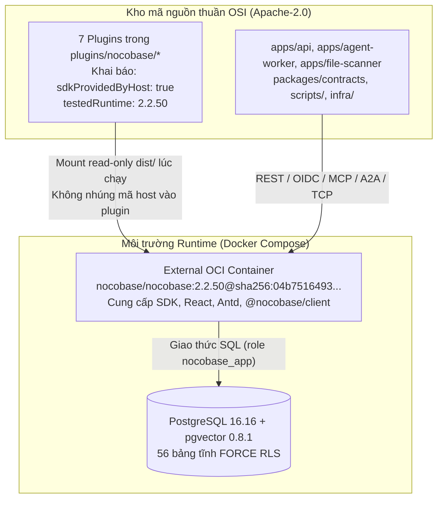

# Tuân thủ NocoBase `2.2.50` Điều khoản 5.2 & Ranh giới Mã nguồn

Trang này trình bày chi tiết phân tích pháp lý mã nguồn **NocoBase**, lý do kỹ thuật – pháp lý của việc **xóa bỏ hoàn toàn `upstream/nocobase` và `.gitmodules`**, mô hình nạp container host OCI bên ngoài, hợp đồng `"sdkProvidedByHost": true` cho 7 plugin gốc `Apache-2.0` và cách **LatticeDX `v0.4.2`** bảo toàn nguyên vẹn nhận diện **Điều khoản 5.2** trên giao diện.

---

## 1. Vì sao xóa bỏ hoàn toàn `upstream/nocobase` và `.gitmodules`?

Trong giai đoạn khảo sát ban đầu (`2026-10-06`, commit tham chiếu `5b47bec116c52239348c09d360e4bd2649c99efc` trên nhánh `main` của `nocobase/nocobase`), nhóm **CTU-OpenPaw** từng gắn tạm submodule chỉ-đọc `upstream/nocobase/` để đối chiếu API SDK (nhưng chưa từng sửa mã upstream hay đưa vào workspace `pnpm`).

Khi kiểm tra sâu giấy phép của mã nguồn upstream (tài liệu hóa tại `docs/nocobase-source-review.md`), nhóm ghi nhận các ràng buộc ngoài chuẩn OSI:

1. Mặc dù `package.json` của upstream khai báo `Apache-2.0` kèm `LICENSE-APACHE.txt`, tệp `LICENSE.txt` (cập nhật ngày `2026-02-24`) bổ sung **NocoBase License Agreement**:
   - **Điều 4.2:** Yêu cầu tuân thủ các điều khoản bổ sung và ưu tiên chúng khi có khác biệt với `Apache-2.0`.
   - **Điều 5.4:** Hạn chế cung cấp công khai dưới dạng dịch vụ SaaS/PaaS no-code, low-code hoặc nền tảng AI.
   - **Điều 5.2:** Yêu cầu giữ nguyên thông tin thương hiệu và bản quyền NocoBase trên giao diện người dùng.
2. Một số tệp nguồn lõi phía server/plugin của upstream (như `packages/core/server/src/application.ts`) mang header **AGPL-3.0** và **NocoBase Commercial License**.

::: warning Phán quyết Pure-OSI từ `v0.4.0` đến `v0.4.2`
Để bảo đảm **100% kho Git `CTU-OpenPaw/lattice-dx` và gói phát hành `latticedx-0.4.2-src.tar.gz` là mã nguồn thuần chuẩn OSI** theo thể lệ VFOSSA OLP PMNM 2026:
- Nhóm đã **gỡ bỏ hoàn toàn Git submodule `upstream/nocobase` và tệp `.gitmodules`** khỏi kho Git.
- Lệnh `pnpm pof:check` (`checkUpstreamClean`) chặn cứng sự xuất hiện của `.gitmodules` hoặc thư mục `upstream/` trong cả Git index lẫn thư mục giải nén `.tar.gz`.
- Lệnh `pnpm release:tarball` (`assertTarballEntries`) cũng từ chối đóng gói nếu phát hiện bất kỳ đường dẫn nào khớp `(^|\/)upstream(\/|$)` hoặc `(^|\/)\.gitmodules$`.
:::

---

## 2. Mô hình Host Runtime OCI bên ngoài kho Git

Thay vì chứa hoặc fork mã nguồn upstream, LatticeDX vận hành host NocoBase **hoàn toàn tách biệt dưới dạng OCI container bên ngoài kho Git lúc chạy (runtime)**:

- **Image & Digest bất biến:** `nocobase/nocobase:2.2.50@sha256:04b75164936e7314ef74d82844bc56c9f34ed7ff1ca976ca53ffac2d3c88d777`
- **Các tệp Compose sử dụng:** `infra/compose/nocobase.yml`, `infra/compose/native-rehearsal.yml` và `infra/compose/prod.yml`.
- **CSDL đi kèm:** `pgvector/pgvector:0.8.1-pg16@sha256:33198da2828a14c30348d2ccb4750833d5ed9a44c88d840a0e523d7417120337` (hoặc `postgres:16.16-alpine@sha256:f2f98726820d0342055351c6e9d36e705f5bfffb3dd53ff556325114b08afb6d`) với role không đặc quyền superuser `nocobase_app`.
- **Cơ chế nạp plugin:** Container host gắn các bản build đã biên dịch của 7 plugin `Apache-2.0` thông qua volume mount chỉ-đọc lúc chạy; giấy phép `Apache-2.0` của LatticeDX không thay thế giấy phép của host container NocoBase `2.2.50`.



---

## 3. Hợp đồng `"sdkProvidedByHost": true` cho 7 Plugin `0.4.2`

Cả 7 plugin do **CTU-OpenPaw** phát triển dưới `plugins/nocobase/` đều khai báo trong `package.json`:

```json
{
  "version": "0.4.2",
  "license": "Apache-2.0",
  "nocobase": {
    "testedRuntime": "2.2.50",
    "sdkProvidedByHost": true
  }
}
```

Mỗi plugin đều có tệp `LICENSE` (`Apache-2.0`) và `README.md` riêng, không chứa hay phân phối lại mã nguồn thực thi của NocoBase:

| # | Package (`0.4.2`) | Thư mục | Phụ thuộc đóng gói lúc build / runtime (Chuẩn OSI) | Giao diện Host SDK sử dụng |
| --- | --- | --- | --- | --- |
| 1 | `@latticedx/plugin-action-bridge` | `plugins/nocobase/action-bridge` | Chỉ Node built-ins (0 npm phụ) | Host NocoBase plugin API |
| 2 | `@latticedx/plugin-lattice-foundation` | `plugins/nocobase/plugin-lattice-foundation` | Chỉ Node built-ins (0 npm phụ) | Host NocoBase, React, Antd, `@nocobase/client` |
| 3 | `@latticedx/plugin-enterprise-auth` | `plugins/nocobase/plugin-enterprise-auth` | `openid-client@6.8.9`, `jose@6.2.15`, `oauth4webapi@3.8.8` (đều `MIT`, khóa `package-lock.json`) | Host NocoBase Auth & SSO API |
| 4 | `@latticedx/plugin-dxos-para` | `plugins/nocobase/plugin-dxos-para` | Chỉ Node built-ins (`node:zlib` v.v.) | Host NocoBase, React, Antd |
| 5 | `@latticedx/plugin-dxos-blocks` | `plugins/nocobase/plugin-dxos-blocks` | `devDependencies`: `maplibre-gl@6.19.0` (`BSD-3-Clause`) + `esbuild@0.28.2` (`MIT`) đóng gói vào `dist/client/index.js` | Giữ `react`, `react-dom`, `antd`, `@nocobase/client` host-external |
| 6 | `@latticedx/plugin-dxos-studio` | `plugins/nocobase/plugin-dxos-studio` | `devDependencies`: `@xyflow/react@12.12.1` (`MIT`), `@dagrejs/dagre@3.1.3` (`MIT`), `esbuild@0.28.2` (`MIT`) đóng gói vào `dist/client/index.js` | Giữ `react`, `react-dom`, `antd`, `@nocobase/client` host-external |
| 7 | `@latticedx/plugin-dxos-ai` | `plugins/nocobase/plugin-dxos-ai` | Chỉ Node built-ins (0 npm phụ) | Host NocoBase, React, Antd, AI Employee & SSE |

> Quy trình kiểm tra tự động `tests/nocobase-externals.test.mjs` và `scripts/verify-pof-readiness.mjs` (`plugin-isolation`) xác nhận các bản build client của plugin luôn giữ `react`, `react-dom`, `antd` và `@nocobase/client` ở trạng thái external thuộc host runtime.

---

## 4. Bảo toàn Nhận diện Điều khoản 5.2 trên Giao diện

Theo **Điều khoản 5.2** của NocoBase License Agreement, LatticeDX bảo toàn đầy đủ dòng bản quyền và liên kết tới NocoBase (`Powered by NocoBase`, `v2.2.50`, `https://www.nocobase.com`, `License settings`) trên các màn hình quản trị và đa cổng nghiệp vụ.

Hai điểm triển khai trực tiếp trong mã nguồn plugin `@latticedx/plugin-lattice-foundation`:

1. **`src/client/native-builder-navigation.js` (dòng 402–412):**
   - Trong `ShellModel` bọc toàn bộ các cổng nghiệp vụ (`/p/*`) và không gian làm việc native (khi không ở chế độ chỉnh sửa layout `configMode`), LatticeDX gắn phần tử footer cố định với thuộc tính `className: 'ldx-clause52-attribution'` và `aria-label: 'NocoBase attribution'`:
   - Hiển thị văn bản `Powered by NocoBase` kèm liên kết `<a href="https://www.nocobase.com" target="_blank" rel="noreferrer">NocoBase</a>`.
2. **`src/client/native-portal-settings.js` (dòng 199–201):**
   - Trong trang quản trị **Multi-Portal Settings** (`/admin/settings/multi-portal`), chân trang hiển thị rõ ràng ranh giới hai lớp:
   - `LatticeDX Open-Core (Apache-2.0) · Powered by ` + `<a href="https://www.nocobase.com" target="_blank" rel="noreferrer">NocoBase</a>`.

Ngoài kiểm tra giao diện thực tế, bộ kiểm toán `pnpm pof:check` (biểu thức `NOCOBASE_ATTRIBUTION_RE`) quét trực tiếp thư mục `plugins/nocobase/plugin-lattice-foundation/src/client/` để bảo đảm nhận diện `Powered by NocoBase` và `https://www.nocobase.com` không bao giờ bị xóa nhầm qua các bản cập nhật.

---

## Tài liệu liên quan

- [Chính sách Pure-OSI `Apache-2.0` & Ma trận PoF OLP PMNM 2026](/oss/pure-osi-policy)
- [Kiến trúc Mô-đun 7 Plugin Apache-2.0](/guide/plugins-modularity)
- [CycloneDX 1.5 SBOM (`257/257`) & Quy trình Build-from-Source Offline](/oss/sbom-and-build-from-source)
