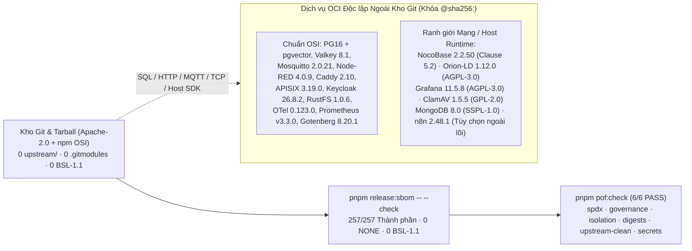

# Chính sách Pure-OSI `Apache-2.0` & Ma trận PoF OLP PMNM 2026

**LatticeDX `v0.4.2`** được phát triển bởi **CTU-OpenPaw** theo mô hình nền tảng doanh nghiệp mở (**DX-OS Open-Core**) và tuân thủ nghiêm ngặt chính sách **100% Pure-OSI** cho toàn bộ kho mã nguồn Git (`CTU-OpenPaw/lattice-dx`) cũng như gói phát hành nguồn `latticedx-0.4.2-src.tar.gz`.

::: tip Nguyên tắc cốt lõi Pure-OSI
- Toàn bộ mã nguồn gốc do **CTU-OpenPaw** viết (`apps/`, `packages/`, `plugins/nocobase/`, `scripts/`, `infra/`, `solutions/`, `tests/`, `.github/`) được cấp phép dưới **Apache License 2.0**.
- **0 thành phần `BSL-1.1` / Business Source License** (cấm tuyệt đối **ThingsBoard**, **EMQX** hoặc phần mềm hạn chế thương mại hóa tương tự trong mã nguồn, lockfile và Docker Compose).
- **0 mã nguồn upstream nhúng trong Git**: Không có thư mục `upstream/` hay `.gitmodules`. Host NocoBase `2.2.50` chỉ chạy như OCI container độc lập bên ngoài lúc thực thi.
:::

---

## 1. Cam kết Thuần khiết Giấy phép OSS (License Purity Guarantee)

Khi nâng cấp từ nhánh `v0.3.0` lên **`v0.4.2`**, nhóm **CTU-OpenPaw** đã chuẩn hóa toàn bộ kiến trúc dữ liệu, IIoT, cache/pubsub và quan sát hệ thống để loại bỏ hoàn toàn rủi ro giấy phép nguồn đóng có thời hạn (**BSL-1.1**).

### Kiểm soát cưỡng bức bằng công cụ tự động

Cơ chế kiểm soát được mã hóa trực tiếp trong `scripts/generate-sbom.mjs` (thuộc `pnpm release:sbom`) và `scripts/verify-pof-readiness.mjs` (`pnpm pof:check`):

- `BANNED_LICENSE_RE`: Chặn cứng mọi thành phần mang nhãn `BSL-1.1` hoặc `Business Source License`.
- `BANNED_TECH_RE`: Chặn cứng mọi gói npm hoặc OCI image có tên chứa `thingsboard` hoặc `emqx`.
- Mọi thay đổi ở tầng Compose (`infra/compose/*.yml`), lockfile (`pnpm-lock.yaml`) hoặc workspace đều bị kiểm tra lại trên GitHub Actions CI.

### Bảng thay thế thành phần chuẩn OSI & Ranh giới Container (`infra/compose/*.yml`)

| Thành phần loại bỏ (Rủi ro) | Thành phần thay thế trong `v0.4.2` | Giấy phép (SPDX) | Vai trò & Ranh giới triển khai |
| --- | --- | --- | --- |
| Redis >= 8 (RSALv2/SSPL) | **Valkey `8.1`** (`valkey/valkey:8.1-alpine`) | `BSD-3-Clause` | Cache phiên đăng nhập, pub/sub (`PUBSUB_ADAPTER=redis` tương thích giao thức) và rate-limiting trong `nocobase.yml` & `prod.yml`. |
| **EMQX** (`BSL-1.1`) | **Eclipse Mosquitto `2.0.21`** (`eclipse-mosquitto:2.0.21`) | `EPL-2.0 OR BSD-3-Clause` | Broker MQTT IIoT nội bộ với Dynamic Security (`allow_anonymous false`, `$CONTROL/dynamic-security/v1`) và `BIRTH`/`DEATH` LWT trong `iiot.yml` & `prod.yml`. |
| **ThingsBoard** (`BSL-1.1` / hạn chế) | **Node-RED `4.0.9`** (`nodered/node-red:4.0.9`) + **PostgreSQL `16`** | `Apache-2.0` + `PostgreSQL` | Chuẩn hóa bản tin IIoT, cầu nối LWT & downlink lệnh Digital Twin (`iiot.yml`, `prod.yml`). |
| **TimescaleDB** (container tách rời) | **PostgreSQL `16.16` + `pgvector 0.8.1`** (`latticeTelemetryPoints`) | `PostgreSQL` | Lưu chuỗi thời gian IIoT trực tiếp trong bảng `latticeTelemetryPoints` của PostgreSQL 16; không vận hành container `timescaledb` tách rời trong `iiot.yml`. |



### Phân tách ranh giới dịch vụ container bên ngoài

Các dịch vụ container chạy ở tiến trình OCI tách biệt trong `infra/compose/*.yml` giao tiếp với LatticeDX qua giao thức mạng chuẩn (SQL, HTTP/REST, OIDC, NGSI-LD, MQTT, `clamd` TCP) và **không** được sao chép, liên kết tĩnh hay cấp phép lại dưới `Apache-2.0`:

- **Nhóm hạ tầng lõi chuẩn OSI:** `PostgreSQL 16.16` (`PostgreSQL`), `pgvector 0.8.1` (`PostgreSQL`), `Valkey 8.1` (`BSD-3-Clause`), `RustFS 1.0.6` (`Apache-2.0`), `Caddy 2.10` (`Apache-2.0`), `Keycloak 26.8.2` (`Apache-2.0`), `keycloak-config-cli 6.5.1-26` (`Apache-2.0`), `Apache APISIX 3.19.0` (`Apache-2.0`), `Eclipse Mosquitto 2.0.21` (`EPL-2.0 OR BSD-3-Clause`), `Node-RED 4.0.9` (`Apache-2.0`), `OpenTelemetry Collector Contrib 0.123.0` (`Apache-2.0`), `Prometheus v3.3.0` (`Apache-2.0`), `Gotenberg 8.20.1` (`MIT`).
- **Dịch vụ tách biên mạng / tùy chọn:**
  - `NocoBase 2.2.50` (`nocobase/nocobase:2.2.50`): chạy như external host OCI container bên ngoài kho Git (xem [Tuân thủ NocoBase Điều khoản 5.2](/oss/nocobase-clause-5-2)).
  - `Grafana OSS 11.5.8` (`AGPL-3.0-only`): chạy ở profile `observability`, đọc dữ liệu từ Prometheus qua HTTP nội bộ.
  - `FIWARE Orion-LD 1.12.0` (`AGPL-3.0-only`) & `MongoDB 8.0` (`SSPL-1.0`): chạy ở container context broker độc lập, giao tiếp qua HTTP NGSI-LD.
  - `ClamAV 1.5.5` (`GPL-2.0-only`): daemon quét mã độc độc lập, kết nối qua TCP socket bởi sidecar `@dx/file-scanner`.
  - `n8n 2.48.1` (`n8nio/n8n:2.48.1`, `Sustainable Use License`): container tích hợp tùy chọn độc lập bên ngoài, **không** thuộc lõi automation engine của LatticeDX (lõi tự động hóa gốc của LatticeDX là LatticeFlow v2 + Visual DMN `Apache-2.0`).

---

## 2. Cơ chế Kiểm toán Tự động `pnpm pof:check` (`6/6 PASS`)

Lệnh `pnpm pof:check` thực thi `node scripts/verify-pof-readiness.mjs`. Công cụ này hỗ trợ chạy **cả trên bản checkout Git** lẫn **trong thư mục giải nén từ gói `.tar.gz` không có `.git/`**, trả về JSON kiểm chứng **6 tiêu chí bắt buộc**:

| # | Mã kiểm tra (`id`) | Nội dung xác minh tự động | Trạng thái trên `v0.4.2` |
| --- | --- | --- | --- |
| 1 | `spdx-headers` | Mọi tệp mã nguồn tự viết (`.ts`, `.tsx`, `.js`, `.jsx`, `.cjs`, `.mjs`) đều chứa `SPDX-License-Identifier: Apache-2.0` (đã xác minh `1,098` tệp qua `source-headers.mjs --check`). | `PASS` |
| 2 | `governance-files` | Đủ 11 tài liệu quản trị bắt buộc (`LICENSE`, `NOTICE`, `COPYRIGHT.txt`, `README.md`, `CHANGELOG.md`, `CONTRIBUTING.md`, `SECURITY.md`, `docs/build-from-source.md`, `docs/oss-pof-compliance.md`, `docs/third-party.md`, `.github/ISSUE_TEMPLATE/bug_report.yml`) và sạch URL cũ. | `PASS` |
| 3 | `plugin-isolation` | Toàn bộ 7 plugin trong `plugins/nocobase/*` đều khai báo `"license": "Apache-2.0"`, `"nocobase": { "sdkProvidedByHost": true }`, có đủ `LICENSE` + `README.md` riêng, và bảo toàn nhận diện Điều khoản 5.2 (`Powered by NocoBase` / `nocobase.com`) trong `plugin-lattice-foundation/src/client/`. | `PASS` |
| 4 | `compose-digests` | 100% chỉ thị `image:` trong toàn bộ `infra/compose/*.yml` phải khóa digest `@sha256:` 64 ký tự hex bất biến (`19/19` images). | `PASS` |
| 5 | `upstream-clean` | Không tồn tại `.gitmodules` hay thư mục `upstream/` hoặc `upstream/nocobase` trong cây tệp/Git index. | `PASS` |
| 6 | `no-secrets` | Không theo dõi tệp `.env` (trừ `.env.example`), `*.pem`, `*.key` và không chứa chuỗi token/private key (`sk-*`, `ghp_*`, `github_pat_*`, `-----BEGIN ... PRIVATE KEY-----`). | `PASS` |

Chạy lệnh xác minh trực tiếp trong kho `lattice-dx`:

```sh
node scripts/source-headers.mjs --check
pnpm pof:check
node --test scripts/tests/oss-pof-audit.test.mjs
```

---

## 3. Ma trận PoF VFOSSA OLP PMNM 2026 (50 điểm)

Bảng dưới đây đối chiếu 1-1 sáu tiêu chí chấm điểm Độ sẵn sàng Nguồn mở (**PoF — 50 điểm**) theo thể lệ **VFOSSA OLP PMNM 2026** (hạn nộp 17:00 ngày 06/12/2026) trên phiên bản phát hành **`v0.4.2`**:

| Tiêu chí PoF (Điểm) | Yêu cầu đối chiếu trên `v0.4.2` | Bằng chứng & Tệp triển khai | Lệnh & Cách xác minh |
| --- | --- | --- | --- |
| **1. Kho mã công khai (5 điểm)** | Mở kho công khai, truy cập được source, lịch sử commit và trang Release ở phiên ẩn danh không đăng nhập; có đủ issue templates, contributing, security policy & changelog. | `https://github.com/CTU-OpenPaw/lattice-dx`, `.github/ISSUE_TEMPLATE/{bug_report,feature_request,config}.yml`, `CONTRIBUTING.md`, `SECURITY.md`, `CHANGELOG.md` | `pnpm pof:check` (`governance-files`), kiểm tra trình duyệt ẩn danh URL repo & trang Releases |
| **2. Giấy phép OSI-approved (10 điểm)** | Toàn bộ mã nhóm cấp phép `Apache-2.0`; 100% mã gốc mang `@copyright (C) 2026 CTU-OpenPaw` + `SPDX-License-Identifier: Apache-2.0`; 100% kho Git & `.tar.gz` thuần OSI (không có `upstream/nocobase` hay `.gitmodules`); giữ nguyên Điều khoản 5.2 NocoBase; **0 BSL-1.1 / ThingsBoard / EMQX**. | `LICENSE`, `NOTICE`, `COPYRIGHT.txt`, `scripts/source-headers.mjs`, `plugins/nocobase/plugin-lattice-foundation/src/client/native-builder-navigation.js` & `native-portal-settings.js` | `node scripts/source-headers.mjs --check`, `pnpm pof:check` (`spdx-headers`, `plugin-isolation`, `upstream-clean`), `node --test scripts/tests/oss-pof-audit.test.mjs` |
| **3. Phát hành gói nguồn (5 điểm)** | Phát hành tag **`v0.4.2`** trên commit đã nghiệm thu; đính kèm `latticedx-0.4.2-src.tar.gz`, tệp checksum `.sha256` và `docs/sbom-cyclonedx.json`. | `scripts/build-oss-release-tarball.mjs`, `package.json` (`release:tarball`), đầu ra `output/release/latticedx-0.4.2-src.tar.gz` + `.sha256` | `pnpm release:tarball --ref=v0.4.2`, kiểm tra `sha256sum -c`, giải nén non-Git chạy lại `pnpm pof:check` |
| **4. Build từ mã nguồn (10 điểm)** | Giải nén gói `.tar.gz` trên môi trường sạch không có `.git/`, biên dịch offline 100% bằng toolchain OSS (`Node 24.x`, `pnpm 10.23.0`), build 7 plugin `0.4.2`, dựng NocoBase `2.2.50` từ DB 0 bảng & chạy kịch bản nghiệm thu. | `docs/build-from-source.md`, `scripts/native-clean-install.mjs`, `plugins/nocobase/*/build.mjs`, `docs/DEMO_PACK.md`, `docs/FINALS_15MIN_SCRIPT.md` | `pnpm install --frozen-lockfile`, `pnpm check`, `node --test ...`, `pnpm native:clean --port=13014`, `pnpm acceptance:headless-paas` |
| **5. Thư viện & gói đi kèm (10 điểm)** | Khóa `pnpm-lock.yaml`, khóa `@sha256:` toàn bộ `19` OCI images, kiểm kê đầy đủ npm + `LICENSE`/`README.md` từng plugin, và xuất **CycloneDX 1.5 SBOM** (`257/257` có giấy phép, `0 NONE`, `0` prod CVEs). | `docs/sbom-cyclonedx.json`, `scripts/generate-sbom.mjs`, `COPYRIGHT.txt`, `NOTICE`, `docs/third-party.md`, `docs/dependency-inventory.md`, `pnpm-lock.yaml`, `infra/compose/*.yml` | `pnpm release:sbom -- --check`, `node --test scripts/tests/generate-sbom.test.mjs`, `pnpm audit --prod --audit-level=low`, `pnpm pof:check` (`compose-digests`) |
| **6. Tài liệu & giao tiếp (10 điểm)** | Tài liệu kiến trúc, báo cáo hệ thống, hướng dẫn cài đặt/vận hành, E2E, Demo 15 phút, ma trận đối chiếu 1-1, quy trình đóng góp & issue tracker có đầu việc thực tế. | `README.md`, `CHANGELOG.md`, `CONTRIBUTING.md`, `docs/olp-2026-architecture-matrix.md`, `docs/DEMO_PACK.md`, `docs/FINALS_15MIN_SCRIPT.md`, `docs/E2E_TESTING_GUIDE_HUNG.md` và cổng tài liệu song ngữ `CTU-OpenPaw/lattice-docs` | `pnpm pof:check`, đối chiếu trực tiếp mã nguồn và các liên kết trong CI |

---

## Tài liệu liên quan

- [Tuân thủ NocoBase `2.2.50` Điều khoản 5.2 & Ranh giới Mã nguồn](/oss/nocobase-clause-5-2)
- [CycloneDX 1.5 SBOM (`257/257`) & Quy trình Build-from-Source Offline](/oss/sbom-and-build-from-source)
- [Đóng góp, Bảo mật, Chính sách Phiên bản `< 1.0.0` & Changelog](/oss/contributing-security-changelog)
- [Kiến trúc 6 Phân hệ DX-OS](/guide/architecture)
