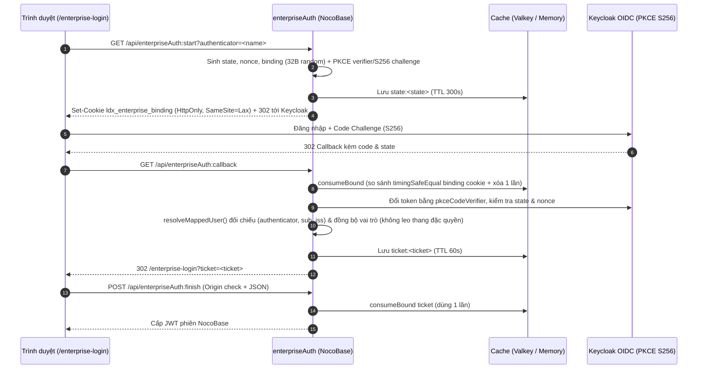

# Xác thực OIDC/PKCE & Phòng thủ Chiều sâu

LatticeDX **`0.4.2`** kết hợp xác thực doanh nghiệp chuẩn **OIDC Authorization Code + PKCE (S256)** qua Keycloak với hàng loạt cơ chế phòng thủ chiều sâu chống **SSRF**, **XSS/SVG**, **Prototype Pollution**, **XXE/ZIP Bomb**, và **Prompt Injection** trên toàn bộ các bề mặt tiếp nhận dữ liệu.

---

## 1. Xác thực Doanh nghiệp OIDC/PKCE (`@latticedx/plugin-enterprise-auth`)

Plugin `@latticedx/plugin-enterprise-auth` (`plugins/nocobase/plugin-enterprise-auth`) cung cấp đăng nhập SSO liên kết tường minh vào tài khoản NocoBase mà không cho phép tự ý tạo tài khoản ẩn (*explicit identity mapping*).

### Thư viện & Cấu hình Triển khai

- **Phụ thuộc Pure-OSI (`MIT`) được đóng gói cục bộ (`bundleDependencies`)**:
  - `openid-client@6.8.9`
  - `jose@6.2.15`
  - `oauth4webapi@3.8.8`
- **Giao diện & Route**: Client route `/enterprise-login` và trang cấu hình quản trị `auth.enterprise-mappings` (`/admin/settings/auth/enterprise-mappings`).
- **Yêu cầu HTTPS & Chống chuyển hướng mở**: `deploymentConfig` (`policy.js`) bắt buộc `DX_NATIVE_AUTH_ISSUER` và `DX_NATIVE_AUTH_ORIGIN` dùng `https://` (chỉ cho phép `http://` trên `localhost`/`127.0.0.1`/`[::1]`), `DX_NATIVE_AUTH_INTERNAL_ISSUER` chỉ chấp nhận dịch vụ `http://keycloak:8080` khi chạy Docker nội bộ, và `safeReturnTo` chỉ chấp nhận đường dẫn nội bộ khớp `^\/(?:admin|p|mobile|v\/mobile)(?:[/?]|$)`.

### Luồng Xác thực PKCE & Ràng buộc Cookie

### 9 Actions của Resource `enterpriseAuth`

| Action | Phương thức | Quyền | Mô tả |
| :--- | :---: | :--- | :--- |
| `start` | `GET` | `public` | Khởi tạo luồng OIDC PKCE `S256`, đặt cookie `ldx_enterprise_binding` và redirect sang Keycloak |
| `callback` | `GET` | `public` | Xác minh `state` + `binding`, đổi mã lấy claims, đồng bộ vai trò an toàn từ `DX_NATIVE_AUTH_GROUP_ROLE_MAP` (chặn vai trò đặc quyền như `ldx_admin`/`allowConfigure`/`pm.*`), cấp `ticket` dùng 1 lần |
| `finish` | `POST` | `public` (cùng `Origin`) | Kiểm tra header `Origin`, tiêu thụ `ticket` và trả về JWT phiên NocoBase |
| `backchannelLogout` | `POST` | `public` (JWT JWKS) | Xác minh `logout_token` theo JWKS (hỗ trợ `RS256/384/512`, `PS256`, `ES256/384/512`), ghi nhận thu hồi vào cache `revoked:<userId>` và `revoked_sid:<sid>` (TTL `86400s`) |
| `configuration` | `GET` | `root` | Trả về trạng thái cấu hình OIDC (`issuer`, `clientId`, `callback`, cảnh báo nếu thiếu) |
| `link` | `POST` | `root` | Ánh xạ tường minh cặp `(authenticator, subject, userId)` với khóa độc quyền `enterprise-link:<name>` |
| `listLinkTargets` | `GET` | `root` | Liệt kê các authenticator `lattice-keycloak` và người dùng thuộc tổ chức hợp lệ để liên kết |
| `listMappings` | `GET` | `root` | Liệt kê các bản ghi ánh xạ SSO hiện tại kèm thông tin nhân sự & `organizationId` |
| `unlink` | `POST` | `root` | Gỡ bỏ ánh xạ SSO và lập tức ghi dấu `revoked:<userId>` để vô hiệu hóa phiên hiện hành |

Ngoài ra, middleware `createRevocationGuard` kiểm tra `revoked:<userId>` và `revoked_sid:<sid>` trên từng request JWT để thực thi đăng xuất tức thì qua Back-Channel Logout hoặc khi bị `unlink`. Đồng thời `createPublicAuthPolicyMiddleware` tự động tắt `allowSignUp` khi triển khai SSO doanh nghiệp.

---

## 2. Phòng thủ Chống SSRF (Server-Side Request Forgery)

LatticeDX áp dụng chính sách chống SSRF nhiều tầng cho mọi thành phần thực hiện kết nối ra ngoài từ phía server:

1. **Connector Vault & Standard Webhooks (`connector-vault.js`, `event-bus.js`)**:
   - Hàm `assertSafeConnectorUrl` và `assertSafeConnectorUrlAsync` giới hạn URL tối đa `2048` ký tự, cấm thông tin xác thực nhúng trong URL (`user:pass@host`), cấm ký tự điều khiển và khoảng trắng.
   - **Chặn IP nội bộ & Cloud Metadata**: Chặn tuyệt đối các dải IPv4 riêng tư/đặc biệt (`0.0.0.0/8`, `10.0.0.0/8`, `127.0.0.0/8`, `169.254.0.0/16`, `172.16.0.0/12`, `192.168.0.0/16`, `100.64.0.0/10`, `224.0.0.0/4`), địa chỉ IP dạng số không chính tắc (hex `0x7f000001`, octal, decimal integer), các biến thể IPv6 (`::`, `::1`, `::ffff:0:0/96`, NAT64 `64:ff9b::/96`, `2002::/16`, `fe80::/10`, `fc00::/7`, `fd00:ec2::254`) và các hostname metadata (`metadata.google.internal`, `metadata.azure.com`, `metadata.aws.internal`, `instance-data`).
   - **Allowlist dịch vụ nội bộ có kiểm soát**: Khi `NODE_ENV=production`, chỉ các host dịch vụ Docker được phép tường minh (`n8n`, `orion-ld`, `nodered`, `mosquitto` hoặc cấu hình qua `DX_INTERNAL_SERVICE_HOSTS` / `DX_CONNECTOR_INTERNAL_ALLOWLIST`) và không thuộc danh sách metadata mới có thể vượt qua kiểm tra nếu được bật cờ cho phép nội bộ.
   - **Bảo vệ Webhook Outbound**: Kết nối outbound không theo redirect mù, kèm timeout `5000 ms`, ký HMAC-SHA256 chuẩn Standard Webhooks (`whsec_`, header chữ ký `v1,<hmac>`), và Circuit Breaker ngắt mạch khi lỗi liên tiếp `5` lần (thời gian hồi `120s`).
2. **Dịch vụ OCR Ngoài (`DX_OCR_ENDPOINT` trong `document-extractor.js`)**:
   - Hàm `validateOcrEndpoint` chỉ cho phép `http:` / `https:`, cấm `username`/`password` trong URL, chặn mọi IP/hostname thuộc `BLOCKED_OCR_HOST_RE` (dải riêng tư, link-local, metadata, IPv6-mapped IPv4).
   - Giao thức `http:` chỉ được chấp nhận đối với danh sách host tin cậy (`TRUSTED_OCR_HTTP_HOSTS`: `localhost`, `127.0.0.1`, `::1`, `host.docker.internal`, `ocr`, `ocr-service`, `dxos-ocr`, `paddleocr`, `tesseract`, `vllm`, `ollama`, `ninerouter`, `9router`, hoặc bổ sung qua `DX_OCR_TRUSTED_HOSTS`). Mọi endpoint bên ngoài bắt buộc dùng **HTTPS**.

---

## 3. Phòng thủ XSS, Từ chối SVG trên ePOD & Kiểm soát Tệp Tải lên

- **Từ chối SVG và giới hạn ảnh ePOD (`wms-engine.js`)**:
  - Hàm `isSafeRasterImageDataUrl` quy định `MAX_EPOD_PHOTO_BYTES = 512 * 1024` (**512 KB**).
  - Chủ động từ chối mọi payload `data:image/svg+xml` để triệt tiêu nguy cơ Stored XSS qua `<script>` hoặc event handler nhúng trong ảnh SVG; chỉ chấp nhận ảnh raster (`png`, `jpeg`, `jpg`, `webp`, `gif`) dưới dạng Base64 hợp lệ (`SAFE_RASTER_DATA_URL_RE`).
- **Làm sạch HTML & JSON nội tuyến (`public-track-html.js`, `public-form-html.js`, `observability.js`)**:
  - Các trang public SSR (`/v/track/:code`, `/v/form/:slug`) dùng `escapeHtml` và `serializeSafeJsonForScript` (escape `<`, `>`, `&`, `\u2028`, `\u2029`) kết hợp dựng DOM qua `document.createElement` và `.textContent` thay vì `innerHTML`.
  - Middleware `createObservabilityMiddleware` gắn sẵn các header bảo mật `X-Content-Type-Options: nosniff`, `X-Frame-Options: SAMEORIGIN`, `Referrer-Policy: strict-origin-when-cross-origin`, và `DX_CORS_STRICT=true` tự động gỡ bỏ header CORS phản chiếu cho các `Origin` không nằm trong allowlist.
- **Bảo vệ giải nén tài liệu P.A.R.A. & Public Forms (`document-extractor.js`, `public-forms.js`)**:
  - Trình trích xuất DOCX/XLSX/PPTX áp đặt trần giải nén `MAX_INFLATED_BYTES = 10 MB` (chống ZIP Bomb), tối đa `10,000` entry, chặn path traversal (`..`), từ chối file nén đặt mật khẩu (`OFFICE_ENCRYPTED_ARCHIVE`), và chặn `<!DOCTYPE` / `<!ENTITY` (`OFFICE_XML_ENTITY_FORBIDDEN`, chống XXE).
  - `dxosForms` giới hạn upload tối đa `2 MB`, chỉ nhận 5 MIME type an toàn (`application/pdf`, `image/png`, `image/jpeg`, `image/webp`, `text/plain`), áp dụng rate limit (`20/phút` cho `submit`, `60/phút` cho `status`, `300` trước lookup) cùng trường honeypot chống bot.
  - Quét mã độc tệp đính kèm qua ClamAV (`clamav/clamav:1.5.5`) trong mạng nội bộ cách ly `scanner` (`DX_NATIVE_CLAMD_HOST`).

---

## 4. Chống Prototype Pollution & Prompt Injection

### Chống Prototype Pollution

Cơ chế chặn các khóa đặc biệt (`__proto__`, `constructor`, `prototype`) được thực thi nhất quán ở mọi lớp tiếp nhận JSON:

- **`native-scope.js`**: `sanitizeSafeFilter` và `scopeNativeValues` từ chối ngay request nếu bất kỳ khóa nào thuộc `['__proto__', 'constructor', 'prototype']`.
- **`public-forms.js`**: `assertNoPrototypePollution` duyệt đệ quy bằng `Object.getOwnPropertyNames` (giới hạn độ sâu `depth <= 20`) và ném `400 FORM_PROTOTYPE_POLLUTION_BLOCKED`.
- **`connector-vault.js` & `pg-rls.js` & `mcp-gateway.js` & `a2a-gateway.js`**: `sanitizeJsonValue`, `isValidOrganizationId` và `FORBIDDEN_COLLECTION_NAMES` đều loại bỏ hoặc từ chối trực tiếp các khóa prototype.

### Phòng thủ Prompt Injection, Leo thang Quyền AI & PII Redaction

- **Bộ lọc Tấn công Ngữ cảnh (`ai-nl-router.js`)**: Hàm `detectUnsafeOrInjection` chặn các mẫu tấn công tiếng Việt và tiếng Anh như bỏ qua hướng dẫn (`ignore previous instructions`, `jailbreak`, `system prompt`), yêu cầu in lộ bí mật (`.env`, `AGENT_API_KEY`, `JWT`, `privateKey`), câu lệnh SQL phá hoại (`DROP TABLE`, `UNION SELECT`), truy cập chéo tenant, tự phê duyệt hoặc vượt qua `M-of-N` HITL, truy vấn SSRF metadata (`169.254.169.254`, `metadata.google.internal`), và gán công cụ Admin Builder cho vai trò không phải admin.
- **Kiểm thử tự động trong Eval Lab (`scripts/eval-vietnamese-nl-agent.mjs`)**: Bộ kiểm chuẩn gồm **163 ca** thuộc 23 danh mục (đạt tỷ lệ pass **163/163 — 100%**), trong đó có **30 ca `security-refusal`** chuyên biệt kiểm tra từ chối Prompt Injection, rò rỉ bí mật, vượt quyền RBAC và vượt biên tenant.
- **Khóa hồ sơ AI & HITL (`plugins/nocobase/plugin-dxos-ai/src/server/index.js`)**: Hook `latticeAiProfiles.beforeValidate` khóa cứng danh sách 11 công cụ `ADMIN_BUILDER_TOOL_NAMES` chỉ dành cho `root`/`admin`, đồng thời `roles.afterCreate` tự động thu hồi quyền gán nhầm cho AI Builder; thao tác thay đổi cấu trúc UI hoặc lệnh Digital Twin nhạy cảm (`HITL_TEMP_THRESHOLD_C = 2.0`) đi qua hàng đợi phê duyệt HITL (`dxosApprovals`) và chụp snapshot Time-Machine trước khi ghi.
- **Che giấu PII (`otel-exporter.js`, `para-resource.js`)**: Tự động che giấu (`[REDACTED_*]`) JWT, Bearer token, khóa `sk-*`, `ldx_pat_*`, email, CCCD/CMND (`9–12` số), số điện thoại Việt Nam (`+84`/`0`), tài khoản ngân hàng/IBAN (`STK`) và mã số thuế (`MST`) trước khi lưu log hoặc xuất OpenTelemetry trace.

## Liên kết Liên quan

- [Kiến trúc Đa Khách Hàng & PostgreSQL 16 FORCE RLS](/security/multi-tenant-rls)
- [PKI Merkle Ledger & PaaS API Keys](/security/pki-ledger-api-keys)
- [Hợp đồng API (OpenAPI 3.1 / AsyncAPI 3.0 & Fastify)](/security/api-contracts)
