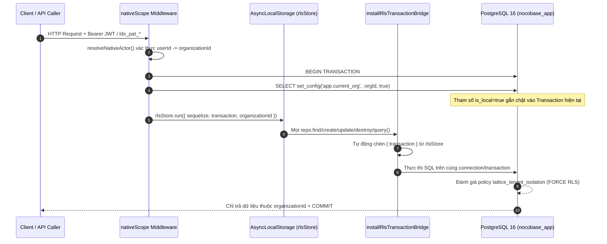

# Kiến trúc Đa Khách Hàng & PostgreSQL 16 FORCE RLS

LatticeDX **`0.4.2`** thực thi cô lập dữ liệu đa khách hàng (*multi-tenant isolation*) theo mô hình **Phòng thủ Chiều sâu (Defense-in-Depth)** kết hợp giữa tầng middleware ứng dụng NocoBase (`createNativeScopeMiddleware`) và tầng cơ sở dữ liệu PostgreSQL 16 (`ENABLE ROW LEVEL SECURITY` + `FORCE ROW LEVEL SECURITY`). Ngay cả khi một truy vấn bỏ qua lớp lọc ORM ở tầng ứng dụng, PostgreSQL vẫn chặn triệt để truy cập chéo tổ chức (`organizationId`).

## Tổng quan Kiến trúc 56 Bảng Tĩnh & Bảng Động

Cơ chế RLS được định nghĩa tập trung trong `plugins/nocobase/plugin-lattice-foundation/src/server/pg-rls.js` (`TENANT_RLS_TABLES`) và kích hoạt qua cờ môi trường `DX_PG_RLS_SESSION=true` (mặc định bật trong `infra/compose/prod.yml`):

- **56 bảng tĩnh (`TENANT_RLS_TABLES`)**:
  - **54 bảng camelCase** dùng cột định danh tenant `organizationId` (ví dụ: `latticeRequests`, `latticeOrders`, `latticeAssets`, `latticeEmployees`, `latticeStockLots`, `latticeEpodRecords`, `latticePkiKeys`, `latticeCryptoLedger`, `latticeApiKeys`, `latticeConnectors`, `latticeAiProfiles`, `latticeAiMemory`, `latticeAiTraces`, `latticeAutomationRules`, `latticePublicForms`, v.v.).
  - **2 bảng snake_case** dùng cột định danh tenant `organization_id`: `lattice_native_request_attachments` và `lattice_native_request_uploads` (`SNAKE_CASE_ORG_TABLES`).
- **Bảng động `latticeCustom*`**: Mọi collection động do quản trị viên hoặc App Builder 2.0 tạo qua `dxosBuilder:createDomain` (tên khớp mẫu `^latticeCustom[A-Za-z0-9_]*$`) đều tự động được gọi `attachRlsPolicyToTable` gắn policy `lattice_tenant_isolation` ngay khi khởi tạo và được phát hiện qua `discoverTenantRlsTables`.

::: info Tại sao phải dùng `FORCE ROW LEVEL SECURITY`?
Theo mặc định của PostgreSQL, chủ sở hữu bảng (*table owner*) có thể bỏ qua RLS thông thường. Bằng việc thực thi đồng thời `ENABLE ROW LEVEL SECURITY` và `FORCE ROW LEVEL SECURITY`, kết hợp với vai trò kết nối **non-superuser** `nocobase_app`, PostgreSQL bắt buộc áp dụng policy `lattice_tenant_isolation` cho **mọi** truy vấn từ ứng dụng, kể cả khi `nocobase_app` là chủ sở hữu database `nocobase`.
:::

## Vai trò Non-Superuser `nocobase_app`

Trong triển khai production (`infra/config/postgres/init-nocobase-db.sh` và `infra/compose/prod.yml`), LatticeDX tách biệt hoàn toàn tài khoản quản trị PostgreSQL (`POSTGRES_USER`) với tài khoản vận hành ứng dụng `nocobase_app`:

```sql
CREATE ROLE nocobase_app LOGIN PASSWORD '...'
  NOSUPERUSER NOCREATEDB NOCREATEROLE NOINHERIT NOBYPASSRLS;
```

Script `init-nocobase-db.sh` kiểm tra nghiêm ngặt `NOCOBASE_APP_DB_USER != POSTGRES_USER` và thu hồi quyền `PUBLIC` trên database lẫn schema `public`, bảo đảm thuộc tính `NOBYPASSRLS` luôn có hiệu lực đối với pool kết nối của NocoBase `2.2.50`.

## Policy `lattice_tenant_isolation`

Với mỗi bảng trong `TENANT_RLS_TABLES` hoặc khớp `latticeCustom*`, hàm `buildRlsPolicySql` sinh bộ DDL chuẩn hóa:

```sql
ALTER TABLE public."<tableName>" ENABLE ROW LEVEL SECURITY;
ALTER TABLE public."<tableName>" FORCE ROW LEVEL SECURITY;

DROP POLICY IF EXISTS lattice_tenant_isolation ON public."<tableName>";
CREATE POLICY lattice_tenant_isolation ON public."<tableName>"
  AS PERMISSIVE FOR ALL TO PUBLIC
  USING (
    current_setting('app.rls_bypass', true) = 'on'
    OR current_setting('app.current_org', true) = '*'
    OR "<orgColumn>" = nullif(current_setting('app.current_org', true), '')
  )
  WITH CHECK (
    current_setting('app.rls_bypass', true) = 'on'
    OR current_setting('app.current_org', true) = '*'
    OR "<orgColumn>" = nullif(current_setting('app.current_org', true), '')
  );
```

- **Fail-closed mặc định**: Nếu biến phiên `app.current_org` chưa được thiết lập (trả về chuỗi rỗng `''`), `nullif(..., '')` trả về `NULL`. Vì `organizationId = NULL` luôn cho kết quả *UNKNOWN* (false), truy vấn không nằm trong ngữ cảnh RLS hợp lệ sẽ thấy **0 bản ghi** và bị từ chối ghi (`WITH CHECK`).
- **Kiểm tra an toàn định danh**: `assertValidOrganizationId` chỉ chấp nhận chuỗi khớp `^[a-zA-Z0-9_-]{1,80}$` và chặn các giá trị nguy hiểm như `'all'`, `'__proto__'`, `'constructor'`, `'prototype'`.
- **Savepoint an toàn trong Transaction**: Hàm `runInRlsSavepoint` tạo `SAVEPOINT "ldx_sp_<n>"` trước các thao tác phụ có thể lỗi để tránh làm hỏng (*abort*) toàn bộ transaction chứa ngữ cảnh RLS đang mở.

## Cầu nối `AsyncLocalStorage` & Transaction Local

Vì NocoBase `2.2.50` sử dụng connection pool bất đồng bộ của Sequelize và có các lời gọi nội bộ (`repo.find`, `repo.create`, `sequelize.query`) không phải lúc nào cũng truyền tham số `{ transaction }` tường minh, `pg-rls.js` cài đặt cơ chế **`AsyncLocalStorage` Transaction Bridge**:



Các đặc điểm kỹ thuật cốt lõi của cầu nối này:

1. **Transaction-local `set_config(..., true)`**: Giá trị `app.current_org` và `app.rls_bypass` chỉ tồn tại trong phạm vi transaction hiện tại (`is_local = true`), tự động xóa sạch khi `COMMIT` hoặc `ROLLBACK`, loại bỏ hoàn toàn nguy cơ rò rỉ session state sang request khác khi connection quay về pool.
2. **Tự động gắn `transaction`**: `installRlsTransactionBridge` bọc các phương thức `find`, `findOne`, `findAndCount`, `count`, `create`, `update`, `destroy`, `query` trên `Repository.prototype` và `sequelize.query`, tự động tiêm `store.transaction` nếu caller chưa truyền.
3. **Tương thích NocoBase `createContextVariablesScope`**: `setContextRlsTransaction` gắn transaction vào `ctx.state.latticeRlsTransaction` với thuộc tính `enumerable: false` để `JSON.stringify(ctx.state)` của NocoBase `2.2.50` không duyệt vào đồ thị tham chiếu vòng của Sequelize `Transaction`.
4. **System Bypass có kiểm soát (`withSystemRlsBypass`)**: Chỉ được dùng nội bộ cho các tác vụ xác thực trước khi biết tenant (như tra cứu `latticeEmployees` trong `resolveNativeActor`, xác thực `ldx_pat_*` trong `paas-api-keys.js`, hoặc phiên `root` quản trị hệ thống), thiết lập `set_config('app.rls_bypass', 'on', true)` cục bộ trong transaction.

## Danh mục 56 Bảng Tĩnh Được Bảo Vệ `FORCE RLS`

<details>
<summary>Xem đầy đủ 56 bảng tĩnh trong TENANT_RLS_TABLES (pg-rls.js)</summary>

| Nhóm miền nghiệp vụ | Danh sách bảng (`organizationId` camelCase) | Số lượng |
| :--- | :--- | :---: |
| **Tổ chức & Yêu cầu cốt lõi** | `latticeRequests`, `latticeOrders`, `latticeAssets`, `latticeEmployees`, `latticeDepartments`, `latticeLocations`, `latticeServiceTickets`, `latticeRecordChatter`, `latticeNotifications`, `latticeSlaPolicies` | 10 |
| **Sự cố, Outbox & Tích hợp** | `latticeIncidentCases`, `latticeIncidentRules`, `latticeAgentProposals`, `latticeContextOutbox`, `latticeIntegrationInbox`, `latticeConnectors`, `latticeEventBus`, `latticeWebhookSubscriptions`, `latticeWebhookDeliveries` | 9 |
| **P.A.R.A. Knowledge Vault** | `latticeParaDocuments`, `latticeParaChunks` | 2 |
| **AI Workforce, MCP & A2A** | `latticeAiProfiles`, `latticeAiAuditLogs`, `latticeAiQuotaUsage`, `latticeAiApprovalQueue`, `latticeAiMemory`, `latticeAiTraces`, `latticeA2aTasks`, `latticeAiQuotaPolicies` | 8 |
| **PKI, API Keys & Quản trị Dữ liệu** | `latticeApiKeys`, `latticePkiKeys`, `latticeCryptoLedger`, `latticeFrozenSnapshots`, `latticeDataLineage`, `latticeDataQuarantine` | 6 |
| **WMS, FEFO, ePOD & DMN** | `latticeOrderLines`, `latticeStockLots`, `latticeEpodRecords`, `latticeDecisionTables`, `latticeDelegations` | 5 |
| **IIoT & Digital Twin** | `latticeTelemetryPoints`, `latticeTwinShadows`, `latticeIotDevices`, `latticeBrokerSubscriptions` | 4 |
| **LatticeFlow, App Builder & UI** | `latticeAutomationRules`, `latticeAutomationRuns`, `latticeAutomationRuleVersions`, `latticeBuiltApps`, `latticeUiSnapshots` | 5 |
| **Phê duyệt, Thông báo & Biểu mẫu** | `latticeNotificationDeliveries`, `latticeApprovalPolicies`, `latticeApprovalRequests`, `latticePublicForms`, `latticePublicFormSubmissions` | 5 |
| **Đính kèm Native (`organization_id`)** | `lattice_native_request_attachments`, `lattice_native_request_uploads` *(snake_case)* | 2 |
| **Tổng cộng** | **54 camelCase + 2 snake_case (+ động `latticeCustom*`)** | **56** |

</details>

## Lớp Kiểm soát Bổ sung tại `nativeScope` Middleware

Song song với PostgreSQL RLS, `nativeScope` (`native-scope.js`) áp dụng các ràng buộc nghiệp vụ trước khi chạm DB:

- **Chặn leo thang qua filter/sort/payload**: `sanitizeSafeFilter` chặn `$where`, `$raw`, `$sql`, truy vấn lồng dấu chấm (relation expansion) và các khóa Prototype Pollution (`__proto__`, `constructor`, `prototype`); `scopeNativeValues` chặn ghi đè `id`, `userId`, `identitySubject`, `organizationId` khác tenant.
- **Khóa chứng từ bất biến & Optimistic Locking**: Các chứng từ ở trạng thái `submitted`, `approved`, `completed`, `cancelled` bị khóa chỉnh sửa trực tiếp (`409 VOUCHER_IMMUTABLE`), phải đi qua quy trình Hủy & Điều chỉnh (`latticeVoucher:cancel` / `latticeVoucher:amend`) với kiểm tra `expectedVersion` / `If-Match`.
- **Chặn xóa trực tiếp & bảo vệ Charts**: Chặn `destroy` trên `latticeRequests` và `latticeOrders`; chặn `charts:queryData` truy vấn chế độ `sql` cho vai trò non-root hoặc đọc các collection nhạy cảm (`users`, `roles`, `latticeApiKeys`, `latticePkiKeys`, `latticeCryptoLedger`, v.v.).

## Liên kết Liên quan

- [PKI Merkle Ledger & PaaS API Keys](/security/pki-ledger-api-keys)
- [Xác thực OIDC/PKCE & Phòng thủ Chiều sâu](/security/auth-oidc-hardening)
- [Hợp đồng API (OpenAPI 3.1 / AsyncAPI 3.0 & Fastify)](/security/api-contracts)
