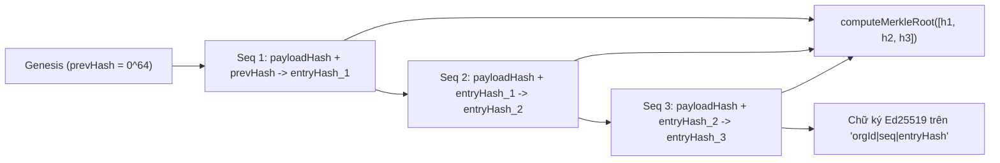

# PKI Merkle Ledger & PaaS API Keys

Hệ thống mật mã toàn vẹn dữ liệu và xác thực máy-tới-máy (M2M) của LatticeDX **`0.4.2`** được xây dựng hoàn toàn bằng mô-đun chuẩn Node.js `node:crypto` (Pure-OSI, không phụ thuộc thư viện mật mã bên ngoài) trong `plugins/nocobase/plugin-lattice-foundation/src/server/pki-ledger.js` và `paas-api-keys.js`.

---

## 1. PKI Ed25519 & Merkle Audit Ledger

Mỗi tổ chức (`organizationId`) sở hữu một cặp khóa ký số **Ed25519** riêng biệt và một chuỗi sổ cái băm bất biến (*append-only hash-chain + Merkle tree*) dùng để ký số chứng từ, đóng băng snapshot dữ liệu, xác thực giao nhận ePOD và kiểm toán không thể chối bỏ (*non-repudiation*).

### Quản lý Khóa Ed25519 (`latticePkiKeys`)

- **Tự động khởi tạo theo tổ chức**: Khi chưa có khóa hoạt động, `ensureOrgSigningKey` sinh cặp khóa `ed25519` (`spki` PEM cho public key, `pkcs8` PEM cho private key), tính `fingerprintSha256 = sha256(spkiDer)` và đặt `keyId = ed25519-<16hex>`.
- **Mã hóa AES-256-GCM tại nơi lưu trữ**: Khóa bí mật được hàm `encryptPrivateKeyPem` mã hóa bằng thuật toán `aes-256-gcm` (IV ngẫu nhiên `12 bytes`, auth tag `16 bytes`, định dạng `<ivHex>:<tagHex>:<cipherHex>`) sử dụng master key dẫn xuất SHA-256 từ `ENCRYPTION_FIELD_KEY` hoặc `APP_KEY` (bắt buộc trong môi trường `NODE_ENV=production`, thiếu khóa sẽ trả `500 PKI_MASTER_KEY_MISSING`).
- **Luân chuyển khóa an toàn (`rotateKey`)**: Khi quản trị viên gọi `dxosLedger:rotateKey`, khóa cũ được chuyển trạng thái sang `status: 'retired'` (`active: false`, ghi nhận `retiredAt`), cặp khóa mới được tạo ở trạng thái `active`, đồng thời một sự kiện `pki.key_rotated` được ghi vào sổ cái. Khi xác minh (`verifySignature`), khóa `retired` vẫn được chấp nhận để kiểm tra chữ ký cũ nếu truyền `expectedKeyId` (`keyId`), trong khi khóa `revoked` bị từ chối với lý do `KEY_REVOKED`.

### Chuỗi Băm & Cây Merkle (`latticeCryptoLedger`)

Mọi sự kiện ghi vào `latticeCryptoLedger` được tuần tự hóa theo từng tổ chức bằng hàng đợi mutex trong bộ nhớ (`runWithOrgMutex`) kết hợp khóa giao dịch PostgreSQL (`SELECT pg_advisory_xact_lock(hashtext('latticedx:ledger:<orgId>'))`) để bảo đảm số thứ tự `seq` liên tục tuyệt đối:



Chi tiết thuật toán trong `pki-ledger.js`:

1. **Canonical JSON (`canonicalJson`)**: Sắp xếp khóa đối tượng theo thứ tự từ điển (lexicographical sort), chuẩn hóa `Date` sang ISO-8601, `BigInt` sang chuỗi, loại bỏ `undefined`/`function`/`symbol`, bảo đảm mọi node tính cùng một `payloadHash = sha256(canonicalJson(payload))`.
2. **Liên kết `prevHash` -> `entryHash`**: Bản ghi đầu tiên có `seq = 1` và `prevHash = '0'.repeat(64)` (`ZERO_HASH`). Mỗi bản ghi tiếp theo tính:
   ```text
   entryHash = sha256("${orgId}|${seq}|${eventType}|${targetCollection}|${targetRecordId}|${payloadHash}|${prevHash}|${recordedAtIso}")
   ```
3. **Chữ ký bản ghi**: `signatureBase64 = Ed25519.sign("${orgId}|${seq}|${entryHash}", privateKey)`.
4. **Cây Merkle (`computeMerkleRoot`)**: Tính gốc Merkle nhị phân bằng cách ghép cặp `sha256(left + right)` theo từng tầng (nếu tầng có số lượng lẻ, phần tử cuối được nhân đôi `right = left`).
5. **Khóa bất biến (Immutable Hooks)**: `registerLedgerHooks` đăng ký các hook `beforeUpdate`, `beforeDestroy`, `beforeBulkUpdate`, `beforeBulkDestroy` trên `latticeCryptoLedger` để ném lỗi `403 LEDGER_IMMUTABLE`, ngăn mọi thao tác sửa/xóa bản ghi sổ cái.

### 8 Actions của Resource `dxosLedger`

Tất cả action dưới `/api/dxosLedger:<action>` được kiểm soát chặt theo phạm vi tổ chức (`resolveLedgerCallerOrg`) và không cho phép truy vấn trực tiếp bảng `latticePkiKeys` hoặc `latticeCryptoLedger` qua REST thông thường (`PAAS_PRIVATE_COLLECTION_FORBIDDEN`).

| Action | Phương thức | Quyền / Scope yêu cầu | Chức năng chính |
| :--- | :---: | :--- | :--- |
| `publicKey` | `GET` | `loggedIn` (cùng org) | Trả về `keyId`, `algorithm` (`Ed25519`), `publicKeyPem`, `fingerprintSha256`, `status` |
| `entries` | `GET` | `loggedIn` (cùng org) | Phân trang danh sách mục sổ cái (`page`, `pageSize`, lọc `targetCollection`, `targetRecordId`, `eventType`) |
| `status` | `GET` | `loggedIn` (cùng org) | Trả về `latestSeq`, `merkleRoot`, `headHash`, `entryCount`, `keyId` |
| `verify` | `GET` / `POST` | `loggedIn` (cùng org) | Kiểm toán toàn chuỗi: kiểm tra liên tục `seq`, `prevHash`, tính lại `entryHash`, chữ ký Ed25519 và `merkleRoot` |
| `signDocument` | `POST` | `write` hoặc `ledger` + Admin hoặc Chủ sở hữu | Ký số snapshot bản ghi thuộc 6 collection (`latticeRequests`, `latticeOrders`, `latticeServiceTickets`, `latticeAssets`, `latticeParaDocuments`, `latticeIncidentCases`) và ghi vào sổ cái |
| `verifySignature` | `POST` | `loggedIn` (cùng org) | Xác minh `signatureBase64` của payload JSON chuẩn hóa (hỗ trợ `keyId` / `expectedKeyId` cho khóa `retired`) |
| `rotateKey` | `POST` | `write` hoặc `ledger` + Admin (`root`/`isPortalAdmin`) | Thu hồi mềm khóa cũ (`retired`), sinh cặp khóa Ed25519 mới và ghi sự kiện `pki.key_rotated` |
| `exportProof` | `GET` / `POST` | `loggedIn` (cùng org) | Xuất gói bằng chứng kiểm toán gồm danh sách public keys, kết quả `verifyLedgerChain`, và proof cho `seq` / `entryHash` |

---

## 2. PaaS Scoped API Keys (`ldx_pat_*`)

Resource `dxosApiKeys` (`paas-api-keys.js`) cung cấp Personal Access Token (PAT) có phạm vi giới hạn (*scoped token*) cho hệ thống tích hợp ngoài, pipeline CI/CD, IoT edge gateway và MCP client.

### Định dạng Token & Lưu trữ An toàn

- **Định dạng token**: `ldx_pat_<8hex>_<32hex>` (khớp regex `^ldx_pat_([0-9a-f]{8})_([0-9a-f]{32})$`), sinh từ `randomBytes(4)` + `randomBytes(16)`.
- **Chỉ hiển thị một lần khi cấp (`issue`)**: Hệ thống chỉ lưu `keyPrefix` (`ldx_pat_<8hex>`) và giá trị băm **SHA-256** (`keyHash`) trong bảng `latticeApiKeys`, đối chiếu bằng so sánh hằng thời gian (`timingSafeEqualHex`).
- **Truyền qua Header**: Hỗ trợ `X-Lattice-API-Key: ldx_pat_<8hex>_<32hex>` hoặc `Authorization: Bearer ldx_pat_<8hex>_<32hex>`.
- **Thời hạn (`expiresInDays`)**: Chấp nhận số nguyên từ **`1`** đến **`365`** ngày (hoặc để trống nếu quản trị viên cấu hình không tự hết hạn theo chính sách).

### 7 Scopes & Quy tắc Kiểm soát

Mỗi API key gắn với đúng 1 `organizationId`, 1 `userId`, 1 `roleName` đã được xác minh trong DB (`rolesUsers` + `latticeEmployees`), và một mảng không rỗng gồm tối đa 20 mục chọn từ **7 scopes hợp lệ** (`ALLOWED_PAT_SCOPES`):

| Scope | Quyền hạn được cấp |
| :--- | :--- |
| `read` | Chỉ đọc (`GET`, `HEAD`, `OPTIONS`) và các `POST` truy vấn an toàn (`list`, `get`, `count`, `dxosLedger:verify`, `dxosLedger:verifySignature`, `latticePara:hybridSearch`, `dxosDmn:evaluate`, `dxosStudio:solutionBundleDiff`, `charts:queryData`, `dxosDataGov:computeMkt`, v.v.); bị chặn trên `/api/dxos-mcp` |
| `write` | Cho phép các thao tác ghi/thay đổi dữ liệu chung (bao gồm cấp/thu hồi key qua `dxosApiKeys:issue` và `dxosApiKeys:revoke`) |
| `wms` | Thao tác ghi trên resource `dxosWms` (nhập/xuất kho FEFO, ePOD, hold/release lô) |
| `dmn` | Lưu bảng quyết định và quy tắc ủy quyền (`dxosDmn:saveTable`, `dxosDmn:saveDelegation`) |
| `iot` | Đẩy telemetry, cập nhật Digital Twin Shadow và xử lý cảnh báo (`dxosBlocks:telemetryIngest`, `dxosBlocks:twinSetDesired`, `dxosBlocks:alarm*`, `dxosBroker`, `dxosAutomations`) |
| `ai` | Gọi agent/MCP (`dxosAi`, `dxosMcp`, `/api/dxos-mcp*`, `dxosN8n`, `dxosAutomations`, `dxosApprovals:decide`) |
| `ledger` | Ký số tài liệu và luân chuyển khóa PKI (`dxosLedger:signDocument`, `dxosLedger:rotateKey`) |

### Ngăn chặn Leo thang Đặc quyền

- Người dùng thường không thể cấp key cho người dùng khác, không thể gán vai trò cao hơn vai trò hiện có (`API_KEY_ROLE_ESCALATION`), và chỉ `root` mới có thể cấp key gắn với vai trò `root`.
- Tại thời điểm xác thực request, middleware `createPaasApiKeyAuthMiddleware` kiểm tra đồng thời: khóa chưa bị thu hồi (`active === true && revokedAt == null`), chưa quá hạn `expiresAt`, tài khoản `users.active !== false`, vai trò vẫn còn trong `rolesUsers`, và nhân sự vẫn thuộc `latticeEmployees` đang hoạt động của đúng tổ chức, đồng thời ghim header `x-role` về đúng `roleName` của key (`clampHeaderRole`).
- Ba action của `dxosApiKeys`:
  - `POST /api/dxosApiKeys:issue` (yêu cầu scope `write`)
  - `GET /api/dxosApiKeys:list` (ẩn `keyHash`, chỉ trả `keyPrefix` và metadata)
  - `POST /api/dxosApiKeys:revoke` (yêu cầu scope `write`)

## Liên kết Liên quan

- [Kiến trúc Đa Khách Hàng & PostgreSQL 16 FORCE RLS](/security/multi-tenant-rls)
- [Xác thực OIDC/PKCE & Phòng thủ Chiều sâu](/security/auth-oidc-hardening)
- [Hợp đồng API (OpenAPI 3.1 / AsyncAPI 3.0 & Fastify)](/security/api-contracts)
